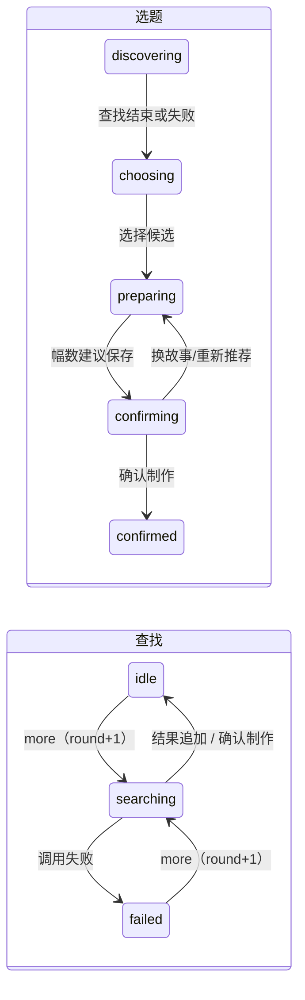

# 故事制作流程修复计划

需求：[req-story-flow-reader-control.md](../../../../reqs/2026/10/30/req-story-flow-reader-control.md)

Git 基线：`14b5ac7`。

## 关键决策

- **查找与选题分离。** `doc.intake.search={round,state:'idle'|'searching'|'failed',error?,requestId?}` 独立于 `phase` 和 `generation`。`more` 不增加世代、不改已选内容；有已选故事时不改 `phase`；无已选故事时写 `phase='discovering'`，查找结束回到 `choosing`。
- **查找不持故事工作锁。** `discover` 任务以 `searchRound` 标识，不进入 `currentJobs`（世代过滤），不写 `lock_token`。结果写入带围栏：`search.round=? AND state='searching'`，只在 `phase='discovering'` 时把它改回 `choosing`，因此崩溃后重跑或确认后迟到的结果都不会追加。进度只留内存并在 `snapshot` 合并，不写文档，避免干扰文档 CAS。
- **引擎只拥有 `intake.phase`。** 整篇写入（`repo.save`、`saveImageProgress`）在行已有 `intake` 对象时，除 `phase` 外保留行内的 `intake`（候选、查找、草稿、手动标记），用 `json_type(document,'$.intake')='object'` 守卫，非选题故事不写入 `intake`。世代围栏保证这些字段不会被旧值覆盖之外的方式改变。
- **`draft` 是定向写入。** 只写 `intake.draft` 和 `intake.manualArt`，不增世代，不动 `state`/锁列，准备进行中也可保存。设置不写入 `selection`，否则 `scriptVersion` 变化会重复入队。
- **无表结构变更。** 候选仍在文档里，`desktop/library.sql` 不引用新列，也不读 `generation_control`（Rust 测试在 0003 结构上运行），服务启动前也能读旧书库；`0006` 只做数据迁移。读取时 `phase==='discovering'` 且没有 `search` 视为查找中（round 0），覆盖回退旧版本再升级时产生的记录。
- **撤销确认流程。** 不做持久等待和幂等确认；`revision.previewedRedraw` 取 `checkedRevision` 的结果（文件检查之前，仅 `!impact.replan`），`revision.lostPages` 记录丢失幅号，实际超出预览时在视图上报告数量和原因（首幅变化或丢失 → 全部重绘）。
- **查找可中止。** 协调器记录进行中的查找（AbortController），`stop()` 立即中止，每轮 `cycle` 用与 `canRun` 相同的判定（`searchRunnable`：当前轮次、`searching`、未暂停、未删除）中止；缓存 `shared` 增加 `drain` 观察者：最后一个观察者离开时等待在途调用结束，并在调用以非中止原因失败时抛出该错误。处理逻辑：
  - 查找已不是当前轮次（如已确认）：任务 `{obsolete:true}`。
  - 干净中止：抛 `JobYield`，退回排队且不计尝试次数。
  - 服务停止且调用失败：照常抛出，走现有 `interrupted` 路径，受重放上限约束。
  - 暂停或删除时调用失败：`JobYield`，恢复后重试。
  - 非本地书籍忽略信号正常返回：结果照常保存。
  - 其他失败：查找失败，任务成功结束（不留 `failed` 行）。
- **中断恢复。** `currentJob` 和 `resumeInterrupted` 对 `discover` 用 `searchRunnable`（后者另加 `attempts<上限`）。`cycle` 回写：`interrupted=0` 的失败，以及活跃故事上达到上限的 `interrupted=1`，转为查找失败并删除任务行；已暂停的故事保持等待恢复。
- **“仍然绘制”顺序。** ① 定向 CAS（`visualReview.status='blocked'`）改为 `status='passed',overridden:true`，保留问题，故事恢复 idle；② 删除文本池中排队和失败的审片检查点（不重排：`advanceStory(retry=true)` 会执行一次修复，排队的检查点也会因绘图持锁永远等待）；`graph` 随后以已通过的 `approved` 回执继续。仅限文本池，重复请求不影响失败的图片。已放行的故事重复请求时只重做 ②，丢失响应或崩溃可自愈；暂停时不绘制，恢复后才绘制。其他状态返回 409。
- **修订令牌只看相关内容。** `token=hash([selection,plan,epoch])`；发布新版的 CAS 由整篇文档改为比较 `selection` 和 `json_extract(document,'$.plan')`，两边都用同一 SQL 表达式，避免非规范 JSON 造成永久 409。旧令牌只造成一次 409，幂等重放用已存的 `requestHash`。

## 任务

### 1. 查找与选题分离

- [x] `drizzle/0006_intake_search.sql`：旧 `discovering` 记录转为 `search`：失败的转为查找失败；失败或有已选故事的 `phase` 改为 `choosing`，其余保持 `discovering`；所有这些行恢复 idle、清除死锁和错误，移除 `intake.progress`；删除未完成的旧 `discover` 任务。用 `CASE WHEN json_valid(document)` 守卫，无效 JSON 行不动。
- [x] `lib/reader-intake.ts`：增加 `IntakeSearch`、`draft` 类型、`intakeSearch()` 读取规则和 `draft` 动作；`IntakeView` 暴露 `search`、`draft`，`progress` 改为只来自内存。
- [x] `server/reader-intake.ts`：`createIntake` 写 `search`；`more` 走独立定向写入（不查世代、不看工作锁；仅在进行中或同一请求已成功时幂等返回，失败状态可重试；已确认或已有分镜时 409）；`choose` 对已选且在准备/确认的故事直接返回；手动画风标记只在值确实变化时设置；`draft` 定向写入；`confirm` 结束查找；工作锁过期不再阻止操作；文档 CAS 失败且世代未变时重试。
- [x] `lib/reader-repository.ts`：`save`、`saveImageProgress` 按上述规则保留 `intake`。
- [x] `lib/reader-model.ts`：`view` 输出 `search`、`draft`；`nextStep` 兼容。
- [x] `server/reader-production.ts`：`graph` 按 `search` 入队；`discover` 用 `raw` 读取并定向写结果；`searchRunnable` 用于 `canRun`、`currentJob`、`resumeInterrupted`；`snapshot` 合并进度和 `productionState`；`script` 取不到锁时退回排队。
- [x] `lib/shelf-generation.ts`、`lib/generation-progress.ts`、`desktop/library.sql`、`desktop/LibraryPane.tsx`：查找失败不算故事失败，进行中可见。

### 2. 查找可中止，队列收尾

- [x] `server/production-queue.ts`：`JobYield`；`retry` 按世代过滤且不含 `discover`。
- [x] `server/story-discovery-cache.ts`、`lib/reader-provider.ts`：`drain` 观察者。
- [x] `server/reader-production.ts`：中止逻辑（`stop`、`cycle`）；每轮 `cycle` 删除所有故事（含已完成、已暂停、已删除）中旧世代和已结束轮次的排队/失败任务；失败的 `discover` 任务回写为查找失败；已暂停故事的过期锁在 `cycle` 释放。

### 3. 修订、草稿和受阻故事

- [x] `server/reader-revisions.ts`：新令牌和 CAS；丢图按不可复用；记录 `previewedRedraw`。
- [x] `lib/reader-revision.ts`、`lib/reader-review.ts`、`lib/reader-model.ts`、`lib/reader-engine.ts`：`revisionRedraw` 报告实际超出预览；`blockedIssues` 共用（引擎和视图）；`overridden` 进审片检查点；`reviewIssues`、`reviewOverridden` 进视图。
- [x] `server/reader-production.ts`、`lib/reader-production.ts`、`lib/reader-api.ts`：`overrideReview` 和 `POST sessions/:id/review-override`。
- [x] `lib/production-stages.ts`、`desktop/library.sql`：放行状态的显示。
- [x] `client/ui/useStoryRevision.ts`、`StoryRevisionEditor.tsx`：打开时刷新基准，真实冲突保留草稿，修正预览文字。
- [x] `client/ui/StoryReviewTools.tsx`（新）、`Reader.tsx`：无首图故事查看分镜、修改；任何受阻版本（含已复用首图的修订）显示全部问题和仍然绘制，阅读页有入口；重绘提示；修订草稿不因首图到达清除。

### 4. 创建界面和两台设备

- [x] `client/ui/StoryCreationSetup.tsx`：查找状态独立显示和重试；点击已选只关窗口；“准备这篇”；设置保存为草稿；另一设备更新时不丢未保存编辑。
- [x] `client/ui/useStoryGeneration.ts`：过期操作被拒后丢弃旧请求并刷新；等待选择时继续同步。
- [x] `lib/reader-production-client.ts`：`watchChoices` 选项；等待选择时不发焦点需求。

### 5. 测试

- [x] 新增 `tests/story-flow-control.test.mjs`：覆盖每条验收标准的服务端行为（真实 SQLite/FileMedia、受控 provider），包括：准备进行中查找完成结果不丢；非选题故事保存后没有 `intake`；中断后恢复、达到上限、暂停时不误报；服务停止杀掉的调用计入上限；放行的顺序和重复请求；首幅丢失全部重绘。
- [x] 中止和续读：`tests/story-discovery-cache.test.mjs` 增加 `drain`（等待在途调用、透出失败、其他观察者不受影响）；用 `withLocalBooks` 包装受控 provider 验证恢复后不重读已完成部分。
- [x] 更新 `tests/reader-intake.test.mjs`、`tests/unified-story-setup-ui.test.mjs`、修订和丢图相关测试中固定旧行为的断言。
- [x] 迁移测试：旧 `discovering` 的排队、运行中（死锁）、失败无已选、失败已选、已准备、已暂停、已删除和无效 JSON 记录。摘要 SQL 在 0000–0003 结构上可读（Node 复现 Rust 测试的前提）。
- [x] `.docs/tests/test-story-flow-reader-control.md` 的场景在隔离书库的 in-app browser 验证；受控 provider 的服务放在本次会话的临时目录，不进仓库。

## 验证

`pnpm typecheck`、受影响文件 ESLint、`pnpm test`（Node 24.22.1）。5173 端口占用导致的既有开发访问测试失败单独说明。不发起真实模型调用，不构建 Docker，不打包桌面应用，不运行 `cargo test`（以 Node 测试覆盖摘要 SQL）。

## 风险

- **整篇写入保留字段：** 漏掉任何一个整篇写入者都会丢候选。定向测试：准备进行中完成查找，结果不丢。
- **旧行为测试：** `tests/reader-intake.test.mjs` 固定了 `phase==='discovering'` 的旧语义，这是有意改变。
- **回退：** 旧版本读取迁移后的记录时，`discovering` 记录会重新入队查找，已选记录走旧恢复逻辑，不损坏数据；再次升级时 `0006` 不重跑，由读取规则兜底。
