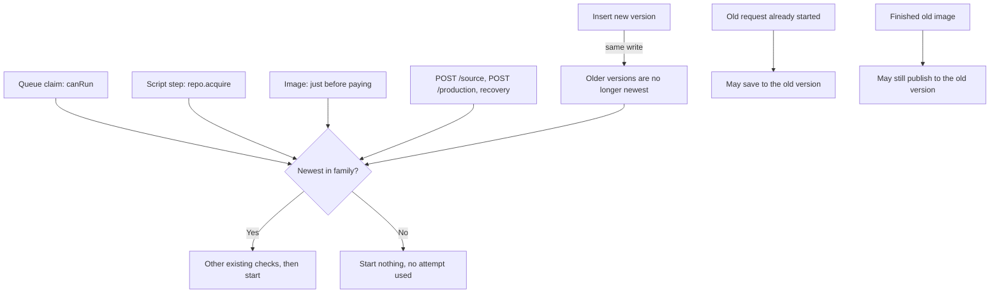

# Plan: production queue hardening

Requirements: [req-production-queue-hardening.md](../../../../reqs/2026/11/01/req-production-queue-hardening.md). Scenarios: [test-production-queue-hardening.md](../../../../tests/test-production-queue-hardening.md).

Risk: non-low. This changes scheduling, paid-work dispatch, version semantics, persisted job data and a public API response.

Git base: `1a82fd95ffaf0881034416bcaa70cebbd8a40ffe`, recorded at the start of SS. It includes `8924e5d`, whose review-failure flow this plan depends on. Per the user's instruction, implement directly on `main` in the existing checkout, without another worktree or branch. Preserve unrelated staged, unstaged and untracked work; milestone commits include only this story's changes.

## Scope

Five goals, in this order:

1. The newest version is the only source of generation eligibility, checked when work actually starts.
2. Publishing a new version and retiring the old one are one atomic write.
3. Search, text, image and local publication are four independent pools.
4. Stage checkpoints and image receipts are kept, and only missing work is done.
5. Scheduling, the shelf response and expired viewer rows are optimized last.

This covers review findings 1, 3 and 5–10. Findings 2, 4 and 11 are out of scope.



## Review-failure flow this plan assumes

- Automatic review and repair runs up to 20 rounds (`readerMaxAutomaticRepairs`), and stops early if a repair changes nothing.
- A blocked story keeps its saved row `failed` and shows its issues, the stop reason, and the repair and audit counts.
- **继续自动修复** is an explicit retry that allows up to 20 more rounds, and is disabled while the story is paused.
- **手动修改** on an issue opens the editor at that frame or at the ending, with the review comments beside it.
- **保存并重新审核** submits a new version immediately. It runs a full review and draws automatically if the review passes, even if the story was paused. A rejected new version is blocked in turn, so repeated corrections produce v2, v3 and so on.
- **跳过问题并绘图** overrides the review on the blocked version.

Today's behaviour, checked on commit `8924e5d` with Node 24.22.1:

| Check | Result today |
|---|---|
| Two manual corrections in a row | Only v3 is active and on the shelf; v1 and v2 are paused |
| Save from a paused, blocked story | Parent stays paused, and the new version is active |
| Retry from a stale tab on v2 | 202, nothing runs |
| Skip from a stale tab on v2 | 200, v2's review reads as passed, nothing draws |
| Shelf row of a blocked story | Includes `reviewIssues`, `retryStage` and `sourceReady` |
| Blocked after 20 rounds, 20 frames, every frame flagged each round | 548,282-character document, 43 jobs |
| Manual correction flagged by review | Repair replaced the edit, and the story drew all frames without asking (finding 2) |

## Decisions

### Goal 1: newest version only

1. **Eligibility is derived from the rows, not stored.** A version is superseded when another row for the same owner has the same `revision.rootId || id` and a higher `revision.number`. This is the rule the shelf already uses, including deleted rows, so deleting the newest version never promotes an older one. Version numbers only rise, so a superseded version stays superseded unless the newest row's document becomes invalid JSON (see Risks). `generation_control` stays the reader's pause switch, and is no longer used to retire versions.
2. **One JSON-safe definition.** [reader-repository.ts](../../../../../lib/reader-repository.ts) owns the family expressions, guarded with `json_valid`, and `list`, `familyEpoch` and every check below use them. The check now runs on every start, so an unguarded query would let one corrupt row stop all scheduling, not just revisions. Outer columns are qualified as `reader_sessions.document`, because an unqualified name binds to the inner row.
3. **Every place work starts is covered.**

   | Start point | Check | When refused |
   |---|---|---|
   | `canRun`, for text and image jobs | Query the family | The job stays queued |
   | `repo.acquire`, used by the script path and the direct `/advance` path | Not-superseded condition in the UPDATE | No lock; `script()` yields |
   | `image()`, right before the provider call | Query the family | `JobYield`, no attempt used |
   | `demand`, used by `POST /production` and managed `/advance` | Query before writing demand or retrying | Returns the snapshot, like a paused story |
   | `demands()`, both background intent and viewer rows | Superseded rows are excluded | No demand, no rebuild |
   | `resumeInterrupted`, for text and image jobs | Query the family | The job stays failed and interrupted |
   | `POST /source`, which calls the provider directly | Query before calling | 409; `GET` is unchanged |
   | `viewedPublicationPending` | Superseded rows are excluded | An old version can't make other stories wait |

   `basis` and the fork INSERT's condition, which also read stored control, treat a superseded row as paused, so an old version whose row still says `active` can be opened and edited like any other paused version.

   Publication jobs are exempt, because their image is already paid for. Search needs no check: `basis` refuses revisions before confirmation, confirming stops the search, and a revision has no intake. `/suggestions` and `/art-recommendation` aren't tied to a saved story.
4. **The unit of "already started" is one step.** A step that has acquired its lock finishes, and any follow-up call inside that same step can still run. Once a plan exists, each step is a single call. A step with several calls, such as preparing a missing source before planning, can only land on a parent with no plan, which the reader had to pause before forking. Splitting steps further isn't worth the complexity.
5. **Superseded versions are reported as paused.** `snapshot` returns `generationControl:'paused'`, `productionState:'paused'` and a new `superseded:true` for an unfinished superseded row, so `StoryRetry` and the review tools already disable or hide their actions. `StoryGenerationControl` shows a note that this is an old version in place of 恢复生成, because a button that can only return 409 would show its error beneath the modal sheet. Completed rows are unchanged.
6. **Clear refusals, not safety.** `control` returns 409 for resume and `background` on a superseded row, and `overrideReview` does too, before both of its branches and with the same condition in its UPDATE. The message points to the newest version. A paused newest version can still record a skip. Pause on an old row stays harmless.

### Goal 2: atomic publication

7. **The INSERT is the whole publication.** `forkRevision` writes the child's `generation_control` directly: `active` by default, and `paused` for `paused:true`. Inserting it makes every older version superseded in that same statement, and the existing family-epoch condition still decides competing submissions. New rows have no `revision.handoff`, and `control` no longer writes to the parent. A crash before the INSERT publishes nothing, and a crash after it leaves the new version running, which is what the reader asked for. The route calls `wake()` after a default submission, because it no longer goes through `control`, which is what wakes the scheduler today. `ReaderProduction` gains that method.
8. **Old handoff rows still work.** A paused child saved earlier with `revision.handoff` is recovered as before: the route's handoff branch and `control`'s `handoffOnly` guard stay, without the parent write.
9. **No data migration for versions.** Old rows left `active`, including any already hidden and running, become ineligible as soon as this ships. Rolling back to an earlier build would let them run again, so run this before that build starts:

   ```sql
   UPDATE reader_sessions SET generation_control='paused'
   WHERE generation_control='active' AND state!='completed' AND EXISTS(
    SELECT 1 FROM reader_sessions newer WHERE newer.user_id=reader_sessions.user_id
     AND COALESCE(json_extract(CASE WHEN json_valid(newer.document) THEN newer.document ELSE '{}' END,'$.revision.rootId'),newer.id)=COALESCE(json_extract(CASE WHEN json_valid(reader_sessions.document) THEN reader_sessions.document ELSE '{}' END,'$.revision.rootId'),reader_sessions.id)
     AND COALESCE(json_extract(CASE WHEN json_valid(newer.document) THEN newer.document ELSE '{}' END,'$.revision.number'),1)>COALESCE(json_extract(CASE WHEN json_valid(reader_sessions.document) THEN reader_sessions.document ELSE '{}' END,'$.revision.number'),1));
   ```

### Goal 3: four pools

10. **Search gets its own pool, with a limit of 1.** Text keeps its limit of 1, and the image and local limits don't change. Search already writes through targeted, fenced updates, and workers keep the saved intake and change only its phase, so it can run beside a script step. The `snapshot` and `recoverLostImages` pool checks need no change, because `currentJob` already excludes search jobs for intake documents. Within one story, the lock and publication backpressure still order text, image and publication steps. Independent pools don't remove those rules.
11. **Saved search jobs are moved by migration.** Job ids don't include the pool, so a saved `pool='text'` search would never be updated by re-enqueueing, and the pump would skip it forever because its handler pool no longer matches. `drizzle/0008_search_pool.sql` updates every `kind='discover'` row. Rolling back also requires `UPDATE production_jobs SET pool='text' WHERE kind='discover'`.

### Goal 4: checkpoints and receipts

12. **Existing guarantees are protected, not redesigned.** Step-key checks, completed receipts on enqueue, separate image and publication jobs, and copied images in revisions stay as they are. New tests pin the combinations this story changes.
13. **Style-only edits before the plan keep the script.** This narrows the earlier decision in `plan-paused-editing-latest-version` to clear partial storyboards. It applies when the parent has no plan, the requirements and frame count are unchanged, and the saved work's frame count (`draft.pages.length`, otherwise `storyboard.outline.beats.length`) matches the selection. One shared predicate in `lib/reader-revision.ts` decides this. `revisionImpact.replan` stays true for existing callers, and a separate flag drives the message. Shot prompts are independent of art style by contract, and review still checks the result against the new style. A batch the parent finishes after the fork may be paid for again.

### Failure containment

14. **One bad job can't stop the pass.** The pump and `recoverExpired` catch non-persistence errors per job, log once per job id, and continue. Persistence errors still abort the tick and retry, as they do today. Orphaned jobs are not deleted.
15. **A deleted story is not a job failure.** `repo.save` and its 404 are unchanged, because direct `advanceStory` callers must keep getting a 404 for a deleted story. In `script()`, a 404 from `advanceStory` becomes `JobYield` when no lock was acquired, or when `raw` shows the row no longer holds the lock this attempt acquired, so the step's checkpoint was saved. Any other case fails as it does today, so a 404 can't cause a silent paid replay. If the step itself failed while the story was being deleted, the recorded `failure` is handled the way `script()` handles it today: a real failure stays visible and retryable, and a call killed by a stop is reset instead of being reported. The waiting job stays queued until the story is restored and resumed. It then settles through the existing step-key check or moves on to the next step.

### Goal 5: optimization

16. **The pump skips stories that can't run.** The queue gets an optional SQL filter for candidates. It is written as a refusal, so a job with no session row still reaches `canRun` and Decision 14:

    ```sql
    j.kind='image-publish' OR NOT EXISTS(
      SELECT 1 FROM reader_sessions s
      WHERE s.id=j.session_id AND s.user_id=j.owner_id
        AND (
          s.generation_control!='active'
          OR EXISTS(
            SELECT 1 FROM library_deletions d
            WHERE d.story_id=s.id AND d.user_id=s.user_id)
          OR (j.kind!='discover' AND s.state='failed')
        )
    )
    ```

    Deletion is checked by its marker, independently of generation mode or stored control. The existing deletion trigger only stops background stories, so a deleted reader-mode row can still say `active`. Its text, image and search jobs must be filtered before `canRun`; the outer publication exemption still lets already-paid images publish. An orphaned job has no matching session and still reaches Decision 14.

    Superseded rows may still be `active`, so the coordinator also reads the superseded ids that have queued jobs once per cycle, starting from `generation_control='active'` rows so paused stories cost no family scan, and skips their non-publication jobs in the pump. That set is only a shortcut: a stale set can only miss a row, and the checks in Decision 3 stay the authority.
17. **Rebuilding and pruning are skipped when nothing changed.**
    - Job rebuilds use a key of document, selection, row state and that story's demands, excluding `expires_at`, or each viewer renewal would force a rebuild. Row state is required because completion is recorded when a row returns to idle with the same document.
    - The rebuild key is recorded only after `graph` succeeds. Entries for stories no longer scheduled are dropped, so a resume always rebuilds once.
    - Pruning uses a key of document, selection and the story's queued and failed job counts. The counts are required because a job that was running when its story changed can fail after the prune has passed.
    - Both prune steps, including today's global DELETE, are bound per story, and run only for stories whose key changed.
    - Direct calls from a reader's request or retry skip neither step. The keys live in memory, so a restart performs one full pass.
    - With 20 repair rounds, a document's review history can reach hundreds of thousands of characters. Parsed results are reused only while the row's strings are unchanged.
18. **The shelf list drops source text.** `GET /sessions` omits `story.original` and blanks `story.sourceText`. `GET /sessions/:id` is unchanged, and the source sheet already falls back to `/source`. `reviewIssues`, `retryStage` and `generationProgress` stay in the list. `StoryReviewTools` is the main recovery surface for a blocked story, and its `story.original` guard would hide it when a blocked story with a first frame is opened in the reader and its full session fails to load. The guard becomes exactly:

    ```ts
    if(!session.story||!(session.story.original||session.generationProgress?.sourceReady)||session.story.pages[0]?.image&&!issues.length)return null;
    ```

    `session.story` stays required, so stories with no plan keep rendering nothing during planning. A blocked story with no images shows only a toast if its load fails, and tapping its card retries. That is today's behaviour, and it doesn't change.
19. **Expired viewer rows are deleted by expiry alone.** `cycle` runs `DELETE FROM production_demand WHERE expires_at<=?`. It doesn't filter by runtime, so another live process's rows are safe, and rows from past runs are gone within one lease.

## Tasks

### Baseline

- [ ] Confirm the recorded Git base and implement directly on `main`. Keep the three story documents here, use existing dependencies and restore missing dependencies with `pnpm install --frozen-lockfile` only when required. Select Node 24.22.1 explicitly because the default shell runs 22.23.4.
- [ ] Rerun the review's reproductions against the worktree's code. They are `/private/tmp/claude-1227099725/-Users-esun-Documents-Projects-shiqu-docker/cc70a8c9-37d1-4ab6-9362-1636080b271c/scratchpad/review-repro.test.mjs` and `audit-flow.test.mjs` beside it. Copy the R9 part into the branch, because that directory belongs to this session, and take the repo root as a parameter, or the run measures the wrong code. Save the R9 results below, adding an unstubbed run with one blocked active story among 20 others, and a run with 20 blocked stories carrying a 20-round review history. If the pinned Node changes the reproduced results, or the flow differs from the section above, stop and update this plan.

### Milestone 1: newest version only (AC1–AC6)

- [ ] Add the JSON-safe family expressions and a superseded check in `lib/reader-repository.ts`, and use them in `list` and in `familyEpoch` in [reader-revisions.ts](../../../../../server/reader-revisions.ts).
- [ ] Add the check to each start point in Decision 3, in `lib/reader-repository.ts`, [reader-production.ts](../../../../../server/reader-production.ts) and [reader-api.ts](../../../../../lib/reader-api.ts).
- [ ] Apply Decisions 5 and 6 in `snapshot`, `control`, `overrideReview` and [StoryGenerationControl.tsx](../../../../../client/ui/StoryGenerationControl.tsx), and treat a superseded row as paused in `basis` and the fork INSERT.
- [ ] Add regression tests that start each route on an old version whose row still says `active`, including the `repo.acquire` condition through a direct `/advance` on a row with no jobs. Add a fork landing between `canRun` and `image()`, a deleted newest version, a corrupt row, an interrupted old job, and an old version holding a viewer row while other stories wait to draw. Assert zero provider calls and unused attempts.

### Milestone 2: atomic publication (AC7–AC11, AC20)

- [ ] Write the child's control directly in `forkRevision`, stop writing `revision.handoff` on new rows, remove the parent writes from `control`, and call `wake()` after a default submission. Keep the handoff branch for rows saved earlier.
- [ ] Rewrite the tests that pin the old two-step design, keeping what they protect:
  - `tests/reader-revisions.test.mjs:124`: restart, deleted parent and replay
  - `tests/reader-revisions.test.mjs:133`: crash recovery, now a failed INSERT publishes nothing, and a crash after it leaves one running version
  - `tests/paused-editing-versions.test.mjs:109-126`: replays must not override a later pause or resume
  - `tests/reader-revisions.test.mjs:58`: still passes, but its title describes the old handoff, so rename it
- [ ] Add tests for an old in-flight request saving to the old version only, a finished old image publishing, a seeded old handoff row recovering, two corrections in a row, saving from a paused and blocked story, and a stale-tab retry and skip.

### Milestone 3: four pools (AC12–AC14)

- [ ] Add `drizzle/0008_search_pool.sql`. In `reader-production.ts`, add `search:1` to the limits, move the `discover` handler and its enqueue call to it, and update the header comment.
- [ ] Add regression tests for AC12–AC14, covering queued and interrupted jobs saved with `pool='text'`. Update the tests that enqueue `discover` with `pool:'text'`, and the now-stale assertion message at `tests/story-flow-control.test.mjs:146`.

### Milestone 4: checkpoints and receipts (AC15–AC17)

- [ ] Add the Decision 13 predicate and flag. Copy `storyboard` and `draft` into the child in `forkRevision`, and report the saved frame count in `revisionSnapshot`.
- [ ] Update the replan branch of the impact message in [StoryRevisionEditor.tsx](../../../../../client/ui/StoryRevisionEditor.tsx) so it doesn't promise a replan in this case. The `reviewOnSave` wording stays as it is, because that path always has a plan.
- [ ] Add regression tests for AC16 with a storyboard and with a draft-only short story, for AC17, and for AC15 across retry, restart and revision reuse with the new eligibility rule. Check the message in the in-app browser with `pnpm desktop:preview` or the reader preview, against an isolated data directory with no paid calls.

### Milestone 5: failure containment (AC18, AC19)

- [ ] Add per-job containment to `pump` and `recoverExpired`, and make the coordinator's prune and lease loops tolerate a missing row.
- [ ] Apply Decision 15 in `script()`.
- [ ] Add regression tests for AC18 using ready orphaned `script`, `discover`, `image` and publication jobs, because a job with an unfinished parent never reaches `canRun`. Add tests for AC19, including a step that fails during deletion. Keep `tests/reader-generation.test.mjs:372` and `tests/local-image-batches.test.mjs:174` passing unchanged.

### Milestone 6: optimization (AC21–AC25)

- [ ] Add the candidate filter and superseded shortcut to the pump in [production-queue.ts](../../../../../server/production-queue.ts), and supply them from the coordinator. Check deletion markers for both background and reader modes, including rows still marked `active`, while exempting publication jobs.
- [ ] Apply Decision 17 in `cycle` and `pruneSuperseded`. Reuse the parsed result for `readable` and `imageInputs` while a row's strings are unchanged.
- [ ] Replace the repeated `JSON.parse` of job dependencies with one helper at the three call sites. Replace the full job load in `canRun` with a query for failed and running-publication rows.
- [ ] Add a shelf-only view in `lib/reader-api.ts`, and change the guard in [StoryReviewTools.tsx](../../../../../client/ui/StoryReviewTools.tsx) to the exact form in Decision 18.
- [ ] In [Reader.tsx](../../../../../client/ui/Reader.tsx), catch a rejected `retrySession` from the settings sheet's `onRetry` and show it through `StoryReviewTools`' `error` prop, clearing it on the next attempt. **继续自动修复** otherwise does nothing visible when the session can't load, and `notify` won't do: its toast renders beneath the modal sheet.
- [ ] Add the expired-demand delete to `cycle`.
- [ ] Add deterministic tests: no `canRun` calls for paused, deleted or superseded stories, including an `active` reader-mode row with a deletion marker and ready queued text, image and search jobs. Assert no provider calls or attempts used, while an already-paid image still publishes to that deleted story. Keep the orphaned-job coverage from AC18.
- [ ] Add the remaining deterministic tests: at most 60 statements in a warm pass over 20 paused 80-frame stories, no job upserts on an unchanged tick, viewer renewal causes no rebuild, publication still runs while paused, a job that fails after its story changed is pruned, the shelf has no source text while the opened story does, a live viewer survives the cleanup, a trimmed shelf row with issues and a story shows the tools, and a `story:null, sourceReady:true` session renders nothing. Timing stays out of the test suite.
- [ ] Rerun R9 against the AC21 and AC22 targets and record the results below. If a blocked active story is still a main cost, add a per-pump cache of refusals. If the shelf's version query is, record it as a follow-up.

### Verification and documentation

- [ ] `pnpm typecheck`, `pnpm lint`, and the full `pnpm test` on Node 24.22.1.
- [ ] Run [test-production-queue-hardening.md](../../../../tests/test-production-queue-hardening.md).
- [ ] If `.docs/story-creation-editing-queue.md` is on the branch by then, update what this work changes: the pool table, the publication flow, the stale-version rules and the implementation links. If it isn't, record the needed changes in the delivery notes.

## Risks

- **Rollback needs two statements.** Old rows stay `active`, so an earlier build would let hidden versions run again. Before rolling back, run the statements in Decisions 9 and 11.
- **A corrupt newest row can revive an older version.** Default forks leave the parent's row `active`, so if the newest row's document became invalid JSON, the older version would look newest and could start drawing with no reader action. The shelf rule already promotes it in that case, and today its stored pause would prevent drawing. App writes go through `JSON.stringify` and `json_set`, so this needs hand-edited data. Accepted, because a second write to pause the parent would bring back the separate step this design removes.
- **A step that already started can still pay once more.** See Decision 4. This is bounded to one step per fork.
- **The family query now runs on every start.** Until Milestone 6, each start costs one more query that parses documents. It only reads rows belonging to one owner, and libraries are small.
- **Two text-class calls now run at once.** Codex or Gemini quotas may be hit sooner while a search overlaps a script step. Images already run three calls at once, and a failure is reported the same way as today.
- **A skipped rebuild could hide a missing job.** A job deleted by hand while the service runs won't be recreated until its story changes, the story stops being scheduled, or the service restarts. App code only deletes jobs that are superseded or whose story has changed.
- **Refusing to resume or skip on an old version changes the API.** The only UI routes are an old link or a stale tab. The resume button is replaced by a note, and a refused skip appears in the review tools' error area.
- **Repair rounds can be costly after a style-only edit.** If review flags kept pages, a new version can run up to 20 paid repair rounds. Shot prompts are style-independent by contract, so this should be rare.
- **Review history grows with the repair cap.** The largest document measured was 548,282 characters. The shelf's version query parses documents for every pair of rows, so it may become the main shelf cost, and the in-memory keys hold full document strings. The R9 run with review history measures both. If the query is the main cost, record it as a follow-up.
- **The desktop shelf SQL is not hardened here.** `desktop/library.sql` still has unguarded `json_extract` calls on document contents. AC6 covers the reader API only.
- **Finding 2 stays open, and this plan does not reduce it.** A manual correction can be replaced by automatic repair, then drawn without asking.

## Cost results

Synthetic stories: 80 frames, 20k-character source. Targets are in AC21 and AC22.

| Scenario | Stage | Cycle ms | Statements | Shelf bytes |
|---|---|---|---|---|
| 20 paused | Review (Node 22) | 860 | 2,848 | 1,915,141 |
| 20 active, pump stubbed | Review (Node 22) | 276 | 3,327 | 1,915,201 |
| 20 paused | Baseline (Node 24) | | | |
| 20 active, pump stubbed | Baseline (Node 24) | | | |
| 1 blocked active, unstubbed | Baseline (Node 24) | | | |
| 20 blocked, 20-round history | Baseline (Node 24) | | | |
| 20 paused | After fix | | | |
| 20 active, pump stubbed | After fix | | | |
| 1 blocked active, unstubbed | After fix | | | |
| 20 blocked, 20-round history | After fix | | | |

## Evidence

SS runtime: existing `/Users/esun/.nvm/versions/node/v24.22.1/bin/node`, Node 24.22.1, pnpm 11.25.0. Main HEAD matched the preserved base; dependencies were present and no install ran. Missing prior scratch reproductions were replaced by `tests/queue-hardening-cost.mjs`, an isolated in-memory SQLite measurement against an extracted copy of the recorded Git base (not a branch/worktree). Equivalent fixtures are not claimed to rerun the missing scratch files. Baseline results: paused 74.966 ms / 88 statements; active (pump stubbed) 104.519 ms / 3,327 statements; blocked active 0.743 ms / 16 statements; 20 blocked with history 36.474 ms / 168 statements. Shelf bytes respectively 2,711,181 / 2,711,181 / 135,740 / 2,715,181. Dependent runtime probes passed.

Milestone 1 verification: 47 existing production/revision/paused-version tests plus 3 new eligibility regressions passed; `pnpm typecheck` passed. Local milestone hash recorded after commit below.

AR passed: no blocking architecture flaws (round 5, full review of this design by the reused independent reviewer). Its non-blocking corrections were applied afterward without another review round. They are the eligibility wording, the extra `demands`, `viewedPublicationPending` and `basis` checks, the old-version note, `wake()`, rollback SQL, test line numbers and scenario setups.

The rollback statement in Decision 9 was run on an in-memory SQLite database with a corrupt row, a completed family and another owner's row. It paused only the unfinished superseded versions.
