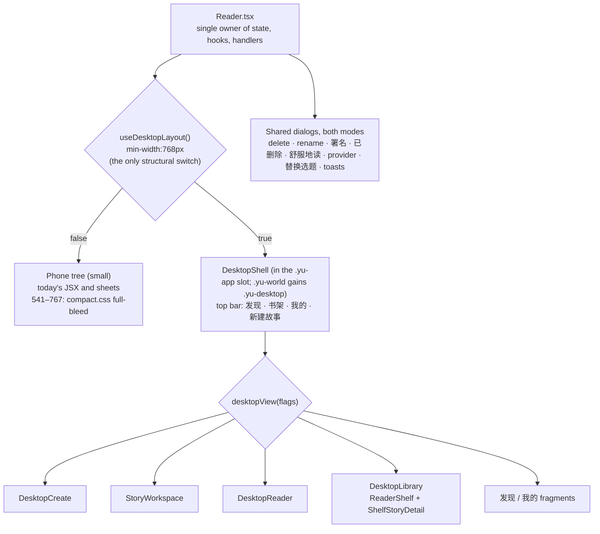

# Responsive redesign of the reader app (small, medium, large)

Requirement: [req-desktop-responsive-layout.md](../../../../reqs/2026/11/05/req-desktop-responsive-layout.md)
E2E spec: [test-desktop-responsive-layout.md](../../../../tests/test-desktop-responsive-layout.md)

Git base: `cb5241a` on `main`, recorded at SS start. It includes the phone-readability delivery (`READABILITY_BASE` = `c76fd09`, the story's last code commit, with docs in `ae64036`) and later provider-settings commits from another session. The phone baseline and the stylesheet byte-equality check are taken against `cb5241a`. Between `c76fd09` and `cb5241a`, the only stylesheet change is the provider diagnostics hunk in `ProviderSettings.css`. Line references were rechecked at SS start: `Reader.tsx` moved by at most 1–2 lines from the cited numbers (for example, the key handler is at :208, the wheel effect at :221, `generate` at :270, the 制作要求 link at :386 and `panelOpen` at :396).

The tree was clean at SS start apart from this story's and phone-navigation's untracked docs. Another session may still commit provider work on `main`. Milestone commits stage this story's files by path only.

Risk: non-low. The work spans coordinated design across `Reader.tsx` and several new desktop compositions, with a wide blast radius over the reader UI. It crosses no protected boundary: no API, data, storage, URL, CLI or skill change.

## Design

### Decisions

- **One state owner, two compositions.** `Reader.tsx` keeps every piece of state, hook and handler.
  - `useMediaQuery(query)` (`client/ui/useMediaQuery.ts`) uses `useSyncExternalStore` over `matchMedia`. Its server snapshot is `false`, so `renderToStaticMarkup` tests and environments without `matchMedia` get the phone tree.
  - `useDesktopLayout()` is `useMediaQuery('(min-width:768px) and (min-height:560px)')`. It is the only value that changes the component tree.
  - **Why the height gate:** with a width-only switch, a phone in landscape (about 844–932 × 390–430) would land in the shell. The top bar, workspace header and frame strip would leave almost no height for content. Short viewports keep the phone UI, full-bleed.
  - The phone CSS condition is the exact complement, `(max-width:767px), (max-height:559px)`, so CSS and the JS tree switch always agree.
  - The phone tree renders today's JSX. Desktop renders new composition components that receive Reader's existing state and handlers as props.
  - **Why not CSS-only:** the REQ needs different structure (detail panel, workspace panes, an inline create page). That cannot be done by restyling a stack of modal sheets.
  - **Why not a second app or router:** both are excluded by the constraints. Keeping state in one place is also what makes resizing safe.
- **Tiers and natural transitions.** There is one structural switch and two CSS reflow points:

  | Width | Tier | How it changes |
  |---|---|---|
  | 320–540px | small | Today's phone UI, rendering exactly as today. |
  | 541–767px, or any width under 560px tall | small | Same phone tree and today's ≤540px rules, plus a content-column cap from `client/ui/compact.css`. |
  | 768px wide and 560px tall | small → medium | Structural switch from phone tree to redesigned compositions (`useDesktopLayout`). |
  | 768–1023px | medium, condensed | Library details and reader side panel are drawers; workspace frame list is a strip; create and 我的 stack. |
  | 1024px | medium, reflow | Library details and reader side panel dock; workspace gains a docked preview; create and 我的 go two-column. |
  | 1280px+ | large | Workspace gets the full three-pane layout; content is capped at 1440px and centered. |

  - **Wider phone viewports reuse today's phone rules.** Every existing `@media(max-width:540px)` block changes only its condition, to `(max-width:767px), (max-height:559px)`. That covers `reader.css` (each such block), `ProviderSettings.css`, `story-review-history.css`, and any other file found with `grep -n "max-width:540px" client`. No declaration and no selector changes.
    - Rule order is untouched, so the cascade is exactly today's: for example, the later `max-height:720px` caption rules still win.
    - At 320–540px the same rules match as before, so the rendering is identical.
    - At 541–767px, and on short screens, the phone UI is full-bleed with the 540px type sizes. There is no 6px type jump at 540/541, and the reader stays immersive and full-bleed.
    - **Why widen rather than mirror:** copying those blocks into a new file would need a copy of every later height rule too, to keep the cascade. Widening the condition keeps one source of truth.
    - The narrower blocks (`max-width:420/380/360px`) are unchanged.
  - **`compact.css`** adds only what full-bleed needs beyond the phone rules. Its rules sit inside `@media (min-width:541px) and (max-width:767px), (min-width:541px) and (max-height:559px)`:
    - a centered content column (`max-width:600px`) for the home, shelf and profile content;
    - the same 600px cap, centered, on each sheet's inner content (the children of `.yu-sheet`), while the sheet surface stays full-bleed. The provider dialog's sticky `.yu-provider-actions` bar is capped with its section, centered; this cosmetic difference is accepted;
    - in the short-viewport branch, reader captions capped at `max-inline-size:30em` with `margin-inline:auto`, so they stay centered over the art;
    - 发现 books as `repeat(auto-fill,minmax(110px,1fr))` instead of the phone's sideways scroller;
    - a featured-card cap.

    Same-specificity overrides depend on load order, so `import './compact.css'` is the last import in `Reader.tsx`, after `./reader.css` and every component that imports CSS. A test asserts this order.
  - `.yu-world` carries `data-layout="phone"` or `data-layout="shell"`, taken from `useDesktopLayout`. The width-sweep E2E uses it to show that structure changes only at the switch. It adds an attribute to an existing element and no new element. A `data-main` attribute marks the main content area that the sweep measures:
    - in the phone tree: the capped content column (`.yu-home`), and for the reader `.yu-reader`. For sheet views (workspace sections, create), `Sheet` stays unchanged, so there is no single inner box to mark. The sweep computes the width as the union of the topmost open sheet's capped children (`.yu-sheet > *`);
    - in the shell: the main area, and for the reader the full-bleed stage, which has no gutters.
  - **Reflows are CSS only.** The 1024px and 1280px reflows are scoped `.yu-desktop` rules inside `@media (min-width:1024px)` / `(min-width:1280px)`. The drawer and the docked panel are the same element, restyled, so nothing remounts and drafts, selection, focus and pane scroll positions survive.
    - `useMediaQuery('(max-width:1023px)')` (call it `drawerForm`) tells a composition when its panel is a drawer. Behavior is read from this query; structure never is.
    - **Library details.** A desktop-only `detailOpen` boolean, set by a selection click or Enter, controls the drawer form. The docked form ignores it and shows the selected story whenever there is one.
      - When `drawerForm` turns true (narrowing past 1024px), an effect sets `detailOpen=false`. The drawer therefore never pops up on its own. If focus was inside the docked details, it moves to the selected card; otherwise it stays where it is.
      - When the drawer opens, focus moves to its heading. The grid is `inert` exactly while `drawerForm && detailOpen`, so widening with the drawer open makes the grid usable again. This applies to the library only.
      - The drawer's own `keydown` handler (on the drawer element, not `window`) closes it on Escape, clears `detailOpen`, keeps the selection and returns focus to the card. Dialogs opened from the drawer (rename, delete) handle their own Escape first, because they are top-layer modals.
    - **Workspace preview.** A desktop-only `previewOpen` controls the 768–1023px drawer, and its toggle (画面与审核) is hidden by CSS at 1024px and wider.
      - `previewOpen` resets to false when `drawerForm` turns true, in `leaveWorkspace` / `exitToShell`, and when the workspace story changes. Frame changes keep it, so an open drawer shows the newly selected frame.
      - If focus was inside the docked preview when narrowing hides it, focus moves to the 画面与审核 toggle.
    - **Reader side panel.** This panel is non-modal at every width: it never makes the stage `inert`, so clicks, swipe and wheel keep paging. Its visibility stays derived from `sceneList` / `source`, so narrowing turns a docked panel into an open drawer without a pop or a focus loss. The REQ allows this as the non-modal exception.
      - Escape has one owner: the existing window `keydown` handler (Reader.tsx:208) closes the panel first, then calls `home()`. The panel adds no Escape handler of its own.
  - **Fluid scale.** Desktop tokens on `.yu-desktop` use `clamp()` tied to `vw` for gutters, gaps, pane widths and heading sizes, starting at 768px from the phone sizes (for example, the intro heading at 28px). Grids use `auto-fill`/`minmax`, and pane widths use `minmax()` with `fr`.
    - With values matched at each reflow point, no text size jumps by more than 2px at a width breakpoint.
    - The main content area (the REQ's outer container, marked `data-main`) never shrinks as the window grows:
      - **Home, shelf, profile and sheet views:** at most 600px wide at 767px. At 768px the shell main area is the viewport minus gutters, at least 720px, and 我的 bounds its single column at 720px or more.
      - **Reader:** full-bleed on both sides of the switch (767px phone `.yu-reader`, 768px shell stage).
  - **Touch in the shell.** Tablets now get the shell, so desktop CSS keeps phone touch rules under `@media (any-pointer:coarse)`: form text stays at 16px (the global rule in `client/styles.css` is never undercut), and top-bar items, frame-strip items, drawer close buttons and section tabs have targets of at least 44px.
- **Desktop view is derived, not separate state.** A pure `desktopView()` in `lib/desktop-view.ts` maps Reader's existing flags to a view, in this precedence order:
  1. `configure` → create
  2. a workspace flag → workspace, with a section
  3. `story` → reader, with an optional side panel
  4. otherwise → `tab`

  The workspace is active when any of `panelOpen`, `revision.tab`, `script` or `reviewHistoryId` is set. Its section follows a total order, and the first flag that is set wins:

  | Order | Flag | Section |
  |---|---|---|
  | 1 | `revision.tab` | `edit` |
  | 2 | `script` | `script` |
  | 3 | `reviewHistoryId` | `history` |
  | 4 | `source` | `source` |
  | 5 | (none of the above) | `flow` |

  `source` alone does not activate the workspace. With `story` set and the workspace inactive, `source` or `sceneList` selects the reader side panel. `desktopView()` is a pure function of these flags and needs no history.

  Both layouts read the same flags, so crossing 768px maps a phone sheet to its workspace section and back with no translation step. Desktop-only handlers only set and clear those flags:
  - `showWorkspaceSection(x)` sets the flag for x and clears the other section flags, using `revision.setTab(null)`, which keeps drafts.
  - `leaveWorkspace()` clears `script`, `reviewHistoryId` and `source`, calls `revision.setTab(null)`, and then runs today's `setSettings(false); closeWorkflow()`.
  - The desktop reader closes its side panel (`setSource(false); setSceneList(false)`) before calling `openStorySettings`.
  - **Top-bar navigation always leaves every open view first.** Every top-bar action runs one exit sequence, `exitToShell()`:
    1. close create if it is open (`setConfigure(false); setDiscoveryTarget(null)`);
    2. `leaveWorkspace()` if any workspace flag is still set;
    3. `home()` if `story` is set, which also resets the URL to `/`.

    Then it runs `setTab(x)`, or `choose()` for 新建故事.
    - This covers create opened over a workspace (`onBackToDiscovery` leaves `workflowTarget` set, so after closing create `panelOpen` would bring the workspace back) and create opened from a reader-entered workspace (`story` stays set).
    - It also prevents a stale `workflowTarget`, which would leave a new intake stuck on 正在打开制作流程… (`generate()` → `gen.start` never clears it; Reader.tsx:136/366).
    - The active top-bar item comes from the derived view: the tab for tab views, 新建故事 on the create page, none in the workspace.
    - Clicking the active item does nothing. In particular, 新建故事 on the create page keeps the typed draft.

  `lib/desktop-view.ts` unit tests cover:
  - the precedence and section order;
  - `source` with and without the workspace;
  - reader → 故事设置 with the panel open;
  - the flag results of `exitToShell()` from create, from a workspace, from create over a workspace, from create over a reader-entered workspace, and from the reader;
  - 新建故事 while already on create, which changes nothing.

  **制作要求:** the phone-readability story removes the unreachable standalone 制作要求 sheet and its `requirements` flag before this story starts. The REQ's 制作要求 item is the 修改故事 editor's 制作要求 tab, which the timeline link `revision.open('requirements')` opens (Reader.tsx:386). It appears under the `edit` section, so the workspace has no separate 制作要求 section or tab.

  No URL changes: `open()` / `home()` keep writing `/read?id=` and `/`, and `#provider-settings` keeps its listener.
- **Remount-safe drafts.** Switching compositions remounts the subtrees, which would lose local `useState` drafts.
  - Revision drafts already live in `useStoryRevision` (Reader level).
  - Three local-draft components get `useRetainedState(key, init)` (`client/ui/useRetainedState.ts`, backed by a module-level map) for their user-input state only:
    - `StoryDiscoveryForm`, key `discovery`: `draft`, `sources`, `limited`, `customTheme`, `rangeOpen`.
    - `StoryCreationSetup`, key `setup:<sessionId>`: `settings`, `editing`, `choosing`, `sourceOpen`, `remote`, and the `baseline` value its remote-change check compares against.
      - **Why restoring `baseline` is not enough:** the mount effect (StoryCreationSetup.tsx:38-42) raises the notice whenever unsaved `settings` differ from `baseline`. That is always true when edits are unsaved, so it would fire on every resize.
      - **Fix:** on the effect's first run in a mount that restored retained state, compare the server value instead of the edits:
        - `savedKey === baseline.current` (nothing changed on the server): keep the retained `settings`, `baseline` and `remote` as they are, with no reset and no notice.
        - `savedKey !== baseline.current` (it really changed while the layout switched): apply today's logic, which raises the notice only if `settings` also differ.
      - Later runs, and mounts with nothing retained, run today's code unchanged, so phone behavior is unchanged. A notice that was already showing survives the resize, because `remote` is retained.
    - `StoryExtractionSearch` (the setup title search), key `search:<sessionId>`: `draft`, `mode`, plus the `title` they were derived from. Its reset effect runs only when `sessionId` or `title` differs from the retained source title, not on every remount.
  - **When drafts are cleared.** Reader clears keys synchronously in the handlers where today's component would discard its draft:
    - `discovery`: in one `closeCreate()` helper (`setConfigure(false); setDiscoveryTarget(null)` plus the clear). It is used by the sheet close, by `exitToShell`, and by both `generate()` success paths (Reader.tsx:277/279), which today call `setConfigure(false)` directly. It is also cleared in the desktop book/mood click before `createSeed` changes. It is not cleared on a failed submit, because the form stays open with the user's input (Reader.tsx:280). Doing it in the handler, not an effect, stops the re-keyed form from reading a stale draft during render.
    - `setup:<id>` and `search:<id>`: when the workspace or panel closes for that session, when the session leaves intake, and in `onBackToDiscovery`. Today the 返回修改书籍 round trip remounts setup with fresh settings, and this keeps it that way.

    Phone behavior is therefore unchanged. Unit tests cover retain, clear, re-init from props after clearing, the `baseline` restore (no remote notice), and the title-search guard.
  - **Why not portals:** React re-creates portal children when the container changes, so a portal would not preserve the drafts.
- **Shared content and stable tree positions.**
  - `StorySettingsPanel` splits into `StorySettingsContent` (body) and the default export. The default export renders `<Sheet …>{StorySettingsContent(props)}</Sheet>`, calling the body as a function, so phone markup is identical and its element tree is too. `tests/story-title-ui.test.mjs` calls `Panel(props)` with a mocked `react` and walks `props.children`, so this keeps it passing. The workspace uses the body. Because the body is called as a plain function, `StorySettingsContent` must stay hook-free; its header comment states this.
  - The same test renders `ReaderShelf` against a mock `react` that provides only `useState`, `useRef` and `useEffect`. New `ReaderShelf` code uses only those hooks.
  - Repeated Reader markup is hoisted into local consts used by both trees, so its output is unchanged: the 发现 pieces (intro, recent, new-story link, books, moods, surprise, note, status), the profile groups, and the reader `<main>` subtree.
  - The `.yu-world` and `.yu-app` elements stay the same in both modes. Only their class names change: in desktop mode they come from the derived view, not from `story`, so a workspace opened from the reader is not clipped by `.yu-immersive`.
  - Children of `.yu-app` are ordered as `ProviderSettings`, then exactly one slot holding `{desktop ? desktopTree : phoneTree}`, then the shared dialogs.
    - Phone-only sheets live inside `phoneTree`.
    - The shared dialogs are delete, rename, 署名与转载 and its defaults, 已删除的故事, 舒服地读, `StoryReselection` (替换选题), the undo notice and the toasts. They keep their slots, so they survive a mode switch.
    - Sheets opened from inside reused components (setup's 修改故事, 重新选择故事 and 故事原文, and `StoryExportControl`'s 作品还未署名) stay sheets. Desktop CSS shows them as centered dialogs over the workspace, as the amended REQ allows.
  - Sheets use native modal dialogs (`showModal()`, top layer), so DOM order does not affect stacking.
  - **Dialogs stay on top across the switch.** Rotating a tablet can cross the switch, so this cannot be treated as rare. A surviving shared dialog would otherwise sit under sheets that remount and call `showModal()` later.
    - **How:** `Reader` does the re-raise once, so `Sheet` stays hook-free. That matters because `tests/story-title-ui.test.mjs` bundles `Sheet` with a mocked `react` that has no `useSyncExternalStore`.
      1. A `useLayoutEffect` keyed on `desktop` compares it with a previous-value ref. Only on an actual change does it snapshot the open dialogs (`document.querySelectorAll('dialog[open]')`) and their focused descendants. In that commit the replaced sheets are already detached, and the remounted sheets have not yet opened (they call `showModal()` in passive effects), so the snapshot holds exactly the surviving dialogs, in order.
      2. A passive effect, also keyed on the change, then calls `close()` and `showModal()` on each snapshotted dialog that is still connected and open, in the original order, and restores focus. It runs after every child's mount effect, including `ProviderSettings`, which sits before the slot, so the surviving dialogs end on top.
    - Comparing with a previous value, rather than skipping a first run, keeps this correct under `<StrictMode>`'s double mount effects.
    - The `close()` during re-raise does not run the sheet's `onClose`, because `Sheet` handles only `cancel`.
  - The wheel and ending-touch effects (Reader.tsx:209-231) bind to `readerRef` / `endingRef`. Add `desktop` to their dependencies so they rebind after the reader `<main>` remounts.
- **Styles are scoped by construction.** All desktop CSS lives in new files, with every selector under `.yu-desktop`, a class added to `.yu-world` only in desktop mode:
  - `client/ui/desktop.css`: shell, dialogs, 发现, create, 我的, reader;
  - `client/ui/StoryWorkspace.css`;
  - `client/ui/ShelfStoryDetail.css`;
  - `client/ui/compact.css`, which is the exception: its rules sit inside the wide-phone media query instead of under `.yu-desktop`.

  Existing stylesheets change only in their `max-width:540px` media conditions, as described above. A kept test checks:
  - Every rule in the three desktop files is scoped under `.yu-desktop`, with two exceptions: `:root:has(.yu-desktop)`, and at-rules (`@media`, `@keyframes`) whose inner rules are scoped.
  - Every rule in `compact.css` is inside its wide-phone media query.
  - No `max-width:540px` condition remains in `client/`, and `compact.css` is the last CSS import in `Reader.tsx`.

  A one-off SS check compares each existing stylesheet with `READABILITY_BASE` after normalizing the widened condition back, and requires byte equality. That proves 320–540px rendering is unchanged.
- **Shell.** `DesktopShell` provides:
  - a sticky horizontal top bar (the user's preference over a side rail). It has the logo on the left, the 发现 / 书架 / 我的 tabs, and 新建故事 on the right. The handlers and `aria-current` follow the derived-view rules above. Page content starts below the bar, and `:root:has(.yu-desktop){scroll-padding-top:<bar height>}` keeps keyboard-focused and `scrollIntoView` targets clear of it.
  - a fluid main area that is full width with `clamp()` gutters and capped at 1440px, then centered;
  - 45em text caps;
  - centered modal dialogs (`.yu-desktop .yu-backdrop` / `.yu-sheet`), with the provider dialog widened through the existing `:has(.yu-provider-settings)` hook;
  - toasts and undo notices anchored in the main area.

  The reader view hides the top bar, to stay immersive; this is the REQ's stated exception. The workspace keeps the top bar, and its own section tabs sit in the workspace header below it. The workspace panes scroll independently below both headers.
- **Library.**
  - `ReaderShelf` gets optional `selectedId` / `onSelect`. When `onSelect` is set (desktop only), the cover and details buttons select the story and are labelled `选择《…》`. The footer `继续阅读` / `重读` still calls `onOpen`, and production rows still call `onResume`, which opens the workspace.
  - An effect calls `onSelect(null)` when the selected story leaves the filtered view or is deleted.
  - Without `onSelect`, nothing changes, so phone markup and tests are unaffected.
  - The new `ShelfStoryDetail` shows the cover, metadata, progress and status, using the existing `StoryGenerationControl` / `StoryRetry`. Its actions all call existing handlers:
    - 阅读 / 继续阅读 → `open`
    - 制作流程 → `openWorkflow`
    - downloads → `exportControl`
    - favorite → `favoriteFromShelf`
    - rename → `setRenameTarget`
    - 署名与转载 → `setPublicationTarget`
    - delete → `askDelete`
  - The selected id is a new desktop-only Reader state.
  - Layout:
    - The grid is `auto-fill`/`minmax(160px,1fr)` at every width.
    - At 1024px and wider, `ShelfStoryDetail` docks as a sticky right column, `clamp(280px,24vw,360px)`.
    - From 768–1023px, the same element is a right-side drawer over the grid. It is opened by `detailOpen` and dismissed with its close button, Escape or a click on the scrim, which keep the selection (see the reflow rules).
- **Story workspace.** `StoryWorkspace` is a full page, laid out as follows:
  - **Header:** title, back (`leaveWorkspace`), section tabs: 制作流程 · 修改故事 · 分镜剧本 · 审核记录 · 原文. A tab shows only when today's matching entry point is available.
  - **Left pane:** frame list, when `scriptStory` has pages (`StorySceneList`, plus pending frames).
  - **Center pane, by section:**
    - flow: `StorySettingsContent` with `workflowContent`
    - edit: `StoryRevisionEditor`
    - script: `StoryScript`
    - history: `StoryReviewHistory`
    - source: `StorySource`
  - **Right pane:** the selected frame's artwork or drawing state, its caption, and that frame's review issues from `revisionSession.reviewIssues`. When `scriptPage` is 0 (结语), it shows the 结语 text and the `issue.page===0` issues instead.
  - Frame selection is new desktop-only state, used outside the edit section. While the 修改故事 script tab is active, the selected frame is derived from `revision.scriptPage`, so there is one source of truth. Selecting in the frame list calls `revision.setScriptPage`, and the editor's own 选择分镜 select moves the list and preview with it.
  - **Reflow by tier.** The same three elements are rearranged by CSS:

    | Width | Frame list | Center | Preview |
    |---|---|---|---|
    | 1280px+ | left pane | center pane | right pane |
    | 1024–1279px | horizontal frame strip above the center | center pane | right pane with a reduced artwork and full issues, so frame selection, editor and issues are visible together at 1024×768 |
    | 768–1023px | horizontal frame strip | full width | drawer toggled by 画面与审核 (`previewOpen`), one tap from the editor without leaving it |

    The section tabs scroll horizontally inside their own row if they overflow, never the page. At 1024px and wider, the editor's own review block (`.yu-revision-review`) is hidden by workspace CSS, because the right pane shows the same issues. This saves height at 1024×768, and the editor component is unchanged.
  - Every button inside the reused components keeps its label and handler. In-workspace calls that open a phone sheet, such as `setScript(true)` or `revision.open(...)`, simply switch the section, because the view is derived from those flags.
- **Create.** `DesktopCreate` shows the book grid, moods and 不挑了 on the left, and an inline `StoryDiscoveryForm` (no `Sheet`) on the right with the same props and `onSubmit={generate}`.
  - Picking a book or mood on the left calls `choose()`. It increments a `createSeed` that keys the form, and clears the retained `discovery` draft, so the form re-initializes from the new selection.
  - The form's own book select keeps using `onBookChange` and does not remount it.
  - Desktop 发现 places the lead fragments (intro, recent, new-story link) beside the browse fragments (books grid, moods, 不挑了).
  - Below 1024px, both create and 发现 stack: choices or lead first, then the form or browse fragments. The book grid stays `auto-fill`, so every book is visible without sideways scrolling.
- **Reader.** `DesktopReader` wraps the hoisted reader `<main>` in a stage and a toggleable side panel (分镜列表 = `sceneList`, 原文 = `source`).
  - The stage sizes the filmstrip frame to the window height with contained images. The filmstrip keeps its `translateX` paging inside a wider frame.
  - Captions are capped at 30em, and the large variant follows `largeText`.
  - Keyboard and wheel blocking omits `source` / `sceneList` in desktop mode, because the panel is not modal. Escape closes the panel first, then calls `home()`.
  - Selecting a frame in the panel calls `goToPage` and keeps the panel open.
  - At 1024px and wider the panel docks to the right of the stage, `clamp(280px,26vw,380px)`, and the stage shrinks to fit. From 768–1023px it is a drawer over the stage. Paging stays active either way, because the drawer is not modal for the stage.
- **我的.** At 1024px and wider, the existing groups are laid out in two columns with stats spanning both. Below that, one column with bounded width. The entries open the same dialogs.

## Tasks

### M0: probe and baseline (no product change)
- [x] Write `tests/desktop-responsive-layout.playwright.e2e.mjs`, following `story-discovery-modes.e2e.mjs`:
  - setup: `productionFixture` + `libraryFixture`, Vite proxy, headless Chromium, isolated data, evidence in `.data/e2e/<run>/desktop-responsive-layout`;
  - seed: one completed story with a frame-1 review issue (fixture approach from the `unified-story-review` tests), 8 or more readable stories and 2 unfinished productions;
  - provider settings access as in `browser-provider-settings.e2e.mjs`.

  Run the phone scenario on the base and save baseline screenshots and geometry at 360/390/430, plus 600/700 as "before" evidence for the compact change.
  - **Done.**
    - **Seeding** is in `tests/fixtures/desktop-layout.mjs`. `seedStory` runs the production intake through the API: create, title search 乌龟报恩, choose, confirm. `f.create` alone fails in this fixture with 本地出处无法核对, because the local book library needs a verified source. `seededBrowser` seeds N completed stories.
    - **The E2E** is registered in `tests/manifest.json` (groups `reader`, `browser-e2e`, gate `user-flows`), which is how `userFlowTests` is now derived.
    - **"Before" evidence:** `.data/e2e/drl-before/DRL-01/desktop-responsive-layout/` holds 35 screenshots and `phone-geometry.json` for 发现, 书架, 我的, the creation sheet, the reader, 故事设置 and 修改故事, at 360, 390, 430, 600 and 700 × 820. At 600 and 700 the app is today's floating 480px card (`.yu-app` x=60/110, width 480), and the intro heading is 30px against 28px at 540px and below.
- [x] Probe in the in-app browser with forced desktop CSS on a scratch tab: check that the filmstrip paging stays aligned when its frame is wider than 480px and sized by height. If it misaligns, record the fix (frame width variable) here before M5.
  - **Result: aligned, so no fix is needed.** With `.yu-app` forced to 1200×900 and no card, `.yu-film-frame` is 1200px wide and the current frame's left edge and width equal the stage's on pages 1, 2 and 3. `translateX(-page×100%)` is relative to the strip's own width, which equals the stage.

### M1: foundation
- [x] Add `useMediaQuery.ts` / `useDesktopLayout.ts`, `lib/desktop-view.ts` (with unit tests for precedence and the section mapping) and `useRetainedState.ts` (with unit tests for retain, clear and re-init).
- [x] Wire `useRetainedState` into `StoryDiscoveryForm`, `StoryCreationSetup` and `StoryExtractionSearch`, each through an optional `retainKey` prop:
  - `StoryCreationSetup` gets `baseline`, `remote`, and the restored first-run rule that compares the server value. A unit test shows that unsaved edits survive a remount with no notice, and that a real server change during the remount still raises it.
  - `StoryExtractionSearch` gets the reset-effect guard. Add Reader's synchronous clearing in the listed handlers. Existing discovery, setup and extraction render tests must pass unchanged.
- [x] Split `StorySettingsPanel` into content plus the sheet wrapper (body called as a function). `tests/story-title-ui.test.mjs` must pass unchanged.
- [x] Derive the `.yu-world` / `.yu-app` class names from the view in desktop mode. Add `desktop` to the wheel and ending-touch effect dependencies.
- [x] Hoist the shared Reader fragments, add the `ProviderSettings` / tree / shared-dialogs ordering, and add `DesktopShell` + `desktop.css` (shell, fluid tokens, dialogs, 发现, 我的, including their 1024px reflows).
- [x] Widen every `max-width:540px` media condition to `(max-width:767px), (max-height:559px)`, and add `compact.css` as the last CSS import. Run the one-off normalized byte-equality check.
- [x] Add Reader's dialog re-raise (snapshot in a layout effect, re-raise in a passive effect, keyed on an actual `desktop` change). `Sheet` is unchanged, so `tests/story-title-ui.test.mjs` passes unchanged.
- [x] Add the CSS scope guard test, covering both the desktop files and `compact.css`.
- [x] Compare the phone screenshots with the baseline, then commit (see the M1 record).

**M1 record** (committed as `2bf2b42`)
- **Byte equality:** every existing `client/*.css` stylesheet equals `cb5241a` once the widened condition is normalized back to `max-width:540px`, so 320–540px rendering is provably unchanged.
- **Phone baseline:** the `DRL-01` screenshots at 360, 390 and 430 are pixel-identical to the M0 baseline for 发现, 书架, 我的, the creation sheet, the reader and 故事设置. 修改故事 at 360 differs only by a sub-pixel tab-button tint, not a style change.
- **Wide phones:** at 600 and 700, `.yu-app` is full-bleed (x=0), `.yu-home` is a centered 600px column, the intro heading is 28px (it was 30px on the old card), the books form a grid, and `data-layout` is `phone`.
- **Desktop shell,** checked by screenshot at 768, 1024, 1280 and 1440: a sticky top bar; 发现 stacked at 768 and two-column from 1024; 我的 two-column at 1024 and up; centered dialogs. Fix applied: `desktop.css` loads before `reader.css`, so its outer rule became `.yu-desktop.yu-world`, to beat the phone `.yu-world` padding and grey background.
- **Deviation: nested sheets across the switch.**
  - **The bug:** when a nested sheet is open (for example setup's 故事原文 inside 故事设置) and the layout switches, both remount in one commit. React runs child effects first, so the parent's `showModal()` ran last and covered the child. Under `StrictMode`, the strict effect re-run repeats that order after Reader's re-raise effect, so fixing it in Reader alone was not enough.
  - **The fix:** `Sheet`'s existing mount effect re-raises any dialog already open inside it, right after its own `showModal()`. No hook was added, so `tests/story-title-ui.test.mjs` still passes. Reader's re-raise of the surviving shared dialogs is unchanged.
  - **How it was found and checked:** the readability E2E's cross-switch audits found it, and a probe confirmed that 故事原文 stays on top after 390→768→390.
- **Readability E2E:** its layout-only widths are now 320, 540, 600 and 767, all phone tier; desktop widths belong to this story's E2E. Each audit also waits for finite animations to end. Crossing the switch mid-flow closes 作品还未署名, the agreed exception, which broke that test's step sequence. It passes on every state.
- **Tests:**
  - `tests/desktop-view.test.mjs` covers precedence, section order, the side panel and source, the top-bar highlight, the `exitToShell` steps and the inert active item;
  - `tests/retained-state-ui.test.mjs` covers retain, clear and re-init, the restored setup (no false notice, while a real server change still notifies) and the title-search reset guard;
  - `tests/desktop-css-scope.test.mjs` covers scoping, the compact media query, no 540px conditions and the `compact.css` import order.
  
  `pnpm test` passes 660/660. The desktop E2E's `DRL-01` passes.
- **Setup restore under `StrictMode`:** instead of skipping only the first effect run, the restored setup stays quiet while the server's saved value equals the restored baseline. That avoids a false notice on the strict re-run.

### M2: library
- [x] Add `selectedId` / `onSelect` and selection clearing to `ReaderShelf`. Add `ShelfStoryDetail` with `.css` (docked and drawer forms, with drawer focus and Escape handling), and `DesktopLibrary`.
- [x] Add render tests:
  - select labels, and footer/production rows still opening;
  - detail actions call their handlers;
  - selection clears on filter.
- [x] Commit.

**M2 record** (committed as `f44b6c3`)
- **`ReaderShelf`:** optional `selectedId` / `onSelect`. The cover and title buttons select, labelled `选择《…》`, with `aria-pressed` on the title and `.is-selected` / `data-story-id` on the row. 继续阅读 / 重读 and the production rows still open directly. Selection clears through a child `SelectionGuard` effect, because `ReaderShelf` stays hook-free at the top level. Without `onSelect` the markup is unchanged, and the existing shelf and title tests pass.
- **`ShelfStoryDetail`** shows the cover, metadata, progress, generation status with its control or 重试生成, 阅读 / 继续阅读 / 重读, 制作流程, the three downloads (`exportControl`), 收藏, 修改故事名, 署名与转载 and 删除故事. Every action calls Reader's existing handler.
- **`DesktopLibrary`:**
  - docked at 1024px and up, with an empty-state placeholder; a drawer from 768–1023px, plus a scrim;
  - the grid is `inert` only while `drawerForm && open`;
  - focus moves to the heading when the drawer opens, and Escape (handled on the drawer) or the scrim closes it and returns focus to the card;
  - when the drawer form turns on, `open` resets during render, so a stale `inert` is never committed. Found by the E2E: a one-commit `inert` dropped card focus when narrowing from 1100 to 900;
  - focus inside the docked details is tracked with `focusin` and moved to the card on narrowing;
  - focus is returned only after the grid's `inert` is removed. Found by the E2E: focusing inside an `inert` subtree is ignored.
- **Tests:** `tests/desktop-library-ui.test.mjs` covers unchanged markup without `onSelect`, select versus open, selection clearing on filter and delete, and every detail action through real buttons. E2E `DRL-03` covers the library at 1280 (click, Enter, filter clears, footer opens), at 900 (drawer focus, Escape and `inert`), drawer to docked at 1100 with the same story, and 1100→900 with card focus (no drawer, not `inert`, focus kept, Enter opens). `pnpm test` passes 664/664.
- **Polish:** the downloads are a single column in the narrow detail panel.

### M3: story workspace
- [x] Add `StoryWorkspace` with `.css` (three tier arrangements, plus `previewOpen` and its drawer), plus Reader's `showWorkspaceSection` / `leaveWorkspace`, the top-bar exit handlers and frame selection. Check every in-section sheet (setup editor and chooser, 故事原文, 替换选题, 作品还未署名) opens as a centered dialog over the workspace.
- [x] Add render tests:
  - sections map from flags;
  - frame list, preview and issues for the selected frame;
  - tabs hidden when their entry is unavailable.
- [x] Commit.

**M3 record** (committed as `3f3331b`)
- **`StoryWorkspace`:**
  - **Header:** 返回 and the section tabs. The tab rule is the pure function `workspaceSections()` in `lib/desktop-view.ts`, which is unit-tested.
  - **Frame list:** its own markup (选择第 n 幅, plus 结语 as 0). `StorySceneList` was not reused, because its 正在阅读 / 跳转 wording is for reading.
  - **Center:** the section's existing component. `StorySettingsContent` is used for the flow section, and the panel props became one shared `settingsProps` object, so the phone sheet and the workspace render identical content.
  - **Right pane:** the selected frame's artwork or drawing state, its caption, and only that frame's `reviewIssues`, with 0 standing for 结语.
- **Tiers:**
  - 1280 and up: three panes;
  - 1024–1279: a frame strip, plus a right pane with a 180px thumbnail;
  - 768–1023: a strip, plus the 画面与审核 drawer, whose `previewOpen` resets during render when the drawer form turns on, with focus moving to the toggle.
  
  The editor's `.yu-revision-review` is hidden at 1024 and up.
- **Frame selection:** while the 修改故事 分镜 tab is active, the frame comes from `revision.scriptPage`, so the list and the editor's 选择分镜 move together. Otherwise it comes from `workspaceFrame`, which resets per story.
- **Deviations found by the E2E:**
  - **Returning to 修改故事 reopened its default tab.** Reader now remembers the last editor tab (`lastEditTab`) and reopens it at the current `scriptPage`.
  - **Opening 制作流程 from the desktop library loaded the story into the reader state,** through `gen.resume` → `onStory`, so 返回 landed in the reader. `openWorkflow` now records whether a story was being read, and `leaveWorkspace` calls `home()` when the workspace was opened from the shell.
  - **The drawer artwork is capped at 36vh,** so the artwork and its issue fit together at 768×1024.
- **Seed:** a finished story that also has artwork and a saved review issue is not a real product state, because `reviewIssues` exist only while a review is blocked. `seedReviewedStory` therefore creates the real equivalent: a finished story, then a caption revision through the revision API whose re-review blocks on frame 1, keeping all of its images.
- **Sheets over the workspace:** a probe at 1280 shows setup's 故事原文, 修改故事 and 重新选择故事, and 替换选题, as centered dialogs over the workspace (340px margins on both sides). Cancelling 替换选题 stays in the workspace, as it does on phones.
- **Tests:** `tests/story-workspace-ui.test.mjs` covers the tabs, the current section, back, frame selection and the preview's per-frame issues, including 结语 and pending frames. `tests/desktop-view.test.mjs` covers tab availability. E2E `DRL-04` passes at 1280×800, 1024×768 and 768×1024 (drawer), across 1280→1100→900→1280 (text, frame and editor scroll kept), and on 1100→900 with focus in the pane; 返回 lands on 书架 with the story still selected. `pnpm test` passes 667/667.

### M4: create and 发现
- [x] Add `DesktopCreate`, `createSeed` and the desktop 发现 arrangement. Add a render test that a book change re-initializes the form, and that the form's own book select does not remount it.
- [x] Commit.

**M4 record** (committed as `1ffc294`)
- **`DesktopCreate`:** the book grid, moods and 不挑了 (the hoisted 发现 fragments, now named consts) beside an inline `StoryDiscoveryForm`, with the same props and `onSubmit={generate}`. They stack below 1024px. The form panel is sticky at 1024px and up. 发现's lead and browse arrangement shipped in M1.
- **`createSeed`:** `choose()` increments it alongside the existing `clearRetained('discovery')`. The form is keyed by it, so a left-side book or mood re-initializes the form. The form's own book picker only calls `onBookChange` and doesn't remount it.
- **Deviation from the plan's render test:** the re-key behavior lives in Reader's `choose()`, and a stubbed render of Reader would not exercise it. E2E `DRL-06` proves it in the real app, and `tests/retained-state-ui.test.mjs` already covers re-initializing after the draft is cleared. `DRL-06` checks:
  - the create page opens with no sheet, and the book list stays visible;
  - the form's own book picker keeps the typed custom theme, while a left-side book re-initializes the form to the new book;
  - a mood sets the theme, and an active 新建故事 does nothing;
  - submitting sends the same `POST /sessions` (bookId and theme) and continues in the intake workspace;
  - 新建故事 from a workspace plus submit lands on the new intake with no 正在打开制作流程…, and 不挑了 opens the create page.
- **Fix:** the sticky create form and the library details used `max-height:calc(100dvh - bar - 48px)`. That ignored the main area's 56px bottom padding, so at the bottom of the page they were pushed under the top bar. Both now subtract 88px.
- The ending page's 开启下一篇 path is checked with the reader in M5 and M6.

### M5: reader
- [x] Add `DesktopReader`, the side panel (docked and drawer forms), and the desktop key/wheel/Escape rules, applying the M0 probe outcome.
- [x] Commit.

**M5 record** (committed as `41fe84b`)
- **`DesktopReader`:** the hoisted reader `<main>` as the stage, plus a non-modal `.yu-reader-panel` showing 分镜列表 (`StorySceneList`, which calls `goToPage` and stays open) or 原文 (`StorySource` plus publication details).
  - **Stage:** `object-fit:contain` at the full window. The caption block is centered and capped at `min(100% - 62px, 40rem)`, with the paragraph capped at 30em. The caption's shading is widened to cover the whole stage.
  - **Panel:** docked at `clamp(280px,26vw,380px)` from 1024px with the stage shrinking, and a fixed drawer below 1024px. The M0 probe showed the filmstrip needs no frame-width change.
- **Keys and wheel:** the phone tree's modal sheets still block paging. On desktop, `source` and `sceneList` no longer block keys or the wheel. The window handler stays the single Escape owner: it closes the panel first, then calls `home()`.
- **故事设置 from the reader:** `openStorySettings` closes the panel first on desktop, so the workspace opens on 制作流程, not 原文. Leaving returns to the same page with the panel closed (`workflowFromReader`).
- **Phone sheets:** the desktop tree no longer renders any phone sheet. The workspace, the create page and the reader panel replaced all of them. Sheets opened inside reused components (setup, 替换选题, 作品还未署名) remain centered dialogs.
- **E2E spec adjustment:** at 900px the drawer covers the stage's right edge, so `DRL-07` proves the stage is not `inert` by clicking the uncovered left edge, which turns back a page. Paging continues with the arrow keys. The spec text is updated to match.
- **Tests:** E2E `DRL-07` covers, at 1440: the top bar hidden; the artwork inside the stage and taller than at 480 (900px tall against the phone's width-bound height); arrow keys and the wheel paging with the panel open; a panel click turning the page; the caption within 30em; Escape closing the panel, then returning to 书架. At 900 it covers the drawer (`position:fixed`) with paging and an edge click; at 1100 the panel docks, the stage narrows and the page is kept. `DRL-05` covers 故事设置 with 原文 open (it opens 制作流程), the 原文 tab, and 返回 to page 3 with the panel closed. `pnpm test` passes 667/667.

### M6: polish and verification
- [x] Add focus-visible and hover states (`(hover:hover)`) across the desktop compositions. Add keyboard reachability for the library grid, frame list and side panel.
- [x] Complete every E2E scenario in the spec, and register the file in `userFlowTests` in `scripts/test-story-e2e.mjs`.
- [x] Browser check in the in-app browser against `pnpm dev`, with `SHIQU_DATA_DIR=/tmp/shiqu-desktop-layout SHIQU_AI_PROVIDER=readonly`, at 390, 600, 767, 768, 900, 1023, 1024, 1279, 1280, 1440 and 1920, plus one slow manual drag from 320 to 1920. Never use the personal library.
- [x] Run `pnpm typecheck`, `pnpm lint`, the new E2E and the reader render tests. Record the final phone-baseline comparison here.

**M6 record**
- **Focus and hover:** every desktop composition has `:focus-visible` outlines and `(hover:hover)` hover states. The library cards, workspace frames and tabs, and the reader panel are real buttons reachable by Tab. Scenario 2 covers Shift+Tab with the card below the bar; scenario 3 covers Enter-to-select.
- **E2E:** every spec scenario is implemented in `tests/desktop-responsive-layout.playwright.e2e.mjs`, which is registered in `tests/manifest.json` with gate `user-flows`, the source of `userFlowTests`. The final run (`.data/e2e/drl-final`) passes all 11 desktop scenarios and both readability cases (13/13). Case `08b` for the provider dialog passes separately on the disposable checkout.
- **Sweep (scenario 11):** six views, every 16px from 320 to 2560 at 900 high. There are zero failures: no sideways scroll, occlusion or clipping; the main area never narrows; text changes by no more than 2px per step; structure changes only between 752 and 768. The height sweep at 1280 switches only between 544 and 560.
- **Implementation corrections found in M6:**
  - **Shared dialogs:** under `StrictMode`, a remounted phone sheet's strict effect re-run covered a surviving shared dialog after Reader's re-raise. The re-raise now runs in `requestAnimationFrame`, before paint. Scenario 10's rotation with 修改故事名 checks it.
  - **Reader main area:** `DesktopReader`'s outer layout now carries `data-main`, because the requirement treats the stage as a pane that may narrow when the panel docks.
  - **Workspace width:** the workspace main area is capped at 1440 like the rest of the shell. It was 1600.
- **In-app browser check:** `pnpm dev` on 3100/3102 with `SHIQU_DATA_DIR=/tmp/shiqu-desktop-layout SHIQU_AI_PROVIDER=readonly`.
  - **Readings:** 390 phone (main area 390); 600 phone (600); 767 phone (600); 768 shell (768); 900 shell; 1023 shell (1023); 1280 shell (1280); 1920 shell (main area capped at 1440). There was no overflow at any width.
  - **Pane timing:** reads taken 300ms after a resize in the pane were stale at 768 and 1023, because the pane delivers the emulated media-query change late. Once settled they are correct. The headless sweep checks every step with real resizes.
  - **Cleanup:** the temporary launch config and data directory were removed. The slow manual 320→1920 drag is replaced by the automated sweep.
- **Not verified, as the risk notes allowed:** Firefox and Samsung Internet behavior with the on-screen keyboard near the 560px height gate. Only Chromium is available here, so the fallback was not needed or built.
- **Checks:** `pnpm typecheck` and `pnpm lint` (on the changed files) are clean, and `pnpm test` passes 667/667.

### CR fixes (round 1)

- **Blocking (fixed): the desktop create page lost its target story.** On the page reached through 返回修改书籍, a book, mood or 不挑了 pick on the left called `choose()`, which cleared `discoveryTarget`. The submit then started a new intake and orphaned the original.
  - `choose()` now keeps `discoveryTarget` while the create view is open for an existing intake, so the left-side picks change only the selection, just as the form's own book picker does on phones.
  - `DRL-06` now covers 返回修改书籍 → 列子 on the left → submit: it posts `…/{id}/setup` on the same session, makes no `POST /sessions`, and the session's `bookId` becomes 列子.
- **`workflowFromReader`** resets in `closeWorkflow`. Paths that set `workflowTarget` without `openWorkflow` (retry, auto-open, reselection, version switch) can no longer inherit a stale reader origin.
- **`lastEditTab`** resets to 制作要求 when `revision.sessionId` changes, so a new story without a plan doesn't open an empty 分镜 tab.
- **The 45em text cap** applies only to `p` in the shell main area. It no longer reaches list rows.
- **Known limitations (accepted):**
  - **Phone setup drafts in one transient case.** The setup gets `retainKey` on phones too. If `workflowSession` briefly turns null while the panel stays open, the remounted setup keeps unsaved edits. Today it would reset. This is harmless, and arguably better.
  - **Focus after a nested re-raise.** When `Sheet` re-raises a nested sheet after a layout switch, focus lands on the nested `.yu-sheet` container rather than the field that had it. The field remounts in any case, so its text survives, but the caret position does not. Shared dialogs re-raised by Reader restore the exact element.
- **Checks:** `DRL-02` and `DRL-06` pass, `pnpm test` passes 667/667, lint is clean.

### Existing browser E2Es on the new layout

- **What broke:** `storyBrowser` defaulted to 1280×1000, and `story-discovery-modes` switched to 1280×900. Both used to show the phone UI inside the floating card. Those sizes are now the desktop shell, so the phone-sheet steps in `story-lifecycle` (10 cases) and `story-discovery-modes` failed: elements weren't found, and 新建故事 matched both the top bar and the shelf button.
- **The change:** these tests verify the phone sheet flows, and the desktop layouts have their own E2E. So the change is to their environment, not their assertions:
  - `storyBrowser`'s default viewport is now 767×1000, the widest phone-tier width and the closest match to the old card;
  - `story-discovery-modes` uses 767 wherever it used 1280.
- **Results:**
  - `story-lifecycle`: 10/10.
  - `story-discovery-modes`: 1/1.
  - `reader-startup` and `story-storage-consolidation`: they pass unchanged at Playwright's default viewport.
  - `release-smoke`: it reuses lifecycle C001 through `storyBrowser`, which passes.

Every new or changed source file gets or updates its header comment, in Chinese.

## Risks

- **`Reader.tsx` size.** Hoisting fragments and adding the desktop branch grows an already large component. Keep compositions in their own files, and pass grouped prop objects rather than adding more inline JSX.
- **Missed remount state.** Other local state lost on remount is acceptable only if it is not user input, for example `ReaderShelf`'s show-all toggle or review-history fetches. Any newly found draft input gets the retained-state treatment, and the plan is updated.
- **Workspace entry points.** Some actions inside reused components open a phone sheet (for example `setSource(true)` from generation navigation). Because the view is derived, these become section switches automatically. Verify each in M3; do not add special cases.
- **Desktop build output** (`desktop/resources/runtime`) updates only on the next desktop build. That build is not run here.
- **On-screen keyboard and the height gate.** On browsers where the on-screen keyboard resizes the layout viewport, a tablet whose height is near 560px could cross the switch while typing. Chrome Android 108+ resizes only the visual viewport, so it is not affected; Firefox and Samsung Internet are uncertain.
  - Verify those browsers in M6 with an emulated keyboard resize.
  - If the switch fires there, hold the current layout for height-only changes while an editable element is focused. This must also hold the CSS side, by adding a `data-layout`-scoped override, so CSS and the tree stay in agreement.
  - The fallback is not built up front. Building it would break the "widened conditions only" invariant, because the widened phone blocks would style the held shell DOM. It would then need overrides under `[data-layout=shell]` for every widened rule, plus a matching update to the byte-equality check. If that happens, return to AR.
- **Matched fluid values.** Matching `clamp()` endpoints at 768, 1024 and 1280px takes care. The E2E sweep (scenario 11) measures content width and font sizes at every 16px step and fails on any decrease or a jump over 2px. Tune values against it rather than by eye.

## Review

AR passed: no blocking architecture flaws (round 6).

Round 6 non-blocking notes, folded in:
- the sheet width is measured as the union of its children;
- the provider action-bar cap is accepted;
- the short-screen caption is centered;
- the keyboard-fallback invariant is noted;
- the right pane shows 结语 issues.

AR risk: non-low — coordinated cross-component compositions across three tiers, a wide UI blast radius, and widened phone media conditions; no protected boundary.

AR review round: 6; reviewer: reused

Round 5 fixed:
- **Width at the switch:** a 600px sheet inner cap and a full-bleed shell reader stage, so `data-main` never shrinks at 752→768.
- **Dialog re-raise:** moved to `Reader` (previous-value ref; snapshot in a layout effect, re-raise in a passive effect), which fixes the mock test, provider-dialog order and StrictMode.
- **作品还未署名:** stated as an exception in the REQ.
- **Library drawer focus:** focus moves from the docked details to the selected card, and the grid is inert exactly while `drawerForm && detailOpen`.
- **Frame selection:** one source of truth while editing.
- **E2E:** same-height type comparisons, and rotation from the workspace flow.
- **On-screen keyboard:** verified in M6, with a fallback if needed.
- **Short-viewport caption cap.**

Round 4 fixed:
- **Height gate:** the shell needs at least 768×560; short screens keep the phone UI.
- **Wider phone viewports:** the existing 540px media conditions are widened, not mirrored, and `compact.css` loads last.
- **Dialog re-raise** replaces the accepted limitation.
- **Drawers:** explicit `detailOpen` / `previewOpen` with reset on narrowing; `inert` for the library only; one owner for Escape.
- **Touch in the shell.**
- **E2E:** the outer-container width measure, the occlusion check, and the reverse-direction steps.

Scope change after round 3: a three-tier responsive design (small/medium/large) with natural transitions, at the user's request. The structural switch moves from 1024px to 768px, 541–767px becomes full-bleed, and reflows happen at 1024px and 1280px. AR must be rerun.

Earlier rounds:

AR fixed, across three rounds:
- **Round 1:** top-bar exits, total section order, retained-state scope (title search, setup baseline), placement of in-section sub-dialogs (REQ amended), the test-safe `StorySettingsPanel` split, view-derived classes, effect rebinding, focus under the bar, and E2E coverage.
- **Round 2:** a server-value first-run rule for restored setup state, a unified `exitToShell()`, discovery clearing, the 制作要求 mapping, hook-free content, the E2E seed, and the touch coverage check.
- **Round 3:** a single `closeCreate()` helper, an inert active top-bar item, and the stylesheet-diff pathspec.

Round 3 result: passed, before the tier change.

## Notes from the phone-readability delivery

- **Static font-size guard:** `tests/phone-readability-css.test.mjs` scans every `client/**/*.css` file, `desktop.css` and `compact.css` included. A font size must be one of:
  - a px value of 12 or more;
  - `clamp()` or `max()` whose first argument is 12px or more;
  - `var()`;
  - a CSS-wide keyword.

  Write fluid desktop headings to fit that.
- **The byte-equality check needs updating.** The phone readability work changed most phone stylesheets. Take the "unchanged at 320–540px" comparison against `READABILITY_BASE`, not `0455be4`. The phone audit E2E (`tests/phone-readability.playwright.e2e.mjs`) stays in force and runs at 768 and 1280 for layout only, so its 768px expectations will need revisiting once the shell takes over at that width.
- **Specificity of the hit-area rules:** the `reader.css` rules use `:where()`, so desktop rules can override `position` and `::after` without raising specificity.
