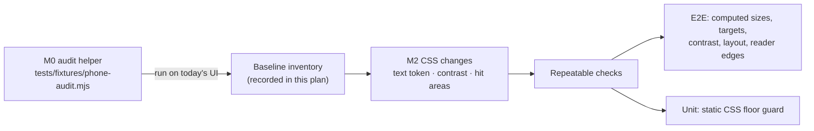

# Phone readability and touch targets

Requirement: [req-phone-readability.md](../../../../reqs/2026/11/05/req-phone-readability.md)
E2E spec: [test-phone-readability.md](../../../../tests/test-phone-readability.md)

Git base: `f568d0c` on `main`, recorded at SS start (history was rewritten after `51b3d74`). Another session then committed five unrelated provider-settings commits on `main` (`d9005d4`…`433e2af`) before this story's first commit, so this story's changes are exactly `433e2af..HEAD` (its own commits), not `f568d0c..HEAD`. This story's delivery commit becomes `READABILITY_BASE` for [plan-desktop-responsive-layout.md](plan-desktop-responsive-layout.md). Record the hash there at DD.

Risk: non-low. Every phone screen changes visually, and the work needs a new measurement harness to prove it. No protected boundary is crossed: no API, data, storage, URL, CLI or skill change, and no component tree change apart from the dead sheet.

## Inventory (at `f568d0c`)

- **Declarations below 12px:** 122 `font-size` declarations across 8 stylesheets, plus `font:11px` on `.production-stage-icon` (`production-timeline.css:5`).

  | File | Count |
  |---|---|
  | `client/ui/reader.css` | 93 |
  | `client/ui/production-timeline.css` | 10 |
  | `client/ui/ReaderShelf.css` | 7 |
  | `client/ui/ProviderSettings.css` | 5 |
  | `client/ui/story-revision.css` | 3 |
  | `client/ui/story-discovery.css` | 2 |
  | `client/ui/story-publication.css`, `client/styles.css` | 1 each |

  - Some of these never render, because a later rule overrides them. An existing readability block (`reader.css:133–157`) already lifts the tab bar, header meta, 发现 metadata, feature-card labels and reader header text to 12px. It does this through `--yu-meta-size:12px` and the colors `--yu-meta:#59694f` and `--yu-action:#526747`, all set on `.yu-world`.
  - Others never render because their classes are not used by any component: `.yu-production-field`, `.yu-prompt-actions`, `.eyebrow`, `.yu-voice-option`, `.yu-lengths`, `.yu-audio` and `.yu-sample-link`.
- **Contrast:** about half of the sub-12px rules use colors below 4.5:1 against the paper color `#fffefa`. Examples: `#97a08c` is 2.7:1 and `var(--muted)` `#7b827a` is 3.9:1. Some of these sit on dark surfaces, where the ratio differs, so M0 measures the real pairs.
- **Undersized controls named in the REQ:**
  - `.yu-avatar`: 35px;
  - `.yu-switch`: 42×24;
  - shelf card actions and cover-overlay actions;
  - `.yu-hero-controls button`: the base rule is 38×34, but the readability block already lifts it to 44;
  - `.yu-provider-segments>label`;
  - option chips.

  M0 produces the full measured list.
- **Dead sheet:**
  - `Reader.tsx:95` declares the `requirements` state.
  - `:156`, `:186` and `:291` clear it.
  - `:464` renders the sheet.
  - `reader.css:66` holds the `.yu-saved-prompt` rules.

  Nothing ever sets the flag to true, and no test references the sheet.

## Design

### Decisions

- **One size token for raised text.** Every declaration that renders below 12px becomes `font-size:var(--yu-meta-size)`. This includes `font:` shorthands, which split into `font-family` plus the token, and the narrow-width overrides (`max-width:380/360px`).
  - **Why reuse the existing token:** `--yu-meta-size` is already the app's readable-meta size. Reusing it avoids a second 12px token.
  - **Why it helps testing:** the E2E can find exactly the raised text through the stylesheet object model, as elements that match a rule using the token.
  - **Hierarchy:** labels that were smaller than nearby 12px text keep their place in the hierarchy through the weight, color and letter-spacing they already have. No new sizes are introduced.
- **A declaration is deleted only when it is provably overridden.** Deletion requires a later rule that:
  - has no media condition;
  - has at least the same specificity;
  - covers every selector in the declaration's selector list.

  For example, `.yu-reader-heading span{font-size:8px}` (`reader.css:9`) is overridden by `reader.css:145`. Every other sub-12px declaration is tokenized.
  - **Why not decide from sampled sizes:** whether a declaration is overridden can depend on media, state (`.selected`, `:disabled`) or only part of a selector list. A wrong deletion would fall back to an inherited size in an unaudited state, where the static guard cannot see it.
  - **Why delete at all:** tokenizing a declaration that never renders would wrongly mark its text as raised for the contrast check.
- **Rules for unused classes are tokenized, not deleted.** The REQ limits the dead-UI cleanup to the 制作要求 sheet. Deleting the unused rules is left for a separate cleanup, outside this story. Tokenizing them keeps the static guard simple: no sub-12px literal may remain outside the exclusions.
- **Contrast fixes touch only raised text that fails.**
  - **Muted grey-green text on light surfaces** adopts `var(--yu-meta)` (5.85:1), the established readable muted tone.
  - **Text in other hues** (accent, red, status colors) keeps its hue. Its lightness drops just enough to reach 4.5:1 against its measured background.
  - **Text on dark surfaces** gets lighter in the same way.
  - **Text that is not raised** keeps its color. The REQ limits changes to raised text. The pre-existing token rule (`reader.css:135`) uses `var(--yu-meta)` and passes today. If M0 finds any pre-existing token text failing, SS stops and the case returns to the REQ, rather than recoloring text this story did not resize.
- **Raised text on plain backgrounds** is the set the contrast check covers there:
  - elements that match a rule (in an active media condition) whose text uses `var(--yu-meta-size)`;
  - text-bearing descendants that inherit that computed size, even when they set their own color.

  Background: the ancestor background colors composited up to the page color.
- **Text over artwork is a fixed set, measured whether or not it was resized.** The REQ names it, and most of it is not raised (the caption is 21px or larger, and the header meta is already 12px). The set:
  - the reader caption `p`, header title and meta, style labels and scene number;
  - the hero feature card's text;
  - the shelf cover badge (`.yu-shelf-book-badge`).

  The checks:
  - **Each named text is paired with its artwork and backing; nothing is detected by hit testing.** This text sits beside the artwork, not inside it (`StoryFilmstrip` is a sibling of the reader header and caption, `Reader.tsx:409-416`). Hit testing cannot find the reader artwork either: `.yu-scene`, `.yu-reader-top` and the scrims are all `pointer-events:none`.

    | Text | Artwork | Backing |
    |---|---|---|
    | Reader header title, meta and style labels | the current `.yu-scene` | `.yu-reader-top::before` |
    | Reader caption `p` and scene number | the current `.yu-scene` | `.yu-scene-caption::before` |
    | Hero feature text | `.yu-feature>img` | `.yu-feature-wash` |
    | Shelf cover badge | the card's cover `img` | the badge's own background |

    - **The backing is a stack:** the element's own background (for example `.yu-feature-tag`'s `#213d2f79` pill), then the scrim beneath it, composited in order.
    - **Artwork intersects the text** (by `getBoundingClientRect`): the text is measured against its backing stack composited over white. If the backing is missing, the helper reports "no backing".
    - **Artwork absent, or not intersecting:** the text is measured like plain-background text, against its real backdrop. That is the backing if one is present, composited over the stage color (for example `.yu-immersive` `#172d22`), not over white. Examples: the reader's drawing state, where the current frame has no image, and the ending, where the filmstrip is not rendered but the header stays visible.
    - Every visible named text therefore gets exactly one contrast entry.
    - **A note on wider viewports:** above 540px the `.yu-scene` rect covers the letterbox bands too. That only makes the check stricter, and contrast is audited at phone widths only.
  - **How the ratio is computed:** the helper reads the backing's computed gradient or color and takes the lowest alpha across the text's vertical span. It composites that over white and compares the text color against the result. Text shadows are ignored, so the check is conservative.
  - **Expected result:**
    - A rough estimate puts today's caption at about 7:1 under this rule.
    - The header is at risk. Its scrim fades from 0.75 alpha at 45% to transparent across the header plus 64px. A second style-label line can sit where the alpha is about 0.5, which gives roughly 3:1 for `#f6f3e7` over white.
    - The hero's top tag is also at risk: `.yu-feature-wash` is nearly transparent near the top, and even with the tag's own pill the estimate is about 2.6:1.
    - M0 therefore measures these pairs first. If they fail, the REQ question is whether the existing text shadow or backdrop blur counts for text over artwork, or whether a backing is added.
  - **If any text in the set fails, its backing is strengthened** (user decision after the M0 probe; see the probe result in M0). The backing keeps its hue. Only the opacity of its stops behind the failing text changes, and the stops away from the text stay as they are.
    - **Recent-story card:** raise the `.yu-feature-wash` stops behind the tag, style line and title, and make the tag pill more opaque.
    - **Reader header:** extend the `.yu-reader-top::before` strong stop so a wrapped meta line still sits on it.
    - **New cases:** any other failure found later also gets a strengthened backing, recorded here. A missing backing still stops SS.
- **Touch targets in CSS only.** No markup changes, so the component tree and existing tests stay as they are. The approach, in order of preference:
  1. **Grow the control itself:** `min-height`/`min-width` 44px with padding, where the layout has room (most buttons, chips, segments and row actions).
  2. **Add a transparent hit area:** a `::after` with `content:"";position:absolute;inset:min(0px,calc((100% - 44px) / 2))` on a `position:relative` control. This is for controls whose visible shape must stay small: the switch, the avatar and actions over covers.
     - The hit area is part of its element for hit testing, so taps and `elementFromPoint` both land on the control.
     - It is used only where the hit area lies entirely inside every clipping ancestor's box (`.yu-app` has `overflow:clip`, and `.yu-sheet` scrolls), and the control has no `::after` of its own. Otherwise option 1 applies, or the hit area moves to `::before`.
     - Existing pseudo-elements must not be reused: `.yu-provider-efforts>summary::after` (`ProviderSettings.css:79`) and `button.yu-swipe-surface::before/::after` (`reader.css:106`).
  3. **Grow gaps in dense rows**, such as chips and card actions, so that 44×44 boxes do not intersect.

  All target rules go in one commented block at the end of `reader.css`, except rules that belong in `ProviderSettings.css` or `ReaderShelf.css`. Each block has a one-line Chinese comment.
- **Reader edges.** The reader's header and bottom controls are already 44px, and the stage itself is one full-surface button.
  - If any enlarged control lies over the stage, its hit area must stay within the header and bottom bands.
  - `.yu-scene-caption` has `pointer-events:none`, so taps pass through it to the stage. Controls inside it (StoryRetry, 重新检查图片 in `.yu-reader-error`) must keep `pointer-events:auto`, and their hit areas are measured like any other.
  - Edge taps at mid-height and swipes must still reach the stage. The E2E checks this.
- **Two kinds of test:**
  - **A static CSS guard** (unit): complete for declared sizes, including states the E2E cannot reach.
  - **A browser audit** (E2E): checks computed sizes, targets, contrast and layout in every state the controlled fixture can reach.

  Computed sizes catch what the static guard cannot, such as inheritance and the browser's default `small` size.
- **Harness reuse.** The E2E uses `storyBrowser` (`tests/fixtures/story-browser.mjs`): the production app behind the dev proxy, controlled inference, and an isolated retained library. The fixture gains an optional third argument, `contextOptions`, merged into `browser.newContext`. Its default stays unchanged for existing callers. The E2E passes `{viewport:{width:390,height:844},hasTouch:true,isMobile:true}`, so the coarse-pointer 16px form rule applies as on a phone.

## Tasks

### M0: audit harness and baseline (probe; no product change, not committed separately)

- [x] Add the optional `contextOptions` argument to `storyBrowser`, with the default unchanged.
- [x] Add `tests/fixtures/phone-audit.mjs`, exporting `auditPhone(page)`. It is evaluated in the page and audits the topmost open modal `dialog` if there is one, otherwise the document. It returns:
  - **`text`:** visible text nodes whose element computes a size under 12px. Skipped: anything inside `.yu-book-cover`, `.yu-stamp`, visually hidden elements (1px clip or `sr-only`) and closed `details`. Text-bearing form controls (`input`, `select`, `textarea`) are included.
  - **`targets`:** each interactive element (`a[href]`, `button`, `summary`, `input`, `select`, `textarea`, `[role=button|tab|switch|radio]`, `[tabindex]:not([tabindex="-1"])`) gets a 44×44 box centered on its rect, after `scrollIntoView({block:'center'})`.
    - A 5×5 grid of `elementFromPoint` samples, spanning ±21px from the center to avoid sub-pixel rounding at the box edge, must all land on the element or one of its descendants.
    - For any input inside a `label`, hidden or visible (for example the `.yu-source-chapter` checkbox), the label is measured instead of the input. Tapping the label focuses or toggles the input. For wrapped text inputs such as `.yu-custom-input`, this means the input's own height is not what gets checked.
    - Exempt: inline links inside sentences, `select`, `textarea`, and `summary` rows at least 90% of their container's width.
    - Sample points inside the control's own border box count as hits. Chromium leaves rounded corners out of hit testing, so without this a round 44px button (which the REQ already counts as 44px) would miss its own corners. Points outside the box must still land on the control, and the overlap check covers neighbors that intrude into the box.
    - Sample points outside the viewport are skipped, so a control flush against a screen edge is measured only inside the screen. The screen edge bounds the tap there.
  - **`contrast`:** two sets, as defined in the Decisions:
    - raised text on plain backgrounds;
    - the fixed over-artwork set, measured against its backing.

    Each entry reports the ratio, or "no backing" when over-artwork text has none.
  - **`layout`:**
    - document and open-dialog `scrollWidth > clientWidth`;
    - controls clipped by their nearest scroll container;
    - pairs of controls whose rects overlap. Two kinds of deliberate layering are skipped:
      - content scrolling under a fixed layer such as the tab bar;
      - a control sitting on top of one at least four times its area, where the smaller control's center hits it. Examples are the reader controls over the swipe surface and the shelf actions over a cover. The top control's own target sampling covers these.
    - truncated text: elements with `text-overflow:ellipsis` or line-clamp whose content overflows.
- [x] Add `tests/phone-readability.playwright.e2e.mjs` following the E2E spec, and register it in `tests/manifest.json`:
  - groups `["reader"]`, level `browser-e2e`, cost `heavy`, platforms `["darwin","linux","win32"]`, suite `e2e`, pr `affected`, gates `["user-flows"]`, covers `[]`;
  - client changes route to the `reader` group (`scripts/test-plan.mjs:7`).
  - The provider dialog is measured in a second test case in the same file. It uses the existing disposable checkout and the real dev server (`checkoutFixture` and `startDevelopment`, as `browser-provider-settings.e2e.mjs` does), because that dialog is only open to the local dev proxy's private proof, which `storyBrowser` does not have.
- [x] First, measure the over-artwork pairs for the reader header and the hero tag (scenario 6) at 360, 390 and 430. If any fails, stop and return to the REQ before any other SS work. Options for the REQ decision: count the existing text shadow for text over artwork, or add a backing.
  - **Result:** failed. The user chose to strengthen the backings, and the REQ and Decisions were updated to match.
    - **Probe:** a scratch test using `storyBrowser`, with the completed fixture story 庄周梦蝶 on page 1 and then 发现 after reading page 2.
    - **Evidence:** `.data/e2e/phone-probe/probe-header` (`contrast.json` and screenshots).
    - **The fixture artwork is a pale, paper-colored image,** close to the "composited over white" worst case.

    | Text | 360 | 390 | 430 |
    |---|---|---|---|
    | Reader caption | 8.23 | 8.23 | 8.23 |
    | Reader scene number | 7.02 | 7.02 | 7.02 |
    | Reader title (16px) | 13.41* | 13.40* | 6.83 |
    | Reader meta 庄子 · AI 生成 | 12.91* | **3.83** | 4.79 |
    | Reader style labels | 13.19–13.36* | 5.33–13.36* | 5.37–7.07 |
    | Hero tag 最近阅读 · 庄子 | **2.43** | **2.43** | **2.43** |
    | Hero style line 原典故事 · 彩铅国漫 | **2.11** | **2.11** | **2.11** |
    | Hero title 庄周梦蝶 (25px) | **3.33** | **3.33** | **3.33** |
    | Hero progress 继续阅读 · 2 / 3 幅 | 6.50 | 6.50 | 6.50 |

    \* At 360, and for some text at 390, the picture box does not reach the header, so that text is measured against the stage color.
  - **Reader header:** at 390 the meta line wraps to a second line (`成` alone), which sits low in the fading scrim (3.83). It passes wherever it stays on one line.
  - **Hero card:** `.yu-feature-wash` is almost transparent across the top half of the card, where the tag, style line and title sit. Even with the tag's own pill, every one of them fails.
- [x] Run the E2E against the unchanged product, with isolated data only (the fixture's retained `.data/e2e` library). Record in this plan:
  - counts of small text, failing targets and contrast entries per state, plus the full lists as an evidence path;
  - the over-artwork set's ratios and backings;
  - the baseline truncation list. These are titles that truncate today; they become the E2E's allowlist.
  - **Decision criteria:**
    - if a spec state cannot be reached with the fixture's controls, stop and update the spec with how to reach it. The static guard covers only declared font sizes, not targets or contrast, so it cannot stand in for an unreached state;
    - if over-artwork text has no backing or fails, or pre-existing token text fails, stop and return to the REQ;
    - if the `::after` hit area does not register with `elementFromPoint` in Chromium, drop option 2 and use padding.
  - **Result:** all 43 states in the main case are reached, plus the provider dialog. Evidence: `.data/e2e/phone-baseline/phone-readability/audit/report.json` and `.data/e2e/phone-baseline/phone-readability-provider/report.json`, with screenshots.
    - **Font sizes:** 29 distinct small-text elements, all at 9–11px. The largest groups are:
      - `small`/`span` meta lines (11px);
      - timeline `.story-flow-link` actions (11px);
      - `.production-stage-state` (9–10px) and `.production-stage-timing` (11px);
      - `.yu-choice-label`, `.yu-revision-note`, `.yu-style-name`, `.yu-source-reference`, `.yu-adaptation`, `.yu-kicker`, `.yu-reader-error` and `.yu-shelf-book-badge`.
    - **Touch targets:** 63 distinct failing controls. The main groups:
      - timeline `.story-flow-link` actions, 18–25px tall;
      - the 修改故事 tab buttons and 丢弃草稿 (38–41px);
      - `.yu-revision-open` buttons (35px);
      - `.yu-generation-control` (28–36px);
      - `.yu-avatar` and `.yu-logo` (35px);
      - shelf favorite and delete (30–36px);
      - `.yu-shelf-refresh` (40px) and `.yu-shelf-reading-footer` (37px);
      - `.yu-switch` (42×24);
      - unstyled buttons: 替换选题's 取消替换 (22px), the export confirmation's 取消, and 继续自动修复;
      - the 修订建议 `summary` (33px);
      - `.yu-source-link` (18px).
    - **Provider dialog:**
      - Small text: `.yu-provider-pill` (10–11px) and the card notes (`small`, 11px).
      - Targets: the key segment labels 保留, 替换 and 移除 (30px tall); the 已保存 and 重新读取设置 buttons (40px); the 推理档位 `summary` (24px, and narrower than 90% of its container at 360 and 390).
    - **Contrast:** only the four over-artwork failures from the probe (the hero tag, style line and title; the reader meta line where it wraps). No raised or pre-existing token text fails.
    - **Layout:** no overflow and no clipped control. One real overlap: the reader's `.yu-reader-review-notice` covers the header's glass buttons.
    - **Truncation today (the allowlist):** `.yu-production-title>em`, `.yu-production-error`, `.yu-shelf-tags` and `.yu-shelf-book-badge`. All four are ellipsis truncations that exist at the base.
    - **Not reachable:** `.yu-recovery-detail` renders only while a fault is being retried automatically (`StoryRetry.tsx:24`), a passing state the fixture cannot hold. Its font size is covered by the static guard, and its only control is a full-width 上次错误 disclosure row. The spec moves it to "Covered elsewhere".
    - **Harness corrections found while reaching the states:**
      - points inside a control's own box count as hits (rounded corners);
      - nested sheets are closed with their 关闭 button, because Escape also closes 故事设置 through the reader's key handler;
      - the overlap exemptions described above.

### M1: remove the dead 制作要求 sheet

- [x] In `client/ui/Reader.tsx`, remove the `requirements` state (`:95`), its three `setRequirements(false)` calls and the sheet at `:464`. Update the file header comment if it mentions the sheet.
- [x] Remove `.yu-saved-prompt` and its descendant rules from `reader.css:66`.
- [x] Check:
  - `grep -rn "setRequirements\|yu-saved-prompt" client` is empty;
  - the 制作要求 links from 故事设置 and the 修改故事 tab still use `revision.open('requirements')` (`Reader.tsx:386`, `:391`), unchanged;
  - `pnpm typecheck` and `pnpm lint` pass.
- [x] Commit (`refactor(reader): remove unreachable requirements sheet`), staging these two files by path.
- Committed as `2e1ac43`. Verified: the grep is empty, and `pnpm typecheck` and `eslint` on the changed files pass.

### M2: readable text and touch targets

- [x] **Text:** apply the token or deletion rule to every sub-12px declaration in the inventory files, including media-scoped ones and `.production-stage-icon`'s shorthand. Excluded: the `.yu-book-cover` lettering (`.yu-book-cover>small`, `.yu-book-cover>i`).
- [x] **Fit:** where 12px text now overflows or newly truncates at 320px, adjust spacing, letter-spacing or wrapping in the same rule (for example, the 2px letter-spacing on kicker labels). Do not change font sizes elsewhere.
- [x] **Contrast:** fix every M0 contrast failure among raised text as in the Decisions, and record each changed color pair (old → new, background, ratio) in this plan.
- [x] **Backings:** strengthen the over-artwork backings that fail, as set out in the Decisions (`.yu-feature-wash`, `.yu-feature-tag` and `.yu-reader-top::before` from the probe). Record each old and new stop and the resulting ratios here.
  - The header scrim's height follows the header, so a wrapped meta line or two-line style labels move its percentage stops. Place the strengthened header stop in px, or confirm it at 320 and 360 as well as 390 and 430.
  - Record the ratios for every hero text, not just the tag: the style line and title have no pill, so they depend on the wash alone.
  - The stronger backings also show on the 480px card above 540px, and they carry into the redesign through `READABILITY_BASE`. Expect them in the M3 comparison.
- [x] **Targets:** fix every M0 target failure in the order of preference set out in the Decisions, including the REQ's named controls. Record the technique used for each control group here.
- [x] Add `tests/phone-readability-css.test.mjs` and register it: groups `["reader"]`, level `contract`, cost `fast`, platforms `["darwin","linux","win32"]`, suite `unit`, pr `code`, gates `[]`, covers `[]`. It parses every `client/**/*.css` file and fails on:
  - any `font-size` or `font` shorthand px literal below 12px, outside rules whose selectors all target `.yu-book-cover>small` or `.yu-book-cover>i`;
  - any `.yu-saved-prompt` selector.
- [x] Run the E2E and the new unit test. Iterate until the E2E reports zero small text, zero target failures, zero contrast failures and zero layout regressions at every spec width.
- [x] Add file header comments to the new test and fixture files, in Chinese. The changed stylesheets keep their headers; update a header only if its summary becomes wrong.
- [x] Commit (`feat(reader): readable phone text and 44px touch targets`) — committed as `d43c17a`. `ProviderSettings.css` was staged through a filtered patch, leaving another session's uncommitted diagnostics hunk out, staging story files by path: the stylesheets, `story-browser.mjs`, `phone-audit.mjs`, both new tests and `tests/manifest.json`.

**M2 record**
- **Text:** 98 declarations moved to `var(--yu-meta-size)` and 22 provably overridden ones deleted (the same selector list sets font-size again later, with no media condition). For example, `.yu-header-note`, `.yu-tabbar button span` and `.yu-reader-heading span`. `.production-stage-icon`'s `font:11px` shorthand was split into family plus token. Only the two book-cover lettering rules stay under 12px.
- **Fit:** nothing new overflows or truncates at 320–1280. The E2E layout audit is clean apart from the baseline allowlist, so no letter-spacing or wrapping changes were needed.
- **Contrast (raised text only, measured including element opacity):**

  | Rule | Old | New | Background | Lowest ratio after |
  |---|---|---|---|---|
  | `.production-stage-copy>small`, `.production-stage-state`, `.production-stage-current`, `.production-stage-timing`, `.production-review-loop` | `#65765a`, `#607354`, `#617254`, `#758468` | `var(--yu-meta)` | `#f3f6ec`, `#e6eddd`, `#f8f1e6` | ≥ 4.9 |
  | `.yu-shelf-tabs>button>span`, `.yu-production-title>em` | `#6c7a60` | `var(--yu-meta)` | `#eceee3` | ≥ 5.0 |
  | `.yu-source-heading p`, `.yu-adaptation`, `.yu-source-reference`, `.yu-style-selection`, `.yu-style-group h4`, `.yu-style-note`, `.yu-choice-label` | `#a0a98f`, `#8b9978`, `#7c8872`, `#8a967f`, `#647953` | `var(--yu-meta)` | `#faf9f1` | ≥ 5.5 |
  | `.yu-revision-field small`, `.yu-revision-impact small`, `.yu-revision-note`, `.yu-review-counts` | `#758468`, `#6d7d60` | `var(--yu-meta)` | `#faf9f1`, `#f8f1e6` | ≥ 5.2 |
  | `.yu-review-heading>span` (审片待处理) | `#856f43` | `#7e6940` | `#f8f1e6` | ≥ 4.6 |
  | `.yu-settings-formats .yu-settings-download` | `#70875a` | `var(--yu-action)` | `#f3f5eb` | ≥ 4.6 |
  | `.yu-retry-control small` | `var(--muted)` | `var(--yu-meta)`; `inherit` (`#d8ceb1`) inside `.yu-reader-error` on the dark stage | `#f8f1e6` / dark stage | ≥ 4.6 |
  | `.yu-publication small` | `var(--muted)` at opacity .75 | `var(--yu-meta)`, opacity 1; `#a7ba9c` under `.yu-ending` | `#faf9f1` / `#19392c` | ≥ 4.6 |
  | `.yu-provider-pill.ok` / `.warn` | `#3f7a46` / `#9a6414` | `#3c7342` / `#8a5a12` | `#e4eedb` / `#f6ebd2` | ≥ 4.6 |
  | `.yu-provider-cards small`; unselected effort chips | `var(--pv-meta)`, `#66755d` | `var(--yu-meta)` | `#fbfaf2`, `#eef3e6`, `#ebede2` | ≥ 4.6 |

  No pre-existing token text failed.
- **Backings** (lowest ratios at 360/390/430 on the fixture's pale artwork):
  - `.yu-reader-top::before`: `#10291df2 0%, #10291dbf 45%, #10291d00 100%` became `#10291df2 0, #10291dbf calc(100% - 64px), #10291d00 100%`. The 0.75 stop now holds through the whole header, wherever its text wraps, and the fade is confined to the 64px below it. The stop is anchored in px, so it is the same at every width. Header text is 6.66 or higher; the meta line that used to wrap was 3.83.
  - `.yu-feature-wash`: `180deg … #192e2180 56%, #132c23f2 100%` became `to top, #132c23f2 0, #192e21b3 170px, #14301e00 230px` (the CR fixes dropped the 0.09 top tint and put the stops in increasing order). It is anchored to the bottom, where the copy sits, so the top of the picture stays light. Hero text measures: style line 5.97, title 7.50, progress 9.32.
  - `.yu-feature-tag` pill: `#213d2f79` became `#213d2fc4`. The tag measures 5.32.
  - Unchanged and passing: the caption at 7.02 or higher, and the shelf badge at 7.78.
- **Targets:**
  - **Transparent `::after` hit areas** (visible shape unchanged; one commented `:where()` block at the end of `reader.css`): `.yu-revision-open`, `.yu-source-link`, `.yu-avatar`, `.yu-logo`, `.yu-switch`, the shelf card actions, the `.yu-review-tools summary`, unstyled sheet buttons (`.yu-sheet>button:not([class])`, such as 取消替换) and `.yu-revision-buttons>button:not(.yu-primary)` (取消 and 丢弃草稿). The shelf progress `.yu-generation-control` moved to a real 44px height in the CR fixes.
  - **44px minimum size:**
    - `.story-flow-link` gets a 44px minimum width and height, and `.yu-flow-header>nav>.story-flow-link` goes from 40px to 44px. These links stack closely in the timeline: invisible hit areas overlapped, and 制作要求 taps landed on the 已保存 link below it, so they get real size instead.
    - `.yu-retry-control button` and `.yu-revision-tabs button`.
    - `.yu-shelf-refresh` (from 40px), the shelf `.yu-production-side>.yu-generation-control` (from 36px) and `.yu-shelf-reading-footer`.
    - Provider dialog: the segment labels and effort chips (the chips also get a 44px minimum width), `.yu-provider-ghost`, `.yu-provider-actions .yu-primary` and the 推理档位 `summary`.
  - **Gaps:** the shelf card actions go from 2px to 8px apart, and those over a cover from 4px to 14px. `.yu-shelf-book-badge`'s `max-width` becomes `calc(100% - 80px)`.
- **Harness changes in M2:**
  - contrast now counts element opacity;
  - the scrim parser reads `to top` gradients and `calc(100% ± Npx)` stops;
  - the overlap exemption scrolls the top control into view before its hit check, and scroll positions are restored after the layout pass;
  - the provider case also audits the opened 推理档位 section.
- **Evidence:** `.data/e2e/phone-m2/…` for M2. After the CR fixes (gaps, notice height, title wrap), the current evidence is `.data/e2e/phone-cr/phone-readability/audit/report.json` and `.data/e2e/phone-cr/phone-readability-provider/report.json`. Both cases pass, and `tests/phone-readability-css.test.mjs` passes.

### M3: preservation and evidence

- [x] Compare before and after screenshots, looking for any change beyond sizes, targets, spacing and contrast colors.
  - **How:** the E2E saves a 390px screenshot of every state. Before is the M0 baseline run on the unchanged product (`.data/e2e/phone-baseline/phone-readability/audit`); after is the M2 run (`.data/e2e/phone-m2/phone-readability/audit`). At 360 and 430 the audits stand in: they measure text, targets, contrast and layout at both widths in every state.
  - **Reviewed side by side:** 发现 (empty and with the recent-story card), 书架, 故事设置 (intake confirmation and completed) and 修改故事.
  - **Result:** the visual identity is unchanged. The differences are the intended ones:
    - small labels are larger;
    - the timeline is airier, because its links are now 44px tall;
    - the recent-story card is darker behind its bottom text, while the top of the picture stays light;
    - the 最近阅读 pill is more opaque;
    - the shelf cover actions sit further apart.
- [x] Check the phone UI in the in-app browser with `pnpm dev` on ports 3100/3102 (the user's app holds 3000/3002), isolated data (`SHIQU_DATA_DIR=/tmp/shiqu-phone-readability SHIQU_AI_PROVIDER=readonly`) and a 390px viewport.
  - **Result:**
    - 发现 and 我的 render as in the E2E.
    - A tap 20px from the avatar's center, outside its visible 35px circle, opens 我的.
    - A tap 6px above the 24px-tall 大一点的文字 switch toggles it. It was turned back off.
  - **Limit:** the readonly provider cannot create stories, so swipe paging and edge taps were not repeated live. The E2E covers them on the fixture story: edge taps, a 120px drag and the center tap each turn or toggle exactly once.
  - The temporary launch config and the temporary data directory were removed afterwards.
- [x] `pnpm typecheck` and `eslint` on the changed and new files pass. The full suites belong to TT.
- **Environment note:** this shell runs Node v22.23.4 while `package.json` requires Node 24. pnpm only warns about that, and every run here completed.

### CR fixes (round 1 findings)

- **Audit hardening.**
  - Sample points inside a control's own box are hit-tested again. Only points that fall in a rounded corner beyond the curve are excused, with 1px of antialias tolerance.
  - Overlap pairs use each control's hit box: its border box plus any absolutely positioned `::after`, measured from the padding box.
  - The scrim parser clamps color-stop positions the way browsers do.
  - The static guard parses `font` shorthands that start with a weight or style, and ignores `!important`. It rejects non-px font sizes, except `clamp()` or `max()` whose lower bound is 12px or more, so the responsive redesign's fluid headings pass. `var()` values are left to the E2E's computed-size check.
- **Real issues the stricter audit found, now fixed:**
  - The shelf progress `.yu-generation-control`'s hit area reached the card details button. It now has a real 44px height and no `::after`.
  - The favorite's hit area overlapped the production row's control. `.yu-production-side`'s gap went from 2px to 6px.
  - `.yu-reader-review-notice` was 42px tall. It now has a 44px minimum height.
  - The wider gap newly truncated production titles at 390px. `.yu-production-title` now wraps at every width; this was the ≤380px behavior, so that rule moved into the base and the duplicate in the 380px block was removed.
- **Other changes:**
  - The hero wash stops are written in increasing order (`to top, #132c23f2 0, #192e21b3 170px, #14301e00 230px`); the 0.09 top tint is dropped.
  - The hit-area rules use `:where()`, so they add no specificity.
- **Kept as is:**
  - `.story-flow-link` stays 44×44 everywhere, because no `StoryFlowAction` sits inside running text.
  - The provider pills keep their literal text colors (`#3c7342`, `#8a5a12`). Changing `--pv-ok` and `--pv-warn` would also change the status border and dot, which are not raised text.
- **Evidence:**
  - both E2E cases pass (`.data/e2e/phone-cr/…`);
  - the guard passes;
  - `pnpm test` passes 648/648;
  - eslint is clean.

## Validation

| REQ criterion | Evidence |
|---|---|
| No readable text under 12px at 360/390/430 | E2E `text` empty in every state; static CSS guard for declared sizes everywhere |
| Named elements at 12px or larger | E2E assertions on `.yu-style-label` and `.production-stage-state`, the `text` audit for the former 11px meta lines, and the static guard for `.yu-recovery-detail` |
| Layout intact from 320px | E2E `layout` at 320/360/390/430/540, with truncation limited to the M0 allowlist |
| Wider viewports do not regress | E2E `layout` at 768 and 1280 (the 480px card) |
| Contrast (plain backgrounds and over artwork) | E2E `contrast` with no entry under 4.5:1 and no "no backing" entry, including the fixed over-artwork set in the reader, the hero card and the shelf badge |
| 44×44 targets, exceptions, no overlap | E2E `targets` and `layout` overlap pairs |
| Reader swipe and edge taps unchanged | E2E reader scenario; existing `tests/reader-interaction.test.mjs` |
| Dead sheet removed | M1 grep, typecheck, the static guard's `.yu-saved-prompt` rule |
| Preservation | Existing tests, M3 screenshots, browser check |

## Risks

- **Hit areas versus neighbors.** An enlarged `::after` can cover a neighboring control, or the reader stage, without visible change. The audit's sampled boxes and the overlap check catch this in reached states. Unreached states rely on the same CSS rules, because hit areas are per control class, not per state.
- **Line breaks at 320px.** Raising 9–11px labels to 12px can push rows to wrap, for example the production timeline's horizontal stages and the shelf tags. Fit adjustments stay within the affected rule. The E2E layout checks at 320px prove it.
- **Fixture coverage.** Every dialog reachable from the phone UI is a spec state, including unstyled buttons such as 替换选题's 取消替换 (`StoryReselection.tsx:64`). The static guard covers only declared font sizes. Rare error variants that render through the same components as a covered state (for example other recovery messages) share that state's measurement. M0 stops on any spec state it cannot reach.
- **Follow-up outside this story:** deleting the unused CSS rules listed in the Inventory.

## Review

AR passed after four rounds, with no blocking architecture flaws. Round 5 then passed the user's decision to strengthen backings after the M0 probe. The review settled:
- **Text over artwork:**
  - it is a fixed set, measured whether or not it was resized;
  - each text is paired with its artwork by rect intersection, not hit testing;
  - the backing is a stack of the element's own background and the scrim beneath it;
  - "no backing" is reported only when artwork intersects the text.
- **Coverage:** every reachable dialog is in the E2E, and the static guard covers only declared sizes.
- **Overrides:** a declaration is deleted only when it is provably overridden.
- **Hit areas** must stay inside every clipping ancestor.
- **Manifest entries** include `platforms`.

**Open risk:** the reader header and the hero tag may fail 4.5:1 under the worst-case scrim rule. M0 measures these first and stops for a REQ decision if they do.
