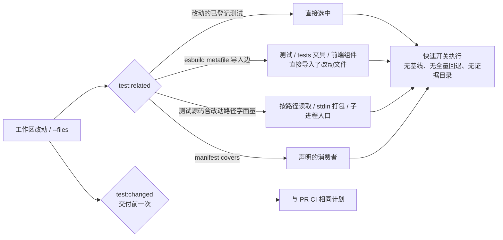

# 开发期测试提速

Requirement: [req-fast-dev-tests.md](../../../../reqs/2026/11/06/req-fast-dev-tests.md)（实现后补写）

Git base: `1d427c6` on `main`（SS 开始时确认）。

Risk: non-low。测试选择属于基础设施边界，PR CI 与发布资格检查共用 `scripts/test-plan.mjs`；选漏会让回归晚到 CI 才暴露。不涉及产品 API、存储、CLI 或技能行为。

## 现状（2026-11-06 实测，Node 22.23.4，并发 2）

| 改动 | `test:changed` 选中 | 实际耗时 |
| --- | ---: | ---: |
| `client/ui/desktop.css` | 87 | 28s（真正读该文件的测试只有 1 个） |
| `lib/reader-review.ts` | 131 | ≈2 min（CPU 合计 225s） |
| `server/app.ts` | 163 | ≈4 min |
| 全量回退（`package.json`、任意 `tests/fixtures/*`、`lib/reader-model.ts`、未登记脚本…） | 176 | ≈5 min |

- 最近 24 次 `test:changed` 中 12 次是全量回退，15 次失败。失败主因（`ci-scope` 红测）已由 `1d427c6` 修复。
- 每次改动都会跑 83 个 `pr: 'code'` 基线文件，且受影响文件一律开启完整提供方/重型开关。
- 20 个 `tests/fixtures/*` 没有声明消费者，改任何一个都会退回全量。
- 本机默认 Node 为 22.23.4，`package.json` `engines` 要求 `>=24 <25`、`.nvmrc` 为 24.22.1；`tests/development-local.test.mjs` 在 22 上必然失败。
- 全量最慢 4 个文件占 36%：`local-image-batches` 102s、`local-library-all-books` 35s、`storyboard-batches` 26s、`book-reading-plans` 23s。
- 单个测试文件可直接运行：`node --test tests/x.test.mjs`（Node 22.23 与 24 默认支持类型剥离），无需经过计划器。
- 24 个文件在运行时用 esbuild 生成被测代码再执行：13 个使用真实 React（11 个 `build`、2 个 `transform`：`book-reference-star`、`story-summary`）；8 个替换模块（`react` 换成手写 hooks 或桩掉 `./shared` 传输：`history-dirty-ui`、`retained-state-ui`、`story-generation-membership`、`story-publication-ui`、`story-revision-flow`、`story-title-ui`、`story-generation-state-machine-client`、`story-workspace-ui`）；3 个打包桌面运行时产物（`desktop-runtime`、`desktop-internet`、`desktop-resources`），打包本身就是被测行为。
- 组件普遍通过 `@/` 别名导入（`tsconfig.json` `paths`、`vite.config.ts` `alias`），`jsx: react-jsx`。
- AR 探针（esbuild metafile，185 个入口，737ms，0 错误）的反查消费者数：`desktop.css` 0、`ReaderShelf.tsx` 0（组件在 stdin 字符串中导入）、`lib/reader-review.ts` 124、`lib/reader-model.ts` 139、`server/app.ts` 92；夹具 `production.mjs` 97、`images.mjs` 101、`test-tier.mjs` 27。核心模块的高扇入来自共享夹具。

## 目标

1. 开发迭代时有一条只跑“相关测试”的命令：
   - CSS/单个组件改动在 10s 内完成；
   - `lib/reader-review.ts` 这类核心模块改动的墙钟时间不超过同一改动 `test:changed` 的 50%（以快速开关、无 `pr:'code'` 基线达成）。
2. `test:changed` 保持为交付前的一次性门禁，夹具改动不再无条件全量。
3. 13 个真实 React 组件测试改为直接 `import` 被测组件，可用 `node --test <file>` 单独运行，不再在测试内生成打包程序。8 个替换模块的测试与 3 个运行时打包测试本期不改。
4. Node 主版本不符时立即可见。

## 非目标

- 不改变 PR CI、main、手动和发布标签对非夹具改动的选测与开关（`pr: 'code'` 基线、完整提供方矩阵、Playwright 门禁保持不变）。预期变化仅有两类：已声明消费者的夹具按消费者选测；所有权契约要求登记动态导入的组件后，`client/ui/BookReferenceStar.tsx`（87→118）与 `client/ui/StoryScript.tsx`（87→101）的选测变宽，选中直接渲染它们的测试。
- 不删除、合并或弱化任何断言；不调整 4 个慢文件的内容。
- 不引入新的测试框架或新依赖；不改上述 8 个替换模块测试和 3 个运行时打包测试。
- 不修改用户的 nvm 默认版本（由用户自行执行 `nvm alias default 24.22.1`）。

## 设计

### 决策

- **新增 `pnpm test:related`，不改 `test:changed`。** `test:changed` 与 PR CI 共用同一计划，是“本地先发现 CI 会挂什么”的保证。`test:related` 是额外的内循环命令，漏选由交付前的 `test:changed` 和 CI 兜底。回滚只需删除该命令。
- **相关性 = 改动的测试 ∪ 直接导入者 ∪ 路径字面量消费者 ∪ `covers` 消费者。** 直接导入者指测试文件本身、其经由 `tests/` 内文件可达的夹具，或经由它们导入的 `client/`、`desktop/` 组件直接导入了改动文件；不沿 `lib/`、`server/` 继续传递（用户选定选项 B，见“SS 进展”）。只经中间模块受影响的测试由交付前 `test:changed` 与 CI 兜底。
  - 导入边用 esbuild `metafile`（已有依赖，解析别名、无扩展名导入和 TSX）对所有已登记 JS 测试做一次只分析、不写盘的构建，参数含 `outdir`（多入口必需）、`format:'esm'`（测试用顶层 await）、`packages:'external'`、`.css` 为 empty。实测 737ms，不做缓存。
  - 路径字面量扫描：选出源码中包含改动文件仓库相对路径（如 `client/ui/desktop.css`、`./client/ui/ReaderShelf.tsx`、`server/cli.ts`）的测试，按路径段边界匹配而非裸子串；少量多选无害。它覆盖 `readFileSync` 读文件、stdin 字符串打包和子进程入口，不需要改 manifest，因此不影响 CI 选测。
  - **构建失败不得当作空集。** 删除/改名导致整体构建失败时，逐个入口重建，构建失败的入口即被选为相关测试；部分入口失败时打印失败数量与首个错误；全部入口失败（通常是 esbuild 本身不可用）时以非零退出并提示运行 `pnpm test:changed`。`relatedTests` 接受 `root` 参数，便于在临时仓库中测试改名/删除。
  - `scripts/test-graph.mjs`（连同 esbuild）只在 `--related` 时动态加载，`test:pr`/`test:changed` 与 CI 的导入面不变。
- **相关集为空时不扩大范围。** 打印提示并以 0 退出：普通源码提示交付前运行 `pnpm test:changed`；仅改 Playwright 文件提示 `pnpm test:e2e`；仅改 `.rs` 提示原生检查 `pnpm desktop:test`。未登记的新测试使 `loadMetadata` 报错时以非零退出。
- **`test:related` 一律快速开关**（不设 `SHIQU_TEST_TIER`），排除 Playwright、native、不支持平台，不写 `.data/test-plans`；它不是资格检查。
- **核心模块靠缩小相关口径提速。** 探针证明快速开关对核心模块几乎不省时间，传递导入图又接近全量；因此内循环只取直接导入者（选项 B），完整影响面交给 `test:changed` 与 CI。
- **夹具消费者沿用现有所有权契约。** `tests/test-tiers.test.mjs` 已要求测试的直接导入（含已知夹具）写入 `covers`；本期把该检查扩展为传递导入图，并为 `tests/fixtures/*.mjs` 补齐消费者。夹具一旦有声明消费者，现有 `directInput` 规则就会把它们作为 `directTests` 以 full 模式选测，不再全量。`.py`、`tests/fixtures/images/` 与按路径读取的 JSON 夹具若未手工声明，仍保持全量回退。
- **新增脚本纳入 `directInput`。** `scripts/test-graph.mjs` 与 Node 版本小工具加入 `directInput` 正则及规划器契约测试的 `covers`，避免改它们触发全量。
- **组件测试直接导入，钩子只作用于前端代码。** 新增 `tests/fixtures/tsx.mjs`，用 `module.registerHooks`（Node 22.23/24 同步、同线程）注册：
  - 仅当导入方位于 `client/` 或 `desktop/` 时，把 `@/` 解析到仓库根，并补全无扩展名相对/别名导入；
  - 只对 `.tsx/.jsx` 用 esbuild `transformSync`（`jsx:'automatic'`，与 `tsconfig` 一致）；
  - `.css` 导入返回空模块；
  - `.ts` 不经 esbuild，交给 Node 原生类型剥离，`server/`、`lib/` 的解析行为不变，避免掩盖生产中会失败的导入错误。

  测试文件先 `import './fixtures/tsx.mjs'`，再 `await import('../client/ui/X.tsx')`，因此 `node --test tests/x.test.mjs` 无需额外参数；字面量动态导入也让导入图能看到被测组件。
- **Node 版本检查：主版本对照 `engines`。** `test-pr.mjs`（含 `test:related`/`test:changed`）、`run-tests.mjs`、`test-providers.mjs` 在主版本不符时向 stderr 输出一行警告并继续；发布前 hook 已精确校验 `.nvmrc`，CI 使用 `node-version-file`，不受影响。

## 任务

### 1. 探针（先做，失败即停）

- [x] 1.1 导入图与收益探针（传递口径下核心模块未达标；用户选定选项 B 后复测达标，见“SS 进展”）：按“决策”参数生成反查表，并叠加路径字面量扫描；对 `client/ui/desktop.css`、`client/ui/ReaderShelf.tsx`、`lib/reader-review.ts`、`server/app.ts`、`tests/fixtures/production.mjs` 记录选中数，并以快速开关实跑 `desktop.css`、`ReaderShelf.tsx` 与 `lib/reader-review.ts` 的相关集计时。判定：
  - `desktop.css` 选中 `desktop-css-scope`，`ReaderShelf.tsx` 选中 `shelf-layout-ui`；
  - CSS 与 `ReaderShelf.tsx` 相关集各 ≤10s；
  - `lib/reader-review.ts` 相关集墙钟 ≤ 同改动 `test:changed` 实测墙钟的 50%（按选项 B 复测）。

  任一不满足即停下，更新本文档后回 AR。
- [x] 1.2 TSX 钩子探针：实现 `tests/fixtures/tsx.mjs`，把 `tests/shelf-layout-ui.test.mjs`、`tests/storyboard-ui.test.mjs` 改为直接导入，断言不变。判定：两者 `node --test` 直接运行通过，Node 22.23 与 24 均可；失败则停止任务 4，其余任务继续。

### 2. `test:related`

- [x] 2.1 `scripts/test-graph.mjs`：导出 `relatedTests(files, {root, metadata})` 与 `testImports(entries, root)`，合并导入图、路径字面量与 `covers` 消费者，并实现构建失败时的入口选中/逐个重建规则。
- [x] 2.2 `scripts/test-plan.mjs`：新增 `createRelatedPlan(files, consumers, metadata)`，选择改动的已登记测试与消费者，排除 `browser-e2e`、native、不支持平台，全部 `mode:'fast'`；空集返回空计划与按改动类型区分的提示。
- [x] 2.3 `scripts/test-pr.mjs`：
  - 把工作区改动收集（staged/unstaged/untracked、`--no-renames`）从 `inputScope` 提取为共用函数；
  - 参数白名单加入 `--related`，可与 `--files`、`--plan` 组合，默认取工作区改动；
  - `executePlan` 增加关闭证据目录与不设 `SHIQU_TEST_TIER` 的选项。

  `package.json` 增加 `"test:related": "node scripts/test-pr.mjs --related"`。
- [x] 2.4 契约测试并入现有 `tests/test-pr.test.mjs`（新文件会因导入 `scripts/test-plan.mjs` 需登记 `covers`，进而改变 `tests/ci-scope.test.mjs` 约第 46 行的精确选测断言），覆盖以下情况：
  - CSS 选中读取它的测试；
  - 组件改动选中直接导入它的测试；
  - 改动的测试文件自选；
  - Playwright/native 不被选中；
  - 空集时退出码为 0，并按改动类型给出提示；
  - 删除/改名导致构建失败时，仍选中受影响入口而非空集；
  - 未登记测试时非零退出；
  - 所有条目都是快速模式，且不写证据目录。
- [x] 2.5 `directInput` 正则加入 `scripts/test-graph.mjs` 与版本小工具，并在规划器契约测试的 `covers` 中登记。

### 3. 夹具消费者

- [x] 3.1 依据 2.1 的反查结果为全部 `tests/fixtures/*.mjs` 在 manifest 中补齐消费者（写入各消费测试的 `covers`）。被读取的 JSON 夹具按读取它的测试人工核对；`.py`、`images/` 未声明者保持全量回退。
- [x] 3.2 在 `tests/test-tiers.test.mjs` 新增所有权检查：沿 `tests/` 内导入边（与 `test:related` 同一口径，不走完整源码图），断言每个测试可达的夹具都在其 `covers` 中，并确认夹具改动按消费者以 full 模式选测。
- [x] 3.3 `tests/ci-scope.test.mjs:36` 的“夹具退回全量”断言改用仍无消费者的夹具（如 `tests/fixtures/startup_pty.py`），并新增一例：`tests/fixtures/production.mjs` 只选其消费者、不为 `full`。

### 4. 组件测试直接导入（依赖 1.2 通过）

- [x] 4.1 其余 11 个真实 React 组件测试改为 `tests/fixtures/tsx.mjs` + 动态导入，删除各自的 esbuild 打包/`transform` 与 `new Function` 代码，断言不变。
- [x] 4.2 每个改过的测试在 `covers` 中登记其动态导入的 `client/ui/*.tsx` 目标与 `tests/fixtures/tsx.mjs`；确认这些 `.tsx` 改动的 `test:changed` 计划不变（组件测试为 `groups:['reader']`，已被 `client/` 规则选中）。更新改动文件的头注释。

### 5. Node 版本提示

- [x] 5.1 新增共享小函数，读取 `package.json` `engines.node` 的主版本，在 `scripts/test-pr.mjs`、`scripts/run-tests.mjs`、`scripts/test-providers.mjs` 中不符时输出一行警告。

### 6. 文档与规则

- [x] 6.1 `AGENTS.md` “Agent Test Selection”：
  - 迭代中用 `pnpm test:related`，或直接 `node --test <file>`；
  - 交付/提交前运行一次 `pnpm test:changed`；
  - 先 `nvm use`；
  - 保留共享 checkout 的 `--files` 规则。
- [x] 6.2 `.docs/testing-triggers.md`、`.docs/development.md` 补充以下内容，并更新触发表中“fixtures without declared consumers”一行：
  - `test:related` 的选择规则；
  - 漏选边界：不含路径字面量的子进程入口、仅经共享夹具间接影响的行为；
  - 直接运行单文件的方法；
  - 夹具消费者规则。

## SS 进展（2026-11-06，Node 24.22.1）

### 探针 1.1

| 改动 | 相关测试（可运行） | `test:related` 实测 | 判定 |
| --- | ---: | ---: | --- |
| `client/ui/desktop.css` | 1（`desktop-css-scope`） | ≈1s | 达标 |
| `client/ui/ReaderShelf.tsx` | 5（含 `shelf-layout-ui`） | 2.3s（含导入图） | 达标 |
| `lib/reader-review.ts` | 116 | 墙钟 149s，CPU 243s | **未达标**：同改动 `test:changed` ≈2 min |
| `server/app.ts` | 107 | 未实跑 | — |
| `tests/fixtures/production.mjs` | 90 | 未实跑 | — |

导入图（含逐入口失败回退的设计）单次约 0.4–0.6s。核心模块未达标的原因：
- 快速开关几乎不省时间。耗时集中在受控集成测试上（`queue-image-recovery` 19s、`story-flow-control` 18s、`agent-skill-startup` 15s、`queue-interruption` 15s…），与提供方矩阵、重型开关无关。
- 这些测试经由 `server/app.ts` 及共享夹具传递依赖几乎所有服务端模块。传递导入图对核心模块天然接近全量。

按“探针 1.1”规则在此停止核心模块相关工作，回 AR。

### 决策：核心模块的相关性口径

| 选项 | `lib/reader-review.ts` | `server/app.ts` | 安全性 |
| --- | ---: | ---: | --- |
| A. 保持传递导入图（现实现） | 116 个，≈150s | 107 个 | 最高；核心改动在内循环里没有提速 |
| B. 只取直接导入者：测试文件本身或其 `tests/` 夹具直接导入改动文件，并上路径字面量与 `covers` | 18 个，CPU≈16s | 99 个（经由夹具），CPU≈393s | 漏掉只经中间模块受影响的测试，由交付前 `test:changed` 与 CI 兜底 |
| C. A 为默认，加 `--direct` 切到 B | 同 A / B | 同 A / B | 由使用者按改动选择 |

**用户决定：B**（2026-11-06）。原推荐理由：内循环的目的是快速反馈，完整影响面已由交付前的 `test:changed` 和 CI 保证；CSS/组件结果在 A、B 下相同。`server/app.ts` 这类入口被共享夹具直接导入，B 下仍然较大，属于事实。

### 选项 B 复测（`pnpm test:related --files <path>`，墙钟含导入分析）

| 改动 | 选中 | 实测 | 判定 |
| --- | ---: | ---: | --- |
| `client/ui/desktop.css` | 1 | 1.2s | 达标（≤10s） |
| `client/ui/ReaderShelf.tsx` | 5 | 1.5s | 达标（≤10s） |
| `lib/reader-review.ts` | 19 | 13.3s | 达标（`test:changed` ≈2 min） |
| `server/app.ts` | 99 | 150s | 已知事实：被 `production.mjs` 等共享夹具直接导入 |
| `tests/fixtures/production.mjs` | 90 | 137s | 已知事实：夹具本身被 90 个测试直接使用 |

AR 第 3 轮建议已采纳：
- 直接导入的判定也沿 `client/`、`desktop/` 组件继续向下找，`shared.tsx` 等共享组件因此能选到渲染它的测试；
- 结果为空时明确提示“0 个文件被运行，不代表通过”。

### 已完成并验证

- 导入图用 `metafile.inputs` 的导入边自行求闭包。esbuild 的 output inputs 会丢掉被 tree-shaking 的未使用导入，契约测试复现过这一漏选。
- 已转换为直接导入的 12 个文件：`shelf-layout-ui`、`storyboard-ui`、`shelf-art-style`、`shelf-retry-ui`、`review-history-ui`、`story-requirements-ui`、`story-stage-feedback`、`unified-story-setup-ui`、`desktop-console`、`desktop-library-ui`、`story-summary`、`book-reference-star`。
  - 用例数与断言数与 HEAD 一致；Node 22.23.4 与 24.22.1 下逐个 `node --test` 直接运行均通过。
  - `book-reference-star` 只转换了渲染部分：其 `useBookReference` 用例替换了 `react` 与 `@/lib/reader-request`，属于模块替换，保持原状。
  - `recent-stories-ui` 未转换：同一次打包结果还被替换 `react` hooks 的用例复用，归入模块替换类。真实 React 类实际转换 11 个完整文件加 1 个部分文件。
- **CI 选测变化**（偏离“非目标”原文，均为变宽）：所有权契约要求动态导入的组件写入 `covers`，`client/` 与 `desktop/` 下 309 个文件中有 2 个计划改变：
  - `client/ui/BookReferenceStar.tsx`：87→118 个文件，新增 books/media/review 域；
  - `client/ui/StoryScript.tsx`：87→101 个文件，新增 preparation 域。

  这两个测试此前在 CI 改动这些组件时根本不会被选中，现在会，是覆盖缺口的修正。
- `pnpm test:related` 已实现，支持 `--files`、`--plan`、`--json`：
  - 不写 `.data/test-plans`；`--related` 与 `--full`/`--changed` 同用时报错；
  - 空集退出码 0，并按改动类型提示 `test:e2e` / `desktop:test` / `test:changed`；
  - 有未登记测试时非零退出。
- Node 主版本提示已接入 `test-pr`、`run-tests`、`test-providers`。
- 已通过：`pnpm typecheck`、`pnpm lint`，`ci-scope` / `test-pr` / `test-tiers` 契约 17/17。

### 里程碑提交

- `948e31d` test: add test:related inner loop and route fixtures by consumers（任务 1.1、2、3、5、6 及 CR 修正）。TT 修正后受影响的 90 个用例通过，CR 第 2 轮 passed。
- `aacb898` test(ui): import TSX components directly in render tests（任务 1.2、4.1、4.2）。上述 12 个文件已逐个直接运行验证，规划器契约 17/17 通过；全量 TT 尚未运行。

### 任务 3、6

- 18 个被测试导入的夹具已登记消费者，共 416 条 `covers`。两个按路径读取的 JSON 夹具已手工登记。手动预览脚本与 `.py` 仍保持全量回退。
- `tests/test-tiers.test.mjs` 新增按 `tests/` 内导入边的所有权检查。
- `tests/ci-scope.test.mjs` 的全量回退示例改用 `startup_pty.py` 与 `story-discovery-preview.mjs`。
- `AGENTS.md`、`.docs/development.md`、`.docs/testing-triggers.md` 已更新。

### TT 与 CR

- **TT（Node 24.22.1，含并发工作的工作区）**：
  - `pnpm typecheck`、`pnpm lint` 通过。
  - 全量源码（`test:pr --files package.json`，176 个文件，309s）有 4 个失败，均在 `release-pre-push`：其临时仓库只复制固定的脚本清单，缺少新的 `scripts/node-version.mjs`。已把该脚本加入清单并登记 `covers`，`release-pre-push` 与规划器契约共 28/28 通过。
  - 对照：`test:changed` 跑 `lib/reader-review.ts` 用时 146.5s，全部通过。
- **CR（独立审查，passed）**：逐文件比较 base 与当前计划，只有已记录的 2 个组件变宽和 19 个夹具由全量改为按消费者选测。已采纳的建议：
  - 路径字面量增加 `./`、`../` 相对写法；
  - esbuild 全部入口失败时报错，部分失败时打印数量与首个错误；
  - `--files` 规范化 `./` 前缀与反斜杠；
  - 提示改为不暗示已运行；
  - metadata 只加载一次；
  - tsx 钩子说明动态导入要求，并排除 `node_modules`；
  - 补齐文件头注释与文档，记录模板字符串路径和参数顺序这两项已知限制。

### 并发工作

TT 期间工作区里另有不属于本方案的改动。其中 `client/ui` 下 5 个组件，以及 `story-stage-feedback`、`unified-story-setup-ui` 上的追加修改，已由并发工作提交为 `84eeb98`；`scripts/desktop-smoke.mjs` 仍未提交。本方案不修改、不提交这些文件；TT 在包含它们的工作区上运行。

## 验证

- 记录以下改动的 `pnpm test:related --plan` 选中数与实际耗时，并与“现状”表对照：
  - `client/ui/desktop.css`、`client/ui/ReaderShelf.tsx`；
  - `lib/reader-review.ts`、`server/app.ts`；
  - `tests/fixtures/production.mjs`。

  CSS/组件需 ≤10s，`lib/reader-review.ts` 需 ≤ `test:changed` 的 50%。
- 改动前后 `pnpm test:changed --plan` 的比较（证明 CI 行为不变）：
  - 非夹具改动（含 `desktop.css`、组件 `.tsx`、`lib/reader-review.ts`、`server/app.ts`、`package.json`），以及新脚本以外的路径：除 `BookReferenceStar.tsx`、`StoryScript.tsx` 两个已接受的变宽外，计划完全一致；
  - `tests/fixtures/production.mjs`：不再为 `full`。
- 改过的组件测试逐个 `node --test tests/<file>` 直接运行通过。
- 在 Node 24.22.1 下 TT 运行 `pnpm test:pr --full` 源码部分、`pnpm typecheck`、`pnpm lint`。

## 风险

- **漏选**：`test:related` 看不到既无静态导入、又无路径字面量的子进程入口。由 `covers`、交付前 `test:changed` 与 CI 兜底，并写入文档。
- **直接导入口径的漏选**：只经 `lib/`、`server/` 中间模块受影响的测试不会被 `test:related` 选中；约五分之一的源码文件（多为无测试渲染的组件和无直接测试的 lib/server 文件）选不到任何测试，此时命令明确提示 0 个文件被运行、不代表通过。由交付前 `test:changed` 与 CI 兜底。`server/app.ts` 因被共享夹具直接导入，仍会选中约百个测试，这是事实而非目标。
- **TSX 钩子与 Vite 差异**：钩子只处理 `@/` 别名、扩展名补全、automatic JSX 与 CSS 空模块，不模拟其他 Vite 插件或虚拟模块。依赖它们的组件由探针或 4.1 暴露，并保留原打包方式。
