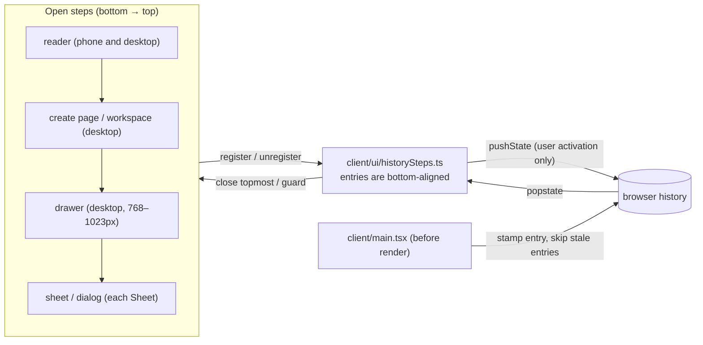

# Phone navigation: back behavior and sheet depth

Requirement: [req-phone-navigation.md](../../../../reqs/2026/11/05/req-phone-navigation.md)
E2E spec: [test-phone-navigation.md](../../../../tests/test-phone-navigation.md)

Git base: `aa5c846` on `main`, which follows the responsive redesign (confirmed at SS start).

Risk: non-low. The browser history model is shared by every view at every tier, the change is hard to see by inspection, and back, forward, reload and bfcache all interact. No protected boundary is crossed: no API, storage, URL scheme, CLI or skill change.

## Design

### Decisions

- **A step registry, not a second navigation state.** `client/ui/historySteps.ts` keeps an ordered stack of the open steps. Each step is registered by the thing that is already open, so the registry follows Reader's single state owner and never disagrees with it.
  - **`Sheet`** registers itself in its existing mount effect, and unregisters in that effect's cleanup. This covers every sheet and dialog, including those inside reused components: the setup's sub-sheets, 作品还未署名, rename, 署名与转载, and the provider dialog.
  - **`useHistoryStep(active, close)`** (in the same module) registers the non-dialog steps:
    - the reader, while `story` is set, on both trees;
    - the desktop create page (`view.kind==='create'`) and workspace (`view.kind==='workspace'`);
    - the drawers, only in drawer form: library details (`drawerForm && open`), workspace preview (`drawerForm && previewOpen`) and reader side panel (`drawerForm && panel`).

    Docked panels are not steps, as the REQ defines.
  - **Each step gives three things:**
    - `close()`, today's close for it: Sheet `onClose`, `home()`, `closeCreate()`, `leaveWorkspace()` or the drawer's close;
    - `busy()`;
    - `dirty()`.
  - **Order is by rank, then top-layer order.** Ranks: reader (0), create page or workspace (1), drawer (2), sheet or dialog (3). The order is computed when a back press is handled, not at registration.
    - **Dialogs** are ordered by the browser's top layer: the registry exports `raised(dialog)`, called at every `showModal()` site (the `Sheet` mount, its nested re-raise, and Reader's rAF re-raise of shared dialogs). Each call gives the dialog the next raise number, and the highest number is topmost. This is the order the user sees, so a nested sheet sits above its parent, and rename stays above 故事设置 when 故事设置 remounts across the layout switch and the re-raise lifts rename again.
    - **Non-dialog steps** of the same rank (only drawers can coexist) fall back to registration order.
    - **Why not registration order:** React runs child effects before parent effects, and Reader-level steps register after every child `Sheet`. Remounted sheets also register after a dialog that survived the switch. Registration order would put the wrong step on top in both cases.
- **Base steps, owners and riders.** Each history entry the app owns carries `state = {shiqu:1, load, depth}`. `depth` is absolute: it counts app entries above the app's first entry, so a depth difference is an index difference. Each load also records `baseDepth`: 0 for a direct link, or the entry's own depth after a reload.
  - **Base steps.** A step that registers before the load's first user input (`pointerdown`, `click` or `keydown`, seen by a capture listener on `window`), with no pending entry to adopt, while every step below it is also a base step, is a *base step*. This covers the reader opened by `/read?id=…` or by a reload, and the provider dialog opened by a direct `/#provider-settings`. After the first input, no new step becomes a base step.
    - Base steps own no entry, and back never closes them. Back from the base entry leaves the app, as the REQ's direct-link and reload criteria require.
    - In-app controls still close them, with no entry released.
  - **Owners.** Every other step, counted from the bottom, owns one entry above `baseDepth`. The invariant is: owners = `depth - baseDepth`.
  - **Riders.** Steps above the owners have no entry of their own. They come from opens without a gesture, from reflow, or from a remount.
- **Opening a step:**
  1. **Adopt first.** A step that opens while an entry is pending release adopts it, whatever the gesture state.
     - **Why:** M0 showed `navigator.userActivation.isActive` stays true for at least 6s after a click. A push-first rule would push over a released entry on the 替换选题 hide-and-show or the create→workflow swap, and leave a dead press later.
  2. **Push when there has been input since the last push.** With nothing to adopt, the step pushes one entry if the capture listener saw user input after the registry's last `pushState`. `pushState` adds one entry, so `depth` goes up by 1.
     - **Why this rule:** it is the rule Chrome uses to mark entries skippable (an entry is kept when there was activation between pushes), so no pushed entry is ever skipped. It also covers late async opens after a click, such as 作品还未署名 appearing after `reader/publication-defaults` returns, so they own an entry and back closes them in the app.
     - **Why not `userActivation`:** M0 showed it stays true for several seconds, and it cannot tell whether a push already used the input.
     - **URLs:** before pushing, the current entry's URL is restored to the one recorded for it. `open()` already used `replaceState` to put `/read?id=…` on the current entry, and that URL moves to the new entry. The entry underneath keeps its own URL (`/`).
  3. **Otherwise** (no input since the last push: a second step from one click, reflow, remounts) the step is a rider, or a base step under the rule above. This is the REQ's "reuse or replace, never push without a gesture".
- **Close by an in-app control** (close buttons, scrim, Escape, saves, `home()`, `backToShelf`, `exitToShell`, version switch, delete): the step's entry becomes *pending release*.
  - The registry settles in a microtask queued on the first registry change of a React commit. React flushes a commit's passive effects in one task, so every unregister and register of that commit, including StrictMode's double run, is seen first. Then `history.go(-n)` releases the entries no open step needs.
    - This depends on steps registering in passive effects (`useEffect`). A comment in `historySteps.ts` records it, because a `useLayoutEffect` registration would split one commit across two settles.
  - Adoption therefore happens only within the same commit, and no timer races a real back press.
  - **Example:** a creation submit closes the create sheet and opens the workflow panel. `generate()` sets `workflowTarget` in the same update as `closeCreate()`, so both happen in one commit and the panel adopts the sheet's entry.
  - Opens in a later commit become riders.
- **The registry ignores its own `go` / `back` traversals.** It records the expected landing depth. A `popstate` that lands there is dropped. One that lands elsewhere (a real press arrived during the traversal) is handled as a real press for the difference between the expected and actual depth.
- **Existing `replaceState` calls keep the stamp.** `open()`, `home()`, `closeWorkflow` and the provider close pass `null` as the state today, which would wipe it; 从头再看, for example, calls `open()` on the reader's own entry. M1 changes them to pass `history.state`, so only the URL changes.
- **Back (`popstate` to a lower depth within the live `load`):**
  1. **Busy step:** if the topmost non-base step is busy, the registry runs `history.go(1)` to restore the entry and keeps everything open. The sheet's existing busy guard already blocks closing.
  2. **Unsaved typed input:** if that step is dirty, the registry asks with `window.confirm('放弃未保存的输入？')`. This is not a sheet, so it doesn't count toward the depth limit.
     - **Keep:** `go(1)` restores the entry, and nothing changes.
     - **Discard:** continue with step 3.
  3. **Close:** the registry calls `close()` on the topmost step only.
  4. **Restore if needed:** if more non-base steps are still open than owned entries, because the closed step was a rider, `go(1)` restores the entry that the step below still owns. That way no step is ever skipped and back is never dead.
- **Forward (`popstate` to a higher depth)**, onto a live or a stale entry, goes straight back with `history.go(-delta)`. Nothing reopens, nothing closes and no work starts.
- **A `popstate` with null state while the hash is `#provider-settings`** is the hash navigation itself. The `hashchange` path handles it (see below), not the back/forward logic.
- **Back from the base onto a stale entry** (its `load` differs from the live `load`). M0 showed Chromium returns to pre-reload entries in the same document.
  - Nothing below the base closes. The busy and dirty guards of the base's topmost step apply first: busy or keep restores with `go(1)`.
  - **Leaving:** if an earlier entry exists (`navigation.currentEntry.index >= stale.depth + 1`, or, without the Navigation API, `history.length > stale.depth + 1` as a best effort), `history.go(-(stale.depth+1))` leaves the app in one press. Without the Navigation API (where `history.length` is only a best effort), if the page is still here 1s later and no `pagehide` or `visibilitychange` has fired, the skip went nowhere, and the next rule applies. With the Navigation API the index check is exact, so there is no timer and a slow previous page can't be mistaken for a failed skip.
  - **Nothing before the app** (it opened as the tab's first page): the open steps close through their normal close paths, then `history.go(-stale.depth)` (a self-traversal) moves to the app's first entry. That entry is restamped as the live base at `/` (`replaceState`, depth 0, `baseDepth` 0), and the start view shows.
    - No stale entry remains below, so a further back is the browser's own first-entry behavior, and stale entries above only bounce forward presses. No press is dead.
- **Back delivered as `cancel` (Chrome Android, Escape).** Chrome Android gives the back gesture to an open modal dialog as `cancel`, not `popstate`, so `Sheet`'s `cancel` handler runs the same guards:
  - **Busy:** the sheet stays open, as today.
  - **Unsaved typed input:** `window.confirm('放弃未保存的输入？')`. Keep leaves everything as it was; discard calls `onClose()`, which releases the entry.
  - **Otherwise:** `onClose()`, as today.
  - **Escape on desktop** goes through the same handler, so it asks too. This is a deliberate small change: Escape is not a close button, and losing typed input to a stray Escape is the failure the REQ is about.
- **Force-closed dialogs (Chrome's close watcher).** Chrome can force-close a modal dialog on a second back press even after `cancel` was prevented, which leaves the app state and the scroll lock open. `Sheet` handles the dialog's `close` event: if the close did not come from its own cleanup, it re-opens the dialog with `showModal()` when it is busy or has unsaved input, and in the unsaved case then asks as above. Otherwise it calls `onClose()`. App state, the `dialog[open]` state and the scroll lock stay consistent, and a forced close never discards input without asking.
- **Typed input** is marked in the DOM, so the registry asks the step instead of keeping a second copy of form state. The form root gets `data-dirty="true"` while its input differs from what it was opened with. `Sheet.dirty()` checks `dialog.querySelector('[data-dirty=true]')`.
  - **Covered forms:**
    - `StoryDiscoveryForm` (creation sheet and create page): draft and custom theme against the initial selection;
    - `StoryExtractionSearch`: draft against `title`;
    - `StoryTitleEditor`: the title against the saved title;
    - `StoryPublicationEditor` and its defaults form: fields against the loaded values;
    - `ProviderSettings`: the key or model fields against the saved settings.
  - **Excluded:** revision drafts, which already survive closing, and the setup editor, which saves on close. Neither gets the mark.
  - **The desktop create page** is not a Sheet, so its `useHistoryStep` passes `dirty` as `!!document.querySelector('.yu-create-form [data-dirty=true]')`.
- **Page loads** are decided in `client/main.tsx` before the app renders or loads data, by an exported pure function in `historySteps.ts`:
  - **Every document** gets a new `load` id. `sessionStorage['shiqu-history']` holds the live `{load, depth, baseDepth}`, which the registry updates on every change.
  - **Entry with no shiqu state** (a direct link, typed URL, QR code, console or first visit): `replaceState({shiqu:1, load, depth:0})`, `baseDepth` 0. The URL opens what it opens today, as the base.
  - **Reload** (`performance` navigation type `reload`): the current entry is restamped with the new `load`, keeping its absolute `depth`, and `baseDepth` = that depth. The URL opens what it opens today, as the base.
  - **`back_forward` load of an entry from another `load`** (a stale entry, when the browser did start a new document):
    - **Direction:** the Navigation API (`navigation.activation`), where available, compares the from-index with the current index. Otherwise the stale entry's `depth` is compared with the live `depth` from `sessionStorage`: lower or equal means back.
    - **Back:** if an earlier entry exists (as above), `history.go(-(depth+1))` before rendering anything. This leaves the app in one press: nothing is rendered, no data is loaded, no reading event is recorded and nothing is resumed. A brief blank flash is accepted. If nothing comes before the app, or (without the Navigation API) the page is still here 2s after the skip with no `pagehide` or `visibilitychange`, the same first-entry rule applies: `history.go(-depth)`, restamp depth 0 at `/` with `baseDepth` 0, and render the start view.
    - **Forward:** `replaceState({shiqu:1, load, depth}, '', '/')` with `baseDepth` = depth, then the app renders the normal start view at `/`.
  - **Known limitation, no Navigation API (Safari):** a forward press back into the app's first entry, after leaving it with back, is indistinguishable from back and is treated as back. It leaves the app.
  - **bfcache restore** (`pageshow` with `persisted`): the document and its registry are intact. If the restored entry's state is stale (another `load`), the start-view restamp above applies; otherwise nothing to do.
- **Hash-opened provider dialog.**
  - **Hash applied while the app is open:** the `hashchange` (and the null-state `popstate` that can precede it) creates an entry with no shiqu state. The registry stamps it in place with depth+1 (`replaceState`, keeping the hash) and offers it as a pending entry, so the provider `Sheet` adopts it instead of pushing.
  - **Closing by the button:** the entry is released with `history.back()`, which removes the hash. `ProviderSettings`' own hash strip runs only when the dialog is a base step, which is the directly loaded `/#provider-settings` case, and passes `history.state`. That keeps today's stay-in-app close.
- **The reader** is a step on every tier: opened from 发现 or 书架 with a gesture, it pushes. 从头再看 keeps the same step (`story` stays set).
  - **List scroll:** Reader records `scrollY` when opening a story from a tab view. After `home()` returns to that tab, it restores the position in a layout effect. `backToShelf` keeps its explicit scroll to the top.
- **Resize and reflow** need no special code:
  - Remounted sheets unregister and re-register in the same commit, so they adopt their own pending entries. The re-raise then restores the visible order, and the raise-number ordering follows it, so a surviving dialog such as rename stays topmost.
  - A drawer that becomes docked unregisters, and its entry is released.
  - A docked reader panel that becomes a drawer registers without a gesture, as a rider on top, so the first back closes it and step 4 restores the reader's entry.
  - Because ownership is bottom-aligned, a rider is never below an owner.
- **Sheet depth on phones (two at most):**
  - **分镜剧本's 修改分镜** closes 分镜剧本 before opening 修改故事 (`setScript(false); revision.open('script')`) in one update, so 修改故事 adopts 分镜剧本's entry and the stack is 故事设置 → 修改故事. The same applies to `StoryReviewTools`' edit-from-script path when 分镜剧本 is open.
  - **替换选题:** while `reselectTarget` is set, the phone panel (故事设置) is not rendered. 替换选题 is the base sheet, and its setup sub-sheets are the second level. Hiding 故事设置 and showing 替换选题 happen in one commit, so 替换选题 adopts 故事设置's entry; cancelling swaps back the same way. `StoryReselection` keeps its key and its single server-side reselection session, and the panel's remount does not touch it.
  - **Return labels:** when a `Sheet` opens while another sheet is open, its header shows `返回「<that sheet's title>」`, read from the ordered registry stack at mount. Closing it by button or by back returns there.
  - **The provider dialog opened by hash** over existing sheets is the REQ's stated exception.
- **StrictMode:** register, unregister and register again within one commit settle in one microtask with the entry adopted and no history change. Behavior matches production.

## Tasks

### M0: probe (no product change)
- [x] In headless Chromium (Playwright), confirm the facts the design depends on, and record the results here:
  - `navigator.userActivation.isActive` is true inside a React effect that runs right after a click;
  - `page.goBack()` / `goForward()` produce `popstate` with the stamped state;
  - after `page.reload()`, going back to an earlier entry triggers a full `back_forward` document load with the old state;
  - `navigation.activation` is available in Chromium.

  **If activation is false in effects**, the push moves into a `pointerdown`/`click` capture listener that marks a gesture window. Update the plan before M1.
  - **Result (Chromium, headless):**
    - `navigator.userActivation.isActive` is true after a click in a `MessageChannel` task (React's passive effects), in `setTimeout(0)` and in `requestAnimationFrame`. It still read true after 6s of no input, so it cannot tell a click's open from a late async open. The design therefore adopts before pushing and pushes only when its own capture listener saw input since the last push (see Decisions).
    - `goBack` / `goForward` deliver `popstate` with the stamped state.
    - `navigation.activation` exists.
  - **Finding that changes the design:** after `reload()`, going back to an entry pushed before the reload is a same-document traversal in Chromium. A `window` marker survived, the navigation type stayed `reload`, and `popstate` delivered the old state, so no fresh load happened.
    - Stale entries are therefore recognized in two places:
      1. **in `popstate`:** a state whose `load` differs from the live `load` is stale. Back from the base leaves the app, or shows the start view when nothing comes before the app. Forward onto a stale entry bounces back like any forward. See Decisions;
      2. **at page load in `main.tsx`:** for true fresh loads, such as returning from another site without the bfcache, or browsers that do reload the document.
    - In both cases no data loads and no step opens for the stale entry.
  - **E2E note:** the fixture's init script cannot run on an explicitly navigated `about:blank`. The E2E uses the context's initial blank entry as the "left the app" target instead, except 7b, which needs the app as the page's first entry.

### M1: history registry and fresh-load handling
- [x] Add `client/ui/historySteps.ts`: the registry with rank and raise-number ordering, `raised()`, `useHistoryStep`, the input-since-last-push rule, entry stamping, base pinning (`baseDepth`), the popstate handling (back, forward, guards, restore, stale back with the earlier-entry check), microtask settling of pending releases, self-traversal suppression, and `sessionStorage` live state. Add unit tests (`tests/history-steps.test.mjs`, with a fake `history`/`window`/`navigation`) for:
  - push after input, rider for a second open from the same input, adopt before push, a late async open after input pushing;
  - base pinning after a direct link and after a reload, and no base step after the first input;
  - ordering when a child sheet registers before the reader in one commit, and when remounted sheets re-register below a surviving re-raised dialog;
  - a real press arriving during the registry's own traversal;
  - back closing only the topmost step, restore after a rider, busy and dirty guards;
  - forward bouncing back, onto both live and stale entries;
  - stale back with an earlier entry, without one (move to the first entry, restamp, start view), and with a skip that goes nowhere (400ms fallback);
  - batch release after `exitToShell`, and StrictMode re-registration settling in one microtask.
- [x] Add the page-load decision to `client/main.tsx`, as an exported pure function in `historySteps.ts` that is unit-tested: base, reload, stale back, stale back with nothing earlier, stale forward, and bfcache restore of a live and a stale entry.
- [x] Change the `replaceState(null, …)` calls in `open()`, `home()`, `closeWorkflow` and the provider close to pass `history.state`.
- [x] Register `Sheet` (busy, dirty, `onClose`), and call `raised()` at every `showModal()` site, including Reader's re-raise. Add the `cancel`-path guard (busy, dirty → confirm) and the close-event repair that re-opens busy or dirty dialogs.
- [x] Register the reader, desktop create page, workspace and the three drawers with `useHistoryStep`. In `generate()`, set `workflowTarget` alongside `closeCreate()`.
- [x] Add list-scroll restore when returning from the reader.
- [x] Add the provider hash adoption, and limit `ProviderSettings`' `replaceState` strip to the base case.
- [x] Also changed: the three `replaceState(null, …)` calls in `useStoryGeneration` pass `history.state`.
- **SS discoveries (M1):**
  - `navigation.currentEntry.index` and `navigation.entries()` list same-origin entries only. The earlier-entry check is therefore three-way: a same-origin entry before the app's first entry → leave; cross-origin entries in history (position unknown) → try leaving with the fallback timer; all entries are the app's → start view. Unit-tested with a fake that hides foreign entries.
  - The browser's own scroll restoration on traversal overwrote the restored list position. `boot()` sets `history.scrollRestoration='manual'`.
  - E2E: the fixture's init script throws on any `about:blank`, including the context's initial page when back returns to it. The E2E leaves to a static page on another origin instead. For 7b, `newPage()` keeps its blank entry, so the case opens the app with `window.open`, where the app is the tab's first entry (`history.length===1`).
- [x] Commit: `75f69db`. Verified: history-steps unit tests 21/21, reader UI contract tests, E2E PHONE-NAV-01/02/03, 06, 07, 07a and 07b, typecheck, lint.

### M2: typed-input marks and sheet depth
- [x] Add the `data-dirty` marks to the five forms listed in the Decisions.
- [x] Apply the sheet-depth changes (修改分镜, 替换选题) and the `Sheet` return label.
- [x] Add render tests (`tests/history-dirty-ui.test.mjs`): `data-dirty` appears only after input changes, for the creation form, title search, rename and the publication editor.
  - The return label and 分镜剧本 closing on 修改分镜 depend on `Sheet`'s mount effect and Reader's state, which the hook-mocked render tests cannot run. E2E 9 covers them instead.
- **SS discoveries (M2):**
  - The creation form is a fragment, so its mark is a hidden `` rather than an attribute on a form root. Book and theme choices count as changes, as the REQ's "text or choices" says.
  - `editScript()` in Reader closes 分镜剧本 and opens 修改故事 in one update, for both the 分镜剧本 button and the review tools' 手动修改.
  - In today's flow, choosing a candidate inside 替换选题 submits the replacement, so no setup sub-sheet can open there; E2E 9 checks the swap and back counts, and case 11 covers a nested setup sub-sheet.
  - In development, StrictMode re-runs `StoryReselection`'s open effect with the same `requestId`; E2E 9 counts unique request ids.
- [x] Commit: `281cc62`. Verified: render tests 3/3, UI contract tests, E2E PHONE-NAV-04, 05, 08, 09, 10 and 11, typecheck, lint.

### M3: E2E and verification
- [x] Write `tests/phone-navigation.playwright.e2e.mjs` following the spec, and register it in `tests/manifest.json` (gate `user-flows`).
- [x] Run it, the responsive and readability E2Es, `story-lifecycle`, `pnpm test`, `pnpm typecheck` and `pnpm lint`.
  - Results: PHONE-NAV 11/11; DESKTOP-LAYOUT 13/13; PHONE-READABILITY 2/2; STORY-LIFECYCLE 10/10 (C005 timed out once under 4× concurrency and passed alone); `pnpm test` 692/692; typecheck and lint clean. Commits `9ef9db8` and `dfd10ce`.
- [x] Check in the in-app browser at 390px with isolated data: open and close sheets with the browser back button, and reload with a sheet open.
  - Result (375×812, empty isolated library, read-only provider): the entry is stamped at load; 署名与转载 pushes depth 1 and back closes it and releases the scroll lock; with 阅读偏好 open, a reload makes depth 1 the base, and back, with the app as the pane's first page, restamps depth 0 at `/` and shows 我的 with no blank page.
- [x] Record what could not be verified here: real iOS Safari edge swipes and the Chrome Android back gesture or close watcher. The REQ asks for those devices, and they are not available.
  - **Not verified on devices:** iOS Safari (no Navigation API: the `history.length` best-effort check, the forward-into-first-entry ambiguity, the edge-swipe jump with a prompt) and Chrome Android (back delivered as `cancel` and the close watcher's forced close). Headless Chromium covers the same code paths: `cancel` by Escape, the forced close by `dialog.close()`, and `popstate` by `goBack`.
- **SS discovery (M3):** a shared dialog that survives a layout switch kept the return label it computed at mount, so rename opened at a desktop tier showed no label at the phone tier. `raised()` now dispatches `shiqu-raised` on the dialog, and `Sheet` recomputes its label on every raise. E2E 11 checks the label after 390 → 900 → 390.

Every new or changed source file gets or updates its header comment, in Chinese.

## Risks

- **Chrome Android close watcher and history.** On real devices, the back gesture may cancel the dialog without a traversal, or traverse as well. The `Sheet` cancel guard, the close-event repair and the registry's in-app release handle the first case. The second case is not testable here. Recorded as unverified.
- **Input-since-last-push.** An open that follows unrelated input (for example a scroll by keyboard, then a background result opens a sheet) pushes an entry. Back closes it in the app, so no press is dead; the cost is at most one entry the user didn't directly ask for.
- **Safari without the Navigation API:** the forward-into-first-entry ambiguity, and `history.length` as a best-effort earlier-entry check (it counts forward entries too). The fallback timer (1s in `popstate`, 2s at page load, cancelled by `pagehide` or `visibilitychange`) covers a skip that goes nowhere. On a very slow exit it can still fire first, so the user lands on the start view and needs a second press.
- **iOS Safari edge swipe with unsaved input:** by the time `popstate` arrives, the swipe animation has already shown the page underneath, so choosing keep visibly jumps forward. Cosmetic and unverified.
- **Leaving from a direct-link base** is a real document exit with no `popstate`, so the typed-input prompt cannot run there. This is today's behavior and outside the registry.

## Review and verification notes

- **CR round 1:** passed, no major findings. Non-blocking items taken:
  - the rider restore after a back now runs in `settle()`, after the commit's knock-on unregisters, so closing several steps at once makes no extra traversals;
  - the fallback timers are longer (1s in `popstate`, 2s at page load), so a slow cross-document exit is less likely to be mistaken for a skip that went nowhere;
  - the provider close strips `#provider-settings` unless the hash itself created the current entry (`hashEntry()`), instead of using `atBase()`;
  - the creation form's opened snapshot is retained with its draft, so a book changed before a layout switch still counts as unsaved.
- **CR round 2 (delta, `9ef9db8`):** passed, no major findings. Taken:
  - `restoreDue` accumulates across back presses that arrive before one commit;
  - a self-traversal that never lands is abandoned after 1s, so settling cannot stall;
  - `hashDepth` clears once history drops below it, and a release drops a stale `#provider-settings` landing hash unless that entry is the hash's own;
  - unit cases cover a cascade close (no restore and release pair) and two quick back presses. 24/24 pass; all 11 PHONE-NAV E2Es pass.
- **Accepted limits:**
  - a real press that lands elsewhere during the start-view restart traversal skips the restamp (rare race);
  - `history.scrollRestoration='manual'` means a reload of a scrolled list starts at the top;
  - a return label is recomputed when its own dialog is raised, not when the sheet below closes.
- **E2E regressions found and fixed:**
  - DESKTOP-LAYOUT-02: releasing several entries landed on the base entry with its old `/read?id=` URL. Releases now carry the app's current path and query onto the landing entry, keeping that entry's hash. Unit-tested.
  - STORY-LIFECYCLE-C002 and PHONE-READABILITY closed 分镜剧本 after 修改分镜; it now closes by design (REQ sheet depth), so they assert that it is gone.
