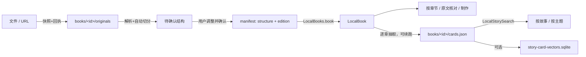

# 自备书籍导入为本地书 · 实现计划

需求见 [req-custom-book-import](../../../../reqs/2026/11/13/req-custom-book-import.md)，验收用例见 [test-custom-book-import](../../../../tests/test-custom-book-import.md)。Git 基点在 SS 开始时记录。

## 目标与边界

导入书在加载后得到与内置书相同的 `LocalBook`（章节、段落、版次、整书输入）。之后的目录、原文核对、按章节提取、故事卡检索、向量建库和制作全部走现有生产实现。新增代码只做四件事：导入快照、确定结构、生成并保存故事卡、管理导入书目录。

## 关键决定

1. **存储：放在书库目录下的文件里，不改数据库结构。** 每本书一个目录 `<书库>/books/<bookId>/`，内容如下：
   - `originals/001.<ext>`…：原始字节，权限 0600，只写一次。
   - `manifest.json`（`version:1`，zod 校验）：书名、作者、年代、来源说明、授权说明、版权确认时间；每个原件的 `{file,sha256,size,originalName|sourceUrl,contentType,encoding,fetchedAt}`；另有 `snapshotHash`、`parserVersion`、`structure`（章节起点、标题、排除标记）、`structureHash`、`edition`、`status`（`structuring|ready`）和质量标记摘要。
   - `cards.json`：沿用内置故事卡的 `storyCardsSchema`（`version:1,bookId,edition,cards`）。
   - `card-progress.json`：每章状态（`done|failed|pending`）和失败原因、生成器身份（提供方、模型、提示版本）、累计调用次数和令牌数，以及本书生成任务写入的抽取缓存键。

   暂存目录 `.book-import-<随机>` 和待删目录 `.book-delete-<id>` 放在**书库根目录**，不放在 `books/` 里面。原因是 `server/library-backup.ts` 的 `runtimeFile` 只在顶层排除文件。备份会递归包含 `books/`，升级不会改动它。`shiqu.sqlite` 不变，所以不需要 `drizzle/` 迁移，也不改 `db/library-format.json`。旧版应用会忽略 `books/`；用导入书做的故事已经保存了原文，旧版仍能阅读。
   *备选：* 新建 `imported_books` 表。好处是有事务，代价是要写迁移、准备回滚备份并更新 `latestMigration`。原文无论如何都得存成文件，所以不采用。

2. **书目 ID 与选择。** 导入书 ID 为 `my-` 加 16 位随机十六进制。新建故事时写入 `selection.bookId=<id>` 和 `customBook=<书名快照>`，服务端用书目里的书名覆盖 `customBook`。在 `lib/reader-books.ts` 新增 `isImportedBookId()` 和 `selectionBookTitle()`。需要改的调用点分两类：
   - **显示和提示词位置**改用 `selectionBookTitle()`：`lib/reader-gemini.ts:56`、`lib/reader-engine.ts:65`、`lib/reader-generation-contract.ts:46`、`lib/reader-source.ts:29`、`lib/reader-png.ts:22`、`server/local-story-discovery.ts:243`、`server/reader-intake.ts:38`（要求有书名）、`client/ui/Reader.tsx` 的 `bookName`、`client/ui/StoryExtractionContext.tsx`、`client/ui/StoryReselection.tsx`（书已删除时给出提示）。
   - **身份键位置保持不变**：`lib/reader-source-storage.ts:14`、`lib/reader-suggestions.ts:25`、`server/book-image-reference.ts:18`。导入书 ID 本身唯一，即使导入书与内置书同名，也不会共用缓存或参考图。

   `bookId:'other'` 的语义保持不变。

3. **加载与失败即关闭。** 新模块 `server/imported-books.ts` 管理 `books/`：列出、读取并校验清单，提供清单 stamp。`LocalBooks` 的改动如下：
   - 增加书库目录参数。
   - `localBookId()` 只要看到 `isImportedBookId()` 格式的 ID 就交给导入书目解析，**即使书不存在也不返回 `undefined`**。书已删除或不可用时，抛出 404 或 503（「这本书已删除或不可用」），避免 `server/local-generation.ts` 回退到模型或网页的未核对原文。
   - 导入书的缓存键由 `id + 清单 stamp` 组成，加载失败的 Promise 不缓存。确认结构、替换和删除时，主动清除该书的缓存，并通知 `LocalStorySearch` 清除它的卡片缓存。
   - 加载时的校验与内置书相同：`realpath` 必须在书目录内，逐个核对原件的 SHA-256，用清单记录的 `parserVersion` 和结构重新解析，得到的版次必须等于 `manifest.edition`。
   - 按文件导入的书，`LocalBook.url` 设为 `local-import:<bookId>`，`provider` 设为「用户导入 · 原文件名」；按 URL 导入的书，取第一个 URL 和其主机名。这样 `reader-source-storage.ts` 和 `StorySource.tsx` 不会拿到空值。

   所有汇总列表都**逐书捕获错误**，不让一本坏书拖垮整页，出错的书单独标为不可用。涉及的位置有：`semanticIndexBooks()`（`local-books.ts:74` 的 `Promise.all`）、嵌入设置 `lib/reader-api.ts:106-111`（含 `catalog`）、导入书目和内容 API。

4. **解析与结构（`server/book-import-parse.ts`，纯函数）。**
   - **解码。** 先用 UTF-8 严格解码（`fatal:true`），失败后依次试 GB18030 和 Big5。两种都能解出且可读汉字比例相近时，报「无法判断编码」，让用户指定。
   - **正文块。** TXT 按行；HTML 用 `htmlparser2` 取 `body`，跳过 `script/style/nav/header/footer`。EPUB 用 `fflate` 解析，限制如下：
     - 解压前读取中央目录，按 `originalSize` 判断，总解压量不超过 64 MB，条目不超过 2,000 个，单条压缩比不超过 100，OPF/XHTML 单个不超过 8 MB；
     - `originalSize` 来自文件本身，不可信，所以解压时还要累计实际输出的字节数，一超出上限就中止；
     - 归一化包内 href，拒绝 `..`、绝对路径和反斜杠；
     - 含 `META-INF/encryption.xml` 或 `rights.xml` 的视为 DRM，拒绝导入。
   - **自动切分。** EPUB 按 spine 和导航目录切；HTML 按 `h1–h3` 切；TXT 用通用标题规则（`第…[回章卷节篇]`、`卷…`，参照 `additionalBookSpecs`）。都没切出章节时，按约 8,000 字一段切成「第 N 部分」。
   - **段落。** 复用 `localLines()`，每段用 `hasSourceAnomaly()` 设置 `unreadable` 标记。另外标出空章节、过短章节和缺文标记。
   - **编号。** 章节 ID 为 `<prefix>-NNN`（prefix 取书 ID 后 8 位），段落 ID 为 `<sectionId>-NNNN`。`edition = sha256(snapshotHash, parserVersion, structureHash)`。解析器行为一旦变化就升级 `parserVersion`，旧版本保持可读，这是接受的维护成本。
   - **结构编辑**只记录「起点块序号、标题、排除」，正文始终从快照重新解析。
   - **适用范围。** 现有的原文质量和范围规则（`local-source-quality.ts`、`local-source-ranges.ts:39` 要求中文标点）面向中文古典文本。无标点、混有假名、希腊或西里尔字母的文本会被标记，按章节提取和故事卡生成可能失败。确认页需要预先告知，任务 0 也要测量这一点。

5. **上传与 URL 抓取。**
   - **上传。** `server/http.ts` 在路由前缓冲请求体，上限 13 MiB。因此**每次请求只传一个文件，单文件不超过 12 MB**。先建导入草稿，再逐个追加原件，不改 `http.ts`。上传路由单独读取原始字节，不经过 4 KB 的 `body()`。
   - **URL 抓取（`server/book-import-fetch.ts`）。**
     - 只允许 `http/https`。
     - 用 `node:https/http` 的 `lookup` 钩子做解析，拒绝回环、私网、链路本地、CGNAT、组播、IPv4 映射的 IPv6 和 `host.docker.internal`；连接时固定使用检查过的 IP，并设置 `servername`，防止 DNS 重绑定。
     - 最多手动跟随 5 次重定向，每一跳都重新检查。
     - 单页上限 12 MB，超时 30 秒，只接受 HTML、纯文本和 EPUB。
     - User-Agent 用通用名称。
   - **远程访问。** 导入和故事卡生成与故事制作一样，对已授权的局域网或远程访问开放。地址检查在服务端完成，与请求从哪里发起无关。

6. **故事卡生成：复用生产抽取，不另建管线。** 运行器 `server/imported-book-cards.ts` 对每个未完成章节执行以下步骤：
   1. 构造 `selection={bookId,customBook:书名,theme:'原典故事',discovery:{mode:'auto'},discoverySources:[整章范围]}`。整章范围从 `indexBookContents(book,true).entries` 中取，因为 `selectedChapterScope()` 只接受目录索引里的键。主题只用于满足 schema，在这种模式下不参与抽取。
   2. **先调用 `selectedChapterScope()` 收窄到本章**，与 `local-generation.ts:49-50` 的生产路径一致，避免每章都读整本书。
   3. 在收窄后的书上调用 `discoverLocalStories()`，走 selectedSourceMode 的主题无关抽取，不走「主故事优先」的 `chapterStories`。
   4. 把已得到的出处累积进 `excludedSources` 后循环调用，直到返回空批次，空批次表示本章读完。
   5. 每张卡的 `title/description/source` 取自抽取结果，`description` 作为梗概，别名先留空。完成一章就原子替换 `cards.json`。

   中间结果已由 `StoryDiscoveryCache` 按版次和模型命名空间缓存（`story-reading-inputs.ts:45`），所以取消或重启后不会重复付费。运行器把写入的缓存键记在 `card-progress.json` 里，删除书时一并删除；为此要给 `StoryDiscoveryCache` 增加 `remove(key)`，同时给 `MediaStore`（`lib/services.ts`）增加 `delete`，并在文件存储中实现。
   - **跨章故事。** 按章抽取时，跨到下一章的未完成事件会被丢弃，章回体书受影响较大。任务 0 要测量丢失比例，丢失明显时改为以相邻两章为范围再按出处去重，并更新本计划。
   - **调度。** 整个书库同一时间只运行一个故事卡任务，用 `AbortController` 取消，进度通过事件流推送（同 `embedding-index`）。进程退出后，下次读取时显示「已暂停」，不会自动续跑。
   - **预估。** 输入令牌按每章收窄后的整书输入，用 `readingTokens()` 累加；调用次数按 `defaultReadingLimits` 的块大小估算；耗时用 `story-discovery-metrics` 的历史中位数，没有数据时用默认值。只有提供方设置里有单价时才显示费用。
   - *备选：* 把 `scripts/experiment-soushen-search.mjs` 的语义切分和梗概提示提炼为共享模块，供生产和脚本共用。卡片更接近内置卡，也有别名，但需要把 Ollama/Codex 调用改成走提供方，范围更大。是否改用由任务 0 判定。

7. **检索接入。** `LocalStorySearch` 增加资源钩子 `importedCards(book)`，读取 `books/<id>/cards.json`，与内置卡一样在运行时从原文构造检索文本。`indexableCards()`、`snapshotFor()` 和 `passages()` 都把导入卡当作内置卡处理。卡片缓存按「书对象 + 文件 stamp」失效，生成到一半也能搜到已完成的卡。`installStoryIndex()` 不接受导入书的外部索引。

8. **删除与重新导入。**
   - **删除。** 把书目录改名移到书库根目录下的 `.book-delete-<id>`，清除 `LocalBooks` 和检索缓存，调用新增的 `StoryCardEmbeddingStore.removeBook(id)`，删除运行器记录的抽取缓存键，最后递归删除目录。若中途崩溃，下次启动列目录时会清理残留的 `.book-delete-*`，以及超过 24 小时未完成的 `.book-import-*` 草稿。孤立向量的判定条件是：书的 ID 以 `my-` 开头，并且 `books/<id>` 目录已不存在。满足条件的向量才删除；书目录存在、只是加载或校验失败时，向量保留。
   - **进行中的任务。** 删除前先取消该书的故事卡任务。已在制作中的故事继续使用已保存的原文；重选或续找时明确报「书已删除」。
   - **重新导入。** 新快照在暂存目录中完成解析和校验，用户确认后整体替换。若 `snapshotHash` 不变且沿用原结构，版次不变，故事卡和向量继续有效；否则按新版次处理，并提示旧卡失效。

9. **「其他」旧路径（待决问题 1 的推荐方案）。** `reader-production.ts` 的保存任务搜索、`Reader.tsx` 的 `savedMaterials` 和 `StoryDiscoveryForm` 的外部结果都不改，已保存的 `other` 任务行为不变。新建故事时，「其他」芯片以「导入这本书」为主操作，「不导入，直接请模型推荐」为次操作；后者沿用现有路径，候选标注「未核对原文」。

10. **版权。**
    - 导入接口要求 `acceptRights:true`，并在清单中记录确认时间。
    - 导入书不进入 `data/library`、npm 包、官方资源或任何上传路径。
    - `story-export.ts` 的 `署名与转载.txt` 写入来源和授权说明，并注明「原文为用户导入」。
    - `pnpm export:story` 遇到没有授权说明的导入书故事时拒绝导出（待决问题 3）。

## 任务

- [ ] 0. **可行性探针（先做，有判定标准）。** 在隔离书库中用公版章回体测试文本（3 回）操作：
  - **假提供方。** 按决定 6 的方式调用。验证：
    - `selectedChapterScope` 收窄后，送给提供方的输入只含本章；
    - 循环在返回空批次时结束；
    - 全部出处都能定位。
  - **真实提供方。** 对其中一回（约 1 万字）试跑，记录卡片数、调用次数、耗时、跨回故事的丢失情况，以及含无标点段落时的失败情况。由维护者对照原文逐张判定。

  **判定：** 循环能读完本章、送入内容限于本章，且维护者认定至少 80% 的梗概说清了起因、行动和结果，就采用决定 6；否则改用备选方案，更新本计划并回到 AR。
- [ ] 1. `lib/reader-books.ts`：实现 `isImportedBookId` 和 `selectionBookTitle`，按决定 2 只替换显示和提示词位置。
- [ ] 2. `server/book-import-parse.ts`：解码、三种格式的正文块（含 EPUB 限制）、自动切分、结构应用、编号、质量标记、版次。
- [ ] 3. `server/book-import-fetch.ts`：按决定 5 实现安全抓取，返回原始字节和回执。
- [ ] 4. `server/imported-books.ts`：草稿创建与追加原件、清单、列出与读取、确认结构、替换、删除、启动时清理残留，所有写入原子完成，暂存目录放在书库根目录。`server/library-backup.ts` 的 `runtimeFile` 排除 `.book-import-` 和 `.book-delete-`。
- [ ] 5. `server/local-books.ts`：增加书库目录参数，导入书失败即关闭（决定 3），缓存键与清除，`semanticIndexBooks()` 包含导入书并逐书捕获错误。更新 `server/app.ts` 的构造。
- [ ] 6. `server/local-story-search.ts`：`importedCards` 钩子、按 stamp 失效的缓存、对外的缓存清除接口；`applicationStorySearch()` 接入；`installStoryIndex()` 拒绝导入书。`server/story-card-embeddings.ts`：增加 `removeBook()`。`server/story-discovery-cache.ts`：增加 `remove(key)`。`lib/services.ts` 的 `MediaStore` 和文件存储：增加 `delete`。
- [ ] 7. `server/imported-book-cards.ts`：预估、按决定 6 逐章生成、取消、暂停状态、失败章节重试、原子写入 `cards.json` 和 `card-progress.json`。
- [ ] 8. `lib/reader-api.ts`，沿用现有书库鉴权：
  - 新增路由：`GET books/imported`；`POST books/imports`（建草稿，可附 `{urls}`）；`POST books/imports/:id/files`（单文件原始字节，最大 12 MB）；`GET|PUT books/imported/:id/structure`；`POST …/confirm`；`GET …/cards/estimate`；`POST …/cards`（事件流）；`POST …/cards/cancel`；`POST …/replace`；`DELETE books/imported/:id`。
  - 修改：`embedding-index` 的白名单（`:126`）和嵌入设置的 `catalog`（`:111`）改为「内置书加已确认的导入书」；所有汇总列表逐书捕获错误。
- [ ] 9. 客户端：
  - 新增 `client/ui/BookImport.tsx`：来源、版权确认、结构检查与调整、故事卡预估与进度。
  - `Reader.tsx`：书目合并导入书并显示状态，`StoryCardSearch books=` 包含导入书（`:664,690`）。
  - `StoryDiscoveryForm.tsx`：把导入书当作本地书处理，「其他」芯片按决定 9 改。
  - `StoryEmbeddingSettings.tsx`：列出导入书。
  - 删除和重新导入前显示确认。
  - 在 `pnpm desktop:preview` 中走查桌面和手机宽度。
- [ ] 10. `server/story-export.ts` 和导出脚本：附来源与授权说明，并按待决问题 3 处理。
- [ ] 11. CLI（`server/headless-cli.ts`）：
  - **分派。** 把 `:103-104` 的 `books` 兜底分支改为只处理无动作或未知动作；`catalog`、`books` 的列表经应用 API 合并导入书。
  - **新增命令**，全部经 `createApplication`/`api()` 执行，先完成 `ensureLibraryReady()`：
    - `books imported`
    - `books import <文件|URL>... --title … [--author --era --source-note --license] --accept-rights`
    - `books structure <id> [--input <json>]`
    - `books confirm <id>`
    - `books cards <id> --estimate`
    - `books cards <id> [--retry-failed]`（前台运行，Ctrl-C 取消，可续跑）
    - `books index <id>`
    - `books reimport <id> <文件|URL>...`
    - `books remove <id> --yes`
  - **免初始化的搜索路径**（`:133-147` 的 `books search` 和 `index-import`）保持不打开书库，遇到导入书 ID 时报错，提示改用应用内搜索或先打开书库。
  - **同步**帮助、`skills/shiqu/SKILL.md` 和 `.docs/use-as-skill.md` 的示例。
- [ ] 12. 在 `tests/manifest.json` 登记测试，包括 `covers` 和 `tests/fixtures/imported-books/*` 的归属：
  - 新增：
    - `tests/book-import-parse.test.mjs`：编码（含 Big5 和编码难以判断的情况）、三种格式、DRM、EPUB 解压炸弹和越界路径、自动切分、结构调整、编号可复现、质量标记、版次。
    - `tests/book-import-fetch.test.mjs`：私网地址、重定向、DNS 重绑定、大小与超时、内容类型（模拟 DNS 和 fetch）。
    - `tests/imported-books.test.mjs`：创建、确认、加载、篡改与清单版本、删除后失败即关闭不回退网页原文、缓存失效、重新导入时版次保留与变化、残留清理、`LocalBooks.resolve/storyOriginal`。
    - `tests/imported-book-cards.test.mjs`：预估；假提供方逐章生成，确认只送入本章、空批次时结束；取消后续跑不重复调用；重启后显示暂停；失败重试；版次变化后旧卡失效；`LocalStorySearch` 的按故事和按主题检索；删除时清理缓存键。
    - `tests/imported-books-api.test.mjs`：路由、单文件上限、鉴权、事件流、一本坏书不影响汇总列表。
  - 扩展：
    - `tests/headless-cli.test.mjs`、`tests/cli-skill.test.mjs`；
    - `tests/story-card-embeddings.test.mjs`：`removeBook`；
    - `tests/story-discovery-cache.test.mjs`：`remove`；
    - `tests/local-story-search.test.mjs`；
    - `tests/library-maintenance.test.mjs`：备份恢复包含 `books/`，排除根目录的暂存目录；
    - 表单测试：导入书视为本地书，「其他」提供两种操作。
- [ ] 13. 验证：先执行 `nvm use`。迭代时运行 `pnpm test:related`；交付前运行 `pnpm test:changed`、`pnpm typecheck` 和 `pnpm lint`。在隔离书库中按验收用例经 CLI 和浏览器各走一遍。不碰用户的真实书库，不打包桌面应用。

## 风险

- **抽取质量与费用。** 主题无关抽取原本为交互查找设计，整本书使用时，长书的调用次数和费用较高。缓解措施：预估、用户确认、可取消可续跑、任务 0 的探针。
- **跨章故事。** 按章抽取会丢失跨章事件，由任务 0 测量并决定是否改为相邻章范围。
- **非古典文本。** 现有质量规则会拒绝部分现代或无标点文本，已作为适用范围写入需求。
- **解析器演进。** 由 `parserVersion` 固定，旧版本须长期保持可读。
- **交互查找的残留缓存。** 用户自己做按主题查找时留下的缓存（标题、梗概、出处，不含原文）不在运行器的记录中，删除书后无法再访问，但仍会进入备份。需求中已注明。
- **与制作队列争用提供方。** 库内同时只运行一个故事卡任务，失败章节可以单独重试。

## AR 记录

AR 判定为非低风险，原因是涉及持久化、网络抓取、对外 CLI 与技能、费用控制。由独立审阅者复核了两轮。第一轮有 8 项阻塞问题，均已修正：上传受 13 MiB 请求体上限约束；EPUB 缺少解压限制；`LocalBooks` 缓存不失效，书被删除后会回退到未核对原文；身份键被误改为书名；按章抽取未先收窄范围；`embedding-index` 和 CLI 的书目白名单被遗漏；一本坏书会拖垮汇总列表；CLI 绕过 `ensureLibraryReady`。第二轮复核通过，另有 5 项非阻塞建议，均已并入本计划：`MediaStore.delete`、孤立向量的判定、实际解压字节计数、章节范围来源、草稿清理。
