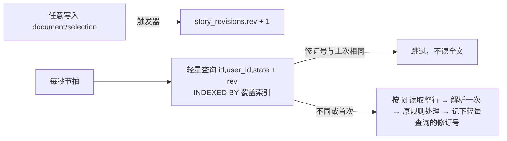

# 计划：制作调度节拍按内容修订号读取故事

需求：`.docs/reqs/2026/11/19/req-production-tick-content-rev.md`
Git 基线：`069dd93`

## 方案

- 修订号存放在独立小表 `story_revisions(story_id PRIMARY KEY, rev)`（WITHOUT ROWID），由触发器维护。任何代码路径的写入都会被发现，不依赖 `updated_at` 或调用方通知。
- `stories` 不加列：`SELECT *`、`SessionRow`、整行比较的测试均不变；写入大文档时触发器只改小表，不再重写整行故事。
- 覆盖索引 `stories_production_scan(id,user_id,state)` 让三处轻量查询不读取故事行（`state` 位于 `document` 之后）。三处查询均写 `INDEXED BY stories_production_scan`，避免规划器改用主键索引后回表；索引缺失时查询直接报错而非静默变慢。
- 已检查的修订号只保存在内存中，重启后首个节拍完整检查一次，保留崩溃恢复语义。

## 决策

- 独立小表而非 `stories` 新列（AR 第 1、2、8 条）：避免回表陷阱、`SELECT *` 多出列、触发器重写大行。
- 持久触发器而非临时触发器：不依赖应用只用一个 SQLite 连接。
- 更新触发器带 `WHEN NEW.document IS NOT OLD.document OR NEW.selection IS NOT OLD.selection`；插入触发器同样把修订号加 1，修订号只增不减，相同 id 删除后重新插入也不会与旧记录相同（AR 第 2 轮建议）。迁移前已有的故事没有修订行，按 0 处理；内存记录为空时首次一定完整检查。
- 记下的是轻量查询读到的修订号（早于整行读取）。两次读取之间若有写入，修订号已变，下个节拍会再次检查；不会把旧内容记为新修订。
- 完成检查只在结果为“不完整/不可读/不再符合条件”时记下修订号；判断为完整但标记未生效（`changes=0`）时不记，下个节拍重试。
- 按需求重建任务图的循环改为一次集合查询（`json_each` 传入需求中的故事 id），保留 `library_deletions` 过滤，删除的故事照旧退出 `seen`。实际书库中这部分每秒另读约 92 万字符。
- 不提升 `schemaVersion`：新增表、触发器和索引对旧版应用透明；插入使用显式列名。

## 任务

- [x] 新增 `drizzle/0022_story_content_revisions.sql`：`story_revisions` 表、`story_content_revision` 更新触发器、`story_content_revision_insert` 插入触发器、`stories_production_scan` 索引；登记 `drizzle/meta/_journal.json`；更新 `db/library-format.json` 的 `latestMigration`；`db/schema.ts` 增加表与索引。
- [x] `server/reader-production.ts`：
  - 导出三处轻量查询的 SQL，供测试检查查询计划。
  - `settleHealthyCheckpoints`：轻量查询空闲且无未决故障的故事；仅对修订号变化者按 id 读取符合原条件（有计划和原文、仍空闲、无未决故障）的整行；用 `this.parsed(row)` 判断完整性；清除不再出现的记录。
  - `pruneSuperseded`：轻量查询修订号与排队、失败计数；仅在键变化或 `forceId` 指定时读取整行；`PruneKey` 改为修订号与计数。
  - 需求循环：集合查询修订号与状态，与需求一起比较；有变化才 `repository.get` 并重建；`RebuildKey` 改为修订号。
  - 更新文件头说明。
- [x] 新增 `tests/production-tick-scope.test.mjs` 并登记 `tests/manifest.json`（只用受控提供方且不触发生成；参照现有非模型测试决定是否自动运行；`covers` 含 `server/reader-production.ts`、`drizzle/0022_story_content_revisions.sql`、`db/schema.ts`、所用夹具）：
  - 局部 `json_set` 写入（不改 `updated_at`）使修订号增加；仅改状态或写入相同内容不增加；新插入的故事修订号从 1 起。
  - 预热一个节拍后，内容未变时再次节拍不返回任何含 `document` 的故事行。
  - 已记录为不完整的暂停故事在局部写入补齐后，下一个节拍标记为完成；其余故事仍不读取全文。
  - 仅排队或失败任务数变化时清理会读取该故事；`forceId` 指定未变化的故事时仍执行。
  - 需求中的故事被局部写入后会重建任务图。
  - 新建协调器（模拟重启）首个节拍会完整检查。
  - 三处轻量查询的 `EXPLAIN QUERY PLAN` 均为 `USING COVERING INDEX stories_production_scan`。
- [x] 更新迁移列表断言：`tests/blocked-revision-recovery.test.mjs`、`tests/story-storage-consolidation.test.mjs`；如有测试比较完整表或触发器清单，一并更新。

## 验证

- `node --test tests/production-tick-scope.test.mjs`
- `pnpm test:changed --plan` 预览后执行 `pnpm test:changed`；按需运行受影响的按需测试：`tests/production-queue-hardening.test.mjs`、`tests/reader-production.test.mjs`、`tests/background-generation.test.mjs`、`tests/queue-interruption.test.mjs`、`tests/blocked-revision-recovery.test.mjs`（受控提供方，不发送付费请求）。
- `pnpm typecheck`、`pnpm lint`。
- 计划报告 `native: true`（`db/`、`drizzle/` 变更）时运行适用的原生源码检查。
- 在书库副本（临时目录）上测量节拍前后的故事全文读取量，不触碰用户书库。

## 风险

- 旧版应用写入时同样触发修订号变化；它们不读该表，无影响。
- 其他按需读取全文的 SQL 内部开销（如 `supersededSql` 对全部故事做 JSON 解析）不在本次范围，记录为后续改进。

## 进度

- AR：第 1 轮阻塞（重建循环查询回表），改为独立修订表并全部 `INDEXED BY` 后第 2 轮通过。

- 实现中发现：清理查询的连接顺序写错（`LEFT JOIN` 早于第一个 `ON`），新测试的查询计划断言发现并已修正。
- 里程碑提交：见下一行（实现完成；`node --test tests/production-tick-scope.test.mjs` 3/3 通过，`pnpm typecheck`、`pnpm lint` 通过；TT 尚未运行）。
