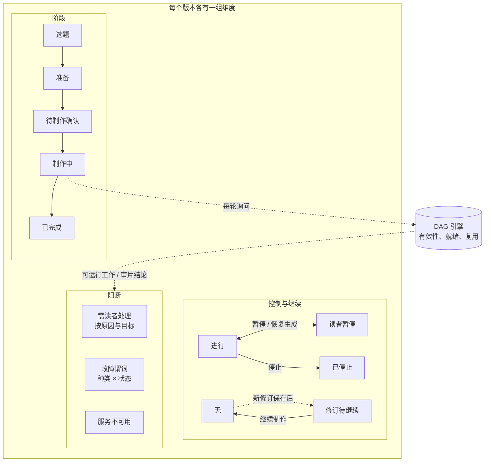
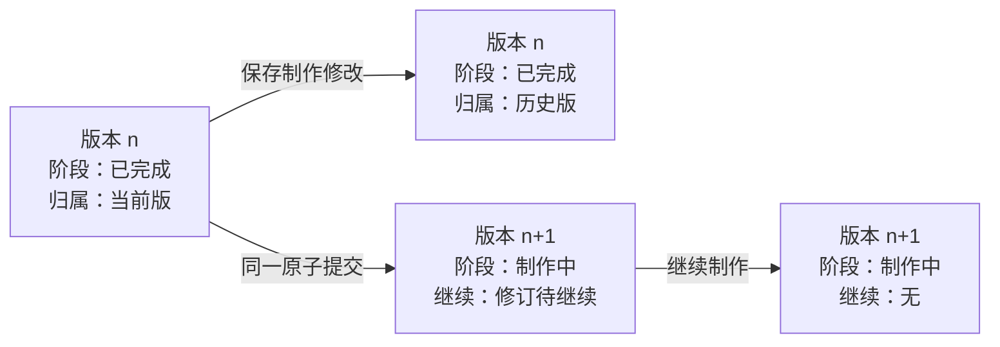

# 制作 DAG 缺陷分类、完整性核查与生命周期状态机

状态：SS 实施中。原始 Git 基点 `0dccad7`。前期工作已分批提交，见「前期提交」。

## 结论

不改用纯状态机，也不推翻 DAG。按画幅、按输入指纹的失效与复用（单幅重绘、旧图复用、手改保护、预估和保存共用同一推导）只有 DAG 能简洁表达，用状态机表达会退化成手写的「改了 X 就重置 Y、Z」，这正是这类系统最常见的缺陷来源。

缺陷主要集中在 DAG 之外：故事处于哪个阶段、读者此刻能做什么、故障如何开启和关闭，目前没有显式模型。规范明确写着「不另设进度枚举」，于是这些状态散落在 gate 标志、`dag.continuation`、`generation_control`、`reader_faults`、`production_jobs`、`stories.state` 和七处状态推导里。

**补一个故事级生命周期定义，DAG 只回答「在当前阶段内哪些产物缺失或失效、哪些可以运行」。** 生命周期不是一条扁平的状态链，而是几个同时成立的维度，见[需求](../../../../reqs/2026/11/24/req-production-lifecycle-state.md#状态的组成)。暂停和需读者处理不是与「制作中」并列的阶段：一个「制作中」的版本可以同时被暂停、等待继续、需读者处理，并有故障。

**保存制作修改会建立新版本。** 原版本保持自己的阶段（例如「已完成」）并成为历史，不会变成「暂停」。新版本的阶段由 DAG 推导（通常为「制作中」），并带有「修订待继续」，等读者「继续制作」。在阅读器确认单幅重新生图是例外：新版直接开始绘制，不等待继续。

## 缺陷分类

数据来源：0.15.0 切换后的修复提交，以及路径审计 `.tests/story-lifecycle/evidence/2026-11-24T15-26-35Z-dag-path-audit/`（17 个用例，7 个失败）。

| 类别 | 例子 | 根因 | 状态机能否解决 |
| --- | --- | --- | --- |
| **生命周期与授权**（最多） | `174a056` 单幅重绘直接开始（一条规则改了 18 个文件）；`64dfdf6`、`6378aef`、`2cbb19f` 继续与回执；`6af9082` 快照停滞与只读门槛；**C010** 等价保存仍新建暂停版本；**C014** 额度用尽后无出口，继续修复返回 409；**C017** 审核调用失败、没有结论时无放行入口 | 没有「状态 × 事件」表，出口和授权由各路由各自判断，遗漏的组合没有出路 | 能，这是主要收益 |
| **故障生命周期** | `800fa19`、`1b4f521` 故障延续；`2cbb19f`、`6378aef`、`ce72bab` 丢图故障；**C015** 重编后旧故障失去幅号，队列绕过恢复授权 | 故障存于 `reader_faults` 表，与 DAG 分离。延续逻辑有两份实现：`lib/production-dag/faults.ts`（含「待匹配」，只被测试调用）和 `server/dag-revisions.ts` 的 `carryFaults`（正式路径，没有待匹配）。违反「测试与生产共用实现」 | 能，作为子状态机统一 |
| **状态投影** | `2a346e9`；**C011** 第 2 幅故障、第 5 幅在途时显示「正在绘制第 2 幅」；**C013** 改名回包缺少在途阶段，界面闪回「排队」；**C014** 问题列表为空却显示完成 | 「当前在做什么」由 `production-dag/progress.ts`、`generation-progress.ts`、`production-stages.ts` 和书架、CLI 各自推导，写入回包和轮询结果不一致。过渡补丁给 `progress.ts` 又加了第四套推导 | 能，统一为一个投影 |
| **DAG 依赖声明** | `6378aef` 首幅参考等待；`2cbb19f` 任务身份覆盖全部输入；`6af9082` 人物与结语编辑的失效；**C016** 手改画面描述新增人物，绘图仍用旧入画名单 | 实际读取的输入或推导规则与登记表、规范不一致，见下节 | 不能，在 DAG 内修 |
| **迁移** | `aad2aac`、`64dfdf6`、`800fa19` 旧格式转换 | 一次性转换的边角情况 | 无关 |

前三类约占三分之二，DAG 依赖模型本身的缺陷是少数，并且都属于「输入声明不全」，可以用静态检查发现。

## DAG 完整性核查

对照三层：规范 `.docs/story-production-dag.md`、登记表 `lib/production-dag/registry.ts`、实际读取 `lib/production-dag/requests.ts`、`runner.ts`、`server/dag-revisions.ts`。

### 节点与调用

30 个节点、20 类调用与规范表格一一对应，`specRow` 由 `production-dag-registry.test` 核对。模型快照与提示词模板按规范不参与有效性，这是有意设计。没有发现漏登记的节点。

### 声明与实际不一致

| # | 问题 | 位置 | 后果 | 严重度 |
| --- | --- | --- | --- | --- |
| G1 | 手改画面描述时沿用 `frame.drawnNames ?? frame.drawn`，没有按新文字用 `castFrom` 重新匹配入画人物。规范要求重新匹配 | `server/dag-revisions.ts:105` | C016：新增人物不进绘图请求，图片指纹也不失效 | 高 |
| G2 | 画面描述被重新生成（生成、转换、画面修订）时没有清除本幅重绘说明，只有结构修订会清除。规范第 149 行要求自动清除 | `runner.ts` 的 `apply`，`visual`/`restyle`/`visualRepair` 分支 | 针对旧画面的说明会套到新画面上 | 中 |
| G3 | 逐幅结论的硬输入不含逐幅验收条目的登记。读者把某条从「全篇」改为「逐幅」后，逐幅结论不失效 | `registry.ts` 的 `frameVerdict` | 新归属的条目没有被审 | 中 |
| G4 | 全篇叙事结论的硬输入不含幅数与结构核对。规范写「需要时还有通过的幅数与结构核对」，实现只用门槛控制 | `registry.ts` 的 `narrativeVerdict` | 核对重跑后结论不随之失效。当前多被结构修订删除核对产物所掩盖 | 低 |
| G5 | 原文核对请求读取书名、选定标题、主题和故事 ID，`source` 指纹只取 `doc.original` | `requests.ts:31` | 只改选定标题、原文不变时不重做。主题已经进入制作要求，影响有限 | 低 |
| G6 | 服务级故障（401、402、429）落成逐篇的画幅故障。规范要求按服务记录、恢复后无需逐篇重试 | 队列与故障记录 | 审计场景 21 不符 | 中 |

G1 到 G5 说明需要一项机械检查：**每个调用请求实际读取的引用 ⊆ 该调用在登记表声明的绑定、核对、来源与上下文**。现在 `requests.ts` 按引用名读取，只要让读取器在测试中记录访问过的引用，就能对全部 20 类调用自动比对。G1、G2 属于产物写入时的派生规则，需要另加「写入后派生字段与规范一致」的检查。

### 场景与出口

规范的场景矩阵（修改范围、制作阶段、组合、异常、并发）覆盖面完整，路径审计已经把 59 个验收场景逐条映射到证据。缺口不在 DAG 的产物范围，而在生命周期：

- **规范已写、实现缺失的出口**：额度用尽后「继续自动修复」（C014，场景 37）；审核调用失败时的放行（C017）；等价设置不建新版（C010，场景 15 和矩阵最后一行）；服务级故障（G6）。
- **规范有设计、没有公开入口**：恢复历史版为当前版（场景 27）、按身份重排（场景 4、47）、手改配文时「同时更新画面描述」（场景 16）、编辑绘图参数、按条目放行。需要逐项决定实现还是从规范移出。
- **无法证明完整**：现在没有「状态 × 事件」表，所以无法机械检查「每个状态下每个读者动作和每种故障都有定义的结果」。C014 和 C017 都是表里本应有、却没人写下来的格子。

## 实施计划

需求已写入 [生命周期状态需求](../../../../reqs/2026/11/24/req-production-lifecycle-state.md)，状态定义、事件与验收以需求为准。下列任务按顺序执行。服务验证见[生命周期验收](../../../../tests/test-production-lifecycle-state.md)。先做只读的状态投影，再让付费工作的转换走共享判定。

- [x] REQ 生命周期需求：状态为带约束的推导维度元组，转换用「事件 × 守卫」规则行定义，测试从规则表生成。C017 采用「跳过本次审核」（2026-11-24 确认）。
- [ ] **权威规则与约束。** 在 `lib/production-lifecycle.ts` 定义稳定的事件、具名状态约束、守卫和规则结果。按目标是否存在、是否属于当前版本或当前故障、绑定是否有效、任务租约是否有效、是否已有付费回执等，将无界输入映射为有限的守卫等价类。规则完整性测试枚举这些类，检查可达组合的唯一命中，再用具体多个任务、多个目标和时间边界验证效果。HTTP 用例针对公开读者事件；内部系统事件走正式调度、队列或结果保存边界。
- [ ] **共享只读投影。** `lib/production-lifecycle.ts` 为纯函数，输入为需求列出的推导输入，输出各维度、主显示项和可用动作。在 `server/reader-production.ts` 集中读取实时上下文。服务写入回包、轮询、书架、故事设置、阅读器、移动端进度和命令行都改读这一投影，替换七处推导，显示用的阻断问题与可用动作不再读 `visualReview`。`lib/reader-api.ts` 的完整与增量书架都包含实时生命周期（含已完成作品的可选横图），增量版本包含任务及故障投影；所有返回 SessionView 的写回沿用读路径。这一步不改变服务端接受哪些命令，用 C011、C013 证明界面、命令行和写入回包一致。
- [ ] **第二步：付费工作的转换走共享判定。** 读者命令提交、调度、任务领取和调用前复核都调用同一判定，按需求「授权在提交与领取时生效」实施：
  - 在 `server/production-queue.ts` 领取事务内从最新任务行和故事数据复核数据库可得的各项，避免在异步预筛后使用快照；
  - 调用前复核进程与读写检查，并补上 `run()` 未检查是否被新版本取代的缺口；
  - 最后一次判定放在提供方的发送边界：参考图解析和读取完成之后、付费请求发出之前。需要给提供方的 `image()` 和文字调用接上发送前的授权回调；
  - 授权上下文按任务绑定，贯穿混合提供方与星标参考图包装；每次发送单独复核。已发生的部分付费用量写回回执，未完成的组合结果不进入产物。
  - 在提供方同步复核数据库后同一执行轮发起传输、写入 `turn/start` 或启进程，中间不再等待。用专用结果区分退回排队、作废与真实故障；Codex 的协议错误包装和横图失败捕获须原样传递授权拒绝。
  - 入口先校验身份与格式、再处理回执重放，临时服务状态只限制新授权；恢复删除后保持「已停止」。

  审核意见编辑去掉 `visualReview` 门槛（`server/reader-revisions.ts:27`）也在这一步，因为它改变命令授权。DAG 门槛只保留产物依赖（`brief`、`frameCheck`、`approved`），流程门槛移入生命周期。完成 C010、C014、C017 的出口。
- [ ] **第三步：故障按绘图输入匹配。** 只保留一份延续实现，正式路径与测试共用。按硬输入指纹匹配，复用先于阻断；多个画幅同时匹配时为每幅建立记录来源的故障实例，恢复只作用于所选画幅的实例。全部指纹确定后来源记录一定关闭，匹配按（来源、画幅、指纹）幂等，已解除的实例不被重建（修复 C015；现有 `faults.ts` 按画幅键匹配，直接接入仍会失败）。服务级故障只定义状态值，共享记录与退避另立需求。
- [ ] **兼容核查。** 在提交新增持久语义前，先用隔离数据探测候选表示。探针至少包含旧调度器启动时尚未产生的画幅身份和硬输入、后来匹配多幅的丢图，以及旧调度器运行期间变化后应失效的跳过绑定。只读投影及不依赖新持久语义的修复可独立执行。 在隔离书库中写入跳过审核记录与新的故障记录，用 `v0.15.0` 标签构建打开，核对它不会领取新版本会阻止的付费工作。失败时不能只提高 `minimumAppVersion`，因为 `v0.15.0` 只检查 `PRAGMA user_version`。须经确认后增加推进 `user_version` 的迁移，并验证旧版在调度前拒绝打开。
- [ ] **完整性测试。** 由规则表生成测试；路由层每个公开读者事件至少一个接受和一个拒绝用例；C010、C011、C013、C014、C015、C017 的 TODO 用例转为必须通过。
- [ ] **入口与文案。** 历史版恢复、重排、同时更新画面描述、绘图参数编辑、按条目放行、全篇复核、允许自动修订覆盖手改，在规则表中标为「不提供」。修改仍提示这些动作的文案（如 `server/reader-production.ts:62`），同步规范、用户指南与 `skills/shiqu/SKILL.md`。

DAG 声明与实际读取不一致的问题（上文 G1 到 G5，包括 C016 的入画人物）不在本计划内，按需求的非目标另立需求。

## 前期提交

- `d7005dc` 保存制作进度的过渡补丁。共享投影落地后，移除重复推导。
- `77789b7` 保存 DAG 路径审计、正式路径的回归测试及已知失败证据。
- `86860f7` 单独交付 Letter 双面 PDF，排除在生命周期变更的审查范围外。

AR risk: non-low — 书库兼容、事务授权和付费发送边界

AR review round: 2; reviewer: reused

AR passed: no blocking architecture flaws

## 验证命令

进入仓库后先运行 `nvm use`。迭代使用 `pnpm test:related --files <变更路径>` 或直接运行已登记的场景文件。交付前预览 `pnpm test:changed --plan`，执行工作区影响检查和本 story 范围的 `pnpm test:pr --files <变更路径>`，并执行 `pnpm typecheck` 和 `pnpm lint`。若计划包含原生覆盖，执行对应的原生验证。UI 通过桌面 Vite 预览在应用内浏览器核对。付费调用计数只使用替身；所有书库场景都在临时目录执行。

## SS 进展

- `168e0d5` 接通详情、完整书架、增量书架和写回的在途任务。C011 与 C013 的受控生产路径通过。
- 旧版预探针在 `v0.15.0` 隔离源码中使用格式 2 的临时书库，在修订继续前写入带绘图硬输入指纹的 `awaiting-match` 来源记录。重启后产生新的画幅键，其第 2 幅的硬输入与来源一致。旧队列仍领取了该幅，`attempts=1`，受控绘图调用 1 次。该候选表示未通过旧版兼容探针，完整的持久化实现及格式升级取决于书库格式决定。

- 应用内浏览器在隔离 Vite 和替身提供方上核对 C013。第 2 幅在途时改展示名，书架和故事设置同时保留第 2 幅重绘与计时。
- C010、C014 已通过正式路径测试。领取事务、发送防线、恢复删除、实时快照不可用及已付费图片临时不可读均使用隔离书库和替身验证。完整事件表、C015 与 C017 仍待实施。
- `a15fd82` 保存 C010、C014、事务内领取与提供方发送复核，分开保存修订等待与读者控制，保留已付费图片回执，并支持恢复删除后明确恢复制作。影响检查 571 通过、0 失败、2 跳过、3 项已知 TODO。类型检查、lint 和 27 项原生测试通过。
- SS 已完成部分的独立复核通过。整条 story 的 CR 仍待 C015、C017 和完整事件规则覆盖。书库格式升级需要 REQ 规定的单独确认。

CR risk: non-low — 事务授权、付费发送边界和书库兼容

CR review round: 3; reviewer: reused
