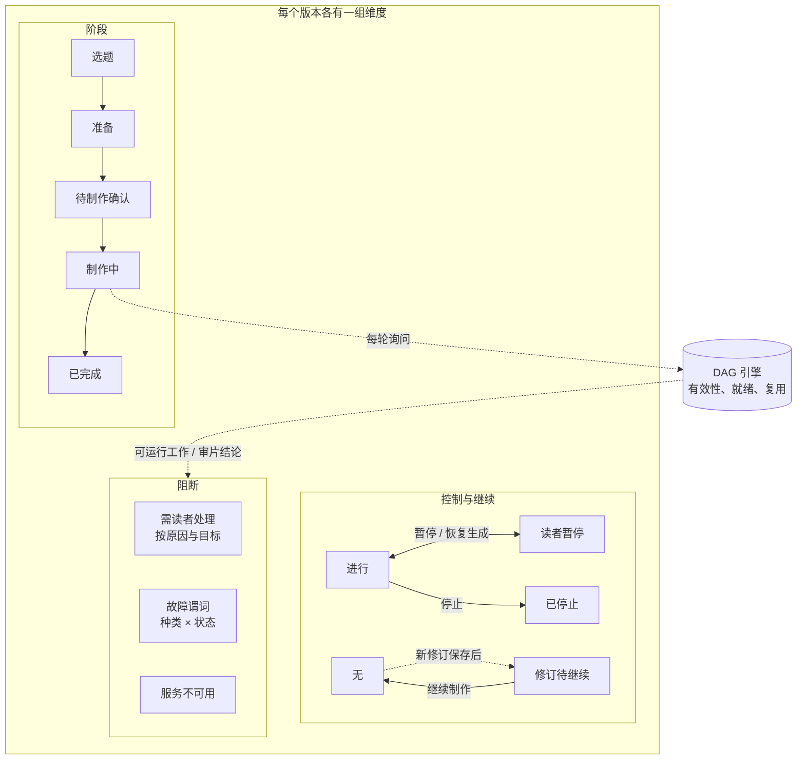
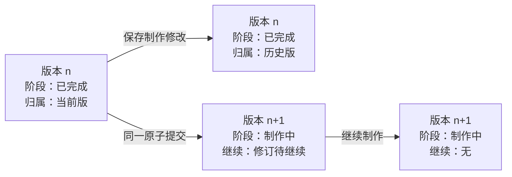

# 制作 DAG 缺陷分类、完整性核查与生命周期状态机

> 已被取代：见[制作规范精简 1-2](../../../../reqs/2026/11/24/req-production-spec-simplification.md)。涉及原约定「修订继承故障和「待匹配」状态」。故障和恢复回执归原版。新版按当前输入和已有产物推导待做工作。 [版本与故障归属](../../../../story-production-dag.md#版本与并发约束)

状态：RPD 交付完成。原始 Git 基点 `0dccad7`。前期工作已分批提交，见「前期提交」。

## 结论

不改用纯状态机，也不推翻 DAG。按画幅、按输入指纹的失效与复用（单幅重绘、旧图复用、手改保护、预估和保存共用同一推导）只有 DAG 能简洁表达，用状态机表达会退化成手写的「改了 X 就重置 Y、Z」，这正是这类系统最常见的缺陷来源。

缺陷主要集中在 DAG 之外：故事处于哪个阶段、读者此刻能做什么、故障如何开启和关闭，目前没有显式模型。规范明确写着「不另设进度枚举」，于是这些状态散落在 gate 标志、`dag.continuation`、`generation_control`、`reader_faults`、`production_jobs`、`stories.state` 和七处状态推导里。

**补一个故事级生命周期定义，DAG 只回答「在当前阶段内哪些产物缺失或失效、哪些可以运行」。** 生命周期不是一条扁平的状态链，而是几个同时成立的维度，见[需求](../../../../reqs/2026/11/24/req-production-lifecycle-state.md#状态的组成)。暂停和需读者处理不是与「制作中」并列的阶段：一个「制作中」的版本可以同时被暂停、等待继续、需读者处理，并有故障。

**保存制作修改会建立新版本。** 原版本保持自己的阶段（例如「已完成」）并成为历史，不会变成「暂停」。新版本的阶段由 DAG 推导（通常为「制作中」），并带有「修订待继续」，等读者「继续制作」。在阅读器确认单幅重新生图是例外：新版直接开始绘制，不等待继续。

## 缺陷分类

数据来源：0.15.0 切换后的修复提交，以及路径审计 `.tests/story-lifecycle/evidence/2026-11-24T15-26-35Z-dag-path-audit/`（17 个用例，7 个失败）。

| 类别 | 例子 | 根因 | 状态机能否解决 |
| --- | --- | --- | --- |
| **生命周期与授权**（最多） | `174a056` 单幅重绘直接开始（一条规则改了 18 个文件）；`64dfdf6`、`6378aef`、`2cbb19f` 继续与回执；`6af9082` 快照停滞与只读门槛；**C010** 等价保存仍新建暂停版本；**C014** 额度用尽后无出口，继续修复返回 409；**C017** 审核调用失败、没有结论时无放行入口 | 没有「状态 × 事件」表，出口和授权由各路由各自判断，遗漏的组合没有出路 | 能，这是主要收益 |
| **故障生命周期** | `800fa19`、`1b4f521` 故障延续；`2cbb19f`、`6378aef`、`ce72bab` 丢图故障；**C015** 重编后旧故障失去幅号，队列绕过恢复授权 | 故障存于 `reader_faults` 表，与 DAG 分离。延续逻辑有两份实现：`lib/production-dag/faults.ts`（含「待匹配」，只被测试调用）和 `server/dag-revisions.ts` 的 `carryFaults`（正式路径，没有待匹配）。违反「测试与生产共用实现」 | 能，作为子状态机统一 |
| **状态投影** | `2a346e9`；**C011** 第 2 幅故障、第 5 幅在途时显示「正在绘制第 2 幅」；**C013** 改名回包缺少在途阶段，界面闪回「排队」；**C014** 问题列表为空却显示完成 | 「当前在做什么」由 `production-dag/progress.ts`、`generation-progress.ts`、`production-stages.ts` 和书架、CLI 各自推导，写入回包和轮询结果不一致。过渡补丁给 `progress.ts` 又加了第四套推导 | 能，统一为一个投影 |
| **DAG 依赖声明** | `6378aef` 首幅参考等待；`2cbb19f` 任务身份覆盖全部输入；`6af9082` 人物与结语编辑的失效；**C016** 手改画面描述新增人物，绘图仍用旧入画名单 | 实际读取的输入或推导规则与登记表、规范不一致，见下节 | 不能，在 DAG 内修 |
| **迁移** | `aad2aac`、`64dfdf6`、`800fa19` 旧格式转换 | 一次性转换的边角情况 | 无关 |

前三类约占三分之二，DAG 依赖模型本身的缺陷是少数，并且都属于「输入声明不全」，可以用静态检查发现。

## DAG 完整性核查

对照三层：规范 `.docs/story-production-dag.md`、登记表 `lib/production-dag/registry.ts`、实际读取 `lib/production-dag/requests.ts`、`runner.ts`、`server/dag-revisions.ts`。

### 节点与调用

30 个节点、20 类调用与规范表格一一对应，`specRow` 由 `production-dag-registry.test` 核对。模型快照与提示词模板按规范不参与有效性，这是有意设计。没有发现漏登记的节点。

### 声明与实际不一致

| # | 问题 | 位置 | 后果 | 严重度 |
| --- | --- | --- | --- | --- |
| G1 | 手改画面描述时沿用 `frame.drawnNames ?? frame.drawn`，没有按新文字用 `castFrom` 重新匹配入画人物。规范要求重新匹配 | `server/dag-revisions.ts:105` | C016：新增人物不进绘图请求，图片指纹也不失效 | 高 |
| G2 | 画面描述被重新生成（生成、转换、画面修订）时没有清除本幅重绘说明，只有结构修订会清除。规范第 149 行要求自动清除 | `runner.ts` 的 `apply`，`visual`/`restyle`/`visualRepair` 分支 | 针对旧画面的说明会套到新画面上 | 中 |
| G3 | 逐幅结论的硬输入不含逐幅验收条目的登记。读者把某条从「全篇」改为「逐幅」后，逐幅结论不失效 | `registry.ts` 的 `frameVerdict` | 新归属的条目没有被审 | 中 |
| G4 | 全篇叙事结论的硬输入不含幅数与结构核对。规范写「需要时还有通过的幅数与结构核对」，实现只用门槛控制 | `registry.ts` 的 `narrativeVerdict` | 核对重跑后结论不随之失效。当前多被结构修订删除核对产物所掩盖 | 低 |
| G5 | 原文核对请求读取书名、选定标题、主题和故事 ID，`source` 指纹只取 `doc.original` | `requests.ts:31` | 只改选定标题、原文不变时不重做。主题已经进入制作要求，影响有限 | 低 |
| G6 | 服务级故障（401、402、429）落成逐篇的画幅故障。规范要求按服务记录、恢复后无需逐篇重试 | 队列与故障记录 | 审计场景 21 不符 | 中 |

G1 到 G5 说明需要一项机械检查：**每个调用请求实际读取的引用 ⊆ 该调用在登记表声明的绑定、核对、来源与上下文**。现在 `requests.ts` 按引用名读取，只要让读取器在测试中记录访问过的引用，就能对全部 20 类调用自动比对。G1、G2 属于产物写入时的派生规则，需要另加「写入后派生字段与规范一致」的检查。

### 场景与出口

规范的场景矩阵（修改范围、制作阶段、组合、异常、并发）覆盖面完整，路径审计已经把 59 个验收场景逐条映射到证据。缺口不在 DAG 的产物范围，而在生命周期：

- **规范已写、实现缺失的出口**：额度用尽后「继续自动修复」（C014，场景 37）；审核调用失败时的放行（C017）；等价设置不建新版（C010，场景 15 和矩阵最后一行）；服务级故障（G6）。
- **规范有设计、没有公开入口**：恢复历史版为当前版（场景 27）、按身份重排（场景 4、47）、手改配文时「同时更新画面描述」（场景 16）、编辑绘图参数、按条目放行。需要逐项决定实现还是从规范移出。
- **无法证明完整**：现在没有「状态 × 事件」表，所以无法机械检查「每个状态下每个读者动作和每种故障都有定义的结果」。C014 和 C017 都是表里本应有、却没人写下来的格子。

## 实施计划

需求已写入 [生命周期状态需求](../../../../reqs/2026/11/24/req-production-lifecycle-state.md)，状态定义、事件与验收以需求为准。下列任务按顺序执行。服务验证见[生命周期验收](../../../../tests/test-production-lifecycle-state.md)。先做只读的状态投影，再让付费工作的转换走共享判定。

- [x] REQ 生命周期需求：状态为带约束的推导维度元组，转换用「事件 × 守卫」规则行定义，测试从规则表生成。C017 采用「跳过本次审核」（2026-11-24 确认）。
- [x] **权威规则与约束。** 在 `lib/production-lifecycle.ts` 定义稳定的事件、具名状态约束、守卫和规则结果。按目标是否存在、是否属于当前版本或当前故障、绑定是否有效、任务租约是否有效、是否已有付费回执等，将无界输入映射为有限的守卫等价类。规则完整性测试枚举这些类，检查可达组合的唯一命中，再用具体多个任务、多个目标和时间边界验证效果。HTTP 用例针对公开读者事件；内部系统事件走正式调度、队列或结果保存边界。
- [x] **共享只读投影。** `lib/production-lifecycle.ts` 为纯函数，输入为需求列出的推导输入，输出各维度、主显示项和可用动作。在 `server/reader-production.ts` 集中读取实时上下文。服务写入回包、轮询、书架、故事设置、阅读器、移动端进度和命令行都改读这一投影，替换七处推导，显示用的阻断问题与可用动作不再读 `visualReview`。`lib/reader-api.ts` 的完整与增量书架都包含实时生命周期（含已完成作品的可选横图），增量版本包含任务及故障投影；所有返回 SessionView 的写回沿用读路径。这一步不改变服务端接受哪些命令，用 C011、C013 证明界面、命令行和写入回包一致。
- [x] **第二步：付费工作的转换走共享判定。** 读者命令提交、调度、任务领取和调用前复核都调用同一判定，按需求「授权在提交与领取时生效」实施：
  - 在 `server/production-queue.ts` 领取事务内从最新任务行和故事数据复核数据库可得的各项，避免在异步预筛后使用快照；
  - 调用前复核进程与读写检查，并补上 `run()` 未检查是否被新版本取代的缺口；
  - 最后一次判定放在提供方的发送边界：参考图解析和读取完成之后、付费请求发出之前。需要给提供方的 `image()` 和文字调用接上发送前的授权回调；
  - 授权上下文按任务绑定，贯穿混合提供方与星标参考图包装；每次发送单独复核。已发生的部分付费用量写回回执，未完成的组合结果不进入产物。
  - 在提供方同步复核数据库后同一执行轮发起传输、写入 `turn/start` 或启进程，中间不再等待。用专用结果区分退回排队、作废与真实故障；Codex 的协议错误包装和横图失败捕获须原样传递授权拒绝。
  - 入口先校验身份与格式、再处理回执重放，临时服务状态只限制新授权；恢复删除后保持「已停止」。

  审核意见编辑去掉 `visualReview` 门槛（`server/reader-revisions.ts:27`）也在这一步，因为它改变命令授权。DAG 门槛只保留产物依赖（`brief`、`frameCheck`、`approved`），流程门槛移入生命周期。完成 C010、C014、C017 的出口。
- [x] **第三步：故障按绘图输入匹配。** 只保留一份延续实现，正式路径与测试共用。按硬输入指纹匹配，复用先于阻断；多个画幅同时匹配时为每幅建立记录来源的故障实例，恢复只作用于所选画幅的实例。全部指纹确定后来源记录一定关闭，匹配按（来源、画幅、指纹）幂等，已解除的实例不被重建（修复 C015；现有 `faults.ts` 按画幅键匹配，直接接入仍会失败）。服务级故障只定义状态值，共享记录与退避另立需求。
- [x] **兼容核查。** 旧版预探针失败（见「SS 进展」）。2026-11-24 已确认升级为书库格式 3，下一版本为 0.16.0（需求「已确认的决定」第 3 条）。
- [x] **书库格式 3 迁移。** 在第三步和 C017 的持久化实现之前完成，一项迁移承载全部新增持久语义：
  - 新增 `drizzle/` 迁移，把 `user_version` 推进到 3；
  - `db/library-format.json` 改为 `schemaVersion` 3、`minimumAppVersion` 0.16.0，并更新 `latestMigration`；
  - 沿用 `ensureLibraryReady()` 的整库备份校验与中断恢复；
  - 同步 `AGENTS.md` 的书库格式说明、用户指南的升级与回退章节。

  验证在临时书库进行，不触碰读者书库：格式 2 书库经备份后升级到格式 3；迁移中断后重做结果一致；`v0.15.0` 隔离构建在调度前以 `LIBRARY_NEWER_SCHEMA` 拒绝打开，零任务领取。`package.json`、`src-tauri` 与命令行的版本号和更新日志在发布准备提交中改为 0.16.0，不在本 story 内修改。
- [x] **完整性测试。** 由规则表生成测试；路由层每个公开读者事件至少一个接受和一个拒绝用例；C010、C011、C013、C014、C015、C017 的 TODO 用例转为必须通过。
- [x] **入口与文案。** 历史版恢复、重排、同时更新画面描述、绘图参数编辑、按条目放行、全篇复核、允许自动修订覆盖手改，在规则表中标为「不提供」。修改仍提示这些动作的文案（如 `server/reader-production.ts:62`），同步规范、用户指南与 `skills/shiqu/SKILL.md`。

DAG 声明与实际读取不一致的问题（上文 G1 到 G5，包括 C016 的入画人物）不在本计划内，按需求的非目标另立需求。

## 前期提交

- `d7005dc` 保存制作进度的过渡补丁。共享投影落地后，移除重复推导。
- `77789b7` 保存 DAG 路径审计、正式路径的回归测试及已知失败证据。
- `86860f7` 单独交付 Letter 双面 PDF，排除在生命周期变更的审查范围外。

AR risk: non-low — 书库兼容、事务授权和付费发送边界

AR review round: 2; reviewer: reused

AR passed: no blocking architecture flaws

## 验证命令

进入仓库后先运行 `nvm use`。迭代使用 `pnpm test:related --files <变更路径>` 或直接运行已登记的场景文件。交付前预览 `pnpm test:changed --plan`，执行工作区影响检查和本 story 范围的 `pnpm test:pr --files <变更路径>`，并执行 `pnpm typecheck` 和 `pnpm lint`。若计划包含原生覆盖，执行对应的原生验证。UI 通过桌面 Vite 预览在应用内浏览器核对。付费调用计数只使用替身；所有书库场景都在临时目录执行。

## SS 进展

- `168e0d5` 接通详情、完整书架、增量书架和写回的在途任务。C011 与 C013 的受控生产路径通过。
- 旧版预探针在 `v0.15.0` 隔离源码中使用格式 2 的临时书库，在修订继续前写入带绘图硬输入指纹的 `awaiting-match` 来源记录。重启后产生新的画幅键，其第 2 幅的硬输入与来源一致。旧队列仍领取了该幅，`attempts=1`，受控绘图调用 1 次。该候选表示未通过旧版兼容探针。2026-11-24 已确认升级为书库格式 3、下一版本 0.16.0，按「书库格式 3 迁移」任务实施。

- 应用内浏览器在隔离 Vite 和替身提供方上核对 C013。第 2 幅在途时改展示名，书架和故事设置同时保留第 2 幅重绘与计时。
- C010、C014 已通过正式路径测试。领取事务、发送防线、恢复删除、实时快照不可用及已付费图片临时不可读均使用隔离书库和替身验证。完整事件表、C015 与 C017 仍待实施。
- `a15fd82` 保存 C010、C014、事务内领取与提供方发送复核，分开保存修订等待与读者控制，保留已付费图片回执，并支持恢复删除后明确恢复制作。影响检查 571 通过、0 失败、2 跳过、3 项已知 TODO。类型检查、lint 和 27 项原生测试通过。
- `60ebf88` 集中选材条件、查找、继续查找、选择候选、保存草稿、重新推荐及确认的守卫，以及后台、暂停、停止、恢复的控制授权。正式接口覆盖这些事件的接受和拒绝。影响检查 417 通过、0 失败、2 跳过、1 项已知 TODO。另运行了 35 项后台、选材条件与替换兼容用例。类型检查和 lint 通过。
- `74659a1` 接通横图生成与重试、图片核对和应用模型设置。横图作废任务与请求标记原子写入，旧版不发横图令牌，删除先于图片核对落库时不记录新故障。影响检查 254 通过、0 失败、2 跳过、1 项已知 TODO。10 项聚焦用例、类型检查和 lint 通过。
- `efefb619` 接通打开、取消和提交替换草稿、放行审片及继续制作。核对替换与取消并发、同源替换回执与草稿关闭原子提交、审片结论在回执事务内复核。影响检查 260 通过、0 失败、2 跳过、1 项已知 TODO。另有 16 项替换和 14 项审片及继续用例通过。类型检查和 lint 通过。
- `b71068e4` 将重试授权的故障、版本、控制、输入及任务可用性核对收进回执事务。已恢复可读的原图免费复用并以同编号重放，暂时无法核对时保持故障和原请求编号。影响检查 284 通过、0 失败、2 跳过、1 项已知 TODO。另有 19 项故障恢复兼容用例通过。类型检查和 lint 通过。
- `098d4315` 接通确认后保存、重绘、指定首幅原图及复制的判定。详情、写回和书架增量统一报告替换草稿及必需／可选故障。修复审查发现的等价选题回执、服务关闭时回执重放、修订编号并发、复制和替换草稿写入围栏、已到期租约发送、横图逐幅重试及原回执保留。增加正式路径回归，影响检查 587 通过、0 失败、2 跳过、1 项已知 C016 TODO。选题、替换和故障兼容增跑 49 通过、1 跳过。类型检查、lint、27 项原生测试通过。
- `060ee692` 详情与两类书架请求在同一 SQLite 读事务截取故事、任务、故障、阅读需求和替换草稿。用第二个连接在读事务中提交图片状态，验证不会混入当前响应。影响检查 564 通过、0 失败、2 跳过、1 项已知 C016 TODO。类型检查、lint、27 项原生测试通过。
- `4486bc7e` 书架、详情和回包共用制作控制、恢复及审片动作。投影区分正在核对的图片与因暂时不可读而等待的绘图任务。正式接口覆盖额度耗尽、暂停后拒绝及恢复后接受，也验证核对中的图片没有提前登记故障。影响检查 393 通过、0 失败、2 跳过、1 项已知 C016 TODO。类型检查和 lint 通过。应用内浏览器用隔离书库验证书架恢复生成后进入队列并完成。
- `602f7004` 选题、替换、删除与恢复、发送租约、队列失败分区由运行时规则表生成测试。正式入口验证复用已恢复图片、查找超时的三次上限、横图内容拦截和草稿复制。书架重试与阅读端提交使用同一目标，CLI 审片等待从生命周期快照判断。影响检查 560 通过、0 失败、2 跳过、1 项已知 C016 TODO。额外兼容用例 51 通过、1 跳过。类型检查和 lint 通过。
- 本轮全部改动合并执行 `pnpm test:pr --files`，602 通过、0 失败、2 跳过、1 项已知 C016 TODO。
- 早期里程碑复核通过时，C015、C017 和完整事件规则仍待逐项验证。书库格式升级随后按 REQ 单独确认并完成。

CR risk: non-low — 事务授权、付费发送边界和书库兼容

此前 CR review round: 8; reviewer: reused

独立复核确认一致数据库快照。只读下的图片核对条件、停止门槛、应用模型设置、查找与横图的超时和拦截分类、CLI 审片读取已修复并复核通过。整条 story 的 CR 仍缺选题、替换、修订、横图及删除恢复的动作投影，确认后重新准备仍需正式入口，并须补齐规则到公开及系统入口的逐条效果证据。以上为第 8 轮的未完成项，后续验证记录见下。

## 格式 3 与审核恢复验证

- 实现里程碑 `ecf7de6`。
- 已沿用 `ensureLibraryReady()` 的自动迁移。格式 2 临时书库在回执写入前注入中断，索引与版本回滚，移除注入后重试得到格式 3。升级前备份通过完整校验。
- `v0.15.0` 标签的隔离应用启动返回 `LIBRARY_NEWER_SCHEMA: library 3, supported 2`，预置绘图任务状态 `queued`，尝试次数 0，租约为空。
- C015 匹配了第 2、3 幅，仅恢复第 2 幅触发一次绘图。第 3 幅在该图可读后免费复用，重启不重建故障。
- C017 在应用内浏览器显示默认结语，点击「跳过本次审核」后仍暂停，显示已保存 0 幅与「恢复生成」。正式路径分别覆盖验收登记、结语和画面输入改变后跳过失效，三种情况均无绘图调用。
- [生命周期规则说明](../../../../story-production-lifecycle.md)已记录全部事件，程序的判定表和公开事件双向验收仍需继续补齐。
- 影响检查 590 通过、0 失败、2 跳过、1 项已知 TODO（C016，非目标）。类型检查、lint、27 项原生测试及 3 项旧版阻断恢复测试通过。
- 本里程碑的独立复核第 3 轮通过。复核修正了修订提交与故障解除间的竞争、同指纹来源去重，以及存在星标参考图时的发送前免费复用检查。全 story 的规则和路由覆盖任务保持开放。

## 最终实现与代码复核

- `f7f158f2` 接通已确认版本的重新准备。后续修正让准备建议成为独立工作状态。完整作品在刷新、暂停和故障期间保留完成阶段；已发送的付费工作可以把结果写回原版。CLI 和阅读器能观察刷新结果或准备故障。
- 详情、写回、完整书架、增量书架和删除清单共用状态推导。当前草稿、修订、复制、核对和横图操作按目标提供；409 保留错误信息并附当前可访问的版本或草稿。已确认的横图丢失在调度、改名和暂不可读期间保留。
- 规则检查枚举各守卫等价类，独立核对公开命令的效果和状态拒绝。正式路径核对选择、修订、恢复、作废、收尾和回执效果。五类提供方使用替身，均在实际队列路径核对暂停与取代发生在发送前时不会产生付费调用。
- C014 验证额度耗尽后的审核意见保存和续授；C017 验证暂停、停止、等待继续及重新尝试，另验证绑定变化在绘图前使跳过失效。
- 应用内预览使用隔离书库，核对了重新准备、保持原分镜、取消替换和返回当前版。格式 3 的自动迁移继续使用启动时整库校验备份，不需手工执行 SQL。

CR fixed: 修复重准备调度与观察、已删除版本的收尾投影、横图缓存、冲突回包、审核意见和恢复准备的守卫；rerun result passed

- `ded33594` 提交共享动作和效果规则、完整的回归及兼容修正。故事范围排除独立的 Letter 双面 PDF 提交 `86860f7`。

CR review round: 16; reviewer: reused

- 交付后复核（2026-11-24）：付费发送点在没有发送许可时原本直接放行，今后新增的制作路径若漏接复核会静默付费。现在队列为每个任务建立任务范围，范围内缺少发送许可的发送抛出 `PaidDispatchUnfenced`，任务按失败记录、不发出请求。队列之外的调用不受影响。`tests/production-queue.test.mjs` 覆盖拒绝、放行和队列外调用三种情况。
- 界面核对（2026-11-24）：用受控模型和一次性书库启动正式应用，在应用内浏览器逐一打开七种需要读者处理的状态（等待继续、删除后恢复、步骤失败、审核调用失败运行中及暂停、绘图中暂停、丢图），书架与故事设置均有对应操作。删除后恢复点击「继续制作」后解除停止并完成。未配置服务时，等待继续的故事显示「已保存，等待继续」，书架和故事设置都没有操作也没有原因，与 0.15.0 的问题同类。原因是状态文案与动作列表分别推导。现在提示点击的状态标明所需动作，未提供时改为显示原因，操作位显示同一原因。`tests/production-reader-exits.test.mjs` 枚举五百余种组合并渲染正式组件，旧代码在该测试下失败（另发现旧版本暂停时提示「恢复生成」却无入口）。审核跳过说明按「继续制作」或「恢复生成」指明实际入口。
- CR 第 1 轮（`70690f69` 之后）修复：
  - 删除后才返回失败的横图任务原先因保存条件排除已删除故事而丢失失败说明，任务却记为成功，恢复后停在 5/6 且没有重试入口。失败说明现与成功结果一样在租约内写回原版，仍无法保存时任务按失败记录。
  - 替换选题提交冲突时，请求层保留 409 附带的当前版本：已由其他窗口替换（或本草稿已提交）时转到新版，否则保留草稿，且不再重复发送过时的请求。
  - 横版步骤在服务不可用时于任何阶段说明原因；快照服务不可用且生命周期提供时给出「应用当前模型设置」。
  - 生命周期新增 `optionalWork`。已完成作品的可选工作暂停时，书架卡片、故事设置和状态文案按派生状态显示恢复入口或原因，不再按旧的 `completed` 隐藏；已完成作品的可选产物失败不再把整篇显示为生成失败。
  - 阅读器空白画幅随生命周期显示暂停、失败或原因，并给出与故事设置相同的入口。
  - 出口测试改为渲染故事设置与书架的实际界面，要求显示生命周期提供的那项可用操作，并拒绝未提供的可用操作；`tests/production-reader-exit-flows.test.mjs` 用正式应用驱动等待继续、步骤失败、暂停、删除后恢复和已完成作品刷新暂停，点击界面给出的操作并确认服务端接受、故事继续。旧书架代码在后者下失败。
  - DAG 规范中「删除后在途结果不再写入」改为与生命周期规则一致：已发出的任务在租约内按原版本收尾。
- C016（G1）随 0.16.0 修复（2026-11-24 确认）：手改画面描述时按名字和别名把新出现的人物并入本幅入画人物，原有入画人物保留，没有入画记录的旧稿保持按全部人物计算。只影响本幅绘图输入，本幅本已因描述变化而重绘。C016 测试转为正式用例，另加只用代词描述时保留原名单的用例。严格按文字重配留待编辑器提供名单调整入口时一起做。G2 到 G5 仍按非目标另立需求。

## 最终验收

VR passed: all acceptance criteria complete

- 状态、输入和事件。当前、历史和已删除版本各自保留制作阶段。在途收尾、控制、等待继续、准备刷新、故障、服务和活动由共享规则推导。具名规则的守卫等价类逐项验证唯一命中，命令效果另用独立预期验证。
- 投影和显示。详情、写回、完整与增量书架、删除清单、阅读端和 CLI 使用相同的生命周期。C011、C013 比较主要任务、画幅、时钟及并列故障。可访问的当前故事或草稿随 409 回包返回，修改、丢图和可选横图动作均按目标核对。
- 授权和任务。命令提交、任务领取和每次付费发送按当时状态复核。对暂停、停止、取代和删除验证领取前、发送前及发送后的归属。五种提供方在正式队列上用替身验证暂停和取代的发送拦截。有效的已付费结果保存到原版，恢复删除后维持停止。
- 故障与审片。C010、C011、C013、C014、C015、C017 均通过。核对等价保存、额度续授与意见保存、同绘图输入的故障匹配、失败审核重试和跳过绑定失效。中断、图片暂不可读和快照不可用的规则由调度器执行，保留原回执。
- 兼容、回归和文档。格式 2 自动备份和升级到格式 3，迁移中断后可重跑。独立的 v0.15.0 探针验证新版格式先拒绝打开且零领取。接口继续返回兼容字段。CLI、内置技能和规范使用同一动作说明。C008、C009、C012 保持通过，C016 仍按批准的非目标登记。
- TT、ET 和界面。故事范围 633 通过、0 失败，工作区影响检查 626 通过、0 失败。两项旧版 v0.14.0 探针按配置跳过，另有一项 C016 TODO。定向兼容用例 59 通过、1 跳过。审核 E2E 8 项、启动保障 191 项、测试登记与安全保障、原生 27 项、类型检查及 lint 均通过。应用内预览核对原分镜、刷新结果、替换草稿和返回当前版。

VR risk: non-low
VR review round: 3; reviewer: reused

## 发布复测修复

本轮基线为 `2b6d1c71`。保留格式 3 的逐节点故障记录；硬输入未确定时在存储中继续阻断，界面投影等待匹配。迁移只修复有同一所有者与版本谱系依据的已有修订。读取已付费图片发生在媒体存储边界；写入当前版本时复核授权或任务租约。

- [x] 在 `server/dag-revision-faults.ts` 共用修订继承和当前输入核对，连接派发、重试和审核跳过。
- [x] 在 `server/dag-production.ts` 校验祖先绘图回执，读者授权后采用可读图片，并在排队任务发送前再次核对。
- [x] 在 0027 迁移按版本顺序修复空键与遗漏记录；使用生产初始化的整库备份和迁移事务。
- [x] 运行 C022–C025、新旧格式升级复现、原报告的失败测试及影响检查。最终改动范围 358 项通过，五个失败来源文件按完整层运行 65 项通过，原生源码 14 项通过。
