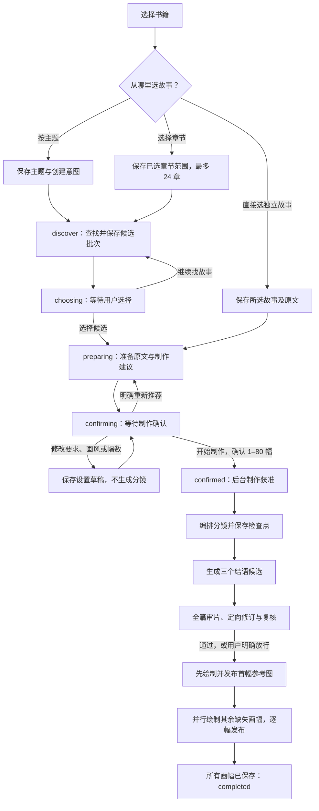
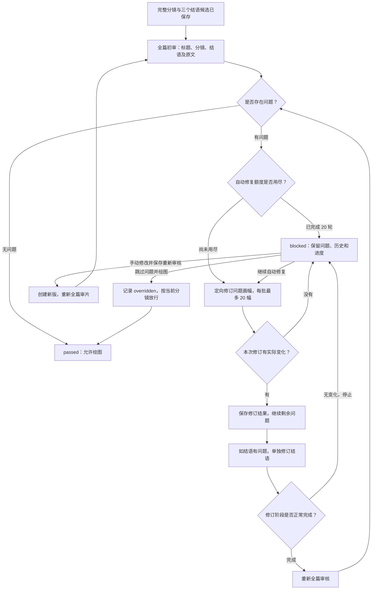
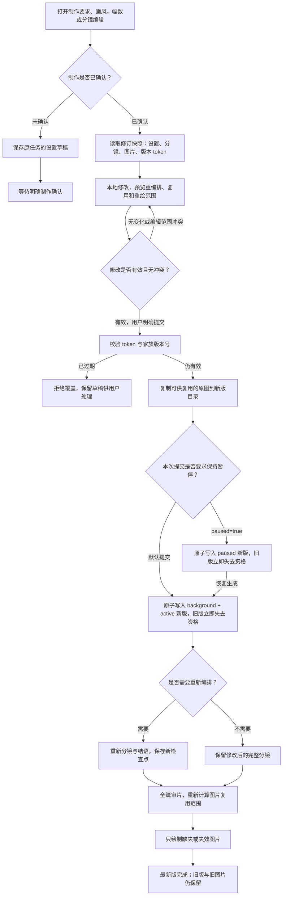
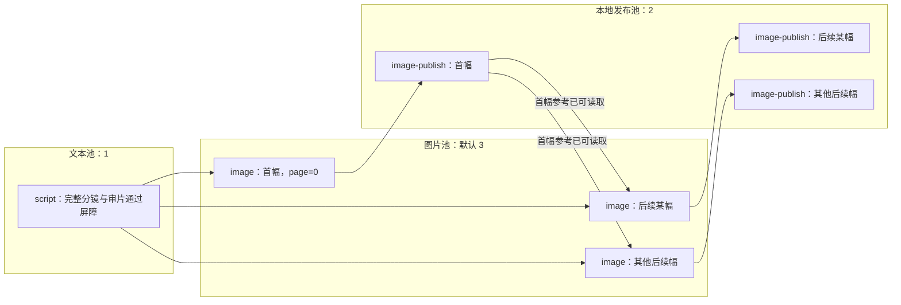
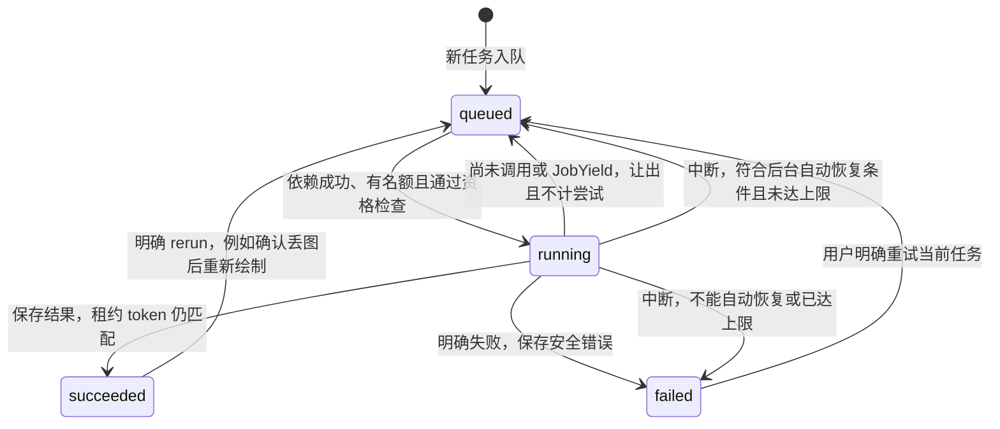

# 故事创建、编辑与队列管理

[开发指南](development.md) · [使用指南](user-guide.md#制作与阅读故事)

本文按 **2026-11-01、提交 `8924e5de395a1c7d33eb8827c68a887582b351aa`** 的代码说明当前阅读端流程；历史管理端不在本文范围内。图表使用 Mermaid，可在支持 Mermaid 的 Markdown 预览器中查看。

## 1. 先建立整体认识

- **创建分两次确认**：先选故事，再确认画风、幅数和制作要求；等待选择或制作确认时，不编排分镜、不绘图。
- **先审片，后绘图**：完整分镜与结语保存后，全篇审核；必要时定向修订并复核。
- **编辑不覆盖原版**：制作确认后的修改提交为独立新版；旧记录、旧图片保留，书架只展示最新提交版本。
- **队列不是简单的先进先出**：它根据已保存结果构建任务依赖图，分查找、文本、图片、本地发布四个执行池；阅读位置影响绘图优先级。
- **两个上限不要混淆**：审片最多自动修复 **20 轮**；中断恢复对同一任务最多自动运行 **3 次**，不是把所有失败都自动重试三次。

## 2. 创建故事：从选书到整篇完成

### 哪些状态是在等人，哪些是在工作？

| 创建阶段 `intake.phase` | 含义 | 后台能做什么 |
| --- | --- | --- |
| `discovering` | 正在找故事 | 执行 `discover`，保存候选与阅读进度 |
| `choosing` | 等待选择候选 | 不自动准备或绘图；明确继续查找可以再排选题任务 |
| `preparing` | 已选故事，准备制作 | 保存原文、必要的画风推荐和幅数建议 |
| `confirming` | 等待制作确认 | 保存设置草稿；明确重新推荐才重做建议 |
| `confirmed` | 用户已确认制作 | 编排、结语、审片、绘图继续到整篇完成 |

候选批次累计保留，最多 **40 批**。查找有独立的 `search.round/state`：再找一批不会替换已选故事，也不会把制作建议冲掉；查找失败不妨碍使用已保存候选继续。确认制作后停止查找，迟到的查找结果不能再追加。

直接选择独立故事跳过模型选题；从多个章节提取故事仍须先选候选。准备阶段已有推荐时复用；直接选故事若尚无画风推荐，可能另做画风推荐，不应把准备阶段理解为固定只有一次请求。

**实现依据**：[创建与选择动作](../server/reader-intake.ts#L13)、[创建状态模型](../lib/reader-intake.ts#L14)、[创建界面](../client/ui/StoryCreationSetup.tsx#L24)、[查找结果隔离](../server/reader-production.ts#L337)。

## 3. 分镜、结语和审片如何衔接？

### 分镜不是必须一次生成整篇

- 确认数量不超过 **20 幅**时，正常路径一次生成分镜草稿。
- 超过 **20 幅**时，先生成全篇提纲，再按每批最多 **20 幅**细化分镜；提纲、已完成批次分别保存。
- 完整分镜保存后，一次请求生成标题和 **三个不同结语候选**；全篇审核同时审核标题、选择结语并保存理由，不另加一次择优请求。
- 结语生成失败时，重试结语，不重新编排已经保存的分镜。

这里的“修复轮数”不是审核调用数，也不是每个分镜批次的数量；检查点分别记录审核报告、修订批次、已处理幅号和停止原因。手动继续会恢复一段新的自动修复额度；因无变化停止时，已经完成的修订批次不会全部重来。

审核问题中 **`page=0` 指结语，`page=1` 指第一幅**；图片任务中的 `page` 则从 **0** 开始。两者不能混用。

**旧故事兼容**：已有完整分镜、但没有审片检查点的旧故事，不会仅因打开就补做审核；提交新的修订版本则会建立新的审片检查点。

**实现依据**：[执行阶段](../lib/reader-engine.ts#L70)、[审核与修复循环](../lib/reader-engine.ts#L94)、[问题幅号与修订批次](../lib/reader-review.ts#L16)、[当前上限](../lib/reader-limits.ts#L7)。

## 4. 编辑故事：草稿、独立新版与最少重做

### 两种编辑不是同一种保存

| 时机 | 编辑保存在哪里 | 何时开始生成 |
| --- | --- | --- |
| 制作确认前 | 设置草稿保存在原任务的 `intake.draft` | 点击“开始制作”或明确重新推荐 |
| 制作确认后，包括尚未完成分镜 | 编辑器先保留本地草稿；提交才创建独立新版 | 点击“开始制作新版”“恢复生成”或“保存并重新审核” |

修订编辑器关闭弹窗会保留当前草稿，**离开这篇故事会清除尚未提交的修订草稿**，它不同于已经保存到服务器的制作前设置草稿。没有完整分镜时可以改要求、画风和幅数，但不能手改尚不存在的完整分镜。

**界面动作与底层状态要分清**：当前修订界面的“完成编辑”只是收起草稿；明确“恢复生成”才提交修改。修订接口也支持 `paused=true`，供“提交但保持暂停”的调用使用；默认提交在同一个 INSERT 中直接创建 active 新版，不再另写父版暂停或子版激活。旧版资格由家族中的更新版本推导，旧构建留下的 `revision.handoff` 仍可恢复。

### 哪些修改会重做什么？

以下是提交时的预计范围；审核若进一步改变画面指令，会重新计算实际重绘数量。

| 修改内容 | 重新编排分镜 | 重新审片 | 图片复用规则 |
| --- | --- | --- | --- |
| 仅旁白 `caption` 或结语 `reflection` | 不需要 | 需要 | 绘图输入没变则复用原图 |
| 非首幅的画面指令 `prompt` | 不需要 | 需要 | 通常仅该幅失效 |
| 首幅画面指令 | 不需要 | 需要 | 全篇失效，首幅是其他幅的角色参考 |
| 全局人物设定 `characters` | 不需要 | 需要 | 全篇失效 |
| 画风 `artStyle` | 不需要 | 需要 | 全篇失效 |
| 制作要求 `productionPrompt` | 需要 | 需要 | 全篇失效 |
| 幅数 `length` | 需要 | 需要 | 新分镜完成后逐幅比较；不保证全部重绘，也不保证能复用 |
| 原分镜尚未完成，仅改画风且保存的目标幅数匹配 | 保留已付费目录、分镜页或短篇草稿，只完成剩余工作 | 需要 | 新画风绘制；不能提交手改完整分镜 |
| 原分镜尚未完成，改要求或幅数 | 从头重新编排 | 需要 | 完成新分镜后判断 |

精确复用条件是：画风、制作要求、人物设定不变，首幅图存在且首幅提示词不变，对应位置的提示词也不变。首幅丢失会使修订版本的整篇复用条件失效。

“重编排设置变化”与“手改分镜”不能同时提交，避免一边要求重排、一边要求保留手改内容。新版提交使用家族版本号与快照条件写入：并发修改不会静默互相覆盖，同一提交编号重放不会再建一个版本。

旧父版已经开始的请求可能仍保存自己的结果，但不能写进新版。图片复制到新版独立路径，不是仅引用父版路径。书架只展示家族最新提交版本；最新版暂停、失败或删除，不会自动把旧版顶回来，收藏和有效阅读位置随新版延续。重新选择另一篇故事则另建独立流程，不是这篇故事的修订版。

每次开始文本锁、绘图付款前、原文补全、需求写入和中断恢复都检查最新版本。旧版即使底层仍为 active，也不会开始新生成；未完成旧版显示暂停与旧版提示，恢复和跳过审片返回 409。已开始的一步可以保存，已付费的旧图仍可发布到旧版。

**实现依据**：[编辑器提交](../client/ui/useStoryRevision.ts)、[编辑与审核入口](../client/ui/StoryRevisionEditor.tsx)、[原子新版创建](../server/reader-revisions.ts)、[最新版本资格与控制](../lib/reader-repository.ts)、[重做及检查点保留判断](../lib/reader-revision.ts)、[精确图片复用](../lib/reader-revision-images.ts)。

## 5. 队列如何拆任务和控制顺序？

### 持久化任务，不依赖浏览器保持打开

服务中的 `ReaderProductionCoordinator` 根据故事检查点调用 `graph()` 构建下一批任务；`ProductionQueue` 负责依赖检查、排序、抢占执行名额与记录结果。正常约每 **1 秒**调度一次，任务结束和用户操作也会唤醒调度器。

| 执行池 | 当前并发上限 | 实际任务 |
| --- | --- | --- |
| `search` | **1**，全书库共享 | `discover`；与同篇准备和其他故事文本并行 |
| `text` | **1**，全书库共享 | `prepare`、`script`；`script` 承载分镜、结语、审核、修订等检查点 |
| `image` | 默认 **3**，可用 `SHIQU_IMAGE_WORKERS` 设为 **1–8** | `image`：调用生成服务并保存图片产物 |
| `local` | **2** | `image-publish`：校验已有图片、把 URL 与用量发布到故事文档 |

图片生成和本地发布分开：生成成功后有独立任务结果，只有发布后，故事对应图片槽位才被填入。**发布失败通常只需重试发布，不必再次付费绘图。**

迁移 [0008_search_pool.sql](../drizzle/0008_search_pool.sql) 把旧的查找任务移到 search 池，保留任务标识、检查点和中断状态。调度先过滤暂停、删除和旧版的非发布任务；删除以 story+owner 删除标记为准，不依赖旧记录的生成模式。已付费发布不受这些过滤限制。未改变故事不重写任务，单纯续期不重建，过期阅读需求按期限清理；书架列表省去原文，打开故事后仍取得完整原文。

下面是绘图阶段的实际依赖；其中 `script` 屏障表示原文、完整分镜和审片已满足条件，不是一个无限运行的文本大任务。

后续幅依赖首幅发布，**不依赖上一幅发布**，所以可以并行绘制。已有图片的任务可直接登记为 `succeeded`，不会因重新构图或刷新页面就再次生成。

文本阶段按 `nextStep()` 一步步推进，每个检查点有自己的任务标识；大故事不是从头重跑一个“整篇任务”。任务 ID 由故事、类型、输入版本和检查点/页号确定，同一 ID 再次入队只更新优先级，不重置成功或失败结果。

### 谁先执行？

1. 只考虑依赖全部 `succeeded` 的 `queued` 任务；再检查执行池名额、故事控制、输入版本、删除标记和失败状态。
2. 就绪任务按 **`priority` 升序 → `created_at` 升序 → `id`** 排序；数字越小越优先，不是所有故事严格轮流。
3. 文本任务优先级为 **-10**，本地发布为 **-5**；它们属于独立池，不与图片争抢同一个名额。
4. 阅读中的故事优先首幅、当前幅及其后 **6 幅**。多窗口需求合并，取更有利的优先级；没有阅读位置优先的后台图片按页顺序继续。
5. 同一故事正在本地发布时，暂不补充新的绘图任务。阅读故事有近期待发布图片及高优先级后续幅时，其他低优先级绘图会短暂让位；让位判断有 **15 秒**年龄限制，并非永久饿死其他故事。

新故事默认 `background + active`，确认后即使离开页面也继续整篇。旧 `reader` 模式才依赖活跃浏览器需求；需求每约 **10 秒**续期，**30 秒**失效，并带本次服务 `runtime_id`，重启不能凭旧浏览器需求擅自启动生成。

**实现依据**：[执行池、图构建、最新版本资格与让位](../server/reader-production.ts)、[通用队列与候选过滤](../server/production-queue.ts)、[阅读续期](../lib/reader-production-client.ts)、[预读与需求期限](../lib/reader-production.ts)。

## 6. 暂停、失败、重启与迟到结果怎么处理？

| 用户动作或异常 | 对新任务的影响 | 已开始、已保存的工作 |
| --- | --- | --- |
| 离开阅读页面 | 撤销该窗口优先级；后台任务继续 | 不取消服务器正在处理的步骤 |
| 暂停生成 | 保存 `generation_control=paused`，禁止新的生成调用 | 普通在途制作结果仍尽量完成并保存；不需要的查找会停止继续调用 |
| 恢复生成 | 改为整篇后台 `active` | 继续缺失步骤；不等于重试明确失败的任务 |
| 明确生成失败 | 当前故事停止补充生成任务 | 同批其他成功结果仍发布保留，用户重试后只补缺失工作 |
| 查找失败 | 记录在 `intake.search`，可单独重试查找 | 已选故事、候选与制作建议保留，不强行阻止确认 |
| 审片未通过 | 阻止绘图 | 保留分镜、问题与历史，用户继续修复、手改或明确跳过 |
| 正常停止服务 | 停止新生成，取消/中断活动请求 | 本地发布允许收尾；下次启动恢复符合条件的后台任务 |
| 崩溃、断电或保存失败 | 需等待遗留租约到期再恢复 | 读取已保存检查点；未保存的远端结果不能保证复用 |
| 图片文件丢失/损坏 | 提示需要手动重试重绘 | 其他已保存图片保留；普通丢图重试只重绘该幅，即使丢的是首幅 |
| 从书架删除 | 删除标记阻止新的生成调用 | 隐藏记录，但在途结果仍可保存，不直接抹掉已付费产物 |

### 为什么重复调度不会反复扣额度？

- **先写执行权，再调用模型**：通过 SQLite 条件更新抢占任务，数据库中的运行数量限制跨调度器并发。
- **双重执行凭证**：任务有 `lease_token`，故事有 `lock_token`；默认租约约 **180 秒**，运行中续期。迟到回执必须匹配当前凭证和输入版本才能发布。
- **输入世代隔离**：换候选/确认更新 `intake.generation`；图片输入版本覆盖设置与分镜。过期排队任务会被清理，旧任务不能覆盖新选择或新图片。
- **检查点优先**：若故事已经保存某一步，但队列结果记录尚未来得及保存，执行器看到 `stepKey` 已推进就不重做那次模型调用。
- **中断不是明确失败**：仅符合条件的未暂停后台任务可自动恢复，达到同一任务 **3 次实际启动**后等待人工重试；明确的提供方失败、审片阻塞和丢图不靠重启无限重试。

这些机制避免常见重复调用，但**不是远端请求的“恰好一次”保证**：提供方接受了请求、而本地还没保存结果就中断，恢复可能再次消耗费用或额度。电脑休眠导致时钟跳变时，本进程仍持有的活跃任务不会只因到期就被自己重领。

**实现依据**：[重试、租约、逐任务错误隔离与结果条件写入](../server/production-queue.ts)、[恢复资格、删除检查点处理、图片发布校验与服务收尾](../server/reader-production.ts)。

## 7. 状态保存在哪里，界面如何展示？

| 保存位置 | 保存内容 | 作用 |
| --- | --- | --- |
| `reader_sessions.selection` | 书籍、主题、画风、制作要求、幅数 | 当前制作输入 |
| `reader_sessions.document` | 候选、原文、提纲、分镜、结语、审核、图片 URL、修订关系、用量 | 故事的可恢复检查点 |
| `reader_sessions` 其他字段 | 控制状态、故事状态、锁、阅读页、收藏 | 全窗口共享控制与阅读进度 |
| `production_jobs` | 任务类型、池、依赖、版本、优先级、结果、状态、尝试次数、租约 | 持久化任务依赖图 |
| `production_demand` | 阅读窗口、当前页、预读范围、到期时间、服务实例 | 临时阅读优先级，不是长期后台意图 |
| 本地媒体目录 | 原图、独立版本图片产物 | 保存图片二进制，不只保存 URL |

数据库文件是所选书库目录中的 `shiqu.sqlite`；媒体在同目录的 `media/reader/<故事ID>/...`。历史管理端的 `jobs` 表**不是**本文阅读端使用的 `production_jobs`。

### 不要把四类“状态”混成一个状态

| 状态 | 回答的问题 |
| --- | --- |
| `intake.phase` | 用户走到选题/确认的哪一步？ |
| `generation_control`：`active/paused/stopped` | 用户是否允许继续生成？ |
| 故事与任务各自的 `state` | 故事检查点/某项任务是否运行、失败或完成？ |
| 返回界面的 `productionState`：`running/queued/paused` | 当前队列实际在执行、等待，还是没有活动执行？ |

阅读端约每 **1 秒**读取故事快照；普通轮询和查看失败故事不会发起付费重试。桌面端约每 **4 秒**只读刷新摘要，按故事分组为“需要处理 / 进行中 / 待继续 / 已完成的故事”，展示制作阶段、任务成功数和图片保存数。

两端复用阶段展示规则：提取/原文 → 制作确认/幅数 → 分镜 → 全篇审片 → 定向修订 → 复核 → 绘图。任务图随检查点推进而增加，所以“已成功任务数 / 已建任务数”不是固定的整篇完成百分比；图片数与阶段状态更适合判断进度。待选故事、待制作确认也不等于生成失败。

**实现依据**：[数据库模型](../db/schema.ts#L13)、[数据库位置](../server/database.ts#L26)、[媒体目录](../server/app.ts#L17)、[快照状态](../server/reader-production.ts#L182)、[阶段展示](../lib/production-stages.ts#L7)、[桌面队列分组](../desktop/LibraryPane.tsx#L38)、[桌面刷新](../desktop/useLibrarySummary.ts#L6)。

## 8. API 与继续阅读入口

接口前缀为 `/api/reader`，`id` 是故事/版本 ID。

| 接口 | 用途 |
| --- | --- |
| `POST /sessions`，带 `intake:true` | 先持久化创建意图 |
| `POST /sessions/{id}/setup` | `choose / more / draft / recommend / confirm` |
| `GET /sessions/{id}` | 读取故事及队列快照 |
| `GET /sessions/{id}/revisions` | 读取修订基线与冲突 token |
| `POST /sessions/{id}/revisions` | 提交独立新版，可指定 `paused:true` |
| `POST /sessions/{id}/production-control` | 暂停/恢复；兼容旧模式动作 |
| `POST /sessions/{id}/production` | 提交阅读位置；`retry:true` 表示明确重试 |
| `DELETE /sessions/{id}/production` | 结束某窗口的阅读需求 |
| `POST /sessions/{id}/review-override` | 明确跳过待处理审核问题 |

**当前代码入口**：[阅读 API](../lib/reader-api.ts#L65)。可继续参考以下文档，但它们记录的是各次交付时的行为，不能用历史“3 轮审片”等数值代替当前代码：

- [排队选题与制作确认](done/2026/10/30/queued-story-setup.md)
- [统一制作流程](done/2026/10/30/unified-story-setup.md)
- [故事修订与最少重做](done/2026/10/30/story-revisions.md)
- [暂停编辑与最新版书架](done/2026/10/31/paused-editing-latest-version.md)

相关行为测试入口：[队列依赖与租约](../tests/production-queue.test.mjs)、[阅读端调度](../tests/reader-production.test.mjs)、[中断恢复](../tests/queue-interruption.test.mjs)、[修订复用](../tests/reader-revisions.test.mjs)、[查找与确认隔离](../tests/story-flow-control.test.mjs)、[审片修复](../tests/storyboard-review.test.mjs)。本文依据源码与已有测试内容梳理，没有调用真实模型。
