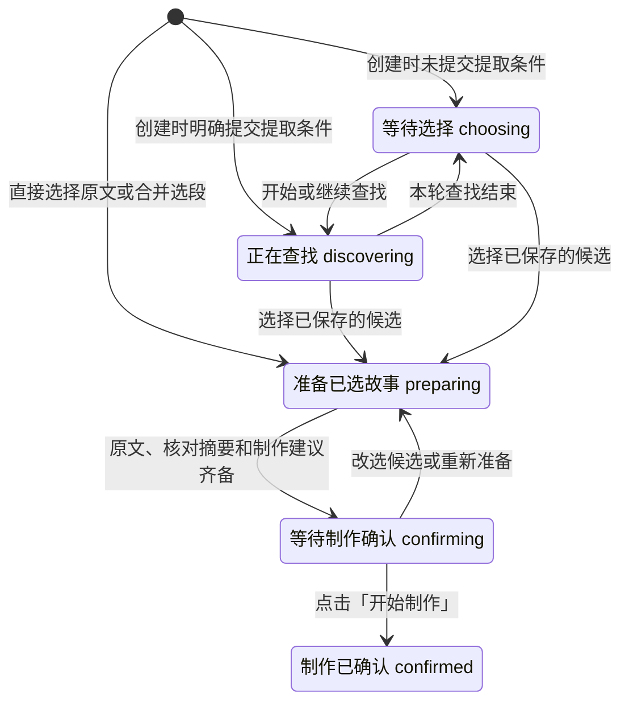

# 故事生成状态机

本文是选题、候选查找、准备与首次制作确认的行为规范，也说明替换选题怎样切换书架上的当前版本。「开始制作」之后，读者可执行的动作见[故事制作生命周期](story-production-lifecycle.md#事件规则)，每一步需要哪些输入、哪些结果可以复用见[制作 DAG](story-production-dag.md#产物有效性)。

## 从选题到首次确认

`intake.phase` 记录选题进展。`intake.search` 单独记录查找轮次和状态，因此读者可以在一轮查找结束前选用已保存的候选，也可以在准备当前故事时继续查看其他候选。

| 操作 | 当前任务发生的变化 |
| --- | --- |
| 创建 | 只保存书籍、主题和范围时，查找为 `idle`、轮次为 0。创建请求明确带提取条件时，首轮为 `searching`。直接选原文或合并选段会保存来源，进入准备。 |
| 修改条件或按标题提取 | 尚未选定故事时可更改条件。开始新查询会清空该任务的旧候选，更新选择代次和查找轮次，旧请求返回的候选不会混入新范围。 |
| 继续查找（`more`） | 增加查找轮次，保留已存候选。已有选择时保留当前准备阶段。合并选段已确定原文，不能追加候选。 |
| 选择候选（`choose`） | 绑定已存的批次和条目，停止本轮查找，进入 `preparing`。确认前改选其他候选时，清除旧原文和建议，保留读者改过或明确清空的要求。 |
| 保存设置（`draft`） | 可在 `preparing` 或 `confirming` 保存。制作要求和验收要求分别记录是否编辑过。迟到的准备结果只填入仍采用建议的字段。 |
| 重新准备（`recommend`） | 在 `confirming` 提交当前设置，回到 `preparing` 重新取得建议。读者改过的要求继续保留。 |
| 开始制作（`confirm`） | 校验当前选择代次、草稿依据、已存原文、制作建议及所需的已核摘要。通过后进入 `confirmed`，结束候选查找，授权后台制作。 |

旧记录可能保留了 `choosing`，却已保存完整准备结果。读取时会核对候选、标题、原文范围、幅数建议和所需摘要。全部匹配才显示待制作确认，读者可直接确认。读取这个检查点不会写库或调用模型。[阶段推导](../lib/reader-intake.ts) · [选题与确认回归](../tests/reader-intake.test.mjs)

## 候选查找何时调用模型

候选查找有独立队列。发起新调用需要有效的查找轮次、允许执行的控制状态，以及仍在查看选择界面的读者。打开没有查找请求的任务、轮询或重启服务，都不会自行开始提取。已经开始的轮次可在读者继续查看时逐项保存和展示候选。最后一位读者离开或查看租约过期后，停止发起新的查找调用。[调度实现](../server/reader-production.ts) · [首次提取回归](../tests/manual-extraction-start.test.mjs) · [连续查找回归](../tests/continuous-story-discovery.test.mjs)

`search.round` 隔离不同轮次的查找结果，`intake.generation` 隔离过期的选择和设置提交。本轮查找失败时，已保存的候选仍可选择。准备失败时，重试针对当前选题。暂停中的准备先恢复，准备齐备后仍须读者确认制作。[条件变更回归](../tests/discovery-conditions.test.mjs) · [选题与确认守卫](../lib/production-lifecycle.ts)

## 替换当前选题

替换草稿属于当前版本，单独查找候选，书架一直保留同一张卡片。有已选原文的任务在首次制作确认前也能打开替换草稿。直接在当前任务改选已保存候选使用 `choose`，在替换窗口提交则须校验草稿及其父版本。[替换实现](../server/reader-reselection.ts)

| 读者操作 | 书架与制作结果 |
| --- | --- |
| 打开替换窗口 | 建立或重用隐藏草稿。原版按其最新状态运行。草稿须发起自己的查找，选好的原文可等提交后再准备。 |
| 取消，或选回同一原文范围 | 关闭草稿，重新读取家族当前版。另一窗口已经完成、替换或删除故事时，以最新读取结果为准。相同标题不足以认定是同一来源。 |
| 提交另一选题 | 一次提交将书架卡片切到新版，保留收藏，阅读位置回到开头。旧版保留原文、分镜、图片和故障。新版按新原文准备，仍需首次制作确认。 |
| 替换窗口打开期间原版被暂停或停止 | 新版继承**提交当时**的控制状态。读者点击「恢复准备」后准备新选题，准备完成后再点「开始制作」。 |
| 草稿已过期，或提交成功但响应丢失 | 过期的新提交被拒绝。重放已受理的同一请求只返回已有结果。迟到的取消也不能删除已提交的新版。 |

替换与普通修订竞争同一个家族当前版本。两端基于同一旧版提交时，落后的提交不能覆盖先成功的版本。替换后的历史版仍可阅读，已派发的工作在原版收尾。[跨窗口与重放回归](../tests/story-generation-state-machine-reselection.test.mjs) · [版本与并发约束](story-production-dag.md#版本与并发约束)

## 确认后的制作与恢复

- 要判断读者此刻能做什么、一次恢复授权覆盖哪个故障，查[生命周期事件规则](story-production-lifecycle.md#事件规则)。
- 要判断分镜、审片和图片从哪里接续、是否会再次调用模型，查[调用契约](story-production-dag.md#调用契约)、[审片范围与结论](story-production-dag.md#审片范围与结论)和[异常与继续动作](story-production-dag.md#异常与继续动作)。
- 维护旧验收记录时，原编号与场景描述可查[收录第 3 至 9 节的历史版本](https://github.com/yysun/shiqu/blob/4d818c87ada69123c5648ab99d1a5d4b3c43aee2/.docs/story-generation-state-machine.md)。当前制作场景及验证记录见[受管用例目录](../.tests/story-lifecycle/SUITE.md)。
