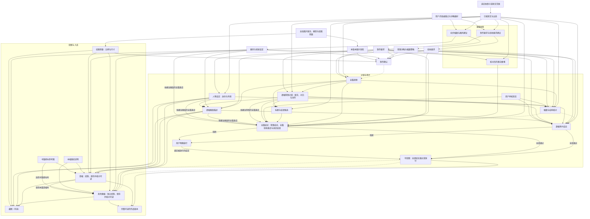
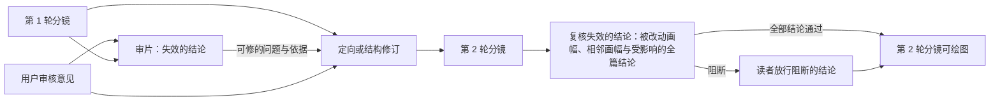

# 故事制作与编辑 DAG

故事生命周期、读者动作与并发授权见[故事制作生命周期](story-production-lifecycle.md)。本文定义产物有效性、就绪和复用。

目标设计 · 用于审阅

读者可以顺着制作时间线走，也可以回到任意可编辑的设置或已有产物。保存影响制作的修改后，当前版本进入「已保存，等待继续」，由读者决定何时接续。**一次编辑只重做受影响的部分，同时保留可复用的已完成结果。**

本文是制作与编辑的目标模型。落地后，[故事生成状态机](story-generation-state-machine.md)第 3 节的步骤推导和第 8 节的修订按钮以本文为准，其余执行门槛、故障实例、命令幂等和替换选题规则不变。

## 主图

实线是**硬依赖**：上游内容变化后，下游产物失效，需要重新生成。圆头线是**核对依赖**，供调用读取已有上下文及确定生成次序。虚线是执行门槛。审片拆为逐幅结论和全篇结论，局部改动只复核受影响的结论。每个节点代表可以独立判断是否有效的产物，多个产物可以由同一次模型调用生成。

- 选定范围提供事实边界。核对后的梗概覆盖本篇改编范围内的事件，供审片查漏。制作要求修改范围时，按新的范围重核梗概；保留原文，分镜仍直接读取原文。候选匹配和检索在选定来源之前发生。读者也可以直接从故事卡进入准备。
- 两项要求分别保存当前文字与读者是否编辑过。准备完成时更新未编辑的字段，读者写过或明确留空的字段保留。替换故事后，未编辑字段采用新选题的建议。改编重点只在准备阶段读取，确认后修改它不影响制作，除非读者明确「重新准备」。
- 幅数与画风建议是默认值。读者确认的是叙事详略和幅数策略，自动幅数仍由编排和审核共同确定。设置编辑发生在确认节点，图中从建议到设置的边表示采用建议时的来源。
- **制作确认把四项设置写成固定值。** 确认时固定当前文字，此后不再随准备建议变化，因此确认后建议或改编重点的变化不会使制作失效。确认同时记录图片服务、模型和绘图参数。确认后的「保存修改」在新修订中更新这些值，由「继续制作」授权；同一选题不需要再次确认，替换选题后须重新确认。文字和推理档位使用派发时的全局设置。
- 图里将各幅画面描述和图片合并展示，实际依赖按画幅记录。**绘图只读取本幅画面描述、本幅入画人物的设定、画风、绘图参数、本幅重绘说明和参考图。** 配文、对白和制作要求只经由画面描述影响图片。审片通过本身只授予绘图资格，验收要求不会成为图片的绘制输入。
- 审片产出逐幅结论和全篇结论，规则见下文「审片范围与结论」。一次审片同时选定标题与结语，并逐条判断验收要求。放行时沿用已选的结语，尚未选定时由读者在放行时选择。**读者改写或确认的标题与结语受保护**：它们是全篇审片结论的绑定输入，审片只判断其是否合格，不得另选；读者清除确认后，审片才重新从候选中选定。
- 幅数与结构核对在新编排或结构变化（增删、重排画幅）后执行，通过后才进入审片。
- 导出读取书架最新保存版本，按该版页序输出。需要插图的格式按页核对文件，缺图时指出页码。导出不创建修订，也不启动制作。公开仍要求完整可读的作品版本。

## 节点目录

实现以本表为准。「硬输入」任一变化使产物失效；核对输入在调用时须就绪，审片结论按各自绑定的内容复核。

| 节点 | 粒度 | 产生方式 | 硬输入 | 核对输入 | 读者可编辑 |
| --- | --- | --- | --- | --- | --- |
| 已核原文与出处 | 故事 | 来源核对 | 选定范围、出处版次 | — | 换范围或出处 |
| 事实梗概 | 故事 | 准备 | 原文、制作要求 | — | 是 |
| 两项要求建议、幅数与画风建议 | 故事 | 准备，可同一次调用 | 原文、改编重点 | — | 否 |
| 制作要求、验收要求、叙事详略与幅数策略、画风 | 故事 | 采用建议或读者填写，确认时固定 | 确认前且采用建议时为对应建议；确认后无 | — | 是 |
| 图片快照 | 版本 | 制作确认时记录 | — | — | 「应用当前模型设置」 |
| 绘图参数 | 版本 | 制作确认时记录 | — | — | 是 |
| 全篇提纲 | 故事 | 编排，不读取人物设定 | 原文、制作要求、详略与幅数策略 | — | 否，改设置后重编 |
| 人物设定 | 人物 | 首批分镜或单独恢复 | 原文、制作要求 | — | 是 |
| 叙事分镜 | 画幅 | 编排批次、修订、手改 | 提纲、原文、制作要求 | — | 是 |
| 画面描述 | 画幅 | 随分镜合批生成，也可单独恢复、换画风转换、修订、手改；同时产出本幅入画人物 | 提纲、制作要求、画风 | 本幅叙事分镜 | 是 |
| 标题与结语候选 | 故事 | 拟定 | 原文、提纲、画幅身份序列 | 叙事分镜 | 改写结语或标题 |
| 幅数与结构核对 | 轮次 | 审核 | 原文、提纲、画幅身份序列、制作要求、详略与幅数策略、审核意见 | 叙事分镜 | — |
| 审核意见 | 故事 | 读者填写 | — | — | 是 |
| 逐幅审片结论 | 画幅 | 同轮审片 | 原文、制作要求、画风、审核意见、本幅与相邻两幅的叙事分镜和画面描述、本幅入画人物设定 | — | — |
| 全篇审片结论 | 版本 | 同轮审片，涵盖叙事完整性、标题、结语和各条验收要求 | 原文、梗概、两项要求、提纲、画幅身份序列、全部叙事分镜与画面描述、画风、标题与结语候选及读者确认结果、审核意见和适用的幅数与结构核对 | — | 改写或确认标题与结语 |
| 明确放行 | 结论 | 读者操作 | 被放行的结论及其输入 | — | 撤回 |
| 重绘说明 | 画幅 | 读者填写 | — | — | 是 |
| 参考图 | 版本 | 当前书籍星标，或本篇首幅。无星标也无成图时，首幅可以没有参考 | — | — | 提供或重绘首幅 |
| 画幅图片 | 画幅 | 绘制并本地保存 | 本幅画面描述、本幅入画人物设定、画风、绘图参数、本幅重绘说明 | 参考图 | 指定重绘 |
| 完整作品 | 版本 | 判定 | 当前审核结论，每幅图片可读 | — | — |

横图是独立的印刷工作。新请求在读者明确发起时保存故事和绘图输入，进度、控制和回执由发起版本保管。升级时将旧版未完成的授权转成已暂停的独立套图，保留输入匹配的可读付费结果。图片快照决定之后绘图使用的服务和模型，不参与已有产物的有效性判断；提示词模板随应用升级变化时，同样只影响之后生成的产物。

## 产物有效性

**一个产物有效，当且仅当内容可读，且它记录的每项硬输入指纹都等于当前版本对应上游产物的指纹。** 调度、复用和重做范围预估由这条规则推导。故事阶段与可用动作由制作生命周期与当前任务共同决定。

- **指纹。** 每个产物保存规范化内容的指纹，以及生成时实际读取的上游指纹。规范化去掉首尾空白，并把「采用默认值」展开为实际值。显示名、署名、收藏和阅读位置不进入任何指纹。
- **调用契约。** 首次制作与重新编排时，首批分镜生成全篇提纲、人物设定和至多 20 幅的配文、画面描述。后续批次沿用已采用的提纲、人物和前批配文，每批一次调用。各产物仍按对应的硬输入分别保存。已确认的旧稿可以恢复原来分开派发的任务。局部恢复及修订仅生成缺失内容。
- **就绪与失效。** 产物首次生成前，它的硬输入和核对输入都须有效。画面描述在本幅叙事分镜与全篇人物设定就绪后生成。文字与绘图产物按硬输入判断有效性。审片另外检查当前内容的一致性。失效的画面描述也等本幅叙事分镜就绪。首幅成图正在重做时，其余需要重绘的画幅等新首幅完成后再绘制。单独重绘首幅时，其余已经有效的画幅仍保持有效。
- **画幅身份。** 每幅分镜有稳定的画幅身份。修订、手改、插入、删除和重排都保留原有画幅的身份，新增画幅和重新编排产生的画幅取得新身份。手改和重绘说明按画幅身份对应。由于绘图不读取相邻画幅，重排本身不使图片失效。导出读取书架最新版本，按该版的幅序和配文打印。
- **画幅身份。** 结构修订中的合并、拆分和改写均产生新画幅身份。原样保留的画幅保留身份、手改和重绘说明。保存预览列出将因失去画幅身份而丢弃的重绘说明。自动修订无法保留手改时停在「需读者处理」。图片继续按绘图输入指纹复用。
- **图片复用。** 一幅图可以用于任何绘图硬输入指纹与它记录的指纹相同的画幅，不要求画幅身份相同。因此重新编排后，画面描述等输入完全一致的画幅仍能沿用旧图。
- **入画人物。** 人物设定按名字和别名分条保存。画面描述读取全篇人物设定作为来源，并保存本幅实际入画的人物名单。手改画面描述时，按名字和别名把新出现的人物并入名单，保留用「他」「二人」等称呼的原有人物。手改配文只保存文字。绘图只读取本幅入画人物的条目，改一个人物只影响该人物入画的画幅。尚未记录入画人物的旧稿按全部人物计算。
- **派生产物。** 修订、手改和换画风转换产生的新产物，记录产生时当前版本各项硬输入的指纹，与新生成的产物相同。基准产物、旧画风、问题清单或编辑内容另存为「来源」，来源不参与有效性判断。之后硬输入再变化时，生成的派生产物同样失效；手改产物按手改保护处理。上游正在重新生成时，下游先不判定复用，等上游产出新指纹后再核对。
- **手改保护。** 手改的文字原样保留。清空手改字段并保存后，继续制作时重新生成。换画风直接转换手改的画面描述，结果保留手改标记。只有结构变化会移除含手改的画幅时，预览才列出原幅号及手改内容，读者可确认放弃并保存或取消。自动修订涉及手改时停在「需读者处理」并给出受影响幅号。
- **审片绑定。** 每条逐幅结论、全篇结论和每次明确放行，都只绑定它自己的输入指纹。其中任一项变化，这条结论只留在原内容上，需要复核；其他结论照常有效。配文或画面描述变动时，本幅和相邻画幅重新审片。
- **参考图。** 画幅图片记录绘制时实际使用的参考图。没有书籍星标时，尚未绘制的非首幅须等首幅可读。星标适用于之后派发的各幅；换画风或指定首幅原图的版本及其后续修订沿用自己的首幅。首幅被重绘或替换后，已有画幅保持有效。保存和完成界面都列出「N 幅使用了旧首幅参考」，并提供「按新参考重绘这些画幅」。之后新绘制的画幅读取当前适用的参考图。
- **重绘说明。** 重绘说明是本幅绘图的硬输入，随版本保留，直到读者清除。本幅画面描述被重新生成时自动清除，因为它针对的是旧画面。

## 调用契约

「绑定输入」决定产物有效性，记录在产物上；「来源」只供本次生成参考，不参与有效性；「上下文」用于阅读整篇，结论仍只能引用绑定输入和允许清单。本表列出全部模型调用，调用实际读取的内容不得超出本表所列；新增调用须先加入本表。

| 调用 | 产出 | 绑定输入 | 来源 | 上下文 |
| --- | --- | --- | --- | --- |
| 查找候选 | 候选故事 | 查找条件 | 本批次已保存的候选 | — |
| 原文核对 | 已核原文与出处 | 选定范围、出处版次 | — | — |
| 准备梗概 | 事实梗概 | 原文、制作要求 | — | — |
| 准备候选画风 | 候选故事的画风建议（候选缺少画风时） | 已核原文、选定故事 | — | — |
| 准备建议 | 核对后的梗概、两项要求建议、幅数与画风建议 | 原文、改编重点与叙事详略 | — | — |
| 人物设定 | 人物设定 | 原文、制作要求 | — | — |
| 编排提纲 | 提纲 | 原文、制作要求、详略与幅数策略 | — | — |
| 编排文字分镜批次 | 首批为全篇提纲、人物设定和本批配文、画面描述与入画人物；后续批次为本批画幅 | 原文、制作要求、详略、幅数策略、画风 | 已采用的提纲、人物和前批配文 | — |
| 编排叙事分镜批次 | 本批叙事分镜 | 提纲、原文、制作要求 | 同批已完成的叙事分镜 | — |
| 生成画面描述 | 本批各幅的画面描述、入画人物 | 提纲、制作要求、画风；核对：本幅叙事分镜 | 全篇人物设定、同批其他画幅的叙事分镜 | — |
| 换画风转换 | 本批各幅的画面描述、入画人物 | 同上，画风取新画风 | 旧画面描述、旧画风、全篇人物设定、同批其他画幅的叙事分镜 | — |
| 叙事修订 | 本批各目标画幅的叙事分镜 | 提纲、原文、制作要求 | 各目标画幅当前叙事分镜、相邻画幅叙事分镜、问题清单、审核意见；同批其他目标画幅 | — |
| 重新生成配文 | 读者清空的指定配文 | 提纲、原文、制作要求 | 原幅位置、相邻配文及审核意见 | — |
| 画面修订 | 本批各目标画幅的画面描述、入画人物 | 提纲、制作要求、画风；核对：本幅叙事分镜 | 各目标画幅当前画面描述与入画人物、全篇人物设定、问题清单、审核意见、同批其他目标画幅 | — |
| 结构修订 | 新的画幅身份序列与受影响画幅的叙事分镜 | 提纲、原文、制作要求、详略与幅数策略 | 当前全部叙事分镜、问题清单、审核意见 | — |
| 拟定标题与结语 | 标题与结语候选 | 原文、提纲、画幅身份序列；核对：叙事分镜 | — | — |
| 结语修订 | 标题与结语候选 | 原文、提纲、画幅身份序列；核对：叙事分镜 | 当前候选与选定结果、问题清单、审核意见 | — |
| 幅数与结构核对 | 幅数与结构核对结论 | 原文、提纲、画幅身份序列、制作要求、详略与幅数策略、审核意见；核对：叙事分镜 | — | — |
| 审片（批量） | 失效的逐幅结论与全篇结论 | 每条结论各自的输入，见节点目录 | — | 全篇叙事分镜与画面描述 |
| 绘图 | 画幅图片 | 本幅画面描述、本幅入画人物设定、画风、绘图参数、本幅重绘说明；核对：参考图 | — | — |
| 横图绘制 | 横图 | 本幅竖图、本幅画面描述、本幅入画人物设定、画风、绘图参数 | — | — |

准备阶段先采用已保存的原文与出处，缺失时由原文核对任务补齐。缺少候选画风时单独保存画风结果。建议与核对后的梗概一并保存，随后等待读者确认；无须为同一改编范围再核对一次梗概。

**逐幅调用按批执行。** 逐幅或逐条产出的调用合并成批次以减少模型调用：叙事分镜、画面描述、叙事修订、画面修订每批最多 20 幅，换画风转换每批最多 6 幅。审片每轮一个调用。批次只包含本轮需要生成的实例，按画幅顺序切分，因此首次制作 24 幅的画面描述为两次调用，只有一幅失效时只为该幅调用一次。每幅结果仍只绑定本幅自己的输入；同批其他实例只是来源，之后改动它们不使本幅失效。相邻画幅的衔接由逐幅审片结论负责，它绑定本幅与相邻两幅的叙事分镜和画面描述。绘图与横图每次一幅，不合批。

**每轮一次审片。** 幅数与结构核对通过后，合并失效的逐幅结论和全篇结论。全篇结论逐条判断验收要求，并在读者未确认时同时选定标题与结语。

**审片批量规则。** 一次审片调用可以产出多条结论。调用前确定本次允许替换的结论清单及每条结论的证据。每条结论只绑定自己的证据。调用读取其他内容作为上下文，超出允许清单的判断直接丢弃。画面问题与叙事问题分别交给画面修订和叙事修订。

## 审片范围与结论

**一次编辑只复核受它影响的结论。** 审片结果拆成两类，各自绑定自己的输入：

- **逐幅结论。** 每幅一条，判断本幅叙事分镜与画面描述是否忠于原文、符合制作要求和画风，以及与相邻画幅衔接。
- **全篇结论。** 判断叙事完整性、主线取舍、标题、结语及所有验收要求。每条验收要求记录通过、未通过或无法判断及依据。未通过的条目指向相关幅号或全篇。

**全篇结论的输入。** 绑定已核原文、梗概、提纲、幅数与结构核对、制作与验收要求、审核意见、画风、全部叙事分镜和画面描述、画幅顺序、结语候选与读者确认的标题及结语。验收要求的每项判断随全篇结论保存，可指出相关幅号。无法判断时提示读者修改要求。

**复核范围由失效的结论推导，** 不单独规定。例如：

| 改动 | 失效的结论 |
| --- | --- |
| 手改一幅画面描述 | 本幅及相邻两幅的逐幅结论、全篇结论 |
| 手改一幅配文、对白或动作 | 本幅及相邻两幅的逐幅结论、全篇结论 |
| 修改一个人物的设定 | 该人物入画的画幅的逐幅结论 |
| 修改梗概、标题或结语 | 全篇结论 |
| 插入、删除或重排画幅 | 新画幅、位置变化处相邻画幅的逐幅结论、全篇结论 |
| 换画风 | 全部逐幅结论、全篇结论 |
| 修改验收要求 | 全篇结论 |
| 修改制作要求或审核意见 | 全部结论 |

**审片只替换失效的结论。** 每次审片读取全篇作为上下文，只对失效的结论作出判断。输入未变的结论及其放行原样保留。

**调用方式。** 一轮失效结论合并为一次调用。允许清单以外的判断直接丢弃。

需要补充全篇审核依据时，可以保存审核意见。全篇复核按钮的范围见[生命周期入口](story-production-lifecycle.md#事件规则)。

**可绘图条件。** 全部逐幅结论与全篇结论都有效，且每条都通过或被放行。

**仍然绘图。** 成稿的幅数核对或审片失败时，可放行当前阻断的结论及其输入。调用正在执行时等结果返回；标题或结语尚未选定时由读者选择。

**修订按轮次向前。** 发现可修问题时，修订从当前稿和问题清单生成新稿。修订可以只改一幅，也可以增删、重排画幅。被修订改动的画幅使相应结论失效，随后复核这些结论；结构变化先重新核对幅数与结构。

每个保存的修订有 20 次自动修订额度，各次审片共用；「继续自动修复」授予新的 20 次。后续轮次以同样方式向前追加。要求冲突、证据不足、修订无变化、问题只涉及手改字段或额度耗尽时，停在问题对应的步骤并保留已有产物。放行或进一步修订需要对应当前审核结果。修订保留画幅身份，新增画幅取得新身份。

## 完整场景矩阵

从选题到图像入库，以及已有作品的制作修订，都按三个条件判断。**当前有哪些有效产物、这次改变了哪些输入或产物、当前有哪些执行授权。** 先在「修改范围」找受影响的节点，再按「制作阶段」看哪些前置产物已就绪，最后应用暂停、确认和故障规则。任意几个条件相遇时按这个顺序组合，界面显示最早能接续的工作和仍在等待的原因。

### 修改范围

| 用户修改 | 新版本需要做什么 | 可以复用什么 |
| --- | --- | --- |
| 未选定故事时修改书籍、章节范围、主题或目标标题 | 更新查找条件。提交查找后，从新范围检索或提取候选 | 仍与新条件匹配且出处有效的候选 |
| 换选题、原文范围或出处版次 | 重新核对原文并准备梗概、两项建议及默认设置，等待确认 | 同一家族的历史版本、可继承的用户设置 |
| 确认前修改改编重点 | 仍采用建议的字段标为待更新，明确「重新准备」后复核梗概和建议 | 原文、读者已编辑的字段 |
| 修改制作要求 | 按新的制作范围复核梗概，重新编排提纲、人物、叙事分镜与画面描述，再审片 | 已核原文。新画面描述与旧图的绘图输入相同时沿用旧图 |
| 修改叙事详略或幅数策略 | 重新编排，核对幅数、故事完整性和画幅对应关系 | 已核原文、仍适用的要求。新画面描述与旧图的绘图输入相同时沿用旧图 |
| 仅修改验收要求 | 用现有分镜重新判断全部结论。发现可修问题时，只修受影响的部分 | 分镜、已完成的幅数核对、结语候选和成图。后续修订改变绘图输入时，再重新判断对应图片 |
| 修改审核意见 | 从对应的审核或修订检查点接续，按更新后的意见处理当前问题 | 当前稿、已完成的有效修订 |
| 修改人物设定 | 标记引用该人物的画面描述待核对，复核出现该人物的画幅；这些画幅的图片失效 | 提纲、叙事分镜、未出现该人物的画幅图片 |
| 换画风预设、修改或恢复默认画风提示 | 把画面描述转换为新画风，按新画风审片，重绘全部画幅 | 原文、提纲、人物、叙事分镜与结语候选 |
| 把当前全局模型设置应用到本版本 | 更新图片快照，只影响之后的绘图 | 全部已有产物。需要用新模型重做时，另行指定重绘或重新编排 |
| 修改绘图参数（比例、尺寸） | 单篇编辑入口不提供 | 全部已有产物 |
| 手改一幅配文、对白或动作 | 保存叙事分镜的新产物，复核本幅、相邻画幅、依据含叙事的全篇条目和全篇审片结论 | 原文、提纲、本幅画面描述与图片、其他画幅 |
| 手改一幅画面描述 | 复核本幅及相邻画幅和依据含画面的全篇条目，本幅图片失效 | 叙事分镜、其他画幅的图片 |
| 插入、删除、替换或重排画幅 | 保存新结构，核对幅数、连续性和全篇完整性，重新拟定结语候选。新画幅补齐叙事分镜与画面描述 | 保留画幅的叙事分镜、画面描述和图片。首幅换成另一幅时按参考图规则提示 |
| 修改审核使用的梗概、拟定标题或结语 | 按修改后的内容复核全篇结论 | 原文、分镜和全部图片。纯展示名走下方改名规则 |
| 指定重绘一幅或多幅，附本次重绘说明 | 用当前已审画面描述从指定绘图任务开始 | 分镜、审片结果和其它图片 |
| 提供或重绘作为参考的首幅 | 确认时可选择按新首幅同时重绘其余画幅。已选择重绘的画幅等新首幅保存后开始 | 文字与审核，其他画幅图片 |
| 更换书籍参考图 | 只影响之后派发的绘图；在途任务沿用已取的参考图，已保存画幅保持有效 | 全部产物 |
| 生成或重绘横图 | 从指定横图的任务开始。读者手动选择重新申请。先前的横图保留供导出 | 主制作流程的产物和其它横图 |
| 将一个历史版本恢复为当前版本 | 不提供 | 历史版继续可读 |
| 修改书架显示名 | 更新展示名称 | 所有制作产物 |
| 重复提交同一输入，或恢复到与已有产物相同的输入 | 显示无内容变化，或采用仍有效的旧产物 | 输入相同且可读的结果。明确指定重试或重绘时按对应授权执行 |

提交修订后，先从发生变化的输入出发，找可以运行的节点：缺失的节点须硬输入与核对输入都已有效，失效的节点须硬输入都已有效，且不依赖未解除的故障。当前版本已获授权时，这些节点就是接下来可运行的工作，可以有多个。每生成一个产物，再核对它的直接下游。下游**实际读取的硬输入**指纹相同且旧产物健全可读时，沿用旧产物。比如重新审片通过后，本幅画面描述、入画人物设定、画风、绘图参数和重绘说明都与旧图一致，原图仍可用。用户指定重做时，为指定范围创建新尝试。

手改分镜时，将修改保存为该节点的新产物，再检查它的下游。若重新编排会移除手改画幅，预览列出内容，由读者一次确认后保存。

### 制作阶段

| 当前阶段 | 提交时如何判断下一步 |
| --- | --- |
| 尚未选题，候选正在查找或已列出 | 更换条件后使用新查找批次；选定可核对的候选即可开始准备。已发出的旧查找结果归原批次 |
| 已选题，原文未准备好 | 先核对并保存选定范围的原文。制作设置可先保存为草稿 |
| 原文已就绪，建议正在准备 | 保存明确填写或留空的字段。结果回来后只补本选题、输入仍有效且尚未编辑的字段。草稿改动使准备输入过期时，显示待按新设置准备 |
| 待制作确认 | 保存设置草稿，显示已有建议与将来影响。明确「重新准备」才运行受影响的准备步骤；确认制作后才开始编排 |
| 提纲已生成或分镜仅完成部分批次 | 复用仍有效的提纲和已完成批次，补缺失批次。仅改画风时，已完成批次的叙事分镜仍有效，只转换画面描述 |
| 分镜齐备，标题、结语或幅数核对待完成 | 先完成仍缺的产物。变动影响某个更早节点时，先处理那个节点；其它有效检查点保留 |
| 全篇审片、定向修订或复核中 | 用变更后的输入选择最早接续节点。各条结论绑定自己的输入，仍有效的结论保留；新的修订从当前稿及其适用的问题清单开始 |
| 审核已通过，等首幅或正在出图 | 依据画幅的硬输入找缺失或失效的图。如果审片也过期，先更新审片，随后才开新绘图任务 |
| 已绘制，等待保存或核对媒体 | 成功生成的结果可读时优先完成本地保存和核对。文件无法读取时按对应故障处理 |
| 整篇已完成 | 展示当前可读版本。提交编辑后按相同依赖规则创建修订；更早的版本保留在历史 |

### 多个修改同时提交

| 组合 | 继续时的行为 |
| --- | --- |
| 制作要求与叙事详略或幅数同时修改 | 合并新设置，编排一次，随后核对幅数和叙事完整性 |
| 制作要求与验收要求同时修改 | 按新制作要求编排，用新版验收要求审核新分镜 |
| 制作要求与画风同时修改 | 编排一次，叙事分镜完成后直接按目标画风生成画面描述，不经过转换 |
| 画风与验收要求同时修改 | 转换画面描述，用新画风与新验收要求做一次全篇审核 |
| 换选题并提交制作设置 | 给新选题准备建议，保留明确提交的设置。依赖旧故事的逐幅编辑、重绘和审核意见由读者重新确认适用范围 |
| 改上游输入，同时手改或指定重绘某一旧画幅 | 验证旧画幅在新版是否仍存在且能对应。冲突时保留草稿，等读者选择如何处理，再开始相关任务 |
| 删除、重排与编辑同一批画幅 | 依据画幅身份合并。删除与编辑指向同一幅时需要读者取舍 |
| 多幅独立编辑或重绘 | 合并各幅需要复核的结论，共同上游只执行一次，复核合并为一次。每个审片阶段仍只调用一次 |
| 产物修改与改显示名同时发生 | 显示名独立更新，需要重跑的步骤按实际内容改动计算 |

用本次提交的最终设置求所有受影响节点的并集，并按依赖排队。一个节点同时被几项改动影响时，用合并后的输入执行一次。每一步的真实调用须与节点目录一致，调用实际读取的内容不得超出「调用契约」所列。提纲和叙事分镜不读取画风，画风只在画面描述、审片和绘图中应用。自由文本的「制作要求」进入提纲，改这个字段时从提纲重算。只改视觉表现可直接编辑画风或画面描述。

## 保存、暂停与继续

**制作编辑统一用「保存修改」。已确认制作后，保存影响制作的修改会提交为当前修订，同时进入「已保存，等待继续」。** 这条规则适用于原版正在运行、已暂停、遇到故障或已经完成的情况。未提交的编辑仍按现有草稿机制保留，草稿无需成为另一种提交按钮。

保存前显示接续点与可预估的重做范围，包括将失效的图片数和将丢弃的重绘说明。保存成功后，在所属流程步骤显示「已保存，等待继续」和接续说明，例如「继续后，将从画面描述开始，完成后重新审片」。该步骤提供一个明确的「继续制作」动作，授权当前保存版本接续。制作要求、画风、验收要求、分镜和审核意见都遵守这套规则。环节名称用于说明下一步，保存按钮的含义始终一致。

已完成的作品可从阅读器直接重绘一幅。「确认重新生图」提交新版并立即把该幅加入绘图队列。旧版套图仍保存在原版本，新版打印使用本版图稿。新版沿用分镜、审片结果和其他画幅，原版仍可阅读。命令行的 `stories edit` 仍按保存、继续、运行的顺序执行。

「已保存，等待继续」在持久状态上是暂停，并带有原因「修订待继续」，与读者主动暂停区分显示。「继续制作」同时解除这两种暂停。它不清除故障，也不代替放行。

本规则取代状态机文档第 8 节中的「应用修改并恢复」「保存并重新审核」和确认后修订的「开始制作」，这三个动作改为「保存修改」加「继续制作」。「仍然绘图」在当前稿件上直接提交审核放行。CLI 的修订与继续命令及 `skills/shiqu/SKILL.md` 同步采用这套语义。

提交和暂停必须一次生效。切换到当前修订后，上一版停止领取新任务。在途工作可以按原版本结算，当前修订保持等待。刷新、关闭编辑器或重启服务后，等待状态继续保留。保存冲突时保留用户输入，等读者处理冲突后再提交。

| 动作 | 对执行的授权 |
| --- | --- |
| 打开或取消替换草稿、选回当前同一原文范围 | 保留书架当前版及其最新状态。取消后重新读取当前版。草稿内查找沿用独立的查找授权 |
| 选择故事或「选择并替换」 | 明确提交选题时授权该选题的准备。新选题可生成原文和两项建议，再停在「待制作确认」 |
| 暂停当前工作 | 停止领取新的授权任务。已经发出的任务可结算到原来的输入版本；界面显示正在收尾 |
| 停止当前制作 | 撤回本阶段的继续执行授权，保留已完成结果。后续须按当前版本重新确认适用的恢复动作 |
| 制作确认前「保存修改」 | 将修改写入当前制作设置，保留「待制作确认」门槛。需要重新生成建议时，显示「继续准备」，仅授权准备 |
| 制作确认后「保存修改」 | 保存有效修改并暂停，等待「继续制作」。保存后没有需要重做的节点时（例如只改显示名、书籍参考图，或恢复到相同输入），沿用原来的制作状态 |
| 「开始制作」 | 首次确认当前设置，记录图片快照，并授权正式制作 |
| 「确认重新生图」 | 授权绘制选中画幅的竖图 |
| 「继续制作」 | 授权当前已保存的修订，从 DAG 算出的最早有效接续点继续。仍需满足确认门槛。它推进不依赖未解除故障的工作；当前版本中已有故障的节点仍需各自的恢复动作。单独发起故障重试或指定重绘时，授权按其明确目标计算 |
| 「仍然绘图」 | 审片阻断或审核调用失败且稿件完整时，放行当前所有待定或阻断的结论，包括幅数与结构核对。需要时确认标题与结语。各结论单独绑输入，审核运行中不可用 |
| 手动暂停后恢复，或停止后重新开始 | 无新修改时继续原有的已授权工作。已停止的工作重新取得适用授权。待确认和故障恢复门槛照常检查 |
| 打开、关闭或刷新故事 | 制作继续按当前读者控制推进。打开的故事优先绘图，各篇按幅序。候选查找仍需选择界面保持打开 |

图中的制作确认标出正式制作的入口。每次启动任务都要核对当前版本和该步骤的授权。界面从产物和授权推导进度。同一篇故事可以同时处于「原文已就绪、建议准备已暂停、分镜待确认」。两项要求暂时没生成时显示「等待准备建议」或「准备已暂停」，用户明确清空时才显示「已留空」。提交替换后如果网络或模型失败，选题继续保留，读者可重试准备。

## 异常与继续动作

| 遇到的情况 | 系统如何接续 |
| --- | --- |
| 查找失败，已有部分候选 | 继续允许选择已核候选。重试只查当前范围的剩余候选 |
| 原文无法核对，或仍缺关键段落 | 停在来源核对，要求重新选择、补范围或重试。依赖该原文的准备与制作等待核对成功 |
| 准备调用失败，原文已核对 | 保留原文、用户草稿及已存产物。经授权重试缺失的准备任务 |
| 并行分镜批次或图片只完成一部分 | 成功批次及画幅继续可用。按未完成或失效的任务接续 |
| 审片发现可修的局部问题 | 保存问题依据。定向修订受影响的分镜或结语，随后复核失效的结论 |
| 审片发现需要调整幅数或整体结构 | 从结构修订或重新编排开始，重新检查全篇。按绘图硬输入指纹核对可复用图片 |
| 审片问题只能通过改动手改字段解决 | 停在「需读者处理」，显示问题与对应手改。读者改写、清空该手改字段以重新生成或明确放行 |
| 验收要求冲突或无法核对 | 保留逐条理由并暂停后续绘图。读者调整相关要求后重新审片 |
| 自动修订无进展或额度用尽 | 保留最后一份稿及审片依据。按当前问题提供继续修订、手改或适用的明确放行 |
| 有效审核结果对应的是较早的分镜、要求或画风 | 结果留在原版本。当前版依其实际内容取得审核结论后才进入绘图 |
| 模型以内容安全为由拒绝生成 | 记为「内容被拦截」故障，中断恢复不自动重试。绘图被拦截时，提供修改本幅画面描述或重绘说明；文字步骤被拦截时，提供修改制作要求、原文范围或相关手改内容。两种情况都可以明确重试一次 |
| 密钥缺失、登录失效、额度不足或被限流 | 记为服务级故障，不写入各篇的步骤故障。限流自动退避；其余情况下所有受影响故事显示同一原因，配置恢复后无需逐篇重试 |
| 图片快照里的服务已不可用 | 绘图等待，并提供「应用当前模型设置」。文字继续使用全局配置 |
| 全局文字服务不可用 | 等待该服务恢复，显示服务级原因，不为每篇故事建立步骤故障 |
| 调用超时或无响应 | 按中断处理，计入同一任务最多 3 次自动尝试 |
| 图片生成失败 | 只重试经授权的失败画幅，首幅参考未就绪时，引用它的画幅等待 |
| 绘图成功，但保存或发布失败 | 原输出可读时只重试本地保存。只有确认原输出失效时才要求授权重绘 |
| 已保存图片暂时读不到 | 显示待核对。读回后直接恢复可用；确认缺失或损坏后，才把对应画幅列为待重绘 |
| 参考图确认缺失 | 暂缓尚未绘制、需要该参考的画幅。已有画幅保持有效。参考恢复后继续；重绘首幅时可明确选择使用新首幅重绘其余画幅 |
| 同时存在多个故障 | 授权恢复的目标可以单独处理，但它自己的硬输入须有效。其余阻断仍显示，全部必要产物有效后才判定整篇完成 |
| 历史版本有完整作品，但缺少新式审核、指纹或画幅身份 | 继续读取作品，按下文「升级转换」处理 |

图片内容不做自动审核。「核对可读」只确认文件能完整读取，画面问题由读者指定重绘。

## 版本与并发约束

- 同一故事家族仍对应一张书架卡。替换选题和确认后的修订提交新版本，切换当前版本同时保留历史。制作确认前保存草稿时，仅更新当前草稿的输入修订。
- 一项任务启动前须绑定故事版本、节点与粒度键、硬输入指纹及本次执行身份。任务身份由这些要素计算，提交产物时再次核对。迟到的付费结果保存在故事家族内。当前版只在仍需要该产物、硬输入匹配且图片可读时采用，已采用的结果保持不变。
- **故障留在原版本。** 保存新修订时，预览列出继续后需重绘的画幅，并单独标出已确认丢失的画幅。「继续制作」授权新版按当前输入补齐失效或缺失的产物，先核对可读的同输入付费结果。原版本保留归属于它的故障和恢复回执。
- **故障只阻断依赖它的工作。** 普通生产，包括「继续制作」授权的工作，跳过故障节点及硬依赖它的节点，其余就绪工作照常推进；首幅故障会阻断尚未绘制的非首幅。必需节点（完成条件涉及的节点及其上游）的故障未解除前整篇不判定完成；横图等可选产物的故障只阻断该产物，不影响完成与导出。服务级故障阻断所有需要该服务的工作；审片阻断按可绘图条件处理。
- 故障和重试按步骤与尝试记录，暂停按被授权的阶段记录。重启后按已保存产物和授权恢复。向同一步骤重放同一条命令时读取已有回执，避免重复生成。新版本也能显式复用符合条件的旧产物。
- `stories` 保存版本、选择与读者控制。家族产物只追加，每版保存采用的引用。阅读、复制和导出按有序画幅构造分镜与图片。队列保存任务与租约；执行日志保留领取、发送、结果、失败、授权重试和修订额度。
- **一次书库升级。** 格式 1、2、3 在首次打开时直接升到格式 4。应用先验证整库备份，再按每版当时的输入采用有效产物。既有绘图许可和放行改为绑定当前稿件的放行记录。转换期间模型调用为零。无法转换的原记录留在书库，书架给出诊断。未完成的阅读模式作品以及有授权的旧横图转为暂停，横图从独立入口恢复。

| 并发事件 | 必须满足的结果 |
| --- | --- |
| 编辑窗口打开后，当前步骤先完成 | 提交时按最新已保存产物计算复用范围。若编辑依据的内容或设置已被改写，保留草稿并提示重新核对 |
| 两个窗口同时提交修订，或一边替换选题一边编辑旧版 | 原子地提交一个当前版本。基于旧版本的后续提交提示冲突，并保留未提交的编辑 |
| 新版本提交后，旧任务才返回成功或失败 | 故障留在原版本。新版补绘在同输入的旧任务结算后检查付费结果，可读时直接采用 |
| 暂停或停止与任务领取同时发生 | 在领取前和正式调用前验证授权。已发出的任务按原版本收尾，新任务服从生效后的控制状态 |
| 已提交动作响应丢失，读者再次点击 | 同一请求返回原提交或恢复回执。控制状态、重试额度和新版本保持实际最新值 |
| 重启时已有结果、部分结果或只有在途记录 | 有效结果继续可用。只补缺失检查点或按当前中断恢复规则处理在途任务 |
| 查看历史版、当前版已换或已删除 | 只读展示可访问的历史。当前版失效时提示并重新定位，提交和恢复须绑定仍有效的当前版本 |
| 故事在任务执行中被删除 | 停止领取新任务和新的付费发送。已发出的任务在租约内按原版本收尾：成功的结果和可选产物（如横图）的失败都写回原版，恢复删除后不重复付费，失败的画幅仍可重试。删除前已保存的产物随删除规则处理 |

## 实现后的验收场景

原编号 1–59 的操作、预期和去向统一在 [Test Manager 制作 DAG 验收索引](../.tests/story-lifecycle/SUITE.md#制作-dag-验收索引)。例如 [35 · 描述入画与配文提及](../.tests/story-lifecycle/SUITE.md#dag-35) 分别关联正式绘图回归和编辑器提示。执行结果按用例与构建记录在[运行台账](../.tests/story-lifecycle/RUNS.md)。

相关文档：[从候选故事到文字分镜](story-creation-flow.md)、[故事生成状态机](story-generation-state-machine.md)。
