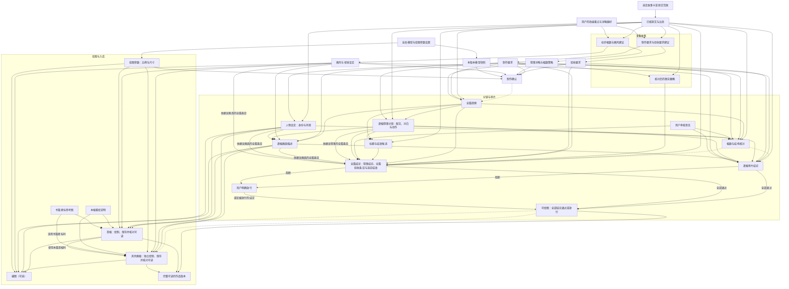
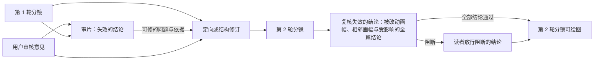

# 故事制作与编辑 DAG

故事生命周期、读者动作与并发授权见[故事制作生命周期](story-production-lifecycle.md)。本文定义产物有效性、就绪和复用。

目标设计 · 用于审阅

读者可以顺着制作时间线走，也可以回到任意可编辑的设置或已有产物。保存影响制作的修改后，当前版本进入「已保存，等待继续」，由读者决定何时接续。**一次编辑只重做受影响的部分，同时保留可复用的已完成结果。**

本文是制作与编辑的目标模型。落地后，[故事生成状态机](story-generation-state-machine.md)第 3 节的步骤推导和第 8 节的修订按钮以本文为准，其余执行门槛、故障实例、命令幂等和替换选题规则不变。

## 主图

实线是**硬依赖**：上游内容变化后，下游产物失效，需要重新生成。圆头线是**核对依赖**：上游变化后下游产物保留，标注「基于旧输入」，交由审片或读者判断。虚线是执行门槛。审片拆为逐幅结论和全篇结论，局部改动只复核受影响的结论。每个节点代表可以独立判断是否有效的产物，多个产物可以由同一次模型调用生成。

- 选定范围提供事实边界。核对后的梗概覆盖本篇改编范围内的事件，供审片查漏。制作要求修改范围时，按新的范围重核梗概；保留原文，分镜仍直接读取原文。候选匹配和检索在选定来源之前发生。读者也可以直接从故事卡进入准备。
- 建议、用户编辑和已经确认的设置分别保存。两项要求各自区分「建议尚未生成」「采用本篇建议」「用户填写」「用户明确留空」。准备完成时可以补齐尚未编辑的字段，用户写过或明确清空的字段保留。替换故事后，仍采用自动建议的字段改用新选题的建议。改编重点只在准备阶段读取，确认后修改它不影响制作，除非读者明确「重新准备」。
- 幅数与画风建议是默认值。读者确认的是叙事详略和幅数策略，自动幅数仍由编排和审核共同确定。设置编辑发生在确认节点，图中从建议到设置的边表示采用建议时的来源。
- **制作确认把四项设置写成固定值。** 采用建议的字段在确认时复制建议内容，此后不再依赖建议，因此确认后建议或改编重点的变化不会使制作失效。确认同时记录模型快照和绘图参数。确认后的「保存修改」在新修订中更新这些值，由「继续制作」授权；同一选题不需要再次确认，替换选题后须重新确认。全局设置的变化只影响之后新建的故事。
- 图里将各幅画面描述和图片合并展示，实际依赖按画幅记录。**绘图只读取本幅画面描述、本幅入画人物的设定、画风、绘图参数、本幅重绘说明和参考图。** 配文、对白和制作要求只经由画面描述影响图片。审片通过本身只授予绘图资格，验收要求不会成为图片的绘制输入。
- 审片产出逐幅结论和全篇结论，规则见下文「审片范围与结论」。全篇叙事结论选定标题与结语，依赖选定结语的验收条目在选定结语保存后再审。放行时沿用已选的结语，尚未选定时由读者在放行时选择。**读者改写或确认的标题与结语受保护**：它们是全篇叙事结论的绑定输入，审片只判断其是否合格，不得另选；读者清除确认后，审片才重新从候选中选定。
- 幅数与结构核对在新编排或结构变化（增删、重排画幅）后执行，通过后才进入审片。
- 导出与公开只读取「完整可读的作品版本」。

## 节点目录

实现以本表为准。「硬输入」任一变化使产物失效；「核对输入」变化只给产物加「基于旧输入」标记，并让依赖它的审片过期。

| 节点 | 粒度 | 产生方式 | 硬输入 | 核对输入 | 读者可编辑 |
| --- | --- | --- | --- | --- | --- |
| 已核原文与出处 | 故事 | 来源核对 | 选定范围、出处版次 | — | 换范围或出处 |
| 事实梗概 | 故事 | 准备 | 原文、制作要求 | — | 是 |
| 两项要求建议、幅数与画风建议 | 故事 | 准备，可同一次调用 | 原文、改编重点 | — | 否 |
| 制作要求、验收要求、叙事详略与幅数策略、画风 | 故事 | 采用建议或读者填写，确认时固定 | 确认前且采用建议时为对应建议；确认后无 | — | 是 |
| 模型快照 | 版本 | 制作确认时记录 | — | — | 「应用当前模型设置」 |
| 绘图参数 | 版本 | 制作确认时记录 | — | — | 是 |
| 全篇提纲 | 故事 | 编排，不读取人物设定 | 原文、制作要求、详略与幅数策略 | — | 否，改设置后重编 |
| 人物设定 | 人物 | 单独调用，不读取提纲 | 原文、制作要求 | — | 是 |
| 叙事分镜 | 画幅 | 编排批次（不读取画风）、修订、手改；同时产出本幅候选人物 | 提纲、原文、制作要求 | — | 是 |
| 画面描述 | 画幅 | 叙事分镜就绪后单独生成、换画风转换、修订、手改；同时产出本幅入画人物 | 提纲、制作要求、画风 | 本幅叙事分镜、本幅候选人物的设定 | 是 |
| 标题与结语候选 | 故事 | 拟定 | 原文、提纲、画幅身份序列 | 叙事分镜 | 改写结语或标题 |
| 幅数与结构核对 | 轮次 | 审核 | 原文、提纲、画幅身份序列、制作要求、详略与幅数策略、审核意见 | 叙事分镜 | — |
| 审核意见 | 故事 | 读者填写 | — | — | 是 |
| 验收条目 | 条目 | 验收要求按条目保存，每条有稳定身份；范围与依据由登记调用产出，读者可修改 | 验收要求（登记另以本条文字为硬输入） | — | 随验收要求编辑；可改登记 |
| 逐幅审片结论 | 画幅 | 审片 | 原文、两项要求、画风、审核意见、本幅与相邻两幅的叙事分镜和画面描述、本幅入画人物设定 | — | — |
| 全篇叙事结论 | 版本 | 审片；没有读者确认的标题与结语时，同时从候选中选定 | 原文、梗概、两项要求、提纲、画幅身份序列、标题与结语候选、读者确认的标题与结语（若有）、审核意见；需要时还有通过的幅数与结构核对 | 叙事分镜 | 改写或确认标题与结语 |
| 全篇验收条目结论 | 每条全篇条目 | 审片 | 原文、该条验收条目、审核意见，以及该条目登记的依据：叙事分镜（全部）、画面描述（全部，含入画人物设定与画风）、画幅顺序、标题与选定结语，可多选 | — | — |
| 明确放行 | 结论 | 读者操作 | 被放行的结论及其输入 | — | 撤回 |
| 重绘说明 | 画幅 | 读者填写 | — | — | 是 |
| 参考图 | 版本 | 当前书籍星标，或本篇首幅。无星标也无成图时，首幅可以没有参考 | — | — | 提供或重绘首幅 |
| 画幅图片 | 画幅 | 绘制并本地保存 | 本幅画面描述、本幅入画人物设定、画风、绘图参数、本幅重绘说明 | 参考图 | 指定重绘 |
| 横图 | 画幅 | 绘制 | 本幅图片、本幅画面描述、本幅入画人物设定、画风、绘图参数 | — | 生成或重绘 |
| 完整作品 | 版本 | 判定 | 当前审核结论，每幅图片可读 | — | — |

横图不计入整篇完成条件。模型快照决定之后的调用使用哪个模型，不参与已有产物的有效性判断；提示词模板随应用升级变化时，同样只影响之后生成的产物。

## 产物有效性

**一个产物有效，当且仅当内容可读，且它记录的每项硬输入指纹都等于当前版本对应上游产物的指纹。** 调度、复用和重做范围预估由这条规则推导。故事阶段与可用动作由制作生命周期与当前任务共同决定。

- **指纹。** 每个产物保存规范化内容的指纹，以及生成时实际读取的上游指纹。规范化去掉首尾空白，并把「采用默认值」展开为实际值。显示名、署名、收藏和阅读位置不进入任何指纹。
- **调用契约。** 每次模型调用都按下文「调用契约」声明它读取的内容。生成类调用只读取所产出节点的硬输入、核对输入和声明的来源，不同输入契约的生成产物不在同一次调用中产出；叙事分镜的调用不含画风，画面描述在叙事分镜就绪后单独生成，人物设定与提纲各自调用、互不读取。调用只重新生成缺失或失效的产物，仍然有效的字段由系统原样合并，不交给模型重写。审片是唯一的批量调用，规则见「调用契约」。
- **就绪与失效。** 产物首次生成前，它的硬输入和核对输入都须已有效；例如画面描述须等本幅叙事分镜及候选人物就绪，它不读取尚未产生的入画人物。已有产物是否失效只看硬输入，核对输入之后的变化只产生「基于旧输入」标记。失效产物的重做一般只需硬输入就绪；画幅图片例外：首幅成图正在重做时，其余需要重绘的画幅等新首幅完成后再以它为参考绘制，避免例如换画风后以旧画风首幅作参考。首幅只是被替换、其余画幅不需重绘时，它们仍保持有效并提示「使用旧参考」。
- **画幅身份。** 每幅分镜有稳定的画幅身份。修订、手改、插入、删除和重排都保留原有画幅的身份，新增画幅和重新编排产生的画幅取得新身份。手改、重绘说明和横图按画幅身份对应。由于绘图不读取相邻画幅，重排本身不使图片失效。
- **合并与拆分。** 结构修订合并画幅时，合并结果沿用其中第一幅的身份；拆分画幅时，第一段沿用原身份，其余各段取得新身份。手改、重绘说明和横图只在该画幅内容未被改写时随身份保留，否则被丢弃。读者保存时，保存预览列出将丢弃的内容；自动修订按下文手改保护处理。
- **图片复用。** 一幅图可以用于任何绘图硬输入指纹与它记录的指纹相同的画幅，不要求画幅身份相同。因此重新编排后，画面描述等输入完全一致的画幅仍能沿用旧图。
- **候选人物与入画人物。** 人物设定按人物分条保存，每条带有名字和别名。叙事分镜产出本幅「候选人物」，即本幅叙事涉及的人物；手改配文、对白或动作后，按名字和别名在新文字中匹配，重新得出候选人物。画面描述读取候选人物的设定，产出本幅「入画人物」，即画面中实际出现的人物；手改画面描述后，按名字和别名在新画面描述中匹配，重新得出入画人物。读者可在编辑器里调整两份名单。候选人物只是画面描述的核对输入，配文提到某人不会直接改变绘图输入；入画人物变化属于本幅绘图硬输入的变化。绘图只读取本幅入画人物的条目，改一个人物只影响该人物入画的画幅。尚未记录入画人物的旧稿按全部人物计算。
- **派生产物。** 修订、手改和换画风转换产生的新产物，记录产生时当前版本各项硬输入的指纹，与新生成的产物相同。基准产物、旧画风、问题清单或编辑内容另存为「来源」，来源不参与有效性判断。之后硬输入再变化时，派生产物与其他产物一样失效。上游正在重新生成时，下游先不判定复用，等上游产出新指纹后再核对。
- **手改保护。** 读者手改过的字段在任何节点上都不会被静默覆盖，包括梗概、人物、叙事分镜、画面描述、标题与结语。自动修订遇到只能改动受保护字段的问题时，停在「需读者处理」。结构修订在提交结果前，检查是否会删除、合并、拆分或改写含手改的画幅；会造成手改损失时，同样停在「需读者处理」，由读者明确同意后才提交。一次提交会使含手改的产物失效时，保存前请读者处理每处手改：换画风转换和修订会保留对应画幅，读者可以选择以手改内容为基准，或者放弃手改；重新编排会产生新画幅，读者只能选择放弃这些手改，或者取消本次保存。
- **审片绑定。** 每条逐幅结论、全篇结论和每次明确放行，都只绑定它自己的输入指纹。其中任一项变化，这条结论只留在原内容上，需要复核；其他结论照常有效。核对依赖带来的「基于旧输入」标记也会使对应结论过期。
- **核对标记的解除。** 文字产物上的「基于旧输入」标记在读取当前内容的审片通过或被放行后解除；审片指出不一致时，由修订处理对应产物。图片上的「使用旧参考」标记在读者忽略提示或重绘该幅后解除，不阻断整篇完成。
- **参考图。** 画幅图片记录绘制时实际使用的参考图。没有书籍星标时，尚未绘制的非首幅须等首幅可读。星标适用于之后派发的各幅；换画风或指定首幅原图的版本及其后续修订沿用自己的首幅。首幅被重绘或替换后，已有画幅保持有效。保存和完成界面都列出「N 幅使用了旧首幅参考」，并提供「按新参考重绘这些画幅」。之后新绘制的画幅读取当前适用的参考图。
- **重绘说明。** 重绘说明是本幅绘图的硬输入，随版本保留，直到读者清除。本幅画面描述被重新生成时自动清除，因为它针对的是旧画面。

## 调用契约

「绑定输入」决定产物有效性，记录在产物上；「来源」只供本次生成参考，不参与有效性；「上下文」只用于产生建议，不能作为结论的判断依据。本表列出全部模型调用，调用实际读取的内容不得超出本表所列；新增调用须先加入本表。

| 调用 | 产出 | 绑定输入 | 来源 | 上下文 |
| --- | --- | --- | --- | --- |
| 查找候选 | 候选故事 | 查找条件 | 本批次已保存的候选 | — |
| 原文核对 | 已核原文与出处 | 选定范围、出处版次 | — | — |
| 准备梗概 | 事实梗概 | 原文、制作要求 | — | — |
| 准备候选画风 | 候选故事的画风建议（候选缺少画风时） | 已核原文、选定故事 | — | — |
| 准备建议 | 核对后的梗概、两项要求建议、幅数与画风建议 | 原文、改编重点与叙事详略 | — | — |
| 登记验收条目 | 条目的范围与依据 | 该条验收条目文字 | 全部验收条目（用于区分各条） | — |
| 人物设定 | 人物设定 | 原文、制作要求 | — | — |
| 编排提纲 | 提纲 | 原文、制作要求、详略与幅数策略 | — | — |
| 编排叙事分镜批次 | 本批叙事分镜、候选人物 | 提纲、原文、制作要求 | 同批已完成的叙事分镜 | — |
| 生成画面描述 | 本批各幅的画面描述、入画人物 | 提纲、制作要求、画风；核对：本幅叙事分镜、候选人物设定 | 同批其他画幅的叙事分镜与候选人物设定 | — |
| 换画风转换 | 本批各幅的画面描述、入画人物 | 同上，画风取新画风 | 旧画面描述、旧画风；同批其他画幅的叙事分镜与候选人物设定 | — |
| 叙事修订 | 本批各目标画幅的叙事分镜、候选人物 | 提纲、原文、制作要求 | 各目标画幅当前叙事分镜、相邻画幅叙事分镜、问题清单、审核意见；同批其他目标画幅 | — |
| 画面修订 | 本批各目标画幅的画面描述、入画人物 | 提纲、制作要求、画风；核对：本幅叙事分镜、候选人物设定 | 各目标画幅当前画面描述与入画人物（含其设定）、问题清单、审核意见；同批其他目标画幅 | — |
| 结构修订 | 新的画幅身份序列与受影响画幅的叙事分镜 | 提纲、原文、制作要求、详略与幅数策略 | 当前全部叙事分镜、问题清单、审核意见 | — |
| 拟定标题与结语 | 标题与结语候选 | 原文、提纲、画幅身份序列；核对：叙事分镜 | — | — |
| 结语修订 | 标题与结语候选 | 原文、提纲、画幅身份序列；核对：叙事分镜 | 当前候选与选定结果、问题清单、审核意见 | — |
| 幅数与结构核对 | 幅数与结构核对结论 | 原文、提纲、画幅身份序列、制作要求、详略与幅数策略、审核意见；核对：叙事分镜 | — | — |
| 审片（批量） | 本次允许替换的结论、建议 | 每条结论各自的输入，见节点目录 | — | 全篇叙事分镜与画面描述、仍有效的结论 |
| 绘图 | 画幅图片 | 本幅画面描述、本幅入画人物设定、画风、绘图参数、本幅重绘说明；核对：参考图 | — | — |
| 横图绘制 | 横图 | 本幅竖图、本幅画面描述、本幅入画人物设定、画风、绘图参数 | — | — |

准备阶段先采用已保存的原文与出处，缺失时由原文核对任务补齐。缺少候选画风时单独保存画风结果。建议与核对后的梗概一并保存，随后等待读者确认；无须为同一改编范围再核对一次梗概。

**逐幅调用按批执行。** 逐幅或逐条产出的调用合并成批次以减少模型调用：叙事分镜、画面描述、叙事修订、画面修订每批最多 20 幅，换画风转换每批最多 6 幅（沿用正式流程的转换批量），验收条目一次登记全部未登记条目；审片每阶段一次，见下文。批次只包含本轮需要生成的实例，按画幅顺序切分，因此首次制作 24 幅的画面描述为两次调用，只有一幅失效时只为该幅调用一次。每幅结果仍只绑定本幅自己的输入；同批其他实例只是来源，之后改动它们不使本幅失效。相邻画幅的衔接由逐幅审片结论负责，它绑定本幅与相邻两幅的叙事分镜和画面描述。绘图与横图每次一幅，不合批。

**审片分阶段。** 尚未登记的验收条目先登记。审片按证据就绪分为两个阶段：第一阶段产出失效的逐幅结论、全篇叙事结论（没有读者确认时同时选定标题与结语）和不依赖选定结语的全篇条目；第二阶段在选定结果保存后，审依赖「标题与选定结语」的全篇条目，并绑定已保存的选定结果。依赖选定结语的条目无论因何失效，都等第一阶段确定选定结果后才审；选定结果改变时，这些条目也失效。**每个阶段有失效结论时最多调用一次，没有失效结论的阶段不调用。** 读者确认的标题与结语不会被审片改选。

**审片批量规则。** 一次审片调用可以产出多条结论。调用前确定本次允许替换的结论清单及每条结论的证据。每条结论只依据并只绑定自己的证据；调用中读到的其他内容是上下文，只能产生建议。调用返回的结论超出允许清单时，超出部分按建议处理。修订产生的画面问题与叙事问题分别交给画面修订和叙事修订，不在同一次调用中处理。

## 审片范围与结论

**一次编辑只复核受它影响的结论。** 审片结果拆成两类，各自绑定自己的输入：

- **逐幅结论。** 每幅一条，判断本幅叙事分镜与画面描述是否忠于原文、符合两项要求和画风、与相邻画幅衔接，以及适用于本幅的验收条目。
- **全篇结论。** 分为两种：全篇叙事结论判断叙事完整性、主线取舍、标题与选定结语；每条全篇验收条目各有一条结论。幅数与结构由前置的幅数与结构核对负责。

**验收条目按范围与依据归属。** 验收要求按条目保存，每条有稳定身份。条目在第一次审片前由登记调用登记范围「全篇」或「逐幅」；全篇条目再登记依据，从「叙事分镜」「画面描述」「画幅顺序」「标题与选定结语」中多选。登记随条目保存，读者可以修改；条目文字改变时登记清空。逐幅条目的判断写入相关画幅的逐幅结论；全篇条目的结论绑定其登记依据对应的全部产物。例如「主角服饰始终一致」依据画面描述，「结尾才揭示身份」依据叙事分镜与画幅顺序。计算复核范围时使用已保存的登记；登记尚未完成的条目先登记，再进入审片。

**复核范围由失效的结论推导，** 不单独规定。例如：

| 改动 | 失效的结论 |
| --- | --- |
| 手改一幅画面描述 | 本幅及相邻两幅的逐幅结论；依据含画面的全篇条目 |
| 手改一幅配文、对白或动作 | 本幅及相邻两幅的逐幅结论；依据含叙事的全篇条目；全篇叙事结论标为基于旧输入 |
| 修改一个人物的设定 | 该人物入画的画幅的逐幅结论；依据含画面的全篇条目 |
| 修改梗概、标题或结语 | 全篇叙事结论；改标题或结语时，还有依据含标题与选定结语的全篇条目 |
| 插入、删除或重排画幅 | 新画幅、位置变化处相邻画幅的逐幅结论，全篇叙事结论，依据含画幅顺序的全篇条目，以及依据含叙事分镜或画面描述且受增删影响的全篇条目 |
| 换画风 | 全部逐幅结论；依据含画面的全篇条目 |
| 修改验收要求、制作要求或审核意见 | 全部结论 |

**审片只替换失效的结论。** 每次审片都读取全篇作为上下文，只对失效的结论作出判断，只能针对这些结论提出问题。输入未变的结论及其放行原样保留。顺带发现的范围外问题记为「建议」，不阻断绘图，也不触发自动修订；读者可以把建议转为审核意见。建议显示在对应画幅或全篇条目上，该处下一次产出结论时消失，不带入之后的版本。

**调用方式。** 每个阶段的失效结论合并为一次调用，读取全篇作为上下文，只对允许清单内的结论作出判断。无论改动了多少画幅，调用方式都相同；自动测试与正式调度使用同一个审片计划。

需要补充全篇审核依据时，可以保存审核意见。全篇复核按钮的范围见[生命周期入口](story-production-lifecycle.md#事件规则)。

**可绘图条件。** 全部逐幅结论与全篇结论都有效，且每条都通过或被放行。

**放行。** 放行针对当前阻断的具体结论，只更新这些结论，只绑定它们的输入。是否可绘图仍按上一条由全部结论推导：其余结论尚未审完时继续审片，例如读者放行时首次选定结语，依赖该结语的条目随后在第二阶段审片。之后修改其他画幅不会撤销它；被放行结论的输入变化时，放行失效。

**修订按轮次向前。** 发现可修问题时，修订从当前稿和问题清单生成新稿。修订可以只改一幅，也可以增删、重排画幅。被修订改动的画幅使相应结论失效，随后复核这些结论；结构变化先重新核对幅数与结构。

每个保存的修订有 20 次自动修订额度，各次审片共用；「继续自动修复」授予新的 20 次。后续轮次以同样方式向前追加。要求冲突、证据不足、修订无变化、问题只涉及手改字段或额度耗尽时，停在问题对应的步骤并保留已有产物。放行或进一步修订需要对应当前审核结果。修订保留画幅身份，新增画幅取得新身份。

## 完整场景矩阵

从选题到图像入库，以及已有作品的制作修订，都按三个条件判断。**当前有哪些有效产物、这次改变了哪些输入或产物、当前有哪些执行授权。** 先在「修改范围」找受影响的节点，再按「制作阶段」看哪些前置产物已就绪，最后应用暂停、确认和故障规则。任意几个条件相遇时按这个顺序组合，界面显示最早能接续的工作和仍在等待的原因。

### 修改范围

| 用户修改 | 新版本需要做什么 | 可以复用什么 |
| --- | --- | --- |
| 未选定故事时修改书籍、章节范围、主题或目标标题 | 更新查找条件。提交查找后，从新范围检索或提取候选 | 仍与新条件匹配且出处有效的候选 |
| 换选题、原文范围或出处版次 | 重新核对原文并准备梗概、两项建议及默认设置，等待确认 | 同一家族的历史版本、可继承的用户设置 |
| 确认前修改改编重点 | 仍采用建议的字段标为待更新，明确「重新准备」后复核梗概和建议 | 原文、读者已编辑的字段 |
| 修改制作要求 | 按新的制作范围复核梗概，重新编排提纲、人物、叙事分镜与画面描述，再审片 | 已核原文。新画面描述与旧图的绘图输入相同时沿用旧图 |
| 修改叙事详略或幅数策略 | 重新编排，核对幅数、故事完整性和画幅对应关系 | 已核原文、仍适用的要求。新画面描述与旧图的绘图输入相同时沿用旧图 |
| 仅修改验收要求 | 用现有分镜重新判断全部结论。发现可修问题时，只修受影响的部分 | 分镜、已完成的幅数核对、结语候选和成图。后续修订改变绘图输入时，再重新判断对应图片 |
| 修改审核意见 | 从对应的审核或修订检查点接续，按更新后的意见处理当前问题 | 当前稿、已完成的有效修订 |
| 修改人物设定 | 标记引用该人物的画面描述待核对，复核出现该人物的画幅；这些画幅的图片失效 | 提纲、叙事分镜、未出现该人物的画幅图片 |
| 换画风预设、修改或恢复默认画风提示 | 把画面描述转换为新画风，按新画风审片，重绘全部画幅 | 原文、提纲、人物、叙事分镜与结语候选 |
| 把当前全局模型设置应用到本版本 | 更新模型快照，只影响之后的调用 | 全部已有产物。需要用新模型重做时，另行指定重绘或重新编排 |
| 修改绘图参数（比例、尺寸） | 单篇编辑入口不提供 | 全部已有产物 |
| 手改一幅配文、对白或动作 | 保存叙事分镜的新产物，复核本幅、相邻画幅、依据含叙事的全篇条目和全篇叙事结论 | 原文、提纲、本幅画面描述与图片、其他画幅 |
| 手改一幅画面描述 | 复核本幅及相邻画幅和依据含画面的全篇条目，本幅图片失效 | 叙事分镜、其他画幅的图片 |
| 插入、删除、替换或重排画幅 | 保存新结构，核对幅数、连续性和全篇完整性，重新拟定结语候选。新画幅补齐叙事分镜与画面描述 | 保留画幅的叙事分镜、画面描述和图片。首幅换成另一幅时按参考图规则提示 |
| 修改审核使用的梗概、拟定标题或结语 | 按修改后的内容复核全篇结论 | 原文、分镜和全部图片。纯展示名走下方改名规则 |
| 指定重绘一幅或多幅，附本次重绘说明 | 用当前已审画面描述从指定绘图任务开始 | 分镜、审片结果和其它图片 |
| 提供或重绘作为参考的首幅 | 核对并保存新首幅。已有画幅保持有效并提示「使用旧参考」，读者可选择重绘它们 | 文字与审核，其他画幅图片 |
| 更换书籍参考图 | 只影响之后派发的绘图；在途任务沿用已取的参考图，已保存画幅保持有效 | 全部产物 |
| 生成或重绘横图 | 从指定横图的任务开始。本幅图片已变化时，旧横图标为失效并提供「重绘横图」，不会自动重绘 | 主制作流程的产物和其它横图 |
| 将一个历史版本恢复为当前版本 | 不提供 | 历史版继续可读 |
| 修改书架显示名 | 更新展示名称 | 所有制作产物 |
| 重复提交同一输入，或恢复到与已有产物相同的输入 | 显示无内容变化，或采用仍有效的旧产物 | 输入相同且可读的结果。明确指定重试或重绘时按对应授权执行 |

提交修订后，先从发生变化的输入出发，找可以运行的节点：缺失的节点须硬输入与核对输入都已有效，失效的节点须硬输入都已有效，且不依赖未解除的故障。当前版本已获授权时，这些节点就是接下来可运行的工作，可以有多个。每生成一个产物，再核对它的直接下游。下游**实际读取的硬输入**指纹相同且旧产物健全可读时，沿用旧产物。比如重新审片通过后，本幅画面描述、入画人物设定、画风、绘图参数和重绘说明都与旧图一致，原图仍可用。用户指定重做时，为指定范围创建新尝试。

手改分镜时，将修改保存为该节点的新产物，再检查它的下游。若一次提交同时要求重新编排和保留一处手改，先请读者确认如何处理该处，再排队。

### 制作阶段

| 当前阶段 | 提交时如何判断下一步 |
| --- | --- |
| 尚未选题，候选正在查找或已列出 | 更换条件后使用新查找批次；选定可核对的候选即可开始准备。已发出的旧查找结果归原批次 |
| 已选题，原文未准备好 | 先核对并保存选定范围的原文。制作设置可先保存为草稿 |
| 原文已就绪，建议正在准备 | 保存明确填写或留空的字段。结果回来后只补本选题、输入仍有效且尚未编辑的字段。草稿改动使准备输入过期时，显示待按新设置准备 |
| 待制作确认 | 保存设置草稿，显示已有建议与将来影响。明确「重新准备」才运行受影响的准备步骤；确认制作后才开始编排 |
| 提纲已生成或分镜仅完成部分批次 | 复用仍有效的提纲和已完成批次，补缺失批次。仅改画风时，已完成批次的叙事分镜仍有效，只转换画面描述 |
| 分镜齐备，标题、结语或幅数核对待完成 | 先完成仍缺的产物。变动影响某个更早节点时，先处理那个节点；其它有效检查点保留 |
| 全篇审片、定向修订或复核中 | 用变更后的输入选择最早接续节点。各条结论绑定自己的输入，仍有效的结论保留；新的修订从当前稿及其适用的问题清单开始 |
| 审核已通过，等首幅或正在出图 | 依据画幅的硬输入找缺失或失效的图。如果审片也过期，先更新审片，随后才开新绘图任务 |
| 已绘制，等待保存或核对媒体 | 成功生成的结果可读时优先完成本地保存和核对。文件无法读取时按对应故障处理 |
| 整篇已完成 | 展示当前可读版本。提交编辑后按相同依赖规则创建修订；更早的版本保留在历史 |

### 多个修改同时提交

| 组合 | 继续时的行为 |
| --- | --- |
| 制作要求与叙事详略或幅数同时修改 | 合并新设置，编排一次，随后核对幅数和叙事完整性 |
| 制作要求与验收要求同时修改 | 按新制作要求编排，用新版验收要求审核新分镜 |
| 制作要求与画风同时修改 | 编排一次，叙事分镜完成后直接按目标画风生成画面描述，不经过转换 |
| 画风与验收要求同时修改 | 转换画面描述，用新画风与新验收要求做一次全篇审核 |
| 换选题并提交制作设置 | 给新选题准备建议，保留明确提交的设置。依赖旧故事的逐幅编辑、重绘和审核意见由读者重新确认适用范围 |
| 改上游输入，同时手改或指定重绘某一旧画幅 | 验证旧画幅在新版是否仍存在且能对应。冲突时保留草稿，等读者选择如何处理，再开始相关任务 |
| 删除、重排与编辑同一批画幅 | 依据画幅身份合并。删除与编辑指向同一幅时需要读者取舍 |
| 多幅独立编辑或重绘 | 合并各幅需要复核的结论，共同上游只执行一次，复核合并为一次。每个审片阶段仍只调用一次 |
| 产物修改与改显示名同时发生 | 显示名独立更新，需要重跑的步骤按实际内容改动计算 |

用本次提交的最终设置求所有受影响节点的并集，并按依赖排队。一个节点同时被几项改动影响时，用合并后的输入执行一次。每一步的真实调用须与节点目录一致，调用实际读取的内容不得超出「调用契约」所列。提纲和叙事分镜不读取画风，画风只在画面描述、审片和绘图中应用。自由文本的「制作要求」进入提纲，改这个字段时从提纲重算。只改视觉表现可直接编辑画风或画面描述。

## 保存、暂停与继续

**制作编辑统一用「保存修改」。已确认制作后，保存影响制作的修改会提交为当前修订，同时进入「已保存，等待继续」。** 这条规则适用于原版正在运行、已暂停、遇到故障或已经完成的情况。未提交的编辑仍按现有草稿机制保留，草稿无需成为另一种提交按钮。

保存前显示接续点与可预估的重做范围，包括将失效的图片数和「使用旧参考」的画幅数。保存成功后，在所属流程步骤显示「已保存，等待继续」和接续说明，例如「继续后，将从画面描述开始，完成后重新审片」。该步骤提供一个明确的「继续制作」动作，授权当前保存版本接续。制作要求、画风、验收要求、分镜和审核意见都遵守这套规则。环节名称用于说明下一步，保存按钮的含义始终一致。

已完成的作品可从阅读器直接重绘一幅。「确认重新生图」提交新版并立即把该幅加入绘图队列。该幅已有横图时也会重绘横图。新版沿用分镜、审片结果和其他画幅，原版仍可阅读。命令行的 `stories edit` 仍按保存、继续、运行的顺序执行。

「已保存，等待继续」在持久状态上是暂停，并带有原因「修订待继续」，与读者主动暂停区分显示。「继续制作」同时解除这两种暂停。它不清除故障，也不代替放行。

本规则取代状态机文档第 8 节中的「应用修改并恢复」「保存并重新审核」和确认后修订的「开始制作」，这三个动作改为「保存修改」加「继续制作」。「跳过问题并绘图」仍是对审片的授权，不经过保存。CLI 的修订与继续命令及 `skills/shiqu/SKILL.md` 同步采用这套语义。

提交和暂停必须一次生效。切换到当前修订后，上一版停止领取新任务。在途工作可以按原版本结算，当前修订保持等待。刷新、关闭编辑器或重启服务后，等待状态继续保留。保存冲突时保留用户输入，等读者处理冲突后再提交。

| 动作 | 对执行的授权 |
| --- | --- |
| 打开或取消替换草稿、选回当前同一原文范围 | 保留书架当前版及其最新状态。取消后重新读取当前版。草稿内查找沿用独立的查找授权 |
| 选择故事或「选择并替换」 | 明确提交选题时授权该选题的准备。新选题可生成原文和两项建议，再停在「待制作确认」 |
| 暂停当前工作 | 停止领取新的授权任务。已经发出的任务可结算到原来的输入版本；界面显示正在收尾 |
| 停止当前制作 | 撤回本阶段的继续执行授权，保留已完成结果。后续须按当前版本重新确认适用的恢复动作 |
| 制作确认前「保存修改」 | 将修改写入当前制作设置，保留「待制作确认」门槛。需要重新生成建议时，显示「继续准备」，仅授权准备 |
| 制作确认后「保存修改」 | 保存有效修改并暂停，等待「继续制作」。保存后没有需要重做的节点时（例如只改显示名、书籍参考图，或恢复到相同输入），沿用原来的制作状态 |
| 「开始制作」 | 首次确认当前设置，记录模型快照，并授权正式制作 |
| 「确认重新生图」 | 授权绘制选中画幅的竖图及该幅已有的横图 |
| 「继续制作」 | 授权当前已保存的修订，从 DAG 算出的最早有效接续点继续。仍需满足确认门槛。它推进不依赖未解除故障的工作；故障节点仍需各自的恢复动作，从上一版延续的故障不因「继续制作」获得恢复授权。单独发起故障重试或指定重绘时，授权按其明确目标计算 |
| 「明确放行」 | 只授权被放行的结论对应的内容进入绘图。这些结论的输入再变化时放行失效 |
| 手动暂停后恢复，或停止后重新开始 | 无新修改时继续原有的已授权工作。已停止的工作重新取得适用授权。待确认和故障恢复门槛照常检查 |
| 打开、关闭或刷新页面，切换阅读中或后台制作 | 已有授权随版本保留。按需模式依据当前阅读需求排队，后台模式继续；页面动作本身只提供需求或读取状态 |

图中的制作确认标出正式制作的入口。每次启动任务都要核对当前版本和该步骤的授权。界面从产物和授权推导进度。同一篇故事可以同时处于「原文已就绪、建议准备已暂停、分镜待确认」。两项要求暂时没生成时显示「等待准备建议」或「准备已暂停」，用户明确清空时才显示「已留空」。提交替换后如果网络或模型失败，选题继续保留，读者可重试准备。

## 异常与继续动作

| 遇到的情况 | 系统如何接续 |
| --- | --- |
| 查找失败，已有部分候选 | 继续允许选择已核候选。重试只查当前范围的剩余候选 |
| 原文无法核对，或仍缺关键段落 | 停在来源核对，要求重新选择、补范围或重试。依赖该原文的准备与制作等待核对成功 |
| 准备调用失败，原文已核对 | 保留原文、用户草稿及已存产物。经授权重试缺失的准备任务 |
| 并行分镜批次或图片只完成一部分 | 成功批次及画幅继续可用。按未完成或失效的任务接续 |
| 审片发现可修的局部问题 | 保存问题依据。定向修订受影响的分镜或结语，随后复核失效的结论 |
| 审片发现需要调整幅数或整体结构 | 从结构修订或重新编排开始，重新检查全篇。按绘图硬输入指纹核对可复用图片 |
| 审片问题只能通过改动手改字段解决 | 停在「需读者处理」，显示问题与对应手改。读者改写、允许自动修订覆盖该处或明确放行 |
| 验收要求冲突或无法核对 | 保留逐条理由并暂停后续绘图。读者调整相关要求后重新审片 |
| 自动修订无进展或额度用尽 | 保留最后一份稿及审片依据。按当前问题提供继续修订、手改或适用的明确放行 |
| 有效审核结果对应的是较早的分镜、要求或画风 | 结果留在原版本。当前版依其实际内容取得审核结论后才进入绘图 |
| 模型以内容安全为由拒绝生成 | 记为「内容被拦截」故障，中断恢复不自动重试。绘图被拦截时，提供修改本幅画面描述或重绘说明；文字步骤被拦截时，提供修改制作要求、原文范围或相关手改内容。两种情况都可以明确重试一次 |
| 密钥缺失、登录失效、额度不足或被限流 | 记为服务级故障，不写入各篇的步骤故障。限流自动退避；其余情况下所有受影响故事显示同一原因，配置恢复后无需逐篇重试 |
| 模型快照里的服务已不可用 | 故事等待，并提供「应用当前模型设置」。应用后按模型快照修改处理 |
| 调用超时或无响应 | 按中断处理，计入同一任务最多 3 次自动尝试 |
| 图片生成失败 | 只重试经授权的失败画幅，首幅参考未就绪时，引用它的画幅等待 |
| 绘图成功，但保存或发布失败 | 原输出可读时只重试本地保存。只有确认原输出失效时才要求授权重绘 |
| 已保存图片暂时读不到 | 显示待核对。读回后直接恢复可用；确认缺失或损坏后，才把对应画幅列为待重绘 |
| 参考图确认缺失 | 暂缓尚未绘制、需要该参考的画幅。已有画幅保持有效。参考恢复后继续；首幅重绘后按参考图规则提示 |
| 同时存在多个故障 | 授权恢复的目标可以单独处理，但它自己的硬输入须有效。其余阻断仍显示，全部必要产物有效后才判定整篇完成 |
| 历史版本有完整作品，但缺少新式审核、指纹或画幅身份 | 继续读取作品，按下文「升级转换」处理 |

图片内容不做自动审核。「核对可读」只确认文件能完整读取，画面问题由读者指定重绘。

## 版本与并发约束

- 同一故事家族仍对应一张书架卡。替换选题和确认后的修订提交新版本，切换当前版本同时保留历史。制作确认前保存草稿时，仅更新当前草稿的输入修订。
- 一项任务启动前须绑定故事版本、节点与粒度键、硬输入指纹及本次执行身份。任务身份由这些要素计算，提交产物时再次核对。修改期间迟到的结果最多进入自己的旧版本；复用时通过同样的输入和可用性检查。
- **故障随修订延续。** 提交普通修订时，逐个检查上一版尚未解除的故障（如确认丢图、内容被拦截、发布失败）：
  - 该节点在新版中的硬输入已经确定，且与故障发生时相同：在新版建立一个延续故障，记录来源故障。它需要针对新版的恢复动作；上一版的恢复请求仍归上一版，在途的按上一版结算。
  - 该节点的硬输入已经确定且不同：原故障不适用于新版，新的生成由「继续制作」授权。
  - 该节点的硬输入尚未确定（例如重新编排期间）：故障暂存为「待匹配」。新指纹确定后、为该节点启动任何任务前，按上两条决定延续或放弃。例如重编排后某幅的绘图输入与一幅已确认丢失的旧图相同，该幅延续待重绘故障，不自动绘制。
  - 替换选题不延续故障。
- **故障只阻断依赖它的工作。** 普通生产，包括「继续制作」授权的工作，跳过故障节点及硬依赖它的节点，其余就绪工作照常推进；首幅故障会阻断尚未绘制的非首幅。必需节点（完成条件涉及的节点及其上游）的故障未解除前整篇不判定完成；横图等可选产物的故障只阻断该产物，不影响完成与导出。服务级故障阻断所有需要该服务的工作；审片阻断按可绘图条件处理。
- 故障和重试按步骤与尝试记录，暂停按被授权的阶段记录。重启后按已保存产物和授权恢复。向同一步骤重放同一条命令时读取已有回执，避免重复生成。新版本也能显式复用符合条件的旧产物。
- 继续使用 `stories` 保存故事和修订，`production_jobs` 保存执行任务。图中的逻辑节点可以对应现有已保存产物或检查点，按需要逐步细化。
- **升级转换。** 已在运行的任务按旧规则完成，故事在下一个检查点转换。转换按位置分配画幅身份，按已保存内容计算各产物指纹，不调用模型。每篇故事的转换在一次原子提交中完成；转换中断或重启后从已保存内容重新转换，结果相同。
  - **旧规则记录。** 转换得到的结论、放行和图片指纹都标为「旧规则」，绑定转换时的内容。它们证明旧版已按当时规则审核或绘制，不代表已按本文规则逐条审核，也不代表图片只读取了本文列出的绘图输入。
  - **旧规则记录的作用。** 内容不变时，旧规则记录支持继续阅读、接续缺失画幅的绘制和整篇完成判定。任一记录的输入变化后，它按本文规则失效，替代它的结论按本文规则审片产生。
  - **映射。** 旧版整篇通过映射为全部逐幅结论、全篇叙事结论，以及一条依据「两者」的旧规则全篇验收结论；它们第一次失效后，才按本文规则拆分验收条目。旧版放行映射为对上述结论的旧规则放行。
  - **缺少审核记录。** 已完成作品保持可读与完成；旧版已可直接绘图的未完成成稿可补完缺幅。保存新的修订后，仍按 DAG 规则取得审核授权。部分完成的故事从第一个缺失或失效的节点接续。

| 并发事件 | 必须满足的结果 |
| --- | --- |
| 编辑窗口打开后，当前步骤先完成 | 提交时按最新已保存产物计算复用范围。若编辑依据的内容或设置已被改写，保留草稿并提示重新核对 |
| 两个窗口同时提交修订，或一边替换选题一边编辑旧版 | 原子地提交一个当前版本。基于旧版本的后续提交提示冲突，并保留未提交的编辑 |
| 新版本提交后，旧任务才返回成功或失败 | 迟到的结果和新产生的故障只归原输入版本。提交时已存在的故障按「故障随修订延续」处理 |
| 暂停或停止与任务领取同时发生 | 在领取前和正式调用前验证授权。已发出的任务按原版本收尾，新任务服从生效后的控制状态 |
| 已提交动作响应丢失，读者再次点击 | 同一请求返回原提交或恢复回执。控制状态、重试额度和新版本保持实际最新值 |
| 重启时已有结果、部分结果或只有在途记录 | 有效结果继续可用。只补缺失检查点或按当前中断恢复规则处理在途任务 |
| 查看历史版、当前版已换或已删除 | 只读展示可访问的历史。当前版失效时提示并重新定位，提交和恢复须绑定仍有效的当前版本 |
| 故事在任务执行中被删除 | 停止领取新任务和新的付费发送。已发出的任务在租约内按原版本收尾：成功的结果和可选产物（如横图）的失败都写回原版，恢复删除后不重复付费，失败的画幅仍可重试。删除前已保存的产物随删除规则处理 |

## 实现后的验收场景

1. 暂停制作后，把《管晏列传》替换为「管鲍之交」。新选题准备好后显示本篇的两项建议，等候确认。旧版仍可从历史查看，新版在确认前的分镜与绘图调用数为零。
2. 准备期间明确清空验收要求，再收到建议。制作要求可用本篇建议，验收要求保持「已留空」。准备失败时则显示可重试的失败状态。
3. 暂停后只改验收要求，再确认重新审核。原分镜和图可查，先执行审片；审核通过且绘图输入不变时，绘图调用数为零。
4. 一张普通画幅被替换，只影响自己的成图，以及本幅和相邻画幅的逐幅结论。首幅被重绘后，其余画幅保持有效并显示「使用旧参考」；读者选择重绘后才产生对应调用。用分镜重排验证复用按画幅身份判断，重排本身的绘图调用数为零。
5. 生成任务在修订提交后迟到。新版保持它自己的输入、审核及图像状态。服务重启后「等待继续」仍有效，用户继续时从新版有效检查点接续。
6. 在受控测试中挂起旧版审片，分别提交新制作要求和新画风。在两种情况下放回旧审核结果，确认新版仍待审核。改制作要求后按新范围核对一次梗概，并重新编排提纲。只改画风的第一项新生成任务是转换画面描述，提纲、叙事分镜和结语的生成调用数为零。
7. 在候选查找中改范围。让旧查找晚于新查找返回，确认新版只接收新条件适用的结果。选择有效候选后，测试待确认时恢复也不会开工。
8. 在分镜只完成一部分时提交两项修改。改画风和验收只更新画面描述与审核，已有叙事批次可复用；若同时改制作要求，则从一份新提纲编排。按步骤调用记录验证没有重复任务。
9. 在已出部分图片时暂停，然后改普通画幅的画面描述或重绘首幅。保存时新任务数为零；授权继续后，前者只重绘本幅，后者只重绘首幅并提示其余画幅使用旧参考。
10. 在已有模型结果但保存失败时，重试保存，绘图调用数为零。参考图暂时不可读、确认丢失、原文件恢复分别产生待核对、待重绘、恢复复用三种结果。
11. 同时留下两个失效画幅，只恢复其中一个，另一个仍等待。故障与暂停同时出现时，恢复生成不能代替针对故障的恢复操作。
12. 两个窗口同时提交同一个旧版本，再重放成功提交的请求。只形成一次切换，不重新启动已经暂停的准备或制作。
13. 分别从正在审片、已暂停和整篇完成的故事保存一次影响制作的修改。三个入口都显示「已保存，等待继续」。从保存成功到点击「继续制作」，新版模型调用数为零。
14. 初次制作确认前保存修改，刷新后能读回新设置，继续显示「待制作确认」。修改导致建议待更新时，「继续准备」只跑准备，正式制作仍等待「开始制作」。
15. 正在绘图时只改显示名，或者提交规范化后相同的制作设置，当前授权和绘图进度保持原状态。
16. 手改一幅配文且不勾选更新画面描述，画面描述生成和绘图调用数都为零。审片次数按阶段计算：若没有依赖选定结语的条目失效且结语沿用，只调用一次（第一阶段）；若「结语呼应开篇」因开篇变化失效，结语即使沿用，第一阶段确定结语后仍调用第二阶段审这条条目，共两次；若第一阶段改选了结语，依赖结语的条目同样在第二阶段再审。勾选「同时更新画面描述」后只重新生成本幅画面描述，并只重绘本幅。
17. 修改一个人物的外观。继续后只有出现该人物的画幅重绘，其余图片沿用。
18. 第 5 幅的逐幅结论阻断后被明确放行并开始绘图。随后手改第 20 幅画面描述，第 5 幅的放行仍有效；手改第 5 幅画面描述后，放行失效，第 5 幅需要重新复核才可绘图。
19. 手改一幅配文后，审片问题只能通过改动该配文解决。自动修订不覆盖手改，故事停在「需读者处理」。
20. 绘图返回内容拦截。中断恢复不自动重试；修改本幅画面描述并重新审片后可以绘制。
21. 移除当前图片服务的密钥。所有进行中的故事显示同一服务故障，不产生逐篇步骤故障；恢复密钥后无需逐篇重试即可继续。
22. 制作确认后修改全局图片模型。该故事继续使用快照里的模型；新建故事使用新模型；对该故事「应用当前模型设置」后，已有图片沿用，只有之后的调用使用新模型。
23. 应用升级改变提示词模板后，已有产物仍有效，模型调用数为零。
24. 重绘一幅已有横图的竖图。对应横图标为失效，其他横图不变，整篇完成状态不受横图影响。
25. 确认制作后修改改编重点，或让建议重新生成。已确认的设置、分镜和图片保持有效，制作调用数为零。
26. 重新编排后，有一幅的画面描述、入画人物设定、画风和绘图参数与旧图完全一致。该幅沿用旧图，绘图调用数为零。
27. 将一个已完成的历史版本恢复为当前版本。提交一次新修订，全部图片沿用，模型调用数为零，整篇直接判定完成。
28. 手改一幅画面描述后换画风。保存前提示该处手改；选择保留后，转换以手改内容为基准，结果仍标为手改。
29. 编排步骤被内容拦截。中断恢复不自动重试；修改制作要求后继续，编排从提纲开始。
30. 已审核通过的 40 幅故事中手改第 10 幅画面描述。复核只对第 9–11 幅和依据含画面的全篇条目作出判断；即使模型指出第 30 幅的问题，也只记为建议，第 30 幅不被修订或重绘。
31. 同一次保存中手改 15 幅画面描述。继续后每个有失效结论的审片阶段只调用一次，允许清单只含失效的结论；输入未变的其余结论和放行全部保留，不被重新判断。
32. 验收要求含一条逐幅条目、一条依据叙事的全篇条目和一条依据画面的全篇条目「主角服饰始终一致」。只修改梗概时，只复核全篇叙事结论；只改一幅配文时，复核相关逐幅结论和依据叙事的全篇条目；只改一幅画面描述时，复核相关逐幅结论和「主角服饰始终一致」，依据叙事的全篇条目沿用。
33. 手改一幅配文后修改制作要求。保存前只提供「放弃这处手改」和「取消本次保存」，不提供保留选项。
34. 结构修订把第 3、4 幅合并、把第 7 幅拆成两幅。合并结果沿用第 3 幅身份，拆分的第一段沿用第 7 幅身份；被改写画幅上的重绘说明在预览中列为将丢弃。
35. 手改画面描述，加入一个原本不入画的人物。入画人物按名字匹配新增该人物，本幅图片失效，绘图读取该人物的设定。另一幅配文新增「此时曹操尚在许都」，入画人物不变，编辑器只提示曹操被提及，绘图调用数为零。
36. 手改 6 幅故事中的 4 幅画面描述。自动测试与正式调度得到相同的审片计划：每个阶段一次调用，允许清单相同，未失效的结论与放行都保留。
37. 自动修订用完 20 次后点击「继续自动修复」，获得新的 20 次；保存新修订后额度重新从 20 次开始。
38. 升级时有一篇已完成、一篇正在绘图的故事。已完成的故事转换后保持完成，模型调用数为零；正在绘图的故事在途任务完成后转换，旧规则通过记录支持从缺失的画幅接续。随后手改其中一幅画面描述，被替换的结论按本文规则产生，依据「两者」的旧规则全篇验收结论失效并按条目拆分重审。
39. 一次复核给第 30 幅留下建议，随后第 30 幅被复核。建议消失；保存新修订后，旧建议不出现在新版本。
40. 换画风后，转换产出的新画面描述记录新画风的指纹，立即有效，复核通过后即可绘图；旧画面描述和旧画风只作为来源保存。
41. 检查编排调用记录：叙事分镜调用的输入不含画风；画面描述在叙事分镜完成后单独调用；人物设定与提纲的调用互不包含对方。
42. 第 2 幅已确认丢图。只修改第 20 幅画面描述并保存，重启服务后点击「继续制作」。第 20 幅复核并重绘；第 2 幅仍显示待重绘，绘图调用数为零，直到读者明确「重绘第 2 幅」。若第 2 幅的画面描述也被修改，则第 2 幅按新版输入正常绘制。
43. 自动结构修订要把含手改的第 12 幅与第 13 幅合并。修订结果不提交，故事停在「需读者处理」并显示将受影响的手改；读者同意后才合并。
44. 升级一篇缺少审核记录的已完成作品：保持可读与完成。保存任一修订后，按本文规则审片前不绘制新画幅。
45. 升级一篇旧版审片阻断后被放行的作品：转换为旧规则放行，内容不变时可继续绘制；被放行结论的输入变化后，放行失效。
46. 升级转换进行中服务重启。重启后该故事重新转换，结果与一次完成的转换相同，不产生重复记录，不调用模型。
47. 验收条目「结尾才揭示身份」登记依据为叙事分镜与画幅顺序。把揭示身份的一幅移到开头：各幅内容不变，该条目与位置变化处相邻画幅的结论被复核，条目不通过；绘图调用数为零。
48. 验收条目「结语呼应开篇」登记依据含标题与选定结语。读者改写结语后，该条目和全篇叙事结论被复核，复核不改选读者的结语，逐幅结论沿用。若读者的结语不合格，全篇叙事结论不通过，由读者修改或放行。
49. 新编排时，第 7 幅叙事分镜尚未完成，第 7 幅画面描述不启动；叙事分镜完成并产出候选人物后，画面描述读取候选人物设定并产出入画人物。
50. 第 5 幅绘图被内容拦截时，其余已获授权的画幅继续绘制；第 5 幅等待其恢复动作，整篇不判定完成。
51. 重新编排期间，上一版有一幅已确认丢图。新编排中一幅的绘图输入与它相同：该幅延续待重绘故障，不自动绘制。另一次重新编排中没有相同输入：故障被放弃，不显示在新版。
52. 一次审片调用的允许清单只含第 9–11 幅结论。返回结果另含第 30 幅的不通过判断，第 30 幅结论不被替换，该判断记为建议。每条被替换的结论只记录自己的证据指纹。
53. 首次制作时验收要求含「结语呼应开篇」。审片前先登记各条目；第一次审片产出逐幅结论和全篇叙事结论并选定结语，「结语呼应开篇」不在其允许清单中。选定结语保存后，该条目另行审片并绑定已保存的选定结语。
54. 新增一条验收条目后继续。该条目先完成登记，再进入审片；其他条目的登记不变。
55. 第 5 幅是唯一在途任务时绘图被内容拦截，会话进入 failed。其余已获授权且依赖就绪的画幅随后取得锁，会话进入 running，第 5 幅的故障记录保留；其余画幅完成后会话回到 failed，整篇不判定完成。
56. 检查调用记录：幅数与结构核对、结语修订、登记验收条目等每次调用读取的内容都不超出调用契约所列。
57. 为第 8 幅生成横图，调用只读取本幅竖图、画面描述、入画人物设定、画风和绘图参数，不读取配文或制作要求。重绘第 8 幅竖图后，横图失效。
58. 第 5 幅逐幅结论阻断，读者放行并在放行时首次选定结语。放行只更新第 5 幅结论；依赖结语的条目随后审片，审完前不开始绘图。
59. 已完成作品为第 8 幅生成横图失败。横图故障只显示在第 8 幅横图上，作品仍判定完成并可以导出。

相关文档：[从候选故事到文字分镜](story-creation-flow.md)、[故事生成状态机](story-generation-state-machine.md)。
