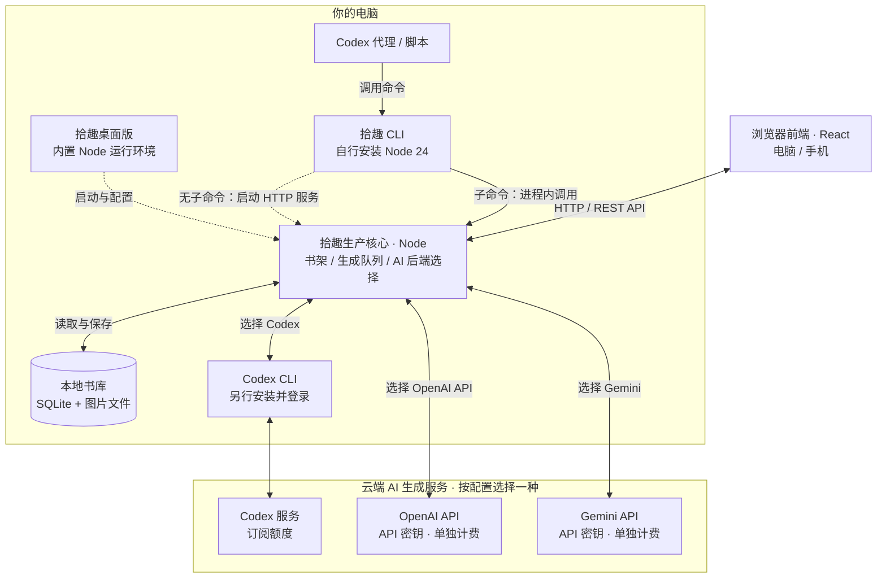

# 拾趣使用指南

[返回 README](../README.md) · [通过 SKILL 使用：完整示例](use-as-skill.md) · [开发指南](development.md)

- [前后端架构](#前后端架构)
- [如何选择后端](#如何选择后端)
- [如何选择](#如何选择)
- [CLI 启动](#cli-启动)
- [无服务 CLI 与 Codex 技能](#无服务-cli-与-codex-技能)
  - [安装与调用技能](#安装与调用技能)
  - [书库与生成配置](#书库与生成配置)
  - [指定数据库目录](#指定数据库目录)
  - [直接使用命令](#直接使用命令)
- [桌面版入门](#桌面版入门)
- [在手机上阅读](#在手机上阅读)
- [制作与阅读故事](#制作与阅读故事)
  - [制作与验收要求](#制作与验收要求)
  - [审片未通过时](#审片未通过时)
  - [阅读和导出](#阅读和导出)
  - [署名与转载](#署名与转载)
  - [ZIP 内容与提示词分享](#zip-内容与提示词分享)
- [发布你的拾趣作品](#发布你的拾趣作品)
- [使用前了解](#使用前了解)
- [数据与备份](#数据与备份)
  - [升级到 0.6.5](#升级到-065)
  - [升级到 0.7.0](#升级到-070)
  - [升级到 0.8.0](#升级到-080)
  - [升级到 0.10.0](#升级到-0100)
  - [升级到 0.9.0](#升级到-090)
  - [升级到 0.8.6](#升级到-086)
  - [升级到 0.8.5](#升级到-085)
  - [书库维护命令](#书库维护命令)
- [常见问题](#常见问题)
- [书库与画风说明](#书库与画风说明)
- [每本书的星标参考图](#每本书的星标参考图)

## 前后端架构

拾趣由**浏览器前端、本地生产核心和 AI 生成后端**组成。本地 Node 核心管理书架和生成队列，调用所选的 Codex、OpenAI API 或 Gemini 生成文字与插图。桌面版或不带子命令的 CLI 启动 HTTP 服务，供电脑和手机浏览器访问；CLI 子命令直接调用同一生产核心，供 Codex 或脚本操作，无需监听端口。



手机连接电脑上的拾趣服务，共享同一书架和生成后端，无需在手机上安装 Node、Codex CLI 或配置 API 密钥。故事、插图和阅读进度保存在电脑上；生成时所需的原文、提示词和参考图片会发送给所选 AI 服务。**只读模式**保留本地阅读与整理，不调用云端生成服务。

## 如何选择后端

根据已有的订阅、API 密钥和运行平台选择 AI 生成后端。桌面版和拾趣 CLI 都支持以下选择：

| AI 生成后端 | 适合什么情况 | 如何接入 | 平台与费用 |
| --- | --- | --- | --- |
| **Codex** | 已有 Codex 订阅，想使用剩余额度 | 另行安装并登录 Codex CLI，在拾趣中选择 Codex | macOS / Linux；使用订阅额度 |
| **OpenAI API** | 想通过 API 使用 OpenAI 的文本与图片模型 | 选择 OpenAI API，填写 API 密钥及文本、图片模型 | macOS / Linux / Windows；API 单独计费 |
| **Gemini** | 使用 Gemini 生成，或需要从网页 URL 选题 | 选择 Gemini，填写 API 密钥及文本、图片模型 | macOS / Linux / Windows；按 Gemini API 项目计费 |
| **只读** | 只阅读、整理已有书库 | 选择只读，无需登录或密钥 | macOS / Linux / Windows；不产生生成费用 |

**在哪里选：** 启动桌面或 CLI 服务后，通过本机或可信局域网浏览器打开「我的 → 生成服务与模型」；CLI 首次运行会询问，也可运行 `npx @apprun/shiqu --configure` 修改。两种入口共用已保存的服务配置；新生产步骤读取保存值，已开始的步骤继续原配置，无需重启。详见[首次配置与修改服务](#首次配置与修改服务)。

## 如何选择

**希望通过图形界面制作和阅读，选桌面版；希望用自然语言委托任务，选 Codex 技能；需要直接调用命令，选 CLI。** 浏览器方式需要本机服务，Codex 和 CLI 子命令直接操作本地生产流程。

| 使用场景 | 推荐入口与条件 |
| --- | --- |
| 希望安装后直接使用，通过图形界面配置服务、管理书架和查看队列 | 桌面版，内置 Node，无需另装运行环境 |
| 已有 Node 24，想用一条命令启动，不安装桌面应用 | CLI：`npx @apprun/shiqu`；终端需保持运行，Ctrl+C 停服 |
| 希望让 Codex 选题、制作、修改故事或批量导出、备份 | 普通启动自动准备技能，在 Codex 中调用 `$shiqu`；桌面内置 CLI 无需系统 npm，NPX 需要 Node 24；独立命令无需服务 |
| 希望关闭控制窗口后仍继续生成和提供阅读服务 | 桌面版：关闭窗口后留在托盘，停止服务或退出拾趣才会停服 |
| 需要脚本启动、自定义端口或目录、环境变量及非交互运行 | CLI：非交互时需提前准备服务配置与书库路径 |
| 使用 Linux、Intel Mac 或 Windows ARM64 | CLI：目前没有对应桌面安装包，需自行安装 Node 24；Windows 使用 API 服务或只读 |
| 希望手机扫码或跨网络访问 | 桌面版提供二维码和互联网隧道控制，隧道需另装 cloudflared；CLI 默认开放可信局域网并打印扫码二维码，不内置互联网隧道 |

### 共同功能与配置

- **制作与阅读：** 桌面版和 CLI 服务模式提供相同的浏览器制作与阅读界面，桌面窗口另提供书架、队列、设置和服务控制。Codex 技能通过 CLI 子命令完成选题、制作、编辑、书架整理与导出，预览输出为可直接打开的离线 HTML。
- **生成服务：** 两种入口都支持 OpenAI API、Gemini 与只读；Codex 生成在 macOS / Linux 可用，需另行安装并登录 Codex CLI，Windows 使用 API 服务或只读。这里的拾趣 CLI 与 Codex CLI 是两个不同工具。
- **本地数据：** 同一本机用户下共用已保存的服务配置和 API 密钥；使用同一书库目录时，共享故事、图片与阅读进度。各入口可独立使用；CLI 子命令操作同一书库前，先停止占用它的服务。

### 在 CLI 与桌面版之间切换

1. **先停止当前服务。** CLI 按 Ctrl+C；桌面版点击「停止服务」或选择「退出拾趣」。仅关闭桌面窗口不会停服。
2. **使用相同版本，确认书库目录一致。** CLI 默认复用共享设置中的目录；显式 `--data-dir` / `SHIQU_DATA_DIR` 只覆盖本次运行，不更改已保存目录。CLI 可用 `--version` 查看版本，也可用 `npx @apprun/shiqu@<版本号>` 指定与桌面版一致的已发布版本。
3. **从另一入口启动。** 已保存的服务配置会直接复用，无需重新输入密钥。修改共享生成配置后，新生产步骤直接使用新值，已开始的步骤保持原配置。

**同一书库不能同时由两个服务运行，即使端口不同也会拒绝启动。** 切换入口不需要复制数据；选择不同目录只会打开另一个书架，不会自动搬移或合并。旧版本可能无法读取新版设置或数据，升级和降级前请先备份。

## CLI 启动

需要 Node 24，推荐版本 24.22.1，以及随附的 npm / npx，无需另装 pnpm。CLI 启动本地服务；无需下载或运行桌面应用，也无需克隆代码：

```bash
npx @apprun/shiqu
```

首次使用时，npx 可能询问是否下载软件包，确认后启动。打开打印的网址，通常是 `http://127.0.0.1:3000`；手机与电脑连接同一可信 Wi-Fi 后，可直接扫描终端二维码。CLI 默认监听 `0.0.0.0`，只允许本机访问时使用 `--host 127.0.0.1`（或 `SHIQU_BIND_IP=127.0.0.1`），此时不打印手机二维码。保持终端运行；按 Ctrl+C 停止服务。

已使用 pnpm 的用户也可运行 `pnpm dlx @apprun/shiqu`，功能相同；或全局安装后使用 `shiqu`：

```bash
pnpm add -g @apprun/shiqu
shiqu
```

### 选择与初始化书库

1. `--data-dir` 指定目录优先于 `SHIQU_DATA_DIR` 环境变量或显式配置文件。
2. 没有显式目录时，只读桌面版已保存的书库路径。目录尚不存在就自动创建，不再询问。
3. 没有桌面设置时，复用 CLI 先前确认的目录；尚无选择则查找桌面默认目录已有的 `shiqu.sqlite`。
4. 仍未找到时，询问要使用或建立的目录。回车接受桌面默认路径，也可输入其他目录；确认后存入共享设置数据库。Ctrl+C 或输入结束会取消，不建立书库。

首次非交互启动必须指定目录；CLI 不会静默创建一个新的默认空书架。桌面配置损坏时会报错，可修复设置或显式指定目录，避免误以为原书架丢失。

```bash
npx @apprun/shiqu --data-dir /absolute/path/to/library
npx @apprun/shiqu --port 3100 --host 127.0.0.1
```

CLI 与桌面版使用相同的数据库、图片和阅读进度格式；切换前先停止另一入口，使用相同版本。同一书库已被占用时启动会失败。选择不同目录只会切换书架，不会搬移或合并数据。

旧 CLI 版本的独立书库不会删除或自动合并，继续使用时显式指定原目录。macOS 旧目录为 `~/Library/Application Support/shiqu/library`，Linux 为 `${XDG_DATA_HOME:-~/.local/share}/shiqu/library`，Windows 为 `%LOCALAPPDATA%\shiqu\library`（旧环境可能使用 `%APPDATA%`）。

CLI 与桌面版共用配置目录中的 `desktop.sqlite`，库目录保存在非密钥设置中。旧 `cli-library.json` 的路径会在需要时迁入该数据库，原文件保留。CLI 先选的目录也可被随后安装的桌面版使用；显式 `--data-dir` 只覆盖本次运行，不改保存值。

### 首次配置与修改服务

不必先准备环境变量。找到或建立书库后，CLI 会复用保存的完整服务配置；尚未配置时，依次询问服务和必要信息：

| 选择 | 需要什么 | 费用 |
| --- | --- | --- |
| Codex | 另行安装 Codex CLI 并先运行 `codex login`，可选择模型 | 使用订阅额度；macOS / Linux 支持 |
| OpenAI API | OpenAI API 密钥、文本和图片模型 | 单独 API 计费，不使用 Codex 订阅额度 |
| Gemini | Gemini API 密钥、文本和图片模型 | 按 Gemini API 项目计费 |
| 只读 | 无需密钥 | 不调用生成服务，已有故事仍可阅读整理 |

选择 Codex、OpenAI API 或 Gemini 后，还会询问**图片服务**：回车或输入 `0` 表示与文本服务相同（默认，原有配置不变）；也可另选一种只用于绘制插图，例如 Codex 写故事与分镜、Gemini 画图。选题、分镜、审核和修订始终使用文本服务，制作流程不变。另选的 API 图片服务使用自己已保存的密钥和图片模型，此时文本服务只询问文本模型。两边都配置好才能开始制作；只读模式忽略图片服务。

API 密钥输入隐藏；已保存该服务的密钥时，回车保留。模型回车使用已保存值或默认值。OpenAI 默认文本模型为 `gpt-6.1-sol`，图片模型为 `gpt-image-2.5-sunburst`；实际使用仍需账户具备相应模型权限与额度。新配置只在整个问答完成后保存；取消或输入结束不会保存部分服务配置。

```bash
npx @apprun/shiqu --configure
npx @apprun/shiqu --reset-providers
```

`--configure` 重新选择或修改服务并保存，然后退出。切换服务保留其他服务的模型和密钥。`--reset-providers` 清除所有已保存的服务选择、模型和 API 密钥，保留故事、阅读进度、书库及网络设置；终端中会重新询问，非交互环境则重置后退出并提示再配置。重置影响后续生产步骤；已开始的步骤继续原配置。有效启动覆盖仍优先，未移除的环境密钥不会因为清空数据库而失效。

配置与桌面版存放在同一个独立 `desktop.sqlite`，不在故事数据库内；以后从另一入口启动也不重复问。API 密钥是明文，由本机文件权限保护，Unix 下目录/文件权限为 0700/0600。设置页面和 HTTP 不返回已存密钥。 页面分别标明“已保存”与“启动提供”：启动密钥不自动复制进数据库，可显式输入保存；存在启动覆盖时仍优先于保存密钥，替换或删除保存值不会移除该覆盖。备份设置数据库会包含密钥；只分享故事目录不会携带全局设置。

源码开发的 `pnpm dev`（含 `local`）与技能调用的 CLI 同样复用这些保存值；显式 shell 环境变量仍优先，不改数据库。开发后端不自动加载项目 `.env`，旧文件里的提供方/模型/密钥不会覆盖桌面选择。`local` 仅把书库改为 checkout 内的独立目录。初次开发可用 `pnpm cli --configure` 保存配置；修改后下一项生产步骤读取新值，无需重启；CLI 下一次执行也会读取新值。

使用桌面、`pnpm dev` 或 CLI 浏览器服务时，可在电脑本机的 `localhost` / `127.0.0.1` 或可信局域网地址打开「我的 → 生成服务与模型」。这里编辑同一套保存设置，可选择文本服务、图片服务（默认与文本服务相同）、模型、推理档位，并分别保留、替换或移除两边的 API 密钥；已保存密钥不会显示。页面单独列出当前运行配置和启动覆盖，保存后新生产步骤使用新配置，已开始的步骤继续使用原配置；显式启动覆盖仍优先。手机可通过可信局域网地址编辑同一配置；互联网隧道和跨站页面不提供此能力。桌面服务也使用同一设置页。

即使当前入口不能编辑设置，页面仍可显示阅读服务正在使用的提供方与图片模型。若编辑入口不可用，请确认使用本机或可信局域网地址并重新读取；旧版本服务需先升级。读取本机设置展示下一生产步骤使用的配置，不等待 Codex / Claude 登录检查；未检查的登录状态不会显示为已连接或未连接。

### 环境变量与配置文件覆盖

显式环境变量/配置文件用于本次启动，不自动保存或覆盖数据库。可用于自动化运行：

```dotenv
SHIQU_AI_PROVIDER=openai
OPENAI_API_KEY=your-key
# 可选，覆盖已保存模型：
OPENAI_TEXT_MODEL=gpt-6.1-sol
OPENAI_IMAGE_MODEL=gpt-image-2.5-sunburst
```

其他服务分别使用 `SHIQU_AI_PROVIDER=codex`，或 `SHIQU_AI_PROVIDER=gemini` 与 `GEMINI_API_KEY`。无人值守只阅读可用 `SHIQU_AI_PROVIDER=readonly`。

仅支持文本的 `SHIQU_AI_PROVIDER=claude` / `deepseek` 也可用 `SHIQU_IMAGE_PROVIDER`（或已保存的单独图片服务）画图，否则仍在绘图前停止。另用一种服务画图时，加 `SHIQU_IMAGE_PROVIDER=gemini`（或 `openai`、`codex`）及该服务的密钥，例如 `SHIQU_AI_PROVIDER=codex`、`SHIQU_IMAGE_PROVIDER=gemini`、`GEMINI_API_KEY=…`。留空保留已保存的图片服务（未保存则与文本服务相同）。`IMAGE_SIZE` 只在 OpenAI 画图时生效。

```bash
npx @apprun/shiqu --config /absolute/path/to/shiqu.env
```

不自动读取当前目录的 `.env`；已有环境变量优先于显式配置文件，命令行参数优先于两者。非交互运行必须已有可用保存配置，或完整指定服务；不会等待终端输入。新环境也要显式提供书库路径。更多变量见 [.env.example](../.env.example)。

## 无服务 CLI 与 Codex 技能

普通 NPX 服务或桌面「启动服务」成功后会尝试准备用户级技能；已有副本仅按原自动更新同意同步随包版本。桌面内置 Node/CLI，无需系统 npm。`skill auto-install [on|off]` 查询或保存启动集成偏好，`SHIQU_SKILL_AUTO_INSTALL=off` 只跳过本次，不改变 auto-update 同意。定制、停用和插件选择均保留，失败不阻止服务。独立 CLI 操作同库前仍需先安全停止占用服务。[安装、桌面运行时与更新说明](use-as-skill.md#启动自动安装与桌面-cli)。


让 Codex 按拾趣技能完成任务：你描述要读什么、怎样改编、何时确认和输出到哪里，Codex 调用 CLI，故事仍保存到本地书库。选题、制作、编辑版本、离线预览、导出与备份恢复均可通过这种方式完成。桌面安装的技能使用内置 Node/CLI；其他安装使用 Node 24 与 npm/npx。执行独立命令时无需服务。

可直接交给 Codex 的自然语言提示词见[通过 SKILL 使用拾趣](use-as-skill.md)，覆盖安装、配置、制作、修改、导出和维护。

### 安装与调用技能

普通 NPX 服务和桌面启动会准备用户级技能。需要手动安装时，先选择使用范围：

```bash
# 当前用户的所有项目
npx @apprun/shiqu skill install --scope global

# 仅当前项目：在目标项目目录执行
npx @apprun/shiqu skill install --scope project
```

| 范围 | 安装位置 | 适用情况 |
| --- | --- | --- |
| global | `~/.agents/skills/shiqu/SKILL.md` | 在多个项目中使用拾趣 |
| project | 当前目录的 `.agents/skills/shiqu/SKILL.md` | 只在指定项目中提供技能 |

必须显式指定范围；单独运行 `skill install` 不安装。安装复制独立文件，不依赖 npx 缓存。同内容重复安装无变化，不同内容或符号链接路径拒绝覆盖。安装会在技能目录记录版本、内容哈希和默认关闭的自动更新偏好。技能优先校验并使用已登记的桌面内置 Node/CLI，无需系统 npm；其他安装通过 `npx --yes @apprun/shiqu@<技能版本>` 调用，需要 Node 24 及随附的 npm/npx；不要求安装 pnpm，也不全局安装 shiqu 命令。用户明确指定其他启动器时沿用其选择。

安装后在 Codex 中调用 `$shiqu`，例如：

```text
$shiqu 使用书库 /absolute/path/shiqu-library，从《庄子》中找一个关于善意与误解的故事。
用水墨写意、适中的叙事详略，先给出候选、原文摘要和制作方案，等我确认后再生成插图。
完成后署名“我的名字”，把离线预览和公开 ZIP 保存到 /absolute/path/output。
```

已有故事也可以直接委托：

```text
$shiqu 找到书库中的《故事名》，保留原文和可复用的图片，把验收要求改为“关键人物的回应必须落实到画面”。
先说明修改影响，再按确认后的要求制作新版本。
```

技能以数据契约、业务规则和验收要求描述任务。Codex 可自行编写程序完成书库筛选、版本比较、报告和批量调度，通过当前 CLI 的 `help --json` 确认可用操作，按保存状态执行；简单任务可直接调用命令。自主程序使用参数数组与 JSON 输入，同一书库串行访问；数据库修改、生成、审核与作品导出由拾趣现有生产实现负责，不由临时程序重写。需要确认时停下，暂停或失败的故事不会隐式恢复。只想临时读取任务契约时可运行 `skill show`，让 Codex 读取其输出；npm 缓存中存在 SKILL.md 本身不会自动注册技能。新技能未出现时重启 Codex。

若所用 npm 版本尚未包含新命令，可在源码目录运行 `pnpm cli skill install --scope global` 或 `--scope project`；同时告诉 Codex 在该源码目录使用 `pnpm cli`。源码入口及用户或项目的显式版本锁优先。没有桌面运行时记录的发布包技能通过 check 返回的 installedVersion 固定 CLI 版本，更新后切换到返回 version 对应的 `npx --yes @apprun/shiqu@<版本号>`，并重新查看该版本的帮助。

### 技能版本与升级

Codex 每次启用技能时调用版本检查；检查只查询 npm 正式发布版本，不替换技能正文，正常结果缓存 24 小时，网络失败缓存 5 分钟。查询缓存位于 `~/.cache/shiqu/skill-version.json`（设置 XDG_CACHE_HOME 时位于其 shiqu 子目录），不反复改动项目安装记录。不安装后台服务，未调用技能时不会主动查询 npm。应用启动只核对随包版本；没有系统 npm 的桌面技能，通过更新桌面应用后再次启动，按原更新同意同步，不运行依赖 npx 的更新命令。

```bash
npx @apprun/shiqu skill check
npx @apprun/shiqu skill check --refresh
npx @apprun/shiqu skill check --scope global --auto-update on
npx @apprun/shiqu skill check --scope global --auto-update off
```

check 默认发现从当前目录到 Git 根的最近项目安装，再查全局；显式 project 指当前目录。同名副本并存时，应核对返回的 path，选择本次加载的副本。结果包含 installedVersion、registry、updateAvailable、autoUpdateReady，以及固定版本的 updateCommand 参数数组和 updateCwd。Codex 仅在已启用自动更新、内容未经修改、没有用户或项目版本锁时执行自动更新；单次更新仍可由用户直接授权。离线继续原任务。

`skill update --scope global|project` **只复制正在运行的 CLI 包自带技能**，不下载新版包；应使用检查返回的固定版本命令及工作目录执行。成功后重新读取技能，后续使用返回 version 对应的 CLI 和帮助。技能目录的 `.shiqu-skill.json` 保存版本、哈希和偏好，不含模型配置或凭证；手动修改的技能、损坏或未知状态、符号链接及降级均拒绝覆盖，没有 force 入口。自动命令带 --automatic，会在写入前再次检查偏好。

旧安装没有记录时，仅内容与运行包完全相同才能通过该版本的 install/update 建立记录；其他副本保留原文件，需人工比较合并。启用自动更新不会替你认领未知副本。并发操作返回 SKILL_BUSY，只有确认没有操作运行后才能清理遗留的 `.update-lock`。当前源码新增的检查规则不会自动出现在旧技能中，需要先更新技能一次；npm 发布后才能使用正式发布更新流程。

### 书库与生成配置

Codex 负责调用命令，文字与插图由拾趣已配置的生成后端完成，可使用 Codex、OpenAI API 或 Gemini。沿用桌面/CLI 已保存的配置；尚未配置时，先按[首次配置与修改服务](#首次配置与修改服务)完成设置。安装技能、初始化书库、查看、编辑和导出均不调用模型，只有显式 run 执行生成。

在任务中说明书库和输出目录。使用现有书库时先停止占用它的桌面、CLI 或开发服务；首次访问时自动创建目录和数据库，与桌面/服务共用开库与迁移逻辑，无需先运行 init。路径按显式 `--data-dir`、`SHIQU_DATA_DIR`、已保存位置、默认书库的顺序选择；自动建库不会配置模型或发起生成，init 保留为可选的显式建库命令。损坏的数据库报错，不自动重建。全局安装技能只改变 Codex 的技能可用范围，不会选择、迁移或复制书库，也不会安装一个永久的 shiqu 命令。

### 指定数据库目录

如需提前建库并指定存储目录，使用可选的 init：

```bash
pnpm cli init --data-dir /absolute/path/my-library
pnpm cli stories list --data-dir /absolute/path/my-library
```

安装包使用 `npx @apprun/shiqu init --data-dir /absolute/path/my-library`。参数是**目录**，数据库文件为该目录下的 `shiqu.sqlite`，媒体保存在同一书库的 `media/` 下；目录不存在时自动创建。已有书库沿用原有数据和迁移流程，不会清空。命令返回解析后的绝对目录，不启动服务或生成。

`--data-dir` 只影响本次调用，不改变桌面/CLI 已保存的默认书库。后续命令继续使用相同参数，或设置 `SHIQU_DATA_DIR` 指向该目录。

### 直接使用命令

CLI 不带子命令时启动原有浏览器服务。带子命令时直接使用同一数据库、正式制作队列和导出规则，无需服务、桌面或前端。源码目录使用 `pnpm cli`；安装包默认使用 `npx @apprun/shiqu`，已安装技能的后续调用固定为 `npx --yes @apprun/shiqu@<技能版本>`。参数及输入示例以当前版本 `help --json` 为准。

```bash
pnpm cli help --json
pnpm cli books
pnpm cli stories create --input selection.json --data-dir /private/shiqu-library
pnpm cli stories search STORY_ID --generation N --data-dir /private/shiqu-library
pnpm cli run STORY_ID --until candidates --data-dir /private/shiqu-library
pnpm cli stories choose STORY_ID --batch 0 --index 0 --generation N --data-dir /private/shiqu-library
pnpm cli run STORY_ID --until prepared --data-dir /private/shiqu-library
pnpm cli stories confirm STORY_ID --generation N --data-dir /private/shiqu-library
pnpm cli run STORY_ID --until reviewed --data-dir /private/shiqu-library
pnpm cli run STORY_ID --data-dir /private/shiqu-library
pnpm cli preview STORY_ID --output /private/preview.html --data-dir /private/shiqu-library
pnpm cli export STORY_ID --format zip --output /private/story.zip --data-dir /private/shiqu-library
```

selection.json 例如 `{"bookId":"zhuangzi","theme":"善意与误解","artStyle":"ink-pencil","narrativeDetail":"balanced"}`。保存、确认、查看不调用模型；只有显式 run 执行指定故事并可能付费，不顺带制作其他后台故事。run 默认最多900秒，可用 `--timeout` 调整；中断保留已保存检查点。读取返回的 reason/session，需要选择、确认、恢复或修改要求时完成对应动作后再运行。旧故事等待画幅数时返回 frame_count_required，使用 help 中的 frameCount API 保存；已确认的故事请求 prepared 返回 already_prepared，不再执行。不适用的旧故事阶段以 BOUNDARY_UNAVAILABLE 拒绝。

子命令 stdout 为单个 `{schemaVersion,ok,data|error}` JSON，日志在 stderr；失败退出非零。skill show 默认输出 Markdown，增加 `--json` 才返回 JSON 信封。`--input file.json` 或 `--input -` 接受JSON。保存可固定 `--request-id UUID` 供重放。search/choose/confirm/setup 必须带 JSON generation 或 `--generation N`（由 stories get 返回的 intake.generation 取得）；同一请求重放沿用原代数。retry/override 必须带当前 faultId，不自动挑选。编辑先用 `stories revisions ID` 读取 token，再提交 `{"token":"...","changes":{"acceptancePrompt":"保留关键人物反应"}}`；返回的新 id 是后续制作对象。旧版本拒绝制作/完整导出，过期 token 或 faultId 返回冲突。config 复用桌面/CLI设置，密钥只通过输入文件/stdin传递，不放进命令参数。init/读取/导出不检查云端，run 未配置时明确报错。

`stories copy STORY_ID --from-data-dir /private/source-library --data-dir /private/target-library` 可跨书库复制已通过审核的故事，默认只保存文本与审核记录。CLI 子命令始终无交互；拾趣 Skill 在对话中报告文本复制完成，再询问是否复制已有图片。用户同意后，Skill 使用 `stories copy-images TARGET_ID --from-data-dir /private/source-library --data-dir /private/target-library --input source.json`，其中 `source.json` 为 `{"sourceId":"来源故事id"}`，向已有的目标副本补图，不再创建故事。用户已明确要求连图片一起复制时，`copy` 也可通过 `--copy-images` 或 JSON 的 `copyImages:true` 一次完成；`--no-copy-images` 或 `copyImages:false` 明确仅复制文本。

图片保持原始字节，在目标书库独立保存；缺失或损坏会报错并保留文本，可重试原命令和输入。更改 `artStyle` 时不能同时复制旧画风图片。新故事初始暂停，后续使用返回的新 id；复制文本和图片均不调用模型、不重新审核。Skill 负责选题、方案检查、文本审核及生图前的阶段控制，按用户授权调用 CLI 推进。

JSON/Markdown 可导出中间稿；ZIP/PDF/PNG要求当前版本全部图片完成。未署名需明确 `--allow-unsigned`；公开 ZIP 默认不含提示词，内部记录须加 `--include-prompts`。输出必须是新路径，导出不自动提交或发布。备份要求已有数据库；帮助、静态书籍/主题/画风列表、技能安装和诊断导出不会自动建立书库，恢复仍要求不存在的新目录。

## 桌面版入门


桌面版统一内置 Node 24，无需另装 Node。已有 Node 并习惯终端的用户可选择上面的 CLI。旧 Lite 用户换装当前桌面版后继续使用原设置和书库；旧 Node 路径不再影响运行时。

桌面版仍不包含 Codex CLI；使用 Codex 需另行安装并登录。macOS 支持 Codex、OpenAI API、Gemini 与只读；Windows 可使用 OpenAI API、Gemini 或只读。

macOS 要求 **13.5 或更新版本**。Windows 安装包要求 **Windows 10/11 x64**，需要 WebView2（缺失时安装程序会联网下载）。Linux 暂无桌面安装包，可使用 CLI。

### 下载与安装

[最新版本与 SHA-256 校验文件](https://github.com/yysun/shiqu/releases/latest) · [所有版本](https://github.com/yysun/shiqu/releases)。下载链接随最新正式版本自动更新，首次发布成功后生效。提供 Apple Silicon（M 系列）Mac 与 Windows x64 安装包，不提供 Intel Mac、Windows ARM64 或 Linux 安装包。Windows 链接在 0.4.0 或更新正式版本发布后生效；此前可从 Actions 手动构建获取。

安装包**未签名、未经过 Apple 公证**。打开 DMG 后，将应用拖入「应用程序」。首次启动若被 macOS 拦截，请在尝试打开后前往「系统设置 → 隐私与安全性」，按系统提示选择「仍要打开」；只为你信任的下载执行此操作。

Windows：[下载安装程序](https://github.com/yysun/shiqu/releases/latest/download/shiqu-standard-windows-x64-setup.exe)。运行 `-setup.exe`，按提示安装到当前用户。安装包未签名，SmartScreen 可能提示风险；仅对确认可信的下载选择「更多信息 → 仍要运行」。Windows 的默认设置目录为 `%APPDATA%\com.shiqu.desktop\`，默认故事目录为其中的 `library`。

### 第一次打开

1. 打开拾趣控制台，点击「启动服务」。首次使用无需先配置生成服务。
2. 如需升级书库，等待「正在升级书库」完成；控制台会显示已校验的备份路径。升级或恢复失败时先保留书库与备份。
3. 点击「在浏览器打开」阅读；新书库为空。需要创作时，使用本机或可信局域网地址打开「我的 → 生成服务与模型」，或点击控制台中的同名入口。
4. 选择文本与图片服务、模型、推理档位，填写必要密钥并保存。新任务使用保存值，无需重启；已开始的步骤继续原配置。

桌面窗口只有单页服务控制台，显示运行状态、内置运行时、故事目录、端口、手机访问和本机路径。书架、生成队列与故事制作统一在浏览器。关闭窗口继续托盘运行；「退出拾趣」停止服务。

### 配置生成服务

电脑本机与可信局域网地址允许打开「我的 → 生成服务与模型」，桌面、CLI、技能和开发模式共用保存值。可选择文本服务与独立图片服务，配置各自模型、Codex 模型/推理及每项任务档位；Codex 可执行文件和登录目录仍在控制台停止服务后选择。首次登录仍需在终端执行 `codex login`。

API 密钥可保留、替换或移除；新输入密钥通过本机或可信局域网 HTTP 提交，保存的密钥永不返回原文，只显示存在状态。密钥仍以明文保存在受系统文件权限保护的共享设置库中。手机和电脑均可通过实际私有 LAN 接口地址进入生成设置；可信 LAN 设备共享配置修改权限，互联网隧道和跨站页面仍被拒绝。不要使用自建反代或端口转发把设置入口暴露到公网。

保存设置不会重启或打断生成。页面与控制台显示新任务使用的配置；每项生产步骤开始时固定提供方、模型、密钥、推理及超时，已开始的步骤不受后续修改影响。启动覆盖仍优先，覆盖项仅显示名称。生成服务未就绪时显示「测试连接」，只检查保存值与启动覆盖的模型元数据或 Codex 登录，不提交未保存内容、不生成故事，也不保证配额。设置页不提供一键重置入口；明确需要清空共享配置时，可使用 CLI 的配置重置命令。

本机路径、数据目录、端口和互联网访问只能在控制台停止服务后修改，并保留原生文件选择器。过期修订的保存会明确拒绝；重新读取后再修改，避免覆盖另一入口的变更。桌面子进程按原生指定的精确设置库路径读写；库缺失或不可读时浏览器拒绝操作，不另建配置。设置数据库格式保持 v2，桌面不自动读取项目 `.env`。

## 在手机上阅读

手机无需安装应用，也不需要单独配置 AI 服务。CLI 默认开放局域网，启动后打印可用的局域网地址和手机二维码；使用 `--host 127.0.0.1` 可限制为本机访问。桌面版在「手机接着读」中显示二维码，局域网访问始终开启；互联网访问由你单独启用。以下互联网隧道步骤适用于桌面版，CLI 不内置互联网隧道。

| 访问方式 | 手机所在网络 | 访问链接 |
| --- | --- | --- |
| 局域网（始终开启） | 与电脑处于同一网络 | IP 和端口，无需配对 ID |
| 互联网（默认关闭） | 其他 Wi-Fi 或蜂窝网络 | 免费临时 HTTPS 地址，使用私密链接配对 |

免费的是隧道服务；制作故事仍使用你配置的 Gemini 费用或 Codex 订阅额度。

**同一 Wi-Fi / 局域网：** 启动服务，扫描 CLI 终端中的二维码，或在桌面版「手机接着读」中选择局域网地址并扫码。直接连接电脑的 IP 和端口，无需配对 ID、令牌或 cookie；防火墙需允许此端口。所有可连接设备共享书架和生成权限，HTTP 连接仅限可信网络。

**其他 Wi-Fi / 蜂窝网络：**

1. 在电脑上安装 [Cloudflare cloudflared](https://developers.cloudflare.com/tunnel/downloads/)。macOS 可使用 `brew install cloudflared`。桌面版需另行安装此工具。
2. 停止拾趣服务，开启「允许互联网访问」。默认自动查找 cloudflared；找不到时填写其可执行文件的绝对路径，例如 `/opt/homebrew/bin/cloudflared`。
3. 保存并启动服务，等待免费隧道连接（最长约 45 秒）。选择「互联网」访问方式，扫描私密二维码，或复制完整私密链接到手机浏览器。
4. 手机自动配对后打开电脑上的同一书架，可阅读、整理和制作故事。无需 Cloudflare 账户或域名。

**完整二维码和链接包含访问凭据，请勿公开分享。** 裸公网地址不会开放书架；完整私密链接可以授予书架和生成权限。打开完整私密链接会自动完成配对；同一书架的访问者共享权限。配对有效期为 12 小时；停止服务后立即失效，重启后需重新扫码。没有多用户隔离。

互联网连接使用 HTTPS，流量经过 Cloudflare，故事数据仍保存在电脑上。免费 Quick Tunnel 每次启动会分配新地址，没有可用性保证，最多支持 200 个并发请求，不支持 SSE；拾趣使用 NDJSON / 轮询。该服务适用于临时访问，不承诺长期在线。隧道进程退出后公网二维码会撤下，局域网继续运行；停止并重启服务可重试。若找不到 cloudflared 或建立隧道失败，仅互联网访问不可用；本机与局域网服务继续运行，「在浏览器打开」仍可使用。升级旧版本不会自动开启互联网访问。

使用期间，**电脑需要保持唤醒，拾趣服务需要保持运行**。关闭互联网访问后，同一网络仍可通过局域网访问。退出应用会停止服务器、隧道和生成进程。

## 制作与阅读故事

### 做一本故事书

1. 选择书目后，默认列出本地故事或章节；可用复选框选择多个章节（最多24章），点击「从已选 N 章提取故事」，再从模型提取的候选中选择一篇；已独立分篇的故事可直接点击「选择这篇并准备制作」。也可切换「按主题找故事」，选择主题后点击「加入队列并找故事」，再选择候选。任务和候选都保存在书架；离开、刷新或重启不会丢失，可继续选择或「继续找故事」。
2. 选定故事后准备原文、完整摘要、数量建议，以及本篇制作与验收建议；主题模式与直接选原典都要对照原文核对摘要。在「故事流程」中查看原文，修改画风、叙事详略、制作要求或验收要求。待选择、待确认时不会生成分镜或图片。
3. 在「叙事详略」选择**简短、适中或详细**，再点击「开始制作」。三档分别偏重紧扣主线、完整因果与关键转折、展开动作细节及停顿，不绑定固定幅数，也没有手动幅数滑块。初步估计不是最终数量；模型按原文编排，审核可增删或替换画幅，结构修改后重新全篇审核。系统完成分镜、结语与审片，文字稿稳定并通过后才绘图。
4. 开始制作后自动生成整篇，离开阅读页面也会继续；在生成进度旁使用「暂停生成 / 恢复生成」控制，无需另行开启后台模式。

新生成插图按 **9:16 竖幅**构图。手机阅读页会等比完整展示原图，不裁切、拉伸或补边。

选择页打开期间会连续寻找、逐篇显示候选；选中或离开后停止，重新打开可接续。空结果、查找失败或暂停时停止自动续找，可按提示「继续找故事」「重试查找」或恢复生成；达到 40 批保存上限后，须从已有候选选择或换主题。若显示「有未能判断的故事」，当前结果并不完整；失败项不会被记成“不符合”，已保存候选仍可选择。

开始分镜时若还没有摘要，系统会先依据原文生成并保存，再继续编排。已有分镜不会因此自动重做。分镜直接依据原文编排，审核参考摘要检查故事是否完整；摘要不作为编排输入。第一页从原文中提取看懂开局所需的背景、人物关系和处境，不把全篇概述当开场或预先讲完结局，不另设“设局”资料项。

### 制作与验收要求

「故事设置」内嵌制作流程，展示故事名称、当前进展、时间线及阶段操作。点击阅读页右上角的设置图标即可打开；点击书架封面或故事名仍进入阅读。未出图任务点击卡片会自动打开同一个故事设置面板；图片齐全后显示下载区，位于流程上方；署名和「编辑署名与转载说明」也在下载区内，不能下载时一起隐藏。首幅图片生成后，已打开的流程会继续保留，关闭后可直接阅读。

在「制作流程」中，可以分别打开两个并列入口：

准备故事时会依据完整原文自动提供可编辑的制作要求和 2–4 条对应验收要求；摘要另存，不代替改编方向。两项建议可分别修改或清空，确认制作后才生效。通用叙事与质量规则由系统提示词负责，不重复填入这两个字段。

候选提取、故事准备、草稿保留和制作确认的分工见[从候选故事到文字分镜](story-creation-flow.md)。

- **制作要求**：指导分镜和绘图，说明希望如何改编，例如具体交锋的轻重、应保留的对白与可压缩的过程。确认制作后的改动会重新编排，提交前会显示预计影响。
- **验收要求**：仅用于审核，不作为分镜生成输入；修订依据审核指出的具体问题执行。每行一条，最多 20 条，写明希望审核的标准，例如「关键反应必须落实到可见画面」。审核逐条显示「通过 / 未通过 / 无法判断」及依据；可修的未通过项进入修订，与原文或制作要求冲突、没有依据或无法从文字分镜判断的要求会停止绘图。文字验收不代表实际图片已经合格。

仅修改验收要求时保留分镜与可复用图片，提交后重新审核；如果审核导致画面指令或结构变化，仍会重新核对图片复用范围。

两个入口都可展开「查看当前系统规则（预览）」与「查看实际使用的完整提示词」，并「复制完整提示词」。**预览包含当前编辑中的要求，不是执行历史**；实际记录包含执行时的原文、分镜等输入，沿用旧版时明确标注。历史未留存会显示「未留存」，不会补造；「上次验收结果」属于已保存版本，编辑要求后须重新审核。查看、复制不会发起生成；分享提示词前请检查其中的原文与自定义内容。

### 替换当前选题

开始制作后使用“替换选题”打开候选窗口，书架不会增加另一本。点击“选择并替换”才切换当前选题，旧原文、分镜、图片和失败记录保留为历史。同一来源再次选中不建版。取消只刷新当前故事；其他窗口已经替换或删除时，不恢复旧快照。

替换沿用提交时最新的暂停或停止状态。暂停的新选题先点“恢复准备”，准备好原文和制作建议后，仍需点“开始制作”。有未应用修改的暂停故事使用“应用修改并恢复”，这一操作会提交修改并恢复制作。

图片加载失败先“重新检查图片”，只核对或重载，不绘图；确认失效后才提供“重绘第 N 幅”，可能消耗服务额度。文件恢复时直接复用；“重试保存图片”只保存已有结果，如果文件也丢失，会另行提示明确重绘。其他正常图片和未处理问题都会保留。普通失败不会因为改名、刷新、重启或恢复生成而自动重试，请选择对应故障的恢复按钮。

### 暂停与修改

生成需要联网，速度取决于提供方，快速翻页时仍可能等待。故事默认生成整篇，无需保持阅读窗口打开；正在打开的故事会优先绘制首幅、当前幅及其后 6 幅；服务启动后自动继续未完成任务，新建任务仍需先选择故事并完成制作确认。生成进度旁的「暂停生成」对所有窗口生效，重启后仍保持暂停，只有「恢复生成」才会继续。已经开始的任务仍会完成并保存。删除故事会停止生成，恢复到书架不会自动重启。升级前处于阅读模式的未完成故事会保留进度并暂停，点击「恢复生成」后按整篇继续；已开启后台生成的故事保留原有状态。

「制作流程」中的制作要求、验收要求、画风、叙事详略和分镜均可修改，提交前显示预计重做范围。修订编辑器的「完成编辑」只返回制作流程，仍须点击「恢复生成」或「开始制作新版」提交；关闭弹窗保留本次修订草稿，离开这篇故事会清除未提交草稿。提交保存为独立新版，原版保留，书架只显示最新提交版。制作要求或叙事详略变化需要重新编排，不能同时保留冲突的手改分镜。

仅改配文或余味且绘图输入未变时保留原图；局部画面指令、首幅参考或全局画风与人物设定变化时重新核对相关图片。结构调整按画幅来源复用，不因页码移动就误用旧图；提交前的数量只是预计，最终以审核后的分镜和复用判断为准。

成功保存的分镜和图片会保留并复用。服务启动后会恢复未暂停故事的排队任务；正常停止服务时进行中的任务会在下次启动时自动恢复，意外中断的任务须等待原有锁到期后恢复。同一任务最多自动运行 3 次，之后需要手动重试。如果提供方已接受请求，但结果尚未保存就发生中断，自动恢复或手动重试可能再次消耗费用或额度。提供方明确返回的失败不会因重启或恢复生成反复重试，请按提示手动重试。图片文件丢失或损坏时，手动重试会重新绘制该幅，可能再次消耗费用或额度；如重绘的是首幅，已完成的画面不会随之更新。手动暂停状态随故事保存。共享同一书库的服务须使用相同版本。

分镜、结语、审片和请求次数的详细机制见[开发指南](development.md#故事生成机制)；创建、编辑、暂停恢复与队列调度的图解见[故事流程说明](story-creation-editing-queue.md)。

### 审片未通过时

自动修订与全篇复核最多进行 20 轮；修订没有实际变化、结果无效或达到上限时会停止并保留进度。查看问题、对应分镜和修订建议后，可选择：

- **继续自动修复**：沿用保存的问题继续修订，通过后绘图；已暂停时须先恢复生成。
- **手动修改**：直接定位问题画幅或结语，对照审核意见编辑，再「保存并重新审核」，通过后继续绘图。
- **查看并修改验收要求**：有冲突或无法判断时，按逐条依据调整要求，再提交新版审核；反复恢复生成不会消除这类阻断。
- **跳过问题并绘图**：显式接受当前文稿的问题；记录会标明已跳过，不等于验收通过。

制作流程中的「返回书架」只是离开页面，不会代替「暂停生成」；恢复生成仍是单独的主要操作。

### 阅读和导出

- **翻页**：点击或轻点画面左侧四分之一返回，右侧四分之一前进，中间区域不翻页；也支持滑动、滚轮和翻页箭头。结尾页右侧返回打开故事前的主页或书架。
- **查看内容**：阅读时可以查看原文、分镜和制作说明，也可以收藏故事。阅读进度会保存，删除的故事可以恢复。
- **整理书架**：桌面端和阅读端均可按故事名、原典书名、主题或画风检索，默认按原典书名分组，也可切换不分组。阅读端单篇分组使用横向全宽卡片；有图卡片的封面底部显示原典书名和收藏、删除按钮。阅读进度与「接着看」固定在卡片底部，生成说明和恢复操作位于中间。桌面端删除故事前会确认，删除后可撤销；书架删除状态与阅读端同步。
- **修改故事名**：从阅读页打开「故事设置」，再选择「修改故事名」，最多 40 字。改名独立保存，不重新编排、审核或绘图。
- **本书参考图**：阅读画面顶部的星形按钮设置每书一幅的生图参考，与书签收藏分开，详见[星标参考图](#每本书的星标参考图)。
- **导出 PDF**：全部插图生成后，在「故事设置」或故事末页导出。
- **一页输出（PNG）**：把全部插图、页码、说明和结尾感悟排成一张总览图，布局随幅数调整。
- **署名与转载说明**：默认说明在「我的」中设置，本篇说明在「故事设置」中编辑，详见[署名与转载](#署名与转载)。
- **下载 ZIP**：保存原文、分镜、全部 WebP 图片和已留存的制作提示词，详见[ZIP 内容与提示词分享](#zip-内容与提示词分享)。任何画幅缺图时须先补齐，不能导出不完整版本。

导出在浏览器本地完成，不会发起新的 AI 请求。当前不提供配音或视频生成。

### 署名与转载

1. 在「我的 → 署名与转载」填写用于公开展示的制作署名、作品链接、联系方式、来源版本与许可、转载条件，并保存为默认说明。
2. 新故事创建时会保存一份默认说明。对于本机生成的故事，导出时还会实时读取当前默认值，补全本篇未填写的项目；本篇已填写的内容优先，已有故事的保存内容不会被改写。原作及来源版本的许可不会被制作人说明收紧。
3. 要为某篇单独设置，在「故事设置」下载按钮下选择「编辑署名与转载说明」；此处显示导出实际采用的制作署名，返回页面时会重新核对默认值。编辑并保存只影响本篇，新版继承本篇说明，不触发重新生成。
4. 「恢复默认说明」会把「我的」中当前的默认值载入本篇草稿，仍需保存才应用；取消不会修改本篇。

默认说明和单篇编辑均可设置 **WebP 签名水印字号**：12–48 px，默认 24 px，按原图像素计算，仅影响 ZIP 内 WebP 的右下角署名与 AI 标识。PDF、PNG 的署名排版不变，书库中的干净原图也不会被修改。过长姓名只在可见署名中缩短，完整署名仍保存在文件信息中。

PDF、PNG、ZIP 下载前都会核对当前默认说明。补全后制作署名仍为空或为「未署名」时，可先填写署名，也可明确选择仍以未署名导出。再次下载也会重新核对，说明变化时重新准备文件；默认说明读取失败时停止导出，请按提示重试，不能直接使用过期文件。

PDF 和 PNG 同样保留制作署名与 AI 披露。署名、水印和元数据帮助识别来源，但可被移除或修改，不构成权属证明。

### ZIP 内容与提示词分享

在「故事设置」或故事末页下载 ZIP。压缩包保留现有文件名，包含：

| 文件 | 内容 |
| --- | --- |
| `故事.json` | 故事元数据、原文、制作与验收要求、逐幅提示词、模型信息、版本及图片哈希 |
| `分镜.md` | 按阅读顺序排列的图片路径、旁白、画面提示词、结语与出处 |
| `图片/` | 保留原尺寸、带署名与 AI 标识的编号 WebP |
| `署名与转载.txt` | 公开署名、转载条件、出处及版本 |
| `提示词.md` | 制作与验收要求、逐幅提示词、实际调用记录及系统规则的包内引用 |
| `提示词.json` | 可供程序读取的实际输入、系统规则与引用、输出契约、参考路径和未留存记录列表 |
| `系统提示词.md` | 实际使用过的系统规则原文，相同规则只保存一次 |

`故事.json` 中的 `productionPrompt`、`acceptancePrompt` 和每幅的 `prompt` 保存相应要求与画面提示词，`promptHistoryFile` 指向 `提示词.json`。完整调用记录独立存放，不撑大阅读网站读取的故事元数据。

相同系统规则不在每次调用中重复展开：`提示词.md` 通过 `[系统制作提示词]`、`[系统验收提示词]` 等包内链接引用 `系统提示词.md`。`提示词.json` 中每条记录的 `instructionsRef` 引用 `systemPrompts` 中对应的规则；`null` 表示该次调用没有独立系统指令。`records` 保留阶段、模型、来源版本和完整输入，`missingRecords` 标出有调用记录但未留存提示词的阶段。

沿用旧版的记录标注来源；不同历史规则分别编号，不改写规则或删减实际输入。未留存的历史明确标注，不用当前规则补造，也不保证完整复现。提示词记录读取失败时须重试，不会静默导出缺少记录的版本。

WebP 内嵌 XMP 公开信息，以及原图和图像载荷的 SHA-256；最终 WebP 文件 SHA-256 写在 `故事.json` 对应画幅中。哈希可核对完整性，不是权属证明或不可删除的签名。

**分享或向 [awesome-shiqu](https://github.com/yysun/awesome-shiqu) 投稿前，请检查整个存档，尤其是原文与自定义要求。** 阅读网站不展示提示词，不代表包内内容保密。包内引用减少重复，但不保证任意输入或大量不同历史规则都能低于阅读网站每个文本文件 1 MiB 的限制。

参考图仅保留记录中的路径，不另打包参考图文件；不会额外导出服务配置凭据、供应商请求 ID 或原始计费回执。ZIP 用于作品分享，不代替完整书库备份。

## 发布你的拾趣作品

想让更多人读到你的拾趣作品？欢迎到 [awesome-shiqu · 拾趣好故事](https://github.com/yysun/awesome-shiqu) 投稿发布。在拾趣中下载「分镜与图片 ZIP」，按[贡献指南](https://github.com/yysun/awesome-shiqu/blob/main/CONTRIBUTING.md)提交 PR；审核通过后，作品会收录到公开作品集，供大家在手机或电脑的浏览器中阅读。

ZIP 中的提示词等附带文件也会随投稿公开，即使阅读页不展示。包内引用能减少重复，但并不保证所有文本文件都低于阅读网站的 1 MiB 限制。

要导出与作品集《官渡之战》相同的公开 ZIP 格式，先启动拾趣，再运行：

```bash
pnpm export:story '鲁提辖拳打镇关西'
# 应用使用其他地址时：
pnpm export:story '吴用智取生辰纲' --url http://localhost:3000
# 也支持处理手动下载的完整 ZIP：
pnpm export:story '/path/to/拾趣下载的故事.zip'
```

故事名或作品 ID 模式通过运行中应用的只读 API 选择当前书架版本、读取完整原文与图片，再调用生产 Node 导出器生成公开 ZIP，无需浏览器或 Playwright。找不到故事、重名、当前版缺图或未制作完成时停止；重名时可改用作品 ID，不退回旧版。应用需已启动并可直接访问；临时导出文件在处理完成或失败后自动清理。请先在拾趣中设置本篇或默认制作署名；未署名的交互确认仍须在应用内完成，再以 ZIP 输入模式转换。

脚本默认保存到 `../awesome-shiqu/works/yysun`，仅包含 `故事.json`、`分镜.md`、`署名与转载.txt` 和 `图片/01.webp` 等连续编号图片。保留原文、出处、模型记录、署名与 AI 披露；移除制作/验收要求、逐幅提示词及内部调用记录。故事名模式由生产 Node 运行时编码 WebP、绘制可见水印并写入 XMP，使用随应用提供的中文字体；输出字节可能与浏览器编码不同。ZIP 输入模式原样保留已有 WebP、水印与 XMP，不重新编码。脚本检查完整幅数、WebP 结构/尺寸、文件与像素载荷哈希，以及 XMP 中的作者、作品编号、版本、幅号和 AI 披露。有缺图、损坏或署名不符时停止；它不通过像素检测来证明水印存在。

故事名模式通过应用当前版本接口识别已有作品，跨版本编号和标题变化仍沿用原 ZIP 文件名。ZIP 输入模式按作品编号匹配；如果新版编号已改变，或要明确更新某个分享路径，用原文件路径：

```bash
pnpm export:story '/path/to/新版故事.zip' --output '../awesome-shiqu/works/yysun/原文件名.zip'
```

脚本复用 `server/story-export.ts` 中 CLI 使用的生产 Node 导出器，并与浏览器下载共用图片编码流程、水印绘制、`lib/reader-zip-content.ts` 的文件命名和 JSON/Markdown/署名序列化，以及 `lib/story-webp-metadata.ts` 的哈希和 XMP 校验。相邻 `awesome-shiqu` 存在时，保存前后会调用它的真实 ZIP 解析器检查兼容性。脚本不生成新剧情或插图，不改写制作稿或阅读进度，不提交或发布作品。

## 使用前了解

- **生成费用**：Codex 文本和图片共用订阅额度，图片可能消耗得更快；OpenAI API 与 Gemini 按各自 API 项目计费，不使用 Codex 订阅额度。拾趣不另设生成次数配额，实际可用性取决于提供方权限与额度；连接检查成功不代表有生成配额。
- **联网与内容**：生成会向所选提供方发送必要的原文、提示词和参考图片。故事和插图为 AI 改编，不能当作原典或学术校勘结果。
- **共享与密钥**：所有可连接设备共享书架和生成权限；可信局域网设备还可修改共享服务配置，局域网仅限可信网络。CLI 和桌面共用的 API 密钥以明文保存在独立设置数据库中，由本机文件权限保护；环境变量不会自动写入数据库。
- **数据与备份**：故事保存在本地；更换数据目录只会切换书架，不会搬移文件。升级到 0.8.0 前先停服并备份完整书库，CLI 与桌面版保持同版，升级后刷新浏览器；旧版不能继续使用升级后的书库。[升级说明](#升级到-080) · [更新记录](../CHANGELOG.md)。

连接失败、端口占用、CLI 书库选择等问题见[常见问题](#常见问题)。

## 数据与备份

故事、图片、原文和阅读进度保存在电脑的「故事数据目录」，手机访问的是同一份数据。可在桌面版「设置」中查看目录；**更换目录只会切换书架，不会自动搬移或合并文件**。

macOS 默认位置：

```text
~/Library/Application Support/com.shiqu.desktop/
├── desktop.sqlite       CLI / 桌面共享设置与凭据（包含明文密钥）
└── library/
    ├── shiqu.sqlite     故事、阅读进度与生成记录
    └── media/           图片、已保存原文与缓存
```

备份与恢复：

1. 停止使用这份书架的所有服务，包括 CLI、桌面版和开发版。
2. 复制整个故事数据目录，包括数据库、可能存在的 SQLite 日志文件和 `media/`。不要只复制数据库，否则会丢失图片。
3. 若要保留设置，另行备份 `desktop.sqlite`；它包含明文凭据，请妥善保管。
4. 恢复时，先停服，将备份放到空目录，再在设置中选择该目录并启动。

不要用一个书架直接覆盖另一个书架。旧开发目录的数据不会自动合并；升级或降级前请先备份，旧版本可能无法显示新版生成的图片。

升级至 **0.6.0** 会迁移历史摘要字段并增加星标参考图存储，保留故事、图片与阅读进度，不自动重做已有故事。CLI 与桌面版须使用相同版本，旧浏览器页面请刷新；旧版程序可能无法读取新版数据，回退应恢复升级前备份。

### 升级到 0.6.5

1. 按上述步骤停服并备份完整书库，另行妥善备份包含密钥的共享设置数据库。
2. CLI 与桌面版更新到相同版本后再启动。首次启动会增加默认署名存储，不改写已有故事、图片和阅读进度，也不会自动重新生成内容。
3. 刷新旧浏览器页面，在「我的 → 署名与转载」设置默认说明。旧故事未填写的项目在导出时实时补全，已填写的内容保持优先。
4. 分享前重新检查 ZIP：0.6.5 默认附带制作要求及已留存的提示词，不再只包含成品与公开说明。缺少的历史提示词不会补造。

旧版本可能无法读取升级后的数据库，降级时请恢复升级前备份，不要直接复用升级后的书库。[完整更新记录](../CHANGELOG.md)。

### 升级到 0.7.0

1. 停止共用书库的所有桌面、CLI 和开发服务，先备份完整书库；共享设置数据库 `desktop.sqlite` 在书库外时需另行备份，其中包含明文凭据，不要公开分享。
2. CLI 与桌面版更新到相同的 **0.7.0**，启动后刷新浏览器。本版迁移生产任务、故障与命令记录，保留已有故事、图片与阅读进度，不自动重新制作。降级必须使用升级前备份和对应旧版本，不能直接打开升级后的数据库。
3. 已有书库执行待处理迁移前会在同级 `<书库名>-backups/` 保存并校验升级快照；失败会停止升级。大书库需要额外时间和磁盘空间，旧快照不自动清理。新版本的[维护命令](#书库维护命令)支持完整备份、校验、恢复到新目录及脱敏诊断。
4. 无服务 CLI 和 Codex 技能可直接使用同一书库与生产流程，无需启动浏览器服务；使用前仍应停止占用该书库的其他入口。只有显式 `run` 执行生成，暂停或失败任务需对应的恢复操作，不会因读取、改名或导出隐式重试。
5. 已安装的技能副本不会随 CLI 更新自动替换，按[技能版本与升级](#技能版本与升级)显式更新。自动更新默认关闭，更新拒绝覆盖本地修改；新命令以当前版本 `help --json` 为准。
6. CLI 公开 ZIP 默认不附内部提示词，浏览器下载仍保留 0.6.5 的提示词布局。分享前检查存档内容；作品 ZIP 不能代替完整书库备份。

### 升级到 0.8.0

1. 停止所有使用同一书库的桌面、CLI 和开发服务，备份完整书库。书库外的共享设置数据库 `desktop.sqlite` 需另行私密备份，其中包含明文凭据；作品 ZIP 不是书库备份。
2. 桌面端和 CLI 都使用 **0.8.0 或更新版本**，刷新旧浏览器页面。首次打开旧书库时，应用先创建并校验完整备份、显示备份路径，再统一故事表并清除旧工作室及未被当前故事使用的示例数据。当前故事、历史版本、回收站、阅读进度和仍被引用的图片保留，不自动重新制作。
3. 一次性升级约需额外两倍书库大小的可用磁盘空间，用于备份和暂存工作副本；请保存应用报告的备份路径。校验失败会停止升级，中断后再次打开会先恢复原书库，再重试。后续普通迁移在各自完整备份后原地执行，不重复合并。
4. 不要用 0.7.x 或更旧程序继续读写升级后的书库。0.2–0.7 的 CLI／浏览器服务会被种子写入保护拒绝，提示 `BACKUP_APP_TOO_OLD`；0.7.x 桌面版可能只显示通用启动错误。新版本也会在写入前拒绝不支持的更新格式。
5. 需要回退时，先停止所有应用，用对应旧版本和升级前备份恢复到新目录，不要覆盖活动书库。`restore` / `--restore` 和旧版导入会在发布目标目录前完成同一升级，不能用 0.8.0 恢复命令生成供旧程序使用的书库；`verify-backup` 只校验备份，不改写它。
6. 0.7.x 安装的 Codex 技能仍会调用旧 CLI，需在 0.8.0 发布后显式更新。例如全局副本运行 `npx --yes @apprun/shiqu@0.8.0 skill update --scope global`；项目副本在对应项目目录使用 `--scope project`，然后重新读取技能。更新保护及版本锁见[技能版本与升级](#技能版本与升级)。

新安装使用同一最终格式，书架为空；等待从数据库加载时显示占位。旧工作室专用接口已移除，阅读端、CLI 与桌面使用同一当前故事库。

### 升级到 0.10.0

1. 停止共用书库的服务，备份完整书库及含凭据的共享 `desktop.sqlite`；桌面与 CLI 更新到相同的 **0.10.0**，刷新浏览器。
2. 本版不新增书库迁移，格式版本仍为 1，最低兼容应用仍为 0.8.0。更早版本先阅读 [0.8.0 升级说明](#升级到-080)；回退使用匹配版本和升级前备份恢复到新目录。
3. 保存生成配置后用于新任务，无需重启；在途步骤继续使用原配置。
4. 启动会尝试准备随包技能，遵守安装偏好与更新同意。发布后可显式运行 `npx --yes @apprun/shiqu@0.10.0 skill update --scope global` 更新已有副本；项目副本使用 `--scope project`，更新后重新读取并遵守版本锁。

### 升级到 0.9.0

1. 停止共用书库的桌面、CLI 和开发服务，备份完整书库；含明文凭据的共享设置数据库 `desktop.sqlite` 需另行私密备份。桌面与 CLI 更新到相同的 **0.9.0**，刷新浏览器；开发用户完整重启 `pnpm dev`。
2. 相比 0.8.6，本版不新增书库迁移，仍使用格式版本 1，最低兼容应用仍为 0.8.0；更早版本仍需执行缺少的迁移并校验备份。从 0.7.x 或更旧版本升级先阅读[0.8.0 升级说明](#升级到-080)，不要用旧程序打开合并后的书库。
3. 桌面现在是服务控制台，书架、队列及生成配置统一到浏览器。在运行服务的电脑上，通过 `localhost` / `127.0.0.1` 或可信局域网地址打开「我的 → 生成服务与模型」；手机和局域网可以编辑共享配置，已存密钥不返回；互联网隧道不开放此入口。本机路径仍在控制台停止服务后修改，Codex 路径位于高级设置。
4. 可分别选择文字和图片服务，未指定图片服务时沿用文字服务。保存独立图片服务后旧版桌面与 CLI 无法读取该设置，回退需恢复匹配的设置备份。保存不打断任务，新步骤直接使用保存配置，无需重启；检查连接不生成内容，也不证明配额充足。
5. Docker 容器入口已移除，改用桌面、CLI 或源码启动。开发服务复用共享保存配置，不自动加载项目 `.env`；显式 shell 覆盖只影响本次启动。
6. 已安装技能副本不会随 CLI 更新自动替换。0.9.0 发布后可运行 `npx --yes @apprun/shiqu@0.9.0 skill update --scope global`；项目副本在对应项目目录使用 `--scope project`，再重新读取技能并遵守已有版本锁。

### 升级到 0.8.6

1. 停止共用书库的桌面、CLI 和开发服务，备份完整书库；书库外的 `desktop.sqlite` 需另行私密备份。桌面与 CLI 更新到相同的 **0.8.6** 后启动，并刷新浏览器。
2. 本版包含恢复故障迁移：应用先建立并校验完整书库备份，再原地升级；保留应用报告的备份路径。迁移补齐仅换画风后仍被文字审核阻止的版本所缺少的恢复故障，不重新审核或绘图。随后可按当前问题明确接受审核或重试。
3. 书库格式仍为版本 1，最低兼容应用仍为 0.8.0。从 0.7.x 或更旧版本升级，先阅读[0.8.0 升级说明](#升级到-080)。需要回退时，用升级前备份和对应版本恢复到新目录，不能覆盖活动书库。
4. 已安装技能副本不会随 CLI 更新自动替换。如需更新，运行 `npx --yes @apprun/shiqu@0.8.6 skill update --scope global`；项目副本使用 `--scope project`。重新读取技能并遵守已有版本锁。

### 升级到 0.8.5

1. 停止共用书库的桌面、CLI 和开发服务，备份完整书库；书库外含明文凭据的 `desktop.sqlite` 需另行私密备份。桌面与 CLI 更新到相同的 **0.8.5** 后启动，并刷新浏览器。
2. 本版不新增数据库迁移，继续使用 0.8.0 的书库格式版本 1；从 0.7.x 或更旧版本升级，先阅读[0.8.0 升级说明](#升级到-080)，保留合并前备份，不能用旧程序打开合并后的书库。
3. 新故事准备时自动建议本篇制作要求和 2–4 条验收要求；查看原文后分别编辑或清空，只有「开始制作」才应用。升级不自动重做已有分镜或插图，历史通用预设归入系统规则，用户自写要求及实际调用记录保留。
4. 重新选择另一篇故事时，未改动的自动建议会替换，用户自写、修改过或明确清空的字段保留；请核对保留的要求是否适合新故事。完整流程见[从候选故事到文字分镜](story-creation-flow.md)。
5. 已安装的技能副本不会随 CLI 更新自动替换。如需使用 0.8.5，发布后可运行 `npx --yes @apprun/shiqu@0.8.5 skill update --scope global`；项目副本在相应目录使用 `--scope project`。重新读取技能，遵守已有版本锁和[安全更新规则](#技能版本与升级)。

### 书库维护命令

支持本功能的拾趣 CLI 提供 `--backup`、`--verify-backup`、`--restore` 和 `--diagnostics`。在源码目录直接用下面的 `pnpm library:maintain`，无需打包或启动应用；安装后的 `shiqu` 使用相同参数。不加载项目 `.env`，不询问或读取提供方密钥，不调用 AI。

先停止桌面版、CLI 和开发服务。未指定 `--data-dir` 时，备份和诊断使用桌面/CLI 已保存的书库位置；指定后只操作该目录，不修改默认设置。

```bash
# 选择尚不存在的备份目录，校验数据库和全部文件
pnpm library:maintain --backup /absolute/private-backups/shiqu-2026-11-03
pnpm library:maintain --verify-backup /absolute/private-backups/shiqu-2026-11-03

# 恢复只能写入不存在的新目录，原书库和备份都保留
pnpm library:maintain --restore /absolute/private-backups/shiqu-2026-11-03 --data-dir /absolute/restored-library

# 恢复后先以只读服务检查书架、图片和进度
SHIQU_AI_PROVIDER=readonly SHIQU_DATA_DIR=/absolute/restored-library pnpm dev

# 诊断可在运行中导出；输出文件必须不存在且位于书库之外
pnpm library:maintain --diagnostics /absolute/private-output/shiqu-diagnostics.json
```

备份包含数据库、全部媒体/缓存及 SHA-256 清单，不包含运行锁、诊断日志及书库之外的 `desktop.sqlite`。它是私有书库备份，包含原文、制作内容和内部记录，不能作为公开作品 ZIP 分享。哈希用于发现缺失和损坏，不是防篡改签名。复制完成后再发布备份目录；校验失败不会产生可用恢复目录。不要把维护输出保存到应用静态目录或公开同步目录。

恢复不改写默认目录、提供方配置或生成控制，也不启动服务。检查无误后，在桌面设置中明确选择恢复目录。原来处于暂停或失败的任务仍保持原状态；原来允许后台制作的任务，在正常启动生成服务后仍按既有规则继续。需要避免任何生成时，显式使用只读模式。降级时使用对应升级前备份，并运行与其匹配的应用版本。

已有书库第一次执行新迁移前，会在同级 `<书库名>-backups/pre-upgrade-时间-编号` 保存并验证升级前快照；无待执行迁移时不重复备份，新空库不备份。备份失败会停止升级，既有备份不自动清理。大书库会增加启动等待和磁盘占用，请按需将旧备份移至私有存储。

诊断只保留版本、运行环境、数据库检查/任务计数与近期白名单事件，不包含密钥、书名、正文、提示词、绝对路径和提供方原始响应。日志在书库 `.diagnostics` 中轮换，最多两份、每份128 KiB，导出最多500条事件；诊断写入失败不阻断制作。原始 stderr 不直接保存，CLI/桌面/开发服务会在输出前记录安全事件。没有日志或数据库损坏时仍可导出受限结果；诊断不代替书库备份。

## 常见问题

**手机扫了码却打不开？** 确认电脑未休眠、服务仍运行。局域网链接要求设备处于同一网络且防火墙允许端口；访客 Wi-Fi 可能隔离设备。跨网络请选择互联网私密链接，重启后重新扫码。新公网域名可能需要等待 DNS 生效；隧道无法连接时检查电脑网络及 cloudflared 安装，也可关闭互联网访问继续使用局域网。

**端口被占用？** 停止服务，在「设置」中换一个端口，再启动。

**没有密钥能用吗？** 首次运行没有内置示例。制作新故事需要可用的 OpenAI API / Gemini 密钥或已登录且有额度的 Codex；也可选择只读。

**连接检查成功，为什么生成失败？** 登录或模型可访问不代表生成配额充足。请检查账户权限、配额和界面提示；Codex 图片生成可能比文本更快消耗额度。

**Codex 和 Gemini 生成多久会超时？** 拾趣对每次 Codex 或 Gemini 生成请求最多等待 15 分钟，包括找故事、画风推荐、分镜、审核、修订和每张图片；这是单次请求的时限，整篇故事可能需要更久。登录状态检查最多等待 10 秒。超时后已保存的分镜和图片会保留，点击重试继续未完成的部分。

**为什么不能直接指定画幅数？** 当前界面用「叙事详略」表达展开程度，模型按原文决定数量，审核还可调整。准备时的建议数和制作要求中的数量偏好不是不可增减的目标；历史固定幅数记录仍可读取。

**CLI 为什么询问书库？** 没有显式目录、桌面保存路径、CLI 已确认目录或桌面默认书库时才会询问。确认后会记住；非交互运行使用 `--data-dir` 指定。没有自动搬移旧 CLI 独立库，需要时请指定原目录。

**提示书库被占用？** 先停止使用该目录的其他 CLI 或桌面服务，再重试。改端口不能绕过同一书库的占用保护。

**关闭窗口后还在运行？** 这是正常行为。可从系统托盘重新打开窗口、停止服务或退出拾趣。

## 书库与画风说明

### 原文与改编

内置书库包含 24 部作品，可直接选择本地故事或章节，也可按主题从随应用提供的原文中选题。选择界面逐篇显示符合主题的完整故事，选中或离开后停止查找。

本地原文会逐步积累成通用故事库：先识别完整故事，保存故事名、简介和原文位置，不生成摘要。不符合当前主题的故事也留下，换主题时复用已识别范围；主题匹配直接批量阅读原文，只保存符合/不符合及简短理由。选中后才依据原文生成简短完整的summary（2–3句、尽量80–150字）、核对理由并建议画幅数。分镜按原文及章节上下文编排，不把摘要作为脚本；审核先对照原文，再参考摘要检查关键阶段及结局遗漏。摘要错误时按原文裁决，原典模式不额外套主题。故事逐篇显示，后端会批量识别和匹配，已有结果直接从缓存继续。完整的不同事件可以共享必要背景原文，不会仅因部分原文重合而被当作重复。旧通用库可接续可信定位和进度，旧摘要判断会按原文重新匹配，不预读整本书，也不自动重做已生成故事。

| 类别       | 书目                                                                       |
| ---------- | -------------------------------------------------------------------------- |
| 志怪与博物 | 聊斋志异、山海经、搜神记、阅微草堂笔记、子不语、酉阳杂俎、太平广记、博物志 |
| 古典小说   | 西游记、三国演义、红楼梦、水浒传、儒林外史                                 |
| 白话小说   | 喻世明言、警世通言、醒世恒言、初刻拍案惊奇、二刻拍案惊奇                   |
| 诸子典籍   | 庄子、列子                                                                 |
| 历史与策论 | 史记、战国策                                                               |
| 笔记小说   | 世说新语                                                                   |
| 日常生活   | 浮生六记                                                                   |

原文保留原有字符（包括繁体字），改编故事使用简体中文。大部头作品可能按原文顺序分批选题，不保证推荐覆盖全书或是全书最优。原文转录尚未全面校对：《浮生六记》仅收录现存四篇；《史记》十表保存实际表格及空单元格；《战国策》按 Kanripo tls 版的 501 章分段。来源、版本及已知质量问题见 [data/README.md](../data/README.md) 和 [data/library/catalog.json](../data/library/catalog.json)。

故事和图片是 AI 改编内容，不应视作原典或学术校勘结果。故事数据保存在本地，但 AI 生成仍会向所选提供方发送必要的原文、提示词和参考图片，并非离线生成。

### 直接选择故事或章节

新建故事时选一本内置书，默认列出故事或章节，可搜索标题、篇章或原文关键词。聊斋志异按篇名选择，世说新语按单则选择，其余书籍按本地目录章节选择；搜索统一简繁体和全半角，可用空格组合多个关键词（顺序不限，全部命中）；关键词会检索章节全文，例如在《三国演义》中搜索「黄忠 定军山」。结果仅显示短预览，不传输整章正文。章节是模型选题范围，可同时选择最多24章；勾选状态在搜索筛选后保留，清空搜索可查看并取消勾选。提取出的故事仍需通过出处、缺字和输入大小校验。已独立分篇但原文不完整的故事会标为不可选。自选书籍仍按主题找故事。

直接选择时不再选择主题，也不沿用之前主题的自动制作要求。选择章节后，任务会保存选定范围，模型只从这些章节提取候选故事（可跨所选相邻章节）；选择候选后才准备原文和画幅建议。已独立分篇的聊斋故事或世说单则仍可跳过选题，直接准备；画风和制作要求仍可修改，最后点击「开始制作」才生成分镜与图片。

### 主题

先选书籍，再按想看的主题寻找故事。内置主题包括：

给我一个反转、人情冷暖、放下执念、聪明与糊涂、善意与误解、命运与选择、欲望与代价、勇气与成长、爱情与错过、幽默与讽刺、因果与报应。

也可选择「其他」，填写自己的主题，例如「善良的人如何守住底线」。选定故事后，再确认画风和制作要求。

### 画风

内置 **15 种画风**，分组与应用内一致。选中故事后会按原文推荐适合的画风，也可在「制作确认」中自行选择。

| 类别 | 画风 | 特点 |
| --- | --- | --- |
| 卡通与简笔 | 清新卡通 | 明快色块，灵动表情 |
| 卡通与简笔 | 极简线描 | 寥寥几笔，轻巧传神 |
| 卡通与简笔 | 软萌 Q 版 | 圆润大头，可爱治愈 |
| 卡通与简笔 | 彩铅国漫 | 温暖色彩，生动表情 |
| 卡通与简笔 | 水彩绘本 | 轻盈晕染，柔和诗意 |
| 卡通与简笔 | 水墨写意 | 墨色留白，古意悠长 |
| 立体与写实 | 3D 动画 | 圆润立体，柔光质感 |
| 立体与写实 | 黏土定格 | 手捏质感，童趣微缩 |
| 立体与写实 | 电影写实 | 真实光影，仿佛入戏 |
| 古典与民艺 | 复古连环画 | 黑白线描，旧书质感 |
| 古典与民艺 | 白描连环画 | 白纸墨线，疏密传神 |
| 古典与民艺 | 工笔重彩 | 细笔勾勒，矿彩雅致 |
| 古典与民艺 | 木版年画 | 鲜明套色，质朴民趣 |
| 古典与民艺 | 剪纸艺术 | 层叠纸影，灵动剪刻 |
| 古典与民艺 | 古典油画 | 醇厚油彩，细腻明暗 |

整篇沿用同一画风；「3D 动画」与「黏土定格」生成的是静态插图。


## 每本书的星标参考图

在阅读某一幅已有图片的画面时，点击顶部星形按钮，将它设为这本书的参考图；每本书只有一幅，选择别幅会自动替换，再点选中的星可取消。书签按钮仍用于收藏整篇故事。没有图片的画幅和结语页不能设星。

同书以后发起的生图会优先使用它，包括其他故事的第一幅；无星时沿用本篇后续参考首图的规则。已有图片不会重绘，正在生成的画面继续用原参考。不同画风仍按当前故事所选画风绘制，参考主要提供可见人物的识别依据；选主要人物清楚的画面更合适。删除来源故事会取消其星标；恢复故事不会自动重新设星。
