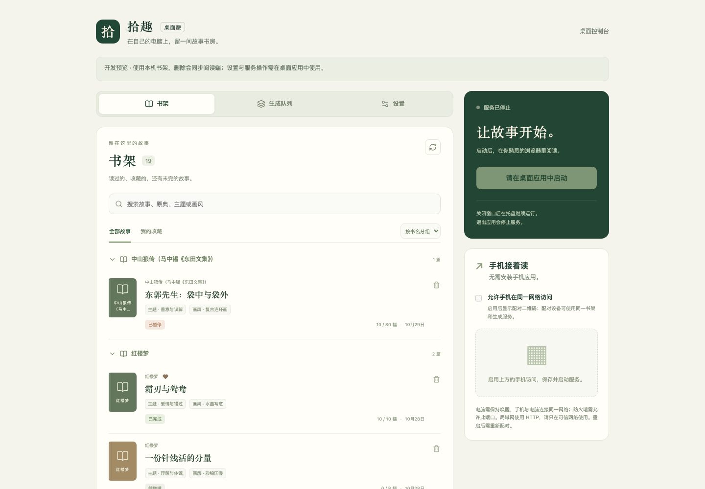

# 拾趣

**还有剩余的 Codex token？不妨用来读读故事。**

写代码之余，把已有的 Codex 订阅额度用来选故事、改编和配图，让中国古典故事变成自己的插画故事书。使用本机已登录的 Codex CLI，无需另配 API 密钥；也支持 Gemini。

从《聊斋志异》《西游记》《庄子》等 24 部作品中挑选故事，选择画风和篇幅，在电脑或手机上阅读，也可以导出 PDF 或一张长图保存。故事、图片和阅读进度保存在你的电脑上。

Codex 文本和图片生成共用订阅额度，图片可能消耗得更快；能否生成仍取决于套餐权限和可用配额。

**先试试看：不配置 AI 服务，也能阅读内置的《种梨》示例。**

- [拾趣](#拾趣)
  - [界面预览](#界面预览)
  - [桌面版入门](#桌面版入门)
    - [选择版本](#选择版本)
    - [下载 macOS 版](#下载-macos-版)
    - [第一次打开](#第一次打开)
    - [配置生成服务](#配置生成服务)
  - [在手机上阅读](#在手机上阅读)
  - [制作与阅读故事](#制作与阅读故事)
    - [做一本故事书](#做一本故事书)
    - [阅读和导出](#阅读和导出)
    - [可以读哪些书](#可以读哪些书)
  - [数据与备份](#数据与备份)
  - [常见问题](#常见问题)
  - [开发者](#开发者)

## 界面预览

**桌面端：书架、服务控制与手机访问。** 下图为桌面 UI 的开发预览。




## 桌面版入门

### 选择版本

**已有 Node 24、想用 Codex 订阅读故事？推荐 Lite。使用 Gemini，或不想配置 Node？推荐 Standard。** 请选择与你的系统和处理器匹配的桌面安装包。

| 版本     | 推荐给谁                            | 运行环境与生成服务                                                        | Apple Silicon（M 系列）Mac 下载                                                                         |
| -------- | ----------------------------------- | ------------------------------------------------------------------------- | ------------------------------------------------------------------------------------------------------- |
| Lite     | 已有 Node 24 的 Codex 订阅用户      | 使用电脑上的 Node 24（推荐 24.22.1）；Codex CLI 需自行安装并登录          | [下载 Lite](https://github.com/yysun/shiqu/releases/latest/download/shiqu-lite-macos-arm64.dmg)         |
| Standard | Gemini 用户，或不想配置 Node 的用户 | 已内置 Node 24；Gemini 需 API 密钥，使用 Codex 时仍需另装并登录 Codex CLI | [下载 Standard](https://github.com/yysun/shiqu/releases/latest/download/shiqu-standard-macos-arm64.dmg) |

**两个版本均支持 Codex 和 Gemini，区别只是是否内置 Node，并非提供方专用版。** Node 是拾趣的运行环境，Codex CLI 是可选的 AI 生成工具。两个版本都不包含 Codex CLI；已经能使用 Codex，也不代表电脑上已有 Lite 所需的 Node 24。尚未安装 Node 24 的 Codex 用户，或不确定选哪个时，仍推荐 Standard。使用 Gemini 则不需要 Codex CLI。

macOS 要求 **13.5 或更新版本**。Windows 需要 WebView2，生成服务请选择 Gemini；原生 Windows 暂不支持 Codex。Linux 需要 WebKitGTK 和托盘支持。

Standard 和 Lite 共用设置及故事数据，是替代安装的两个版本，不要同时运行。

### 下载 macOS 版

[最新版本与 SHA-256 校验文件](https://github.com/yysun/shiqu/releases/latest) · [所有版本](https://github.com/yysun/shiqu/releases)。下载链接随最新正式版本自动更新，首次发布成功后生效。目前 GitHub 仅提供 Apple Silicon（M 系列）Mac 安装包，不提供 Intel、Windows 或 Linux 安装包。

安装包**未签名、未经过 Apple 公证**。打开 DMG 后，将应用拖入「应用程序」。首次启动若被 macOS 拦截，请在尝试打开后前往「系统设置 → 隐私与安全性」，按系统提示选择「仍要打开」；只为你信任的下载执行此操作。

### 第一次打开

1. 打开拾趣。想先体验阅读，可以跳过 AI 配置。
2. 要制作新故事，进入「设置」，选择并配置下方的生成服务。
3. 点击「保存设置」，再点击「启动服务」（有未保存的更改时显示「保存并启动」）。
4. 点击「在浏览器打开」，开始阅读或制作故事。也可直接输入本机 IP 和端口，无需配对。

桌面窗口用于管理书架、查看生成队列和设置；完整阅读与故事制作在浏览器中进行。关闭桌面窗口后，服务仍在托盘运行；选择「退出拾趣」才会停止服务。

### 配置生成服务

| 方式   | 你需要准备                                                          | 费用与限制                                             |
| ------ | ------------------------------------------------------------------- | ------------------------------------------------------ |
| Gemini | 有效的 Gemini API 密钥，在「设置」中填写                            | 按你的 Gemini 项目计费，需要相应模型权限和配额         |
| Codex  | 本机安装并通过 ChatGPT 账户登录的 Codex CLI，在「设置」中选择 Codex | 使用订阅额度，文本和图片共用额度；需要套餐或工作区支持 |

Codex CLI 不包含在桌面安装包中。首次使用需在终端运行 `codex login`；如果应用找不到它，可在设置中选择可执行文件。模型可留空以使用 CLI 默认值；使用 Sol 时，推理档位建议先选 `low`。Codex 不会回退到 Gemini 或 API 计费，自定义网页来源请改用 Gemini。

「检查连接」只检查访问或登录状态，不生成内容，也不保证实际生成配额。修改提供方、密钥或其他设置前，请先停止服务，保存后重新启动。

**密钥以明文保存在本机设置数据库中，由系统文件权限保护，并非加密存储。** 浏览器和手机无法读取密钥，但可连接服务的设备可以使用生成服务。桌面版不读取项目的 `.env` 文件。

## 在手机上阅读

手机无需安装应用，也不需要单独配置 AI 服务。局域网访问始终开启；互联网访问由你单独启用。

**同一 Wi-Fi / 局域网：** 启动服务，在「手机接着读」中选择局域网地址并扫码。直接连接电脑的 IP 和端口，无需配对；防火墙需允许此端口。所有可连接设备共享书架和生成权限，HTTP 连接仅限可信网络。

**其他 Wi-Fi / 蜂窝网络：**

1. 在电脑上安装 [Cloudflare cloudflared](https://developers.cloudflare.com/tunnel/downloads/)。macOS 可使用 `brew install cloudflared`。Standard 和 Lite 均需另行安装此工具。
2. 停止拾趣服务，开启「允许互联网访问」。默认自动查找 cloudflared；找不到时填写其可执行文件的绝对路径，例如 `/opt/homebrew/bin/cloudflared`。
3. 保存并启动服务，等待免费隧道连接。选择「互联网」访问方式，扫描私密二维码，或复制完整私密链接到手机浏览器。
4. 手机自动配对后打开电脑上的同一书架，可阅读、整理和制作故事。无需 Cloudflare 账户或域名。

**完整二维码和链接包含访问凭据，请勿公开分享。** 裸公网地址不会开放书架；完整私密链接可以授予书架和生成权限。配对通过 URL 片段交换为 Secure / HttpOnly cookie，凭据不保存在服务器配置或 helper 参数中。配对有效期为 12 小时；停止服务后立即失效，重启后需重新扫码。没有多用户隔离。

互联网连接使用 HTTPS，流量经过 Cloudflare，故事数据仍保存在电脑上。免费 Quick Tunnel 每次启动会分配新地址，没有可用性保证，最多支持 200 个并发请求，不支持 SSE；拾趣使用 NDJSON / 轮询。该服务适用于临时访问，不承诺长期在线。隧道进程退出后公网二维码会撤下，局域网继续运行；停止并重启服务可重试。升级旧版本不会自动开启互联网访问。

使用期间，**电脑需要保持唤醒，拾趣服务需要保持运行**。关闭互联网访问后，同一网络仍可通过局域网访问。退出应用会停止服务器、隧道和生成进程。

## 制作与阅读故事

### 做一本故事书

1. 选择书目和主题，从推荐的故事中挑选一篇；点击「换一批」可以继续选题。
2. 使用该故事推荐的画风，或自行改选；「采用推荐」可以恢复推荐画风。
3. 选择「简短 / 适中 / 详细」（默认适中），等待原文保存和插图数量建议。
4. 用滑块或数字调整为 **1–60 幅**，确认后开始生成。1 幅是「单幅概述」；确认前不会生成完整分镜或图片，确认后数量固定。
5. 打开故事边读边等，应用会继续生成当前页和后续页面的插图。

画风推荐随选题给出，不单独增加模型调用；插图数量建议会增加一次文本请求。建议会保存在书架，稍后继续无需重复推荐。详略不对应固定幅数，短故事不会强行凑页。

生成需要联网，速度取决于提供方，快速翻页时仍可能等待。返回书架后，该阅读窗口不再派发新图片任务，已经开始的任务仍会完成并保存；关闭网页或断网后，停止派发可能延迟约 30 秒。如果其他窗口仍在阅读同一故事，生成会继续。

成功保存的分镜和图片会保留。失败时可按界面提示重试；如果提供方已接受请求，但结果尚未保存就发生中断，重试可能再次消耗费用或额度。重启服务不会仅凭旧窗口自动恢复付费生成，重新打开故事后才会继续。

### 阅读和导出

- **翻页**：点击或轻点画面左侧四分之一返回，右侧四分之一前进，中间区域不翻页；也支持滑动、滚轮和翻页箭头。结尾页右侧返回打开故事前的主页或书架。
- **查看内容**：阅读时可以查看原文、分镜和制作说明，也可以收藏故事。阅读进度会保存，删除的故事可以恢复。
- **整理书架**：桌面端和阅读端均可按故事名、原典书名、主题或画风检索，默认按原典书名分组，也可切换不分组。阅读端单篇分组使用横向全宽卡片，右上角可收藏、不再收藏或删除。桌面端删除故事前会确认，删除后可撤销；书架删除状态与阅读端同步。
- **导出 PDF**：全部插图生成后，在「阅读偏好设置」或故事末页导出。
- **一页输出（PNG）**：把全部插图、页码、说明和结尾感悟排成一张总览图，布局随幅数调整。

导出在浏览器本地完成，不会发起新的 AI 请求。当前不提供配音或视频生成。

### 可以读哪些书

内置书库包含 24 部作品，按主题从随应用提供的原文中选题，每批最多推荐五篇来源可核对的完整故事。

| 类别       | 书目                                                                       |
| ---------- | -------------------------------------------------------------------------- |
| 志怪与博物 | 聊斋志异、山海经、搜神记、阅微草堂笔记、子不语、酉阳杂俎、太平广记、博物志 |
| 古典小说   | 西游记、三国演义、红楼梦、水浒传、儒林外史                                 |
| 白话小说   | 喻世明言、警世通言、醒世恒言、初刻拍案惊奇、二刻拍案惊奇                   |
| 诸子典籍   | 庄子、列子                                                                 |
| 历史与策论 | 史记、战国策                                                               |
| 笔记小说   | 世说新语                                                                   |
| 日常生活   | 浮生六记                                                                   |

原文保留原有字符（包括繁体字），改编故事使用简体中文。大部头作品可能按原文顺序分批选题，不保证推荐覆盖全书或是全书最优。原文转录尚未全面校对：《浮生六记》仅收录现存四篇，《史记》十表大多只保留表序。来源、版本及已知质量问题见 [data/README.md](data/README.md) 和 [data/library/catalog.json](data/library/catalog.json)。

故事和图片是 AI 改编内容，不应视作原典或学术校勘结果。故事数据保存在本地，但 AI 生成仍会向所选提供方发送必要的原文、提示词和参考图片，并非离线生成。

## 数据与备份

故事、图片、原文和阅读进度保存在电脑的「故事数据目录」，手机访问的是同一份数据。可在桌面版「设置」中查看目录；**更换目录只会切换书架，不会自动搬移或合并文件**。

macOS 默认位置：

```text
~/Library/Application Support/com.shiqu.desktop/
├── desktop.sqlite       设置与凭据（包含明文密钥）
└── library/
    ├── shiqu.sqlite     故事、阅读进度与生成记录
    └── media/           图片、已保存原文与缓存
```

备份与恢复：

1. 停止使用这份书架的所有服务，包括桌面版和开发版。
2. 复制整个故事数据目录，包括数据库、可能存在的 SQLite 日志文件和 `media/`。不要只复制数据库，否则会丢失图片。
3. 若要保留设置，另行备份 `desktop.sqlite`；它包含明文凭据，请妥善保管。
4. 恢复时，先停服，将备份放到空目录，再在设置中选择该目录并启动。

不要用一个书架直接覆盖另一个书架。旧开发目录的数据不会自动合并；升级或降级前请先备份，旧版本可能无法显示新版生成的图片。

## 常见问题

**手机扫了码却打不开？** 确认电脑未休眠、服务仍运行。局域网链接要求设备处于同一网络且防火墙允许端口；访客 Wi-Fi 可能隔离设备。跨网络请选择互联网私密链接，重启后重新扫码。新公网域名可能需要等待 DNS 生效；隧道无法连接时检查电脑网络及 cloudflared 安装，也可关闭互联网访问继续使用局域网。

**端口被占用？** 停止服务，在「设置」中换一个端口，再启动。

**没有密钥能用吗？** 可以阅读内置示例。制作新故事需要可用的 Gemini 密钥或已登录且有额度的 Codex。

**连接检查成功，为什么生成失败？** 登录或模型可访问不代表生成配额充足。请检查账户权限、配额和界面提示；Codex 图片生成可能比文本更快消耗额度。

**Lite 找不到 Node？** 请选择 Node 24 的可执行文件。macOS 的 nvm 用户通常可在 `~/.nvm/versions/node/v24.22.1/bin/node` 找到；桌面应用未必继承终端 PATH。不想配置运行环境可改用 Standard。

**关闭窗口后还在运行？** 这是正常行为。可从系统托盘重新打开窗口、停止服务或退出拾趣。

## 开发者

前端为 React + Vite，后端为 Node REST API，数据使用 Node 内置 SQLite 和本地媒体目录。开发只需 **Node 24.22.1** 与 **pnpm 11.25.0**，无需独立数据库。

```bash
nvm install
nvm use
corepack enable pnpm
pnpm run setup
pnpm dev
```

打开终端打印的本机访问地址；手机使用同一终端中的局域网二维码。默认前端端口为 `3000`，API 为 `3002`。与桌面版同时运行时可用：

```bash
SHIQU_API_PORT=3003 pnpm dev --port 3001
```

开发版从 `.env` 读取 AI 配置，**不读取桌面保存的密钥**。默认书架跟随桌面版的数据目录；可用 `SHIQU_DATA_DIR` 显式覆盖。两端共享书架时均需使用当前版本，两端均无需配对。私有书库及备份不得放入 Vite 的 `public` 目录。

Codex 配置示例（先安装并登录 CLI）：

```bash
pnpm add -g @openai/codex@0.165.0
pnpm run codex:login
pnpm run codex:status
```

```dotenv
SHIQU_AI_PROVIDER=codex
CODEX_MODEL=gpt-6.1-sol
CODEX_REASONING_EFFORT=low
```

其他变量见 [.env.example](.env.example)，修改后重启服务。无浏览器设备可用 `pnpm run codex:login -- --device-auth`。

常用检查：

```bash
pnpm test
pnpm typecheck
pnpm lint
```

测试使用模拟模型响应，不发起付费生成。桌面 UI 使用 Vite 开发服务器验证；只有需要打包时才运行构建命令。桌面开发、平台依赖和打包说明见 [desktop/README.md](desktop/README.md)。主要代码位于 `client/`（界面）、`lib/`（业务逻辑）、`server/`（HTTP 与存储）、`db/` 与 `drizzle/`（数据库）、`desktop/` 与 `src-tauri/`（桌面版）。
