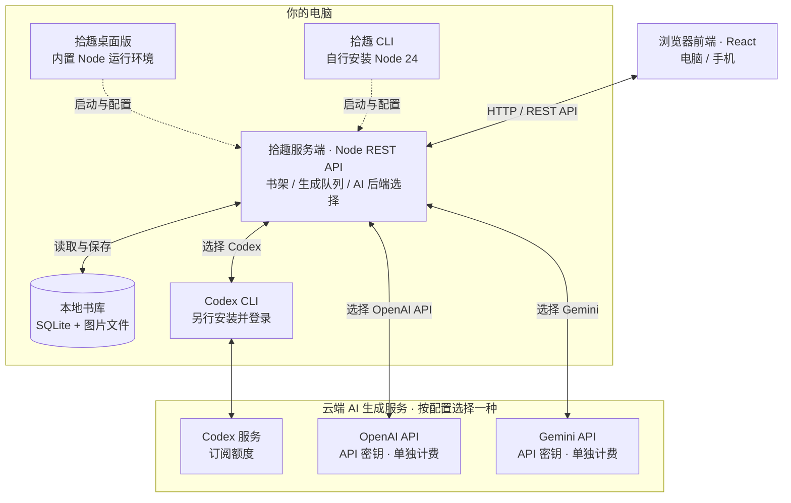
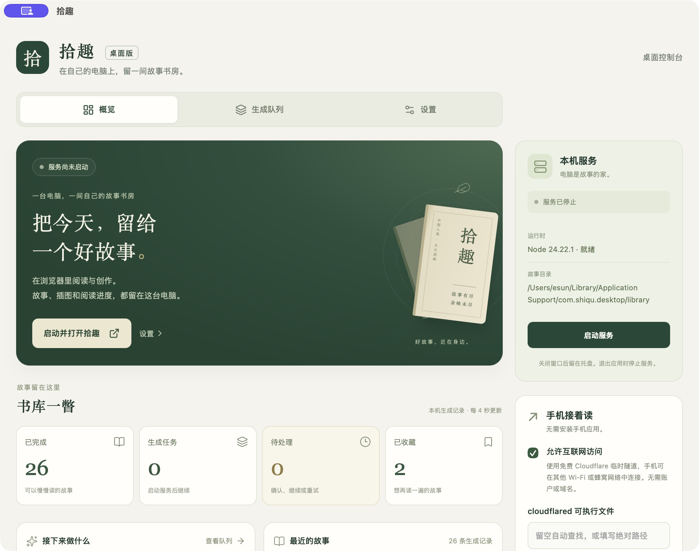

# 拾趣

**还有剩余的 Codex token？不妨用来读读故事。**

把中国古典故事变成自己的插画故事书：选书、选主题、选画风，在电脑或手机上阅读，也可以导出 PDF 或一张长图保存。故事、图片和阅读进度保存在你的电脑上。

首次运行从空书架开始，配置生成后端后创作第一篇故事。

## 书籍、主题与画风

- **书籍（24 部）**：聊斋志异、山海经、搜神记、阅微草堂笔记、子不语、酉阳杂俎、太平广记、博物志、西游记、三国演义、红楼梦、水浒传、儒林外史、喻世明言、警世通言、醒世恒言、初刻拍案惊奇、二刻拍案惊奇、庄子、列子、史记、战国策、世说新语、浮生六记。
- **主题**：给我一个反转、人情冷暖、放下执念、聪明与糊涂、善意与误解、命运与选择、欲望与代价、勇气与成长、爱情与错过、幽默与讽刺、因果与报应；也可自定义主题。
- **画风（15 种）**：清新卡通、极简线描、软萌 Q 版、彩铅国漫、水彩绘本、3D 动画、黏土定格、电影写实、水墨写意、复古连环画、白描连环画、工笔重彩、木版年画、剪纸艺术、古典油画。

详见[书库说明](data/README.md)与[画风说明](.docs/user-guide.md#画风)。

## 界面预览

选书、按主题选故事、画风、画幅数；系统自动分镜、制图。故事保存在书架中以供阅读和输出。


[前后端架构](#前后端架构) · [如何选择后端](#如何选择后端) · [下载桌面版](#下载与快速开始) · [CLI 启动](#cli-启动) · [使用指南](.docs/user-guide.md) · [开发指南](.docs/development.md)

## 前后端架构

拾趣由**浏览器前端、本机服务端和 AI 生成后端**组成。电脑和手机通过浏览器选书、制作、阅读与导出；本机 Node 服务管理书架和生成队列，调用所选的 Codex、OpenAI API 或 Gemini 生成文字与插图。桌面版与拾趣 CLI 是启动、配置这套本机服务的两种方式。



手机连接电脑上的拾趣服务，共享同一书架和生成后端，无需在手机上安装 Node、Codex CLI 或配置 API 密钥。故事、插图和阅读进度保存在电脑上；生成时所需的原文、提示词和参考图片会发送给所选 AI 服务。**只读模式**保留本地阅读与整理，不调用云端生成服务。

## 如何选择后端

根据已有的订阅、API 密钥和运行平台选择 AI 生成后端。桌面版和拾趣 CLI 都支持以下选择：

| AI 生成后端 | 适合什么情况 | 如何接入 | 平台与费用 |
| --- | --- | --- | --- |
| **Codex** | 已有 Codex 订阅，想使用剩余额度 | 另行安装并登录 Codex CLI，在拾趣中选择 Codex | macOS / Linux；使用订阅额度 |
| **OpenAI API** | 想通过 API 使用 OpenAI 的文本与图片模型 | 选择 OpenAI API，填写 API 密钥及文本、图片模型 | macOS / Linux / Windows；API 单独计费 |
| **Gemini** | 使用 Gemini 生成，或需要从网页 URL 选题 | 选择 Gemini，填写 API 密钥及文本、图片模型 | macOS / Linux / Windows；按 Gemini API 项目计费 |
| **只读** | 只阅读、整理已有书库 | 选择只读，无需登录或密钥 | macOS / Linux / Windows；不产生生成费用 |

**在哪里选：** 桌面版在「设置」中选择服务并保存，再启动服务；CLI 首次运行会询问，也可运行 `pnpm dlx @apprun/shiqu --configure` 修改，完成后重新启动。两种入口共用已保存的服务配置；切换后端前先停止服务，新选择在下次启动时生效。详见[首次配置与修改服务](.docs/user-guide.md#首次配置与修改服务)。

## 下载与快速开始

推荐使用桌面版，内置运行环境，安装即可使用。习惯终端，或使用 Linux、Intel Mac、Windows ARM64？可直接使用 [CLI 启动](#cli-启动)。两种方式都能制作、阅读和导出故事，也支持手机访问。

桌面版内置 **Node 24**，无需自行配置运行环境；提供书库概览、生成队列、图形设置、托盘启停与手机访问入口。



支持 **Apple Silicon（M 系列）Mac**（macOS **13.5+**）与 **Windows 10/11 x64**。Windows 需要 WebView2，缺失时安装程序会联网下载。Intel Mac、Windows ARM64 和 Linux 暂无安装包。Windows 下载在 0.4.0 或更新正式版本发布后生效。

[下载 macOS DMG](https://github.com/yysun/shiqu/releases/latest/download/shiqu-standard-macos-arm64.dmg) · [下载 Windows 安装程序](https://github.com/yysun/shiqu/releases/latest/download/shiqu-standard-windows-x64-setup.exe) · [版本与校验文件](https://github.com/yysun/shiqu/releases/latest)

macOS 支持 Codex、OpenAI API 和 Gemini，Windows 使用 OpenAI API 或 Gemini。桌面版不包含 Codex CLI，使用 Codex 需另行安装并登录。

1. **macOS**：打开 DMG，将应用拖入「应用程序」。安装包**未签名、未经过 Apple 公证**；首次被拦截时，在「系统设置 → 隐私与安全性」中按提示选择「仍要打开」。**Windows**：运行 `-setup.exe`，按提示安装到当前用户；安装包未签名，SmartScreen 可能提示风险，仅对确认可信的下载选择「更多信息 → 仍要运行」。
2. 打开拾趣，首次进入「设置」选择服务：**OpenAI API / Gemini** 填写 API 密钥，**Codex** 使用已登录的 CLI；也可选择**只读**。保存后与 CLI 共用，支持「重置所有服务配置」。
3. 点击「保存设置」，再点击「启动服务」（有未保存更改时显示「保存并启动」），然后点击「在浏览器打开」。
4. 选择书籍和主题，点击「加入队列并找故事」。选择界面会持续查找，找到一篇就显示一篇，选中或离开后停止；重开后保留候选和阅读进度并继续。空结果、失败、暂停或达到 40 批保存上限时停止自动查找。选中故事后，在「制作确认」选择画风、详略与 **1–80 幅**插图，确认后开始生成。

本地书籍会逐篇积累与主题无关的故事库：保存完整事件摘要和原文定位，再单独匹配主题。不符合当前主题的故事也保留，换主题时优先复用；正反判断同样缓存。符合时保存匹配理由和完整拟改编摘要，不能只介绍开局或计策目的。主题模式和直接选原典的新任务都在现有制作准备步骤中对照原文核对、补齐完整摘要，保存后再确认制作。分镜参照核对摘要把握主线，对照真实原文细化；主题模式按主题与摘要审核，原典/忠于原文模式按原文本身展开，两者都保留开场、节奏、因果、静态画面及连续性规则。第一页结合摘要，从原文中提取看懂开局所需的背景与处境做开场，不照搬全篇摘要或提前讲出后续结局；不另设“设局”资料项。摘要不替代原文。首次查找需要原文识别和主题判断，后续复用已完成的工作，不会先扫完整本书；旧主题游标不当作通用库完成进度。

生成会在后台继续，可随时暂停、恢复。关闭桌面窗口后服务仍在托盘运行；选择「退出拾趣」才会停止。[完整安装与配置说明](.docs/user-guide.md#桌面版入门)。

## CLI 启动

已有 **Node 24**（推荐 24.22.1）及随附的 npm / npx 时，可直接启动浏览器版，无需另装 pnpm：

```bash
npx @apprun/shiqu
```

已使用 pnpm 的用户也可运行 `pnpm dlx @apprun/shiqu`，功能相同。默认开放可信局域网，启动后打印手机扫码二维码；只允许本机访问时使用 `--host 127.0.0.1`。

CLI 优先寻找桌面版保存的书库目录，目录不存在时自动创建；没有桌面设置时，先复用 CLI 已确认目录或已有桌面默认书库；仍未找到才询问，并记住选择。打开终端打印的网址即可阅读，按 Ctrl+C 停止。首次未配置时会询问 Codex / OpenAI API / Gemini / 只读，API 密钥输入隐藏。配置保存在与桌面版共用的设置数据库，之后无需再问；`--configure` 修改服务，`--reset-providers` 清除已保存服务配置。环境变量可仅覆盖本次运行。详见[CLI 使用说明](.docs/user-guide.md#cli-启动)。

已有书库、想在桌面版与 CLI 之间切换？先停止原服务，再按[切换步骤](.docs/user-guide.md#在-cli-与桌面版之间切换)操作。

## 手机阅读与导出

- **同一 Wi-Fi**：桌面版在「手机接着读」中选择局域网地址并扫码；CLI 启动后直接扫描终端打印的二维码，或打开局域网地址。手机无需安装应用或配对。
- **其他网络**：使用桌面版时，先在电脑安装 cloudflared，再开启「允许互联网访问」，再扫描私密二维码。免费隧道仅适合临时访问，完整链接和二维码请勿公开分享。[设置步骤](.docs/user-guide.md#在手机上阅读)。
- **阅读与整理**：支持翻页、查看原文和分镜、收藏及搜索书架；手机与电脑共享阅读进度。
- **导出保存**：全部插图生成后，可导出 PDF 或一页 PNG 总览图；导出在浏览器本地完成，不增加 AI 请求。当前不提供配音或视频生成。

手机访问期间，电脑需要保持唤醒，拾趣服务需要保持运行。

## 发布你的拾趣作品

想让更多人读到你的拾趣作品？欢迎到 [awesome-shiqu · 拾趣好故事](https://github.com/yysun/awesome-shiqu) 投稿发布。在拾趣中下载「分镜与图片 ZIP」，按[贡献指南](https://github.com/yysun/awesome-shiqu/blob/main/CONTRIBUTING.md)提交 PR；审核通过后，作品会收录到公开作品集，供大家在手机或电脑的浏览器中阅读。

## 使用前了解

- **生成费用**：Codex 文本和图片共用订阅额度，图片可能消耗得更快；OpenAI API 与 Gemini 按各自 API 项目计费，不使用 Codex 订阅额度。拾趣不另设生成次数配额，实际可用性取决于提供方权限与额度；连接检查成功不代表有生成配额。
- **联网与内容**：生成会向所选提供方发送必要的原文、提示词和参考图片。故事和插图为 AI 改编，不能当作原典或学术校勘结果。
- **共享与密钥**：所有可连接设备共享书架和生成权限，局域网仅限可信网络。CLI 和桌面共用的 API 密钥以明文保存在独立设置数据库中，由本机文件权限保护；环境变量不会自动写入数据库。
- **数据与备份**：故事保存在本地；更换数据目录只会切换书架，不会搬移文件。备份应包含数据库和图片，操作见[数据与备份](.docs/user-guide.md#数据与备份)。

连接失败、端口占用、CLI 书库选择等问题见[常见问题](.docs/user-guide.md#常见问题)。

## 开发者

React + Vite、Node REST API、SQLite 与本地媒体目录，无需独立数据库。使用 **Node 24.22.1** 与 **pnpm 11.25.0**：

```bash
nvm install
nvm use
corepack enable pnpm
pnpm run setup
pnpm dev
```

配置、检查命令和生成机制见[开发指南](.docs/development.md)；桌面开发与打包见[桌面文档](desktop/README.md)。

## 许可

项目原创代码与文档采用 [Apache License 2.0](LICENSE)，允许商业使用、修改与再分发，具体条件见许可全文及 [NOTICE](NOTICE)。

古典原文的来源版本、注释及其他第三方资料遵循各自适用的权利要求，见[来源说明](data/library/source-notices.md)和[书目清单](data/library/catalog.json)。

拾趣不主张用户生成的故事或插图的著作权；其权利归属取决于适用法律，用户仍须遵守素材权利要求和 AI 生成服务条款。生成内容不会自动适用项目代码的 Apache-2.0 许可。
